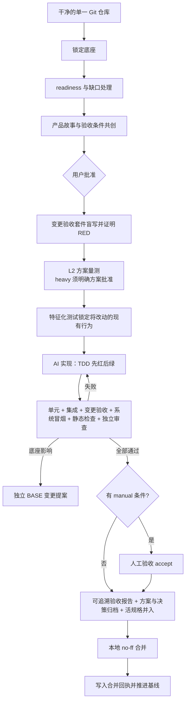

# StoryLoop

StoryLoop 是面向已有 Git 工程的产品需求—开发—验收闭环。你只需要与 AI 共创用户故事和验收用例并最终批准；批准后的核心流程测试、实现迭代、回归、独立验收、证据报告和本地合并由外部 Loop 控制。

它不绑定 Java、Python 或前端技术栈，不要求拆分多个仓库，也不改写现有 CI 文件。

## 快速开始

支持 Windows 和 Linux（含 WSL2），要求 Python 3.11+、Git，以及干净的目标仓库。Linux 需要可读的 `/proc` 和内核 child subreaper 支持（启动时自动检查，无需 root）。安装后命令入口是 `storyloop`，等价写法是 `python -m storyloop`。

Linux / WSL2：

```bash
python3 -m venv .venv && .venv/bin/pip install .

.venv/bin/storyloop init ~/work/my-project --settings ~/work/storyloop-settings.json
.venv/bin/storyloop readiness ~/work/my-project --json
# 若有缺口，先补基础或按报告用 --readiness DIGEST --reason 明确确认
.venv/bin/storyloop change ~/work/my-project --idea "增加订单取消功能，已发货订单不能取消"
# 终端里会逐条提出澄清问题（回车选推荐项）；满意后批准，闭环自动跑到底或停在明确的人工停点
.venv/bin/storyloop approve ~/work/my-project --change FEAT-20260916-001
.venv/bin/storyloop status ~/work/my-project --change FEAT-20260916-001 --json
```

PowerShell：

```powershell
python -m pip install .

storyloop init C:\work\my-project
storyloop readiness C:\work\my-project --json
# READY 后再共创需求；缺口按报告补齐或明确确认
storyloop change C:\work\my-project --idea "增加订单取消功能，已发货订单不能取消"

# 审核 .storyloop/drafts/<change-id>/ 中的故事和验收条件；需要时继续修订
storyloop change C:\work\my-project `
  --change FEAT-20260916-001 `
  --message "取消原因必填"

# 最终批准；后续默认自动执行到底或停在明确人工决策点
storyloop approve C:\work\my-project --change FEAT-20260916-001

storyloop status C:\work\my-project --change FEAT-20260916-001 --json
storyloop report C:\work\my-project --change FEAT-20260916-001
```

新人从 [定位与概念手册](docs/concepts.md) 和 [入门教程](docs/tutorial.md) 开始；完整说明见 [使用指南](docs/product-iteration-guide.md)，接入自己的仓库见 [接入手册](docs/onboarding-a-repository.md)。`docs/` 是本项目的知识库，入口是 [docs/README.md](docs/README.md)：使用文档之外，按模块、架构、扩展、接口、能力、积木、测试组织了给贡献者和代理读的工程文档。

新协议按 light / standard / heavy 分流，重档先审核方案再实现；完整命令、预算与恢复见 [分流指南](docs/routing-guide.md)。子项目 2b 真实代理验收（Task 12）仍待完成。

## 核心保证

- 产品层输入：用户无需编写技术方案和详细任务文档。
- 用户批准：未决问题会阻止批准；任何故事或验收条件修订都会使旧批准失效。
- 底座知识库：`foundation-survey` 技能包（随引擎维护，`storyloop skills` 装进任何项目，Claude Code 与 Codex 通用）摸清底座的模块组成、架构与运行机制、扩展机制、接口与能力、可复用积木和测试基础设施，产物挂在底座受保护；product 据此不重复建设，implement 据此复用而不是重写，review 据此核对。
- 角色按权限边界划分（[角色目录](docs/roles.md)）：survey 摸底、product 立合同、acceptance 盲写验收、design 出方案并圈定要改的既有文件、characterize 锁定现有行为、implement 实现、review 独立审查；细分工放在角色内的子代理。
- 需求质量门：合同采用 spec-kit 结构（优先级、独立验证方式、EARS 规则、Gherkin 验收条件），澄清问题以选择题形式逐条回答并入合同；批准前有确定性 checklist 把关。
- OpenSpec 管理：批准合同、增量规格、实现方案（design.md）和人为决策（decisions.md）进入 `openspec/changes/<change-id>/`，完成时并入 `openspec/specs/<capability>/spec.md` 活规格；装了 `openspec` CLI 时结构校验是门。
- 测试分层：变更验收套件（`acceptance/changes/<id>/`，acceptance 角色盲写、先红、受保护）、项目级系统冒烟（`acceptance/smoke/`，跨变更累积、只能经人批准更新）、实现前的特征化测试门（锁定将被修改路径的现有行为，在旧代码上跑绿才开工，机器验证）、单元与集成分开的回归命令、静态检查。每层各自出结论，任何一层红都不能过。用例缺陷走 `acceptance-repair` 通道并从合同提交重新证明 RED。
- 人工验收：合同里的 `manual` 条件停在 `MANUAL_ACCEPTANCE_REQUIRED`，人用 `accept` 逐条留痕，记录与实现指纹绑定。
- 单仓库底座：初始化提交和文件摘要构成逻辑底座；业务改动只进入可变区 `module_roots`（默认 `modules/`、`features/`），测试改动进入 `test_roots`。
- 底座独立演进：普通功能触碰底座会暂停并产生 `BASE-*` 提案。
- CI 中立：只提供 `storyloop ci ...`；不创建或覆盖 GitHub Actions、GitLab CI、Jenkins 文件。项目自己的流水线由人通过 `base-propose --allow-ci` 纳入底座，参考模板见 [接入手册的 CI 一节](docs/onboarding-a-repository.md#9-ci)。
- 自动本地 Git：控制器只创建本地功能分支、提交并 `--no-ff` 合并；控制器代码不调用 push、删除分支或重写历史。
- 证据追溯：报告映射需求、故事、验收条件、测试、真实命令结果、证据摘要、实现提交和最终合并提交。



## CI 入口

```powershell
storyloop ci C:\work\my-project --change FEAT-20260916-001
```

CI 平台只需增加这一普通命令步骤。它从 Git 可见、非忽略文件构造隔离候选副本，跑该变更的验收套件和项目级系统冒烟；测试若修改候选代码或产生未声明文件会失败。套件清单、测试源文件和执行证据均有 SHA-256 保护；行为失败、错误、超时、跳过、篡改或缺失结果都不能算通过。

## 目录结构

```text
my-project/
├─ .storyloop/                         本地控制面，被 Git 忽略
│  ├─ config.json                      运行参数与工程画像（profile）
│  ├─ baseline.json                    底座指纹、可变区、集成点
│  ├─ drafts/<change-id>/              合同草案；drafts/smoke/<id>/ 是系统冒烟更新草案
│  ├─ base-proposals/                  BASE-* 提案
│  ├─ state/                           runs/ 运行状态；telemetry/ 账本与 calls/<调用>/ 诊断记录
│  ├─ evidence/<change-id>/            acceptance-red.json、acceptance-result.json 等证据
│  └─ requests/ responses/             仅 manual 适配器使用
├─ openspec/
│  ├─ foundation/                      底座知识库（survey 产出，受保护）：modules、architecture、extension、
│  │                                    api、capabilities、building-blocks、testing
│  ├─ changes/<change-id>/             已批准产品合同：proposal.md、stories/acceptance/traceability.json、
│  │                                    checklist.md、specs/<capability>/spec.md（增量规格）、
│  │                                    design.md（实现方案）、decisions.md（人为决策）
│  └─ specs/<capability>/spec.md       活规格，完成时由引擎并入增量
├─ acceptance/
│  ├─ changes/<change-id>/             变更验收套件（合同的一部分，受保护；旧仓库的 smoke/<id>/ 仍被识别）
│  ├─ smoke/                           项目级系统冒烟：manifest.json + 核心链路用例，跨变更累积，只经人批准更新
│  └─ ui/                              旧版本留下的 UI 回归资产（不进候选副本、不是证据，引擎不再生成）
├─ modules/ 或 features/               新业务模块（module_roots 可配置为任何目录）
└─ reports/storyloop/<change-id>/      JSON 与 Markdown 验收报告，含成本与耗时
```

初始化时可变区之外的已跟踪文件都属于稳定底座；可变区（`module_roots`）可以是任何目录，包括已有代码的目录。`pom.xml`、`package.json` 等构建集成点如需修改，会转成独立底座提案。构建系统在仓库根或一级子目录（monorepo）都能被探测到。`.storyloop` 被加入仓库本地 `.git/info/exclude`，不会修改项目的 `.gitignore`。

## 命令

| 命令 | 作用 |
|---|---|
| `init PATH [--settings FILE]` | 探测通用工程并锁定底座；可用 JSON 显式配置安全 argv |
| `change PATH --idea TEXT [--no-interactive]` | 从一句产品意图创建草案；终端里逐条澄清待决问题 |
| `change PATH --change ID --message TEXT` | 与 AI 继续修订同一变更 |
| `approve PATH --change ID [--no-interactive]` | 批准并自动跑完后续闭环 |
| `run PATH --change ID [--no-interactive]` | 继续一个已批准的变更；终端里遇到 `NEEDS_INPUT` 会直接提问 |
| `status PATH --change ID --json` | 查看合同和外部 Loop 状态，含下一步命令 `next` |
| `log PATH --change ID [--json]` | 排障视图：每次代理调用的结果、耗时、费用、会话 ID 与调用记录目录，每轮失败原因，下一步命令 |
| `ci PATH --change ID` | CI 入口：隔离运行该变更的验收套件和项目级系统冒烟 |
| `report PATH --change ID` | 定位最终验收报告 |
| `base-propose PATH --path P [--path P2] --reason TEXT [--allow-mutable] [--allow-ci]` | 为计划中的底座改动开 BASE 提案（无需先触发功能变更）；`--allow-ci` 是 CI 配置进入或修改底座的唯一通道，由人决定，代理永远不能 |
| `base-update PATH --proposal BASE-ID` | 校验独立底座提交、完整回归并提升底座版本 |
| `accept PATH --change ID --criterion A1 --note TEXT` | 记录人工验收条件已由人确认（仅在 `MANUAL_ACCEPTANCE_REQUIRED` 停点可用） |
| `answer PATH --change ID --answer TEXT [--answer TEXT]` | 回答 `NEEDS_INPUT` 停点的问题（按顺序；只给一个答案则适用于全部）。在终端里 `run`/`approve` 会直接提问，无需此命令 |
| `reset PATH --change ID --reason TEXT` | 人工复位卡住的运行（`WORKSPACE_TAINTED`，或人工验收等待期间工作区已变）；不动文件，被中断的一轮不计预算，理由留痕 |
| `acceptance-repair PATH --change ID --reason TEXT` | 变更验收用例本身有缺陷时，让 acceptance 角色修自己的套件并从合同提交重新证明 RED；之前的尝试作废，理由写入 decisions.md（旧名 `smoke-repair`） |
| `smoke-propose PATH --change ID` | 变更合并后，acceptance 角色提议把哪些核心链路并入或更新项目级系统冒烟，草案写到 `.storyloop/drafts/smoke/<id>/` |
| `smoke-apply PATH --change ID` | 人审核草案后安装到 `acceptance/smoke/`，隔离跑绿才提交；红的草案不留任何改动 |
| `skills PATH` | 把引擎自带的技能包（`foundation-survey`）安装或刷新到项目的 `.claude/skills/` 与 `.codex/skills/`，Claude Code 与 Codex 都能直接用；已初始化的项目自动开 BASE 提案 |
| `survey PATH [--reason TEXT] [--from FILE]` | 底座摸底：survey 角色只读探索仓库，写出 `openspec/foundation/` 知识库（模块、架构、扩展机制、接口、能力、积木、测试）并开 BASE 提案；提交后 `base-update` 即受保护，之后每个角色起手先读它。产物校验失败时原始回答保存在 `.storyloop/state/foundation/last-survey.json`，人工修正后用 `--from` 安装，不再调用代理 |
| `document PATH --change ID [--design FILE] [--capability NAME]` | 为已 PASSED 的变更补生成 design.md、decisions.md 和活规格（配合 `base-propose`/`base-update` 提交） |

退出码 `0` 表示命令正常结束，其中包括停在 `MANUAL_ACCEPTANCE_REQUIRED`：自动验收已全部通过，只是在等人逐条确认，不算失败；`2` 表示失败、受阻或等人回答（如 `NEEDS_INPUT`、`WORKSPACE_TAINTED`、`BUDGET_EXHAUSTED`、`BASE_CHANGE_REQUIRED`、`BOUNDARY_VIOLATION`、`CHARACTERIZATION_FAILED`、`EXISTING_GREEN`、`smoke-apply` 的 `SMOKE_UPDATE_FAILED`）；`130` 表示中断。报错时 stderr 输出 `{status, message, next}` JSON。脚本判断停点请读输出里的 `status` 与 `next`（加 `--json`），不要只看退出码。

## 自动化边界

正常的测试或实现失败会自动反馈给实现代理，直到通过或预算耗尽。以下情况明确暂停：

- 需要修改稳定底座。
- 已批准需求出现不可消解的业务歧义。
- 代理写入未授权路径或修改保护文件。
- 达到尝试预算。
- 存在必须由人实际判断的手工验收条件：自动验收、回归和审查通过后停在 `MANUAL_ACCEPTANCE_REQUIRED`，用 `storyloop accept` 逐条记录后 `storyloop run` 继续；人工证据与实现指纹绑定并写入验收报告。
- 变更验收用例本身有缺陷（定位器、时序、数据准备）：由人判断后执行 `storyloop acceptance-repair`，实现代理永远不能改验收用例。
- 特征化测试在旧代码上不绿（`CHARACTERIZATION_FAILED`）：锁定现有行为的测试写错了。就地修正 `test_roots` 里的这些测试（不用提交）后 `run`：引擎不再调用代理，重跑整个单元层，绿了才提交这些测试并继续。

完成阶段（实现提交、报告、文档归档与活规格并入、no-ff 合并、回执）是幂等的：中途崩溃后再次 `storyloop run` 会采纳已存在的实现提交、丢弃上次留下的引擎产物并重新生成，不会重复调用实现代理。

出现 `BASE_CHANGE_REQUIRED` 后，先在原分支把该 `BASE-*` 涉及的路径作为独立变更实现、审核并提交；工作树干净后执行 `storyloop base-update PATH --proposal BASE-ID`。命令要求提交路径与提案完全一致；CI 文件只有在提案以 `--allow-ci` 开出时才允许；单元、集成、系统冒烟三层都不能失败且至少一层真实通过，然后将底座版本从例如 `1.0.0` 提升到 `1.0.1`。它不会替你丢弃或搬移功能分支上的未提交修改。

默认使用本机已安装并登录的 Codex CLI。也可在 `.storyloop/config.json` 选择 `command` 或 `manual` 适配器；`examples/claude-code/` 提供驱动 Claude Code 的 `command` 适配器（按角色收窄工具、Bash 前缀白名单、项目规范文件、圈数到上限自动续会话、回报成本；review 默认拆成正确性、安全、架构、测试四个并行视角再由主评审合并，implement 可用 `--implement-lanes` 按层拆通道并行，引擎协议不变）。每个角色的返回结构有 JSON Schema（`storyloop/role_schemas.py`），随请求下发，Codex 用 `--output-schema`、Claude 适配器用 `--json-schema` 由 CLI 原生约束；结构不符时在同一会话带着具体问题修复。每次代理调用的耗时、轮数和费用记入 `.storyloop/state/telemetry/`，汇总进验收报告；请求、回答、完整 stderr 与会话 ID 落在 `.storyloop/state/telemetry/calls/<调用>/`，`storyloop log` 汇总查看。工具不保存 API 密钥；不要把生产凭证、PII、数据库连接或商业秘密放进目标仓库和 Agent 输入。

安全边界：自定义 agent 与 test command 是当前用户权限下的原生进程，必须是受信任命令。StoryLoop 能检测本地仓库/控制面篡改，但不能在操作系统层证明第三方进程没有访问网络或远端 Git；需要强隔离时，请在无网络、无 SSH/Token 凭证的容器或 CI 沙箱中运行。

Windows 上自动探测到的 `.cmd`、`.bat`、`.ps1` 包装器不会被直接执行。初始化会给出 warning，回归项在没有安全命令时明确记为 `SKIPPED`，核心冒烟仍正常运行。可传入例如 `settings.json`：

```json
{"unit_commands":[["{python}","-m","unittest","discover","-s","tests/unit"]],"integration_commands":[["{python}","-m","unittest","discover","-s","tests/integration"]],"check_commands":[["ruff","check","."]],"test_roots":["tests"],"module_roots":["modules","features"],"integration_paths":["pyproject.toml"]}
```

settings 只接受这些键，未知键会报错：`unit_commands`（旧名 `test_commands`）、`integration_commands`、`check_commands`、`test_roots`、`module_roots`、`integration_paths`、`candidate_allow`、`scratch_paths`，以及可选正整数 `max_attempts`。含义与默认值见 [接口与配置](docs/api.md#三配置)。`max_attempts` 也可在 `.storyloop/config.json` 显式设置；`design_min_stories`、适配器等运行参数直接改该文件。

```powershell
storyloop init C:\work\my-project --settings C:\work\settings.json
```

## 开发与验证

项目仅使用 Python 标准库：

```bash
.venv/bin/python -m unittest discover -s tests -t .
```

新增功能或修复必须先添加可复现失败的测试。模块地图、扩展步骤和必须守住的不变量见 [modules.md](docs/modules.md)、[extension.md](docs/extension.md)、[testing.md](docs/testing.md) 与 [贡献指南](docs/contributing.md)。

## 许可证

当前作为本地工程交付，尚未指定对外分发许可证。
