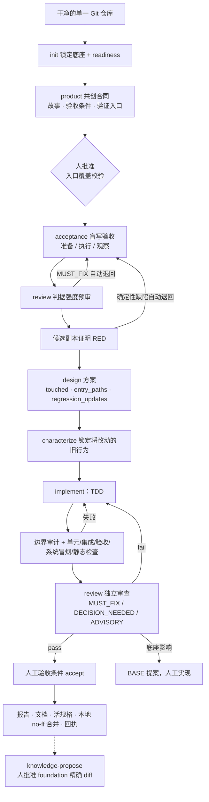

# StoryLoop

StoryLoop 是面向已有 Git 工程的需求—开发—验收闭环。人和 AI 共创用户故事、验收条件与**验证入口**，人批准合同；之后的验收用例、方案、实现、回归、独立审查、证据报告和本地合并由仓库外的引擎驱动，只在需要人判断的地方停下。

它不绑定技术栈，不要求拆仓库，也不改写现有 CI 文件。

## 设计主线

StoryLoop 回答的不是“AI 能不能写代码”，而是**“凭什么相信它做完了”**。2026-11 参考 [HelixHarness 调研](docs/research/2026-11-08-HelixHarness调研.md)重新规划后，设计按四条主线组织（完整设计见[验证入口及评测底座设计](docs/superpowers/specs/2026-11-08-验证入口与评测底座-design.md)）：

1. **判定权在外环。** 引擎在仓库外运行，代理的“我做完了”不是证据，只有真实命令结果、退出码和指纹算数。验收用例由独立角色在实现前盲写、受保护，并在候选副本中观察到 RED；任何红层都不能被审查的 pass 覆盖。
2. **引擎管契约，技能管方法。** 违反会造成误判通过、越界或数据损坏的，能确定性检查的，改变状态流转或恢复的，跨角色契约，以及评测度量，都由引擎强制。其余方法、经验和判断质量写成技能（`SKILL.md`），按 `roles:` 挂到权限明确的角色上。不靠提示词约束引擎本该强制的纪律。
3. **验证入口进合同。** 每个故事声明公共验证入口，由人确认；验收用例必须经入口执行与观察，方案说明入口如何到达改动文件，审查核对三方一致。这是此前 dogfood 反复返工的根因：三个角色各自猜入口。
4. **用评测驱动演进。** 人工介入分**例行**（批准、可确定性判定后的自动退回）与**非例行**（需要人判断）。L1 逐次记录，L2 用冻结 Case 衡量引擎版本，L3 观察真实项目。产品目标是压低非例行介入，同时不出现假通过。

## 一次变更怎么走



## 角色与技能

角色按权限边界划分（[角色目录](docs/roles.md)）。技能写方法，引擎守门：

| 角色 | 能写 | 挂载技能 | 引擎强制的门 |
|---|---|---|---|
| `survey` | 无（只读） | `foundation-survey` | 产物经 BASE 保护；事实需带 `path:line` 证据 |
| `product` | 无 | `spec-craft`、`oracle-craft`、`foundation-use` | 需求质量门；验证入口必填、自动条件绑定入口；人批准后合同指纹锁定 |
| `acceptance` | 本变更验收套件 | `oracle-craft`、`foundation-use` | 套件受保护、证明 RED；保持性条件实现前失败、越界、未经入口自动退回；预审 MUST_FIX 退回 |
| `design` | 无 | `oracle-craft`、`impact-analysis`、`foundation-use` | 范围证据、`entry_paths`、`regression_updates` 校验；heavy 方案需人批准 |
| `characterize` | `test_roots` | `tdd`、`foundation-use` | 锁定测试须在旧代码上跑绿 |
| `implement` | 可变区 + `test_roots` | `tdd`、`review`、`systematic-debugging`、`foundation-use` | 边界审计；已有测试只能改方案声明的；分层验证；`max_attempts` 预算 |
| `review` | 无（只读） | `oracle-craft`、`review`、`foundation-use` | 意见稳定 ID 与三级；同一条件连续判强度不足按收敛规则停一次；不能覆盖红层 |

技能随引擎发布，`storyloop skills` 装进项目的 `.claude/skills/` 与 `.codex/skills/`（Claude Code 与 Codex 通用）；项目可放同名副本覆盖，这两个目录属于底座，实现者不能修改。

## 人在哪里介入

- **例行**：批准合同、批准 heavy 方案、引擎能确定性判定后的自动退回（验收缺陷、预审 MUST_FIX，与夹具自动修复共用 `acceptance_fixture_retry_limit`，默认 2 次）。
- **非例行**：需要人判断的停点。业务歧义（`NEEDS_INPUT`）；超出自动预算的判据缺陷（`ORACLE_DEFECT`，人判断后 `acceptance-repair`）；方案需修订（`DESIGN_REVISION_REQUIRED`、`NO_PROGRESS`，用 `run --replan`）；需改底座（`BASE_CHANGE_REQUIRED`）；越界或工作区被污染（`WORKSPACE_TAINTED`，`reset`）；`manual` 验收条件（`MANUAL_ACCEPTANCE_REQUIRED`，`accept`）。
- 合同改变既有行为、旧快照或断言随之失效时，由方案声明 `regression_updates` 受控修改；实现阶段才发现的冲突停到 `DESIGN_REVISION_REQUIRED` 并附冲突证据，不在实现循环里空转。

每个停点都给出可复制的下一步命令。

## 知识维护

- **底座知识库** `openspec/foundation/`：`survey` 按领域分节摸底，事实与规范分开，逐条附证据；经 BASE 保护，所有角色先读，用前对照当前代码核实（`foundation-use`）。
- **增量**：变更 PASSED 后，`knowledge-propose` 提议经代码证实的精确 diff；人用 `authorize-knowledge` 批准具体路径，引擎重验哈希后原子写入并推进底座版本。
- **经验与勘误**：`openspec/lessons/` 与 `errata.md` 由代理提草案、人审批后落地，下一次变更按合同提交冻结的版本取用；OpenSpec 活规格记录需求契约。

## 评测与当前状态

- **L1**：每次运行记录例行/非例行介入、调用数、耗时与成本覆盖率（`storyloop metrics`）。
- **L2**：`storyloop bench` 冻结 5 个 dogfood Case 的 Base、已批准合同、参考修复和隐藏 Gold。校准只跑 Gold；真实参测时，模拟人自动处理例行批准，每次 attempt 至多纠正一次。门槛：至少 4 个 Case 两次均 `PASSED` 且 Gold 通过，每次非例行停点不超过 1。见 [bench.md](docs/bench.md)。
- **L3**：真实项目观察（阶段②）。

截至 2026-11-13，门槛 1～3 均未达标，10 次 attempt 中 PASSED 依次为 1、1、3。瓶颈从 RED 误判，依次移到验收绕过入口，再到合同入口覆盖不足；门槛 3 出现 1 次假通过。每次的修复与数据见[路线图](docs/roadmap.md)。门槛 4 使用 v2.1 Case。

## 路线

**①a 评测底座 ✅ → ①b 验证入口与审查收敛 ✅ → ①c 技能融合与知识维护 ✅ → 门槛（进行中） → ② 扩面：RuoYi 多故事、真实模型撞底座、L3 → ③ 需求与测试充分性。** 详见 [路线图](docs/roadmap.md)。

## 不变的工程保证

- 单仓库底座：初始化提交和文件摘要构成逻辑底座；业务改动只进入可变区 `module_roots`，测试改动进入 `test_roots`；功能变更触碰底座就暂停并产生 `BASE-*` 提案，base 只由人实现（[决策 0018](docs/decisions/0018-base-human-only.md)）。
- 需求质量门与 OpenSpec：合同采用 spec-kit 结构（EARS 规则、Gherkin 验收条件），澄清以选择题逐条回答；批准合同、增量规格、design.md、decisions.md 进入 `openspec/changes/<id>/`，完成时并入活规格。
- 测试分层：变更验收（先红、受保护）、项目级系统冒烟（只经人批准更新）、特征化门（旧代码上先绿）、单元与集成分开、静态检查；每层各自出结论，任何一层红都不能过。
- 证据追溯与调用对账：报告映射需求 → 故事 → 条件 → 测试 → 命令结果 → 提交，并区分 🔧 机器事实、👤 人工记录、🤖 代理陈述；`NOT_AVAILABLE` 不会显示成零或通过。
- CI 中立、只做本地 Git：只提供 `storyloop ci`，不创建或覆盖 CI 文件；控制器只建本地分支、提交并 `--no-ff` 合并，不 push、不删分支、不改写历史。

## 快速开始

支持 Windows 和 Linux（含 WSL2），要求 Python 3.11+、Git，以及干净的目标仓库。Linux 需要可读的 `/proc` 和内核 child subreaper 支持（启动时自动检查，无需 root）。安装后命令入口是 `storyloop`，等价写法是 `python -m storyloop`。

Linux / WSL2：

```bash
python3 -m venv .venv && .venv/bin/pip install .

.venv/bin/storyloop init ~/work/my-project --settings ~/work/storyloop-settings.json
.venv/bin/storyloop readiness ~/work/my-project --json
# 若有缺口，先补基础或按报告用 --readiness DIGEST --reason 明确确认
.venv/bin/storyloop change ~/work/my-project --idea "增加订单取消功能，已发货订单不能取消"
# 终端里会逐条提出澄清问题（回车选推荐项）；满意后批准，闭环自动跑到底或停在明确的人工停点
.venv/bin/storyloop approve ~/work/my-project --change FEAT-20260916-001
.venv/bin/storyloop status ~/work/my-project --change FEAT-20260916-001 --json
```

PowerShell：

```powershell
python -m pip install .

storyloop init C:\work\my-project
storyloop readiness C:\work\my-project --json
# READY 后再共创需求；缺口按报告补齐或明确确认
storyloop change C:\work\my-project --idea "增加订单取消功能，已发货订单不能取消"

# 审核 .storyloop/drafts/<change-id>/ 中的故事和验收条件；需要时继续修订
storyloop change C:\work\my-project `
  --change FEAT-20260916-001 `
  --message "取消原因必填"

# 最终批准；后续默认自动执行到底或停在明确人工决策点
storyloop approve C:\work\my-project --change FEAT-20260916-001

storyloop status C:\work\my-project --change FEAT-20260916-001 --json
storyloop report C:\work\my-project --change FEAT-20260916-001
```

首次接入可先 `storyloop init PATH --scaffold --stack python`（支持 Maven、Node、Python 及混合栈；未知/Gradle 仅 generic），补齐并提交后再执行原 init。契约与可运行薄执行器例子见[版本化冒烟执行器](docs/smoke-harness.md)。

新人从 [定位与概念手册](docs/concepts.md) 和 [入门教程](docs/tutorial.md) 开始；完整说明见 [使用指南](docs/product-iteration-guide.md)，接入自己的仓库见 [接入手册](docs/onboarding-a-repository.md)。`docs/` 是本项目的知识库，入口是 [docs/README.md](docs/README.md)：使用文档之外，按模块、架构、扩展、接口、能力、积木、测试组织了给贡献者和代理读的工程文档。

新协议按 light / standard / heavy 分流，重档先审核方案再实现；完整命令、预算与恢复见 [分流指南](docs/routing-guide.md)。最终报告按读者分成 0–6 节，并在每条信息旁保留来源与可用性。

## CI 入口

```powershell
storyloop ci C:\work\my-project --change FEAT-20260916-001
```

CI 平台只需增加这一普通命令步骤。它从 Git 可见、非忽略文件构造隔离候选副本，跑该变更的验收套件和项目级系统冒烟；测试若修改候选代码或产生未声明文件会失败。套件清单、测试源文件和执行证据均有 SHA-256 保护；行为失败、错误、超时、跳过、篡改或缺失结果都不能算通过。

## 目录结构

```text
my-project/
├─ .storyloop/                         本地控制面，被 Git 忽略
│  ├─ config.json                      运行参数与工程画像（profile）
│  ├─ baseline.json                    底座指纹、可变区、集成点
│  ├─ drafts/<change-id>/              合同草案；drafts/smoke/<id>/ 是系统冒烟更新草案
│  ├─ base-proposals/                  BASE-* 提案
│  ├─ state/                           runs/ 运行状态；telemetry/ 账本与 calls/<调用>/ 诊断记录
│  ├─ evidence/<change-id>/            acceptance-red.json、acceptance-result.json 等证据
│  └─ requests/ responses/             仅 manual 适配器使用
├─ openspec/
│  ├─ foundation/                      底座知识库（survey 产出，受保护）：modules、architecture、extension、
│  │                                    api、capabilities、building-blocks、testing
│  ├─ changes/<change-id>/             已批准产品合同：proposal.md、stories/acceptance/traceability.json、
│  │                                    checklist.md、specs/<capability>/spec.md（增量规格）、
│  │                                    design.md（实现方案）、decisions.md（人为决策）
│  └─ specs/<capability>/spec.md       活规格，完成时由引擎并入增量
├─ acceptance/
│  ├─ changes/<change-id>/             变更验收套件（合同的一部分，受保护；旧仓库的 smoke/<id>/ 仍被识别）
│  ├─ smoke/                           项目级系统冒烟：manifest.json + 核心链路用例，跨变更累积，只经人批准更新
│  └─ ui/                              旧版本留下的 UI 回归资产（不进候选副本、不是证据，引擎不再生成）
├─ modules/ 或 features/               新业务模块（module_roots 可配置为任何目录）
└─ reports/storyloop/<change-id>/      同源 JSON/Markdown 验收报告，含来源、对账、成本覆盖与合并回执
```

初始化时可变区之外的已跟踪文件都属于稳定底座；可变区（`module_roots`）可以是任何目录，包括已有代码的目录。`pom.xml`、`package.json` 等构建集成点如需修改，会转成独立底座提案。构建系统在仓库根或一级子目录（monorepo）都能被探测到。`.storyloop` 被加入仓库本地 `.git/info/exclude`，不会修改项目的 `.gitignore`。

## 命令

| 命令 | 作用 |
|---|---|
| `init PATH [--settings FILE]` | 探测通用工程并锁定底座；可用 JSON 显式配置安全 argv |
| `init PATH --scaffold [--stack STACK …]` | 生成待人工补全的接入草案；不初始化、不构建、不提交 |
| `change PATH --idea TEXT [--no-interactive]` | 从一句产品意图创建草案；终端里逐条澄清待决问题 |
| `change PATH --change ID --message TEXT` | 与 AI 继续修订同一变更 |
| `approve PATH --change ID [--no-interactive]` | 批准变更；base 批准后由人显式运行 |
| `approve PATH --draft KIND/ID` | 审批 `lesson` 或 `errata` 草案；与 `--change` 互斥 |
| `run PATH --change ID [--implementer human] [--replan --reason TEXT] [--no-interactive]` | 继续已批准变更；E1 的 base 必须首次指定 `--implementer human`；`--replan` 在方案类停点（如 `DESIGN_REVISION_REQUIRED`、`NO_PROGRESS`）重新规划 |
| `status PATH --change ID --json` | 查看合同和外部 Loop 状态，含下一步命令 `next` |
| `log PATH --change ID [--json]` | 排障视图：每次代理调用的结果、耗时、费用、会话 ID 与调用记录目录，每轮失败原因，下一步命令 |
| `ci PATH --change ID` | CI 入口：隔离运行该变更的验收套件和项目级系统冒烟 |
| `report PATH --change ID` | 定位最终验收报告 |
| `base-propose PATH --path P [--path P2] --reason TEXT [--allow-mutable] [--allow-ci]` | 为计划中的底座改动开 BASE 提案（无需先触发功能变更）；`--allow-ci` 是 CI 配置进入或修改底座的唯一通道，由人决定，代理永远不能 |
| `base-update PATH --proposal BASE-ID [--confirm-oracle-skills]` | 兼容旧提案：`PROPOSED` 导入同 ID 草案，历史回执照旧恢复；新 base 由 `run` 完成版本推进 |
| `base-review PATH --change BASE-ID --verdict pass\|fail --note TEXT` | 由不同于实现提交者的人具名审查当前 base 候选 |
| `accept PATH --change ID --criterion A1 --note TEXT` | 记录人工验收条件已由人确认（仅在 `MANUAL_ACCEPTANCE_REQUIRED` 停点可用） |
| `answer PATH --change ID --answer TEXT [--answer TEXT]` | 回答 `NEEDS_INPUT` 停点的问题（按顺序；只给一个答案则适用于全部）。在终端里 `run`/`approve` 会直接提问，无需此命令 |
| `reset PATH --change ID --reason TEXT` | 人工复位卡住的运行（`WORKSPACE_TAINTED`，或人工验收等待期间工作区已变）；不动文件，被中断的一轮不计预算，理由留痕 |
| `acceptance-repair PATH --change ID --reason TEXT` | 变更验收用例本身有缺陷时，让 acceptance 角色修自己的套件并从合同提交重新证明 RED；之前的尝试作废，理由写入 decisions.md（旧名 `smoke-repair`） |
| `smoke-propose PATH --change ID` | 变更合并后，acceptance 角色提议把哪些核心链路并入或更新项目级系统冒烟，草案写到 `.storyloop/drafts/smoke/<id>/` |
| `smoke-apply PATH --change ID` | 人审核草案后安装到 `acceptance/smoke/`，隔离跑绿才提交；红的草案不留任何改动 |
| `drafts PATH [--reject KIND/ID --reason TEXT]` | 列出经验与勘误等草案，或保留草案并标记为已驳回 |
| `lessons PATH [--confirm ID \| --retire ID --reason TEXT]` | 列出经验及计算出的新鲜度，或确认、退休一条经验 |
| `lessons-propose PATH --change ID` | 对已结束或停点的变更执行一次只读复盘并提议草案 |
| `adapters check PATH [--json]` | 检查角色适配器能力与档次映射 |
| `skills PATH` | 把引擎自带的技能包（`foundation-survey`）安装或刷新到项目的 `.claude/skills/` 与 `.codex/skills/`，Claude Code 与 Codex 都能直接用；已初始化的项目自动开 BASE 提案 |
| `survey PATH [--reason TEXT] [--from FILE]` | 底座摸底：生成 `openspec/foundation/` 候选和 BASE 草案；批准后由人工 base 通道提交并验证。产物校验失败时原始回答保存在 `.storyloop/state/foundation/last-survey.json`，人工修正后用 `--from` 安装 |
| `knowledge-propose PATH --change ID` | 变更 PASSED 后，提议经代码证实的 foundation 知识精确 diff（只读，不改正文）；无稳定知识返回 `NO_KNOWLEDGE_DELTA` |
| `authorize-knowledge PATH --proposal ID --paths [PATH …]` | 人批准知识提案中的精确 foundation 路径，引擎重验后原子写入并推进底座版本；空 `--paths` 表示拒绝 |
| `bench calibrate\|run\|report …` | 冻结 Case 评测底座：校准只跑 Gold、真实参测需明确接受成本，见 [bench.md](docs/bench.md) |
| `document PATH --change ID [--design FILE] [--capability NAME]` | 为已 PASSED 的变更补生成 design.md、decisions.md 和活规格（配合 `base-propose`/`base-update` 提交） |

退出码 `0` 表示命令正常结束，其中包括停在 `MANUAL_ACCEPTANCE_REQUIRED`：自动验收已全部通过，只是在等人逐条确认，不算失败；`2` 表示失败、受阻或等人回答（如 `NEEDS_INPUT`、`WORKSPACE_TAINTED`、`BUDGET_EXHAUSTED`、`BASE_CHANGE_REQUIRED`、`BOUNDARY_VIOLATION`、`CHARACTERIZATION_FAILED`、`EXISTING_GREEN`、`smoke-apply` 的 `SMOKE_UPDATE_FAILED`）；`130` 表示中断。报错时 stderr 输出 `{status, message, next}` JSON。脚本判断停点请读输出里的 `status` 与 `next`（加 `--json`），不要只看退出码。

## 自动化边界

正常的测试或实现失败会自动反馈给实现代理，直到通过或预算耗尽。以下情况明确暂停：

- 需要修改稳定底座。
- 已批准需求出现不可消解的业务歧义。
- 代理写入未授权路径或修改保护文件。
- 达到尝试预算。
- 存在必须由人实际判断的手工验收条件：自动验收、回归和审查通过后停在 `MANUAL_ACCEPTANCE_REQUIRED`，用 `storyloop accept` 逐条记录后 `storyloop run` 继续；人工证据与实现指纹绑定并写入验收报告。
- 变更验收用例本身有缺陷（定位器、时序、数据准备）：能确定性判定的缺陷与判据强度预审的 MUST_FIX 先自动退回 acceptance 角色（默认至多 2 次，例行）；仍不合格时停 `ORACLE_DEFECT`，由人判断后执行 `storyloop acceptance-repair`。实现代理永远不能改验收用例。
- 合同改变既有行为、已有测试或快照锁定旧行为而方案未声明 `regression_updates`：停 `DESIGN_REVISION_REQUIRED`，用 `storyloop run PATH --change ID --replan --reason TEXT` 重新规划时补声明。
- 特征化测试在旧代码上不绿（`CHARACTERIZATION_FAILED`）：锁定现有行为的测试写错了。就地修正 `test_roots` 里的这些测试（不用提交）后 `run`：引擎不再调用代理，重跑整个单元层，绿了才提交这些测试并继续。

完成阶段（实现提交、报告、文档归档与活规格并入、no-ff 合并、回执）是幂等的：中途崩溃后再次 `storyloop run` 会采纳已存在的实现提交、丢弃上次留下的引擎产物并重新生成，不会重复调用实现代理。

E1 的人工底座通道：`base-propose` 生成草案（旧 `PROPOSED` 提案先用 `base-update --proposal` 导入）；`approve --change BASE-ID` 批准合同；`run --change BASE-ID --implementer human` 建 `storyloop/BASE-*` 分支并证明旧底座全绿。停在 `HUMAN_IMPLEMENTATION_REQUIRED` 后，人只提交合同列出的路径；再次 `run` 验证全部已配置的 unit/integration/checks、系统冒烟及声明的构建步骤。另一名人执行 `base-review --verdict pass --note ...`，随后 `accept --criterion BASE-ACCEPT --note ...`，最后 `run` 本地合并、写回执并把底座 patch 版本加一。`base_build_commands: []` 表示项目声明无构建步骤；缺少该键不能批准。E1 拒绝系统冒烟和其他判据路径的 base 修改，代理实现与跨厂商审查留给 E2。

默认使用本机已安装并登录的 Codex CLI。也可在 `.storyloop/config.json` 选择 `command` 或 `manual` 适配器；`examples/claude-code/` 提供驱动 Claude Code 的 `command` 适配器（按角色收窄工具、Bash 前缀白名单、项目规范文件、圈数到上限自动续会话、回报成本；review 默认拆成正确性、安全、架构、测试四个并行视角再由主评审合并，implement 可用 `--implement-lanes` 按层拆通道并行，引擎协议不变）。每个角色的返回结构有 JSON Schema（`storyloop/role_schemas.py`），随请求下发，Codex 用 `--output-schema`、Claude 适配器用 `--json-schema` 由 CLI 原生约束；结构不符时在同一会话带着具体问题修复。每次代理调用的耗时、轮数和费用记入 `.storyloop/state/telemetry/`，汇总进验收报告；请求、回答、完整 stderr 与会话 ID 落在 `.storyloop/state/telemetry/calls/<调用>/`，`storyloop log` 汇总查看。工具不保存 API 密钥；不要把生产凭证、PII、数据库连接或商业秘密放进目标仓库和 Agent 输入。

安全边界：自定义 agent 与 test command 是当前用户权限下的原生进程，必须是受信任命令。StoryLoop 能检测本地仓库/控制面篡改，但不能在操作系统层证明第三方进程没有访问网络或远端 Git；需要强隔离时，请在无网络、无 SSH/Token 凭证的容器或 CI 沙箱中运行。

Windows 上自动探测到的 `.cmd`、`.bat`、`.ps1` 包装器不会被直接执行。初始化会给出 warning，回归项在没有安全命令时明确记为 `SKIPPED`，核心冒烟仍正常运行。可传入例如 `settings.json`：

```json
{"unit_commands":[["{python}","-m","unittest","discover","-s","tests/unit"]],"integration_commands":[["{python}","-m","unittest","discover","-s","tests/integration"]],"check_commands":[["ruff","check","."]],"test_roots":["tests"],"module_roots":["modules","features"],"integration_paths":["pyproject.toml"]}
```

settings 只接受这些键，未知键会报错：`unit_commands`（旧名 `test_commands`）、`integration_commands`、`check_commands`、`test_roots`、`module_roots`、`integration_paths`、`candidate_allow`、`scratch_paths`，以及可选正整数 `max_attempts`。含义与默认值见 [接口与配置](docs/api.md#三配置)。`max_attempts` 也可在 `.storyloop/config.json` 显式设置；`design_min_stories`、适配器等运行参数直接改该文件。

```powershell
storyloop init C:\work\my-project --settings C:\work\settings.json
```

## 外环指标

`metrics` 只读取已有变更、验收报告、运行状态和账本，汇总 M1–M12、调整建议及延后项信号；它不调用代理，也不要求工作区干净：

```bash
storyloop metrics PATH
storyloop metrics PATH --since 2026-10-01 --ci-results artifacts/ci --json
storyloop metrics PATH --save
```

默认输出中文 Markdown。`--json` 返回完整分子、分母、样本、证据和缺失原因；`--save` 只覆盖 `reports/storyloop/metrics/<UTC 日期>.md` 与 `.json`，不会提交。CI 可用 `storyloop ci PATH --change ID --record artifacts/ci/ci-ID.json` 保存 M6 所需结果，再把产物目录交给 `--ci-results`。阈值默认值内置，可在 `.storyloop/config.json` 的 `metrics.thresholds` 按规则 ID 覆盖；建议始终由人决定是否采纳。完整字段见 [接口与配置](docs/api.md#外环指标-json)。

## 开发与验证

项目仅使用 Python 标准库：

```bash
.venv/bin/python -m unittest discover -s tests -t .
```

新增功能或修复必须先添加可复现失败的测试。模块地图、扩展步骤和必须守住的不变量见 [modules.md](docs/modules.md)、[extension.md](docs/extension.md)、[testing.md](docs/testing.md) 与 [贡献指南](docs/contributing.md)。

## 角色画像与跨厂商审查

配置 `adapters` 和 `roles` 后，引擎给每次调用附加 `role_profile`：请求档次只有 `strong`/`standard`，与变更的 light/standard/heavy 档位分开。标准档 implement 默认 strong；review 默认 strong。适配器选择模型并回报实际 model/vendor/tier，报告第 5 节逐调用展示请求 → 实际与“已生效 / 未生效 / 未配置”。这些是适配器回报，并非模型质量或工具权限的机器证明。

```json
{
  "adapters": {
    "claude": {"kind": "command", "agent_command": ["{python}", "/abs/claude_agent.py", "--tier-model", "strong=opus", "--tier-model", "standard=sonnet"]},
    "codex": {"kind": "codex", "models": {"strong": "<本机已核实可用模型>", "standard": "<本机已核实可用模型>"}}
  },
  "roles": {"default_adapter": "claude", "review": {"adapter": "codex"}},
  "cross_vendor_review": {"enabled": true, "on_unavailable": "fail_closed"},
  "limits": {"max_calls": 80, "max_agent_wall_seconds": 28800, "max_tokens": null, "max_cost_usd": null}
}
```

先在干净项目执行 `init`，再 `skills`。若 skills 返回 BASE 提案，按提案把列出的文件独立提交，再执行 `base-update PROJECT --proposal BASE-ID --confirm-oracle-skills`；确认覆盖判据角色技能是有意变更。将上述配置合入 `.storyloop/config.json`，运行 `storyloop adapters check PROJECT --json`，然后 `change → approve → run`（approve 默认会开始运行）。准备度、重档和设计批准仍遵循原有门禁。具体协议见 [API](docs/api.md)，证据与重放步骤见 [角色画像验收](docs/superpowers/reports/2026-10-19-子项目4-验收.md)。

从源码工作树验收时，CLI 和 command 适配器必须使用同一份引擎。共享 venv 若 editable 安装指向另一工作树，直接执行示例 `.py` 会导入那份代码；请在专用环境安装当前工作树，或显式设置适配器 Python 的模块搜索路径。真实验收使用显式 `sys.path.insert(0, WORKTREE)` 的 `python -c` 包装，并记录 `storyloop.__file__` 与 HEAD；没有把旧安装的结果当成新实现证据。

`COST_LIMIT_REACHED` 在下一次调用前停止；提高 limits 后 `run` 恢复。失败调用也计成本；没有费用回报时只展示已知费用覆盖，不估价、不把未知当作零。无画像的旧配置继续工作，已有报告与回执保持原字节；缺少旧诊断的历史报告不会凭空补齐新状态。

## 经验与勘误

StoryLoop 把仓库经验放在 `openspec/lessons/`，把对底座知识库的更正追加到 `openspec/foundation/errata.md`。代理只能提出草案；人审批后才会落地。一次完整闭环如下，其中 `status` 会在有待批草案时给出 `drafts` 提示：

```bash
storyloop run PROJECT --change FEAT-20261020-001
storyloop status PROJECT --change FEAT-20261020-001 --json
storyloop drafts PROJECT
storyloop approve PROJECT --draft lesson/D-FEAT-20261020-001-01
storyloop report PROJECT --change FEAT-20261020-002
```

若审批的是 `knowledge` 强度经验或 `errata/<id>` 勘误，审批结果会包含 `base_proposal` 和下一步命令；提交已由审批命令创建，随后按返回值升级底座：

```bash
storyloop approve PROJECT --draft errata/D-FEAT-20261020-001-02
storyloop base-update PROJECT --proposal BASE-20261020-001
```

`check` 强度经验只有在命令能证明“来源变更的合同提交上失败、当前 HEAD 上通过”时才会获批，随后写入 `profile.check_commands`；`config` 强度的新建及从其他强度转换仍拒绝，需改成 `prose` 并人工修改配置；既有 config 条目可退休或保持该强度更新说明，实际配置不变。`lessons-propose PROJECT --change ID` 可手动补做只读复盘；失败或达到成本上限不会改变已有 `PASSED` 结论。

若 `approve --draft` 已创建提交，但随后写配置或审批状态失败，提交与 BASE 提案会保留，草案仍可用同一条命令重试。重试只补齐配置和审批，不重复创建经验、勘误或提交。恢复前请保持原分支、HEAD、草案内容及工作区不变；存在未完成落地时，先恢复原草案再审批其他草案。Git 提交前的普通异常仍恢复原文件与索引。

恢复记录保存在 `.storyloop/state/memory-landings/`，请保留至审批成功。若记录损坏、BASE 提案丢失、草案被修改，或外部提交推进了 HEAD，命令会保留现场并拒绝自动恢复，需要人工核查。请勿手工删除恢复记录，删除后无法保证重试不会重复落地。Git 提交前进程意外终止留下的脏工作区也需要人工核查；自动恢复仅覆盖记录已写入且提交身份可以确认的事务。

下一个相关变更会从其合同提交冻结的经验版本取用；最终报告第 6 节“记忆”列出提供给各次调用的经验和代理声明使用的条目。代理“声称使用”只是回报，不是已经打开并阅读经验正文的机器证明。

## 许可证

[Apache License 2.0](LICENSE) 附加 [Commons Clause](https://commonsclause.com/) 条件，全文见 [LICENSE](LICENSE)。

- 可以自由使用、修改、分发，包括在公司内部使用。
- 不得出售本软件，也不得出售主要价值来自本软件的产品或服务（含托管、咨询与支持服务）。
- 超出以上范围的商业使用，请先通过 [GitHub](https://github.com/jinlin725168-ai) 联系作者取得授权。
