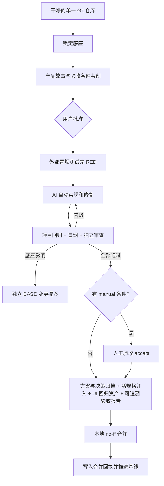

# StoryLoop

StoryLoop 是面向已有 Git 工程的产品需求—开发—验收闭环。你只需要与 AI 共创用户故事和验收用例并最终批准；批准后的核心流程测试、实现迭代、回归、独立验收、证据报告和本地合并由外部 Loop 控制。

它不绑定 Java、Python 或前端技术栈，不要求拆分多个仓库，也不改写现有 CI 文件。

## 快速开始

支持 Windows 和 Linux（含 WSL2），要求 Python 3.11+、Git，以及干净的目标仓库。Linux 需要可读的 `/proc` 和内核 child subreaper 支持（启动时自动检查，无需 root）。安装后命令入口是 `storyloop`，等价写法是 `python -m storyloop`。

Linux / WSL2：

```bash
python3 -m venv .venv && .venv/bin/pip install .

.venv/bin/storyloop init ~/work/my-project --settings ~/work/storyloop-settings.json
.venv/bin/storyloop change ~/work/my-project --idea "增加订单取消功能，已发货订单不能取消"
# 终端里会逐条提出澄清问题（回车选推荐项）；满意后批准，闭环自动跑到底或停在明确的人工停点
.venv/bin/storyloop approve ~/work/my-project --change FEAT-20260916-001
.venv/bin/storyloop status ~/work/my-project --change FEAT-20260916-001 --json
```

PowerShell：

```powershell
python -m pip install .

storyloop init C:\work\my-project
storyloop change C:\work\my-project --idea "增加订单取消功能，已发货订单不能取消"

# 审核 .storyloop/drafts/<change-id>/ 中的故事和验收条件；需要时继续修订
storyloop change C:\work\my-project `
  --change FEAT-20260916-001 `
  --message "取消原因必填"

# 最终批准；后续默认自动执行到底或停在明确人工决策点
storyloop approve C:\work\my-project --change FEAT-20260916-001

storyloop status C:\work\my-project --change FEAT-20260916-001 --json
storyloop report C:\work\my-project --change FEAT-20260916-001
```

完整说明见 [通用工程迭代使用指南](docs/product-iteration-guide.md)。

## 核心保证

- 产品层输入：用户无需编写技术方案和详细任务文档。
- 用户批准：未决问题会阻止批准；任何故事或验收条件修订都会使旧批准失效。
- 需求质量门：合同采用 spec-kit 结构（优先级、独立验证方式、EARS 规则、Gherkin 验收条件），澄清问题以选择题形式逐条回答并入合同；批准前有确定性 checklist 把关。
- OpenSpec 管理：批准合同、增量规格、实现方案（design.md）和人为决策（decisions.md）进入 `openspec/changes/<change-id>/`，完成时并入 `openspec/specs/<capability>/spec.md` 活规格；装了 `openspec` CLI 时结构校验是门。
- 外部验收：实现代理不能修改或自行通过 OpenSpec、冒烟测试和报告；冒烟只包含本次变更的核心链路与不该坏的基础功能，用例缺陷走 `smoke-repair` 通道并从合同提交重新证明 RED。
- 人工验收：合同里的 `manual` 条件停在 `MANUAL_ACCEPTANCE_REQUIRED`，人用 `accept` 逐条留痕，记录与实现指纹绑定。
- 单仓库底座：初始化提交和文件摘要构成逻辑底座；普通业务新增只进入 `modules/` 或 `features/`。
- 底座独立演进：普通功能触碰底座会暂停并产生 `BASE-*` 提案。
- CI 中立：只提供 `storyloop ci ...`；不创建或覆盖 GitHub Actions、GitLab CI、Jenkins 文件。
- 自动本地 Git：控制器只创建本地功能分支、提交并 `--no-ff` 合并；控制器代码不调用 push、删除分支或重写历史。
- 证据追溯：报告映射需求、故事、验收条件、测试、真实命令结果、证据摘要、实现提交和最终合并提交。



## CI 冒烟入口

```powershell
storyloop ci C:\work\my-project --change FEAT-20260916-001
```

CI 平台只需增加这一普通命令步骤。命令会从 Git 可见、非忽略文件构造隔离候选副本；冒烟测试若修改候选代码或产生未声明文件会失败。冒烟清单、测试源文件和执行证据均有 SHA-256 保护；行为失败、错误、超时、跳过、篡改或缺失结果都不能算通过。

## 目录结构

```text
my-project/
├─ .storyloop/                         本地控制面，被 Git 忽略
│  ├─ config.json
│  ├─ baseline.json
│  ├─ drafts/<change-id>/
│  ├─ state/
│  └─ evidence/
├─ openspec/
│  ├─ changes/<change-id>/             已批准产品合同：proposal.md、stories/acceptance/traceability.json、
│  │                                    checklist.md、specs/<capability>/spec.md（增量规格）、
│  │                                    design.md（实现方案）、decisions.md（人为决策）
│  └─ specs/<capability>/spec.md       活规格，完成时由引擎并入增量
├─ acceptance/
│  ├─ smoke/<change-id>/               外部核心流程测试（合同的一部分，受保护）
│  └─ ui/<capability>/                 可选：实现后生成的 UI 回归资产与页面测试计划，不进冒烟
├─ modules/ 或 features/               新业务模块（module_roots 可配置为任何目录）
└─ reports/storyloop/<change-id>/      JSON 与 Markdown 验收报告，含成本与耗时
```

初始化时可变区之外的已跟踪文件都属于稳定底座；可变区（`module_roots`）可以是任何目录，包括已有代码的目录。`pom.xml`、`package.json` 等构建集成点如需修改，会转成独立底座提案。构建系统在仓库根或一级子目录（monorepo）都能被探测到。`.storyloop` 被加入仓库本地 `.git/info/exclude`，不会修改项目的 `.gitignore`。

## 命令

| 命令 | 作用 |
|---|---|
| `init PATH [--settings FILE]` | 探测通用工程并锁定底座；可用 JSON 显式配置安全 argv |
| `change PATH --idea TEXT` | 从一句产品意图创建草案 |
| `change PATH --change ID --message TEXT` | 与 AI 继续修订同一变更 |
| `approve PATH --change ID` | 批准并自动跑完后续闭环 |
| `run PATH --change ID [--no-interactive]` | 继续一个已批准的变更；终端里遇到 `NEEDS_INPUT` 会直接提问 |
| `status PATH --change ID --json` | 查看合同和外部 Loop 状态 |
| `ci PATH --change ID` | 独立运行核心流程冒烟测试 |
| `report PATH --change ID` | 定位最终验收报告 |
| `base-propose PATH --path P [--path P2] --reason TEXT` | 为计划中的底座改动开 BASE 提案（无需先触发功能变更） |
| `base-update PATH --proposal BASE-ID` | 校验独立底座提交、完整回归并提升底座版本 |
| `accept PATH --change ID --criterion A1 --note TEXT` | 记录人工验收条件已由人确认（仅在 `MANUAL_ACCEPTANCE_REQUIRED` 停点可用） |
| `answer PATH --change ID --answer TEXT [--answer TEXT]` | 回答 `NEEDS_INPUT` 停点的问题（按顺序；只给一个答案则适用于全部）。在终端里 `run`/`approve` 会直接提问，无需此命令 |
| `reset PATH --change ID --reason TEXT` | 人工复位卡住的运行（`WORKSPACE_TAINTED`，或人工验收等待期间工作区已变）；不动文件，被中断的一轮不计预算，理由留痕 |
| `smoke-repair PATH --change ID --reason TEXT` | 冒烟用例本身有缺陷时，让冒烟角色修自己的套件并从合同提交重新证明 RED；之前的尝试作废，理由写入 decisions.md |
| `document PATH --change ID [--design FILE] [--capability NAME]` | 为已 PASSED 的变更补生成 design.md、decisions.md 和活规格（配合 `base-propose`/`base-update` 提交） |

退出码 `0` 表示命令成功，`2` 表示失败、受阻或待输入，`130` 表示中断。

## 自动化边界

正常的测试或实现失败会自动反馈给实现代理，直到通过或预算耗尽。以下情况明确暂停：

- 需要修改稳定底座。
- 已批准需求出现不可消解的业务歧义。
- 代理写入未授权路径或修改保护文件。
- 达到尝试预算。
- 存在必须由人实际判断的手工验收条件：自动验收、回归和审查通过后停在 `MANUAL_ACCEPTANCE_REQUIRED`，用 `storyloop accept` 逐条记录后 `storyloop run` 继续；人工证据与实现指纹绑定并写入验收报告。
- 冒烟用例本身有缺陷（定位器、时序、数据准备）：由人判断后执行 `storyloop smoke-repair`，实现代理永远不能改验收用例。

完成阶段（实现提交、文档归档、UI 回归资产、报告、合并、回执）是幂等的：中途崩溃后再次 `storyloop run` 会采纳已存在的实现提交、丢弃上次留下的引擎产物并重新生成，不会重复调用实现代理。

出现 `BASE_CHANGE_REQUIRED` 后，先在原分支把该 `BASE-*` 涉及的路径作为独立变更实现、审核并提交；工作树干净后执行 `storyloop base-update PATH --proposal BASE-ID`。命令要求提交路径与提案完全一致、至少一条回归命令真实通过且不含 CI 文件，然后将底座版本从例如 `1.0.0` 提升到 `1.0.1`。它不会替你丢弃或搬移功能分支上的未提交修改。

默认使用本机已安装并登录的 Codex CLI。也可在 `.storyloop/config.json` 选择 `command` 或 `manual` 适配器；`examples/claude-code/` 提供驱动 Claude Code 的 `command` 适配器（按角色收窄工具、Bash 前缀白名单、项目规范文件、圈数到上限自动续会话、回报成本）。每次代理调用的耗时、轮数和费用记入 `.storyloop/state/telemetry/`，汇总进验收报告。工具不保存 API 密钥；不要把生产凭证、PII、数据库连接或商业秘密放进目标仓库和 Agent 输入。

安全边界：自定义 agent 与 test command 是当前用户权限下的原生进程，必须是受信任命令。StoryLoop 能检测本地仓库/控制面篡改，但不能在操作系统层证明第三方进程没有访问网络或远端 Git；需要强隔离时，请在无网络、无 SSH/Token 凭证的容器或 CI 沙箱中运行。

Windows 上自动探测到的 `.cmd`、`.bat`、`.ps1` 包装器不会被直接执行。初始化会给出 warning，回归项在没有安全命令时明确记为 `SKIPPED`，核心冒烟仍正常运行。可传入例如 `settings.json`：

```json
{"test_commands":[["{python}","-m","unittest","discover"]],"module_roots":["modules","features"],"integration_paths":["pyproject.toml"]}
```

```powershell
storyloop init C:\work\my-project --settings C:\work\settings.json
```

## 兼容的旧流程与 v2 Stage DAG

早期独立实例的 `init --goal`、`discuss`、`prepare`、`approve`、`run --story`、`accept` 和 HTML 报告仍保留。当 `init` 的目标是已有 Git 根目录时自动进入新的通用工程模式；目标是空目录时保持旧实例模式。

底层 v2 `stage-run`、`stage-status`、`stage-resume` 仍可用于技术 Stage/DAG 编排，但普通产品迭代不需要直接操作这些命令。其协议见 [集成协议](docs/protocols.md) 与 [架构说明](docs/architecture.md)。

## 开发与验证

项目仅使用 Python 标准库：

```powershell
python -m unittest discover -s tests -v
```

新增功能或修复必须先添加可复现失败的测试。重点保护：有效 RED、审批失效、底座边界、CI 文件不变、无伪造证据、本地 no-ff 合并和不执行 push。

## 许可证

当前作为本地工程交付，尚未指定对外分发许可证。
