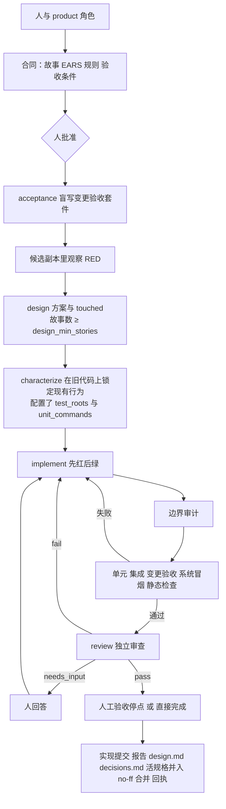

# 架构与运行机制

对应引擎版本：0.1.0，核对日期 2026-10-11。StoryLoop 把产品共创、验收程序和实现过程分开，用可恢复的程序状态连接它们。它是 CLI 工程工具，作用于一个已有的 Git 仓库（`storyloop init <仓库>`）；没有远程服务器或生产部署功能。早期的独立实例模式与 v2 Stage/DAG 引擎已删除，最后的代码保存在本地 tag `archive/legacy-modes`。

## 技术栈

Python 3.11+，只用标准库，没有运行时依赖（`pyproject.toml` 的 `dependencies = []`）；入口 `storyloop = storyloop.cli:main`。外部依赖都是目标仓库或用户环境自带的：`git`（必需）、代理 CLI（`codex` 或 `claude`）、可选的 `openspec` CLI、项目自己的测试命令。模块分层见 [modules.md](modules.md)。

## 一次变更的链路

## 状态与持久化

- 变更：`.storyloop/state/changes/<id>.json`（草案、修订、批准指纹），预览文件在 `.storyloop/drafts/<id>/`。
- 运行：`.storyloop/state/runs/<id>.json`。`run` 每次从这里恢复，按 `status` 决定从哪一步继续；完成阶段的每一步（`VERIFIED` → `MERGED` → `RECEIPTING` → `FINALIZING` → `PASSED`）都先落盘再做下一步。
- 一个仓库同时只有一个 `run`：`run_change` 持有操作系统级锁（`storage.locked`）。
- 所有状态文件原子写入（临时文件 + fsync + replace），崩溃不会留下半个文件。
- 账本与诊断：`.storyloop/state/telemetry/`；问答：`.storyloop/state/answers/`；证据：`.storyloop/evidence/<id>/`。

## 运行规则

1. 合同指纹在批准时锁定；任何故事或验收条件修订都让批准失效。
2. 变更验收套件与合同一起提交，字节指纹受保护；实现代理写到它即判越界。
3. 只有候选副本里观察到的行为失败（退出码 1）才是有效 RED；环境错误、跳过、超时都不算。
4. 每轮尝试后对全树快照做边界审计：可变区与 `test_roots` 内是允许的改动；集成点、底座与 CI 改动转 BASE 提案；受保护的合同、套件与可变区外的新文件判 `BOUNDARY_VIOLATION`；未声明的被忽略文件、暂存、控制面改动判 `WORKSPACE_TAINTED`。
5. 证据与人工验收都绑定实现指纹（Git 可见文件减去 `openspec/changes/`、`openspec/specs/`、`acceptance/changes/`、`acceptance/smoke/`、`acceptance/ui/`、`reports/storyloop/`），代码变了就失效。
6. `max_attempts` 是唯一质量预算；`agent_timeout_seconds` 只防挂死，适配器圈数上限只是检查点。
7. 完成阶段幂等：崩溃后再次 `run` 不重复调用代理、不重复提交。

## 安全与信任模型

- 验收执行器、项目测试命令及 command 适配器必须可信。批准命令意味着允许执行相应程序。
- 指纹检测可发现修改，不是 OS 沙箱，不能阻止同用户权限下的恶意进程读取宿主机文件。不要用它执行未知代码。
- base 代理实现同样不是沙箱：引擎隔离用户级和系统级 Git 配置、拒绝在项目树内运行的引擎自行调用代理，并在调用返回后核对引擎源码。这些措施只能阻止或发现已知篡改路径，不能隔离同用户恶意进程。base 代理应使用适配器 CLI 自带沙箱（如 Codex `workspace-write`）或不含凭证的容器；需要强隔离时使用容器。
- Codex 适配器使用其现有 read-only/workspace-write 沙箱；引擎不会以绕过沙箱参数启动 Codex，也不会自行提权。Codex 会话落盘以便 `exec resume` 修复格式问题；恢复调用沿用会话原有沙箱。
- command 适配器和测试进程没有内建文件系统隔离，保留给受信任适配器。若需要处理不可信代码，应在独立低权限用户或容器中使用。
- Windows 进程执行使用 `KILL_ON_JOB_CLOSE` Job Object，并通过门闩保证目标在加入 Job 后才启动；正常退出、失败、超时、输出超限和中断都清理完整 Job，并等待 Job 内活动进程归零后才报告 containment。
- Linux 每次调用启动独立的 `PR_SET_CHILD_SUBREAPER` 监督进程，避免并发调用相互收养后代。正常结束、超时和输出超限后，监督进程反复终止并回收子进程及被收养的后代，再发送完成确认。缺少内核能力、`/proc` 不可读、监督进程崩溃或清理超时均 fail-closed。该机制管理受信任命令的进程生命周期，不隔离恶意同用户进程、外部服务或文件系统。其他 POSIX 平台仅清理进程组，不声称 containment。
- 代理与测试进程只拿到白名单环境变量，名字含 KEY、TOKEN、PASSWORD、SECRET、CREDENTIAL 的变量一律剔除。
- 不读取鉴权文件。不将生产凭证、PII 等敏感材料放进合同、上下文、检查输出。调用记录与报告会脱敏常见凭证格式，但通用文本脱敏不保证能识别所有敏感信息。
- 不执行来源不明的安装脚本，不自动安装目标应用依赖，不执行生产数据库操作、推送或部署。

## 实际能力范围

- 业务断言失败、审查发现、结构不合法的实现回答都会回喂给下一轮实现尝试，直到通过或预算耗尽。
- 环境启动失败、编译/运行异常、测试协议损坏或跳过会阻断，不会被当作有效 RED。修正后可以恢复。
- 实现级的先红后绿属于开发角色内部的纪律。implement 角色的提示词要求测试先行，并在 design.md 的 Tests First 一节记录；引擎不观察或证明这个过程（决定见 [0012](decisions/0012-implementation-tdd-by-prompt.md)），引擎强制的只有验收级证据。
- 审查的文字结论不能替代实际自动检查，机器检查也不能证明需求语义正确。保留人工业务裁决和体验验收。
- 验收结果可以由任意语言的执行器产生，但每种技术栈需要自己的执行器和环境准备。尚未内置浏览器平台、数据库编排、CI 服务、多变更并行或自动发布。
- 默认 Codex 通道依赖本机 CLI、登录及可用额度。
