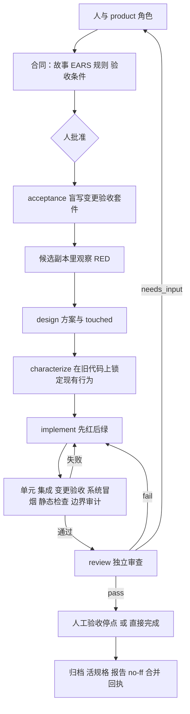

# 架构与边界

StoryLoop 把产品共创、验收程序和实现过程分开，用可恢复的程序状态连接它们。它是 CLI 工程工具，作用于一个已有的 Git 仓库（`storyloop init <仓库>`）；没有远程服务器或生产部署功能。早期的独立实例模式与 v2 Stage/DAG 引擎已删除，最后的代码保存在本地 tag `archive/legacy-modes`。

## 模块

命令面：`init / skills / survey / change / approve / run / status / log / answer / accept / reset / acceptance-repair / smoke-propose / smoke-apply / document / base-propose / base-update / ci / report`。

| 模块 | 责任 |
|---|---|
| cli / next_steps / change_log | 命令入口、诚实退出码；每个停点与报错的下一步命令；`log` 排障视图 |
| project_profile / baseline / base_upgrade | 工程探测（根目录与一级子目录）、底座锁定与版本、BASE 提案与回归门升级 |
| changes / approvals / requirement_checklist / models | 草案与修订（澄清记录、答案入合同）、批准指纹、确定性需求质量门、产品合同结构校验 |
| openspec_docs | 增量规格、活规格并入与取代记录、design.md / decisions.md、`openspec validate` 门 |
| smoke / smoke_runner | 变更验收套件与清单（`acceptance/changes/<id>/`）、隔离候选副本、证据与指纹、`run_ci` |
| project_agents / project_contracts / role_schemas | 七个角色的无状态调用（codex / command / manual）、角色 JSON Schema（CLI 原生约束与引擎校验同源）、结构修复、`_telemetry` 剥离 |
| call_log / telemetry | 每次调用的诊断记录（请求、回答、stderr、会话 ID）；墙钟、轮数、费用账本 |
| project_loop / project_loop_support | 外部闭环状态机：RED、方案、特征化门、实现—分层验证—审查循环、边界审计、人工验收停点、acceptance-repair、幂等完成阶段 |
| project_boundaries / boundaries | 可变区、集成点、底座、CI 与 scratch 路径的变更分类；写入者停止后的全树快照（拒绝链接、硬链接、敏感文件、采集中变化） |
| manual_acceptance / answers / run_recovery | 人工验收记录（绑定实现指纹）、问答账本、`reset` |
| system_smoke | 项目级系统冒烟：受保护的清单与用例、隔离运行、`smoke-propose` / `smoke-apply` 维护、克隆后采纳 |
| skills / foundation_survey | 引擎自带技能包的安装、版本状态与文本加载；survey 角色摸底，产物校验后写入 `openspec/foundation/` 并开 BASE 提案 |
| change_report / project_receipt / project_git | 追溯报告（证据门、成本节）、合并回执、本地分支与 no-ff 合并 |
| processutil / windows_job / linux_job / linux_supervisor / process_bootstrap | 最小环境、输出与时间上限、Windows Job 与 Linux subreaper 进程树回收 |
| storage / path_security | 原子写、操作系统锁、受控路径检查 |

## 运行规则

1. 合同指纹在批准时锁定；任何故事或验收条件修订都让批准失效。
2. 变更验收套件与合同一起提交，字节指纹受保护；实现代理写到它即判越界。
3. 只有候选副本里观察到的行为失败（退出码 1）才是有效 RED；环境错误、跳过、超时都不算。
4. 每轮尝试后对全树快照做边界审计：可变区内是功能改动，集成点与底座改动转 BASE 提案，未声明的被忽略文件、暂存、控制面改动判 `WORKSPACE_TAINTED`。
5. 证据与人工验收都绑定实现指纹（Git 可见文件减去引擎产物），代码变了就失效。
6. `max_attempts` 是唯一质量预算；`agent_timeout_seconds` 只防挂死，适配器圈数上限只是检查点。
7. 完成阶段幂等：崩溃后再次 `run` 不重复调用代理、不重复提交。

## 安全与信任模型

- 验收执行器、项目测试命令及 command 适配器必须可信。批准命令意味着允许执行相应程序。
- 指纹检测可发现修改，不是 OS 沙箱，不能阻止同用户权限下的恶意进程读取宿主机文件。不要用它执行未知代码。
- Codex 适配器使用其现有 read-only/workspace-write 沙箱；引擎不会以绕过沙箱参数启动 Codex，也不会自行提权。Codex 会话落盘以便 `exec resume` 修复格式问题；恢复调用沿用会话原有沙箱。
- command 适配器和测试进程没有内建文件系统隔离，保留给受信任适配器。若需要处理不可信代码，应在独立低权限用户或容器中使用。
- Windows 进程执行使用 `KILL_ON_JOB_CLOSE` Job Object，并通过门闩保证目标在加入 Job 后才启动；正常退出、失败、超时、输出超限和中断都清理完整 Job，并等待 Job 内活动进程归零后才报告 containment。
- Linux 每次调用启动独立的 `PR_SET_CHILD_SUBREAPER` 监督进程，避免并发调用相互收养后代。正常结束、超时和输出超限后，监督进程反复终止并回收子进程及被收养的后代，再发送完成确认。缺少内核能力、`/proc` 不可读、监督进程崩溃或清理超时均 fail-closed。该机制管理受信任命令的进程生命周期，不隔离恶意同用户进程、外部服务或文件系统。其他 POSIX 平台仅清理进程组，不声称 containment。
- 不读取鉴权文件。不将生产凭证、PII 等敏感材料放进合同、上下文、检查输出。调用记录与报告会脱敏常见凭证格式，但通用文本脱敏不保证能识别所有敏感信息。
- 不执行来源不明的安装脚本，不自动安装目标应用依赖，不执行生产数据库操作、推送或部署。

## 实际能力范围

- 业务断言失败、审查发现、结构不合法的实现回答都会回喂给下一轮实现尝试，直到通过或预算耗尽。
- 环境启动失败、编译/运行异常、测试协议损坏或跳过会阻断，不会被当作有效 RED。修正后可以恢复。
- 实现级的先红后绿属于开发角色内部的纪律。implement 角色的提示词要求测试先行，并在 design.md 的 Tests First 一节记录；引擎不观察或证明这个过程（决定见 [0012](decisions/0012-implementation-tdd-by-prompt.md)），引擎强制的只有验收级证据。
- 审查的文字结论不能替代实际自动检查，机器检查也不能证明需求语义正确。保留人工业务裁决和体验验收。
- 验收结果可以由任意语言的执行器产生，但每种技术栈需要自己的执行器和环境准备。尚未内置浏览器平台、数据库编排、CI 服务、多变更并行或自动发布。
- 默认 Codex 通道依赖本机 CLI、登录及可用额度。
