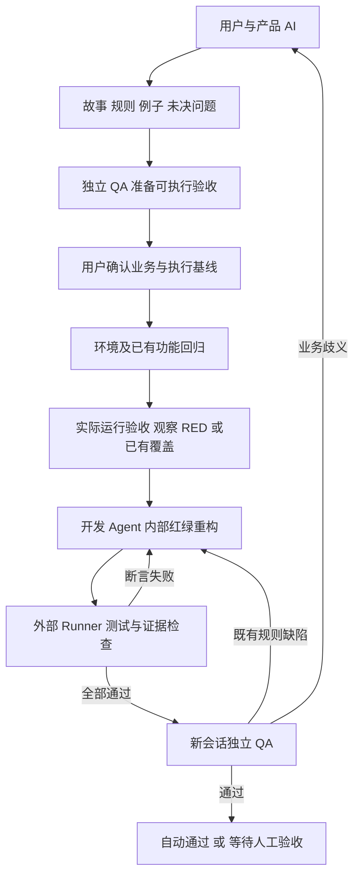
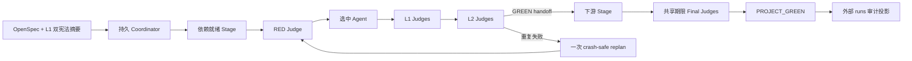

# 架构与边界

StoryLoop 把产品共创、验收程序和实现过程分开，用可恢复的程序状态连接它们。首版是 CLI 工程工具，报告为离线 HTML；没有远程服务器或生产部署功能。

## 通用工程模式模块

`storyloop init <已有 Git 仓库>` 进入的模式，命令面是 `change / approve / run / accept / answer / reset / smoke-repair / document / base-propose / base-update / ci / report`。

| 模块 | 责任 |
|---|---|
| project_profile / baseline / base_upgrade | 工程探测（根目录与一级子目录）、底座锁定与版本、BASE 提案与回归门升级 |
| changes / approvals / requirement_checklist | 草案与修订（澄清记录、答案入合同）、批准指纹、确定性需求质量门 |
| openspec_docs | 增量规格、活规格并入与取代记录、design.md / decisions.md、`openspec validate` 门 |
| smoke / smoke_runner | 受保护的冒烟套件与清单、隔离候选副本（Git 可见文件，剔除 UI 资产）、证据与指纹（`candidate_digest` / `implementation_digest`） |
| project_agents / project_contracts | 四个角色的无状态调用（codex / command / manual）、返回结构校验、`_telemetry` 剥离 |
| project_loop / project_loop_support | 外部闭环状态机：RED、实现—回归—冒烟—审查循环、边界审计、人工验收停点、smoke-repair、幂等完成阶段 |
| project_boundaries / boundaries | 可变区、集成点、底座、CI 与 scratch 路径的变更分类；写入者停止后的全树快照 |
| manual_acceptance / answers / run_recovery | 人工验收记录（绑定实现指纹）、问答账本、`reset` |
| ui_regression | 实现后的 UI 回归资产挂点（只读调用外部生成器，文件限定在 `acceptance/ui/<capability>/`） |
| change_report / project_receipt / project_git | 追溯报告（证据门、成本节）、合并回执、本地分支与 no-ff 合并 |
| telemetry | 每次代理调用的墙钟、轮数、费用账本 |

## 早期实例模式模块

| 模块 | 责任 |
|---|---|
| models | 严格结构、语义、依赖和覆盖校验 |
| discovery | 产品对话、非执行式 QA 生成、提案落盘与历史 |
| agents | v1 Codex、显式 argv、手动桥接，逐次新会话 |
| stage_config / boundaries | v2 Adapter/Stage/DAG 合同、可移植写边界、不可变快照与变更验证 |
| stage_agents | v2 选中项探测、统一 Agent 协议、manual 控制面与非终态分类 |
| json_contract / stage_judges | 公共严格 JSON、Judge 执行、RED 分类、只读证据与命令/快照绑定 |
| stage_runner | 单 Stage 单次闭环、Agent 全树写边界复核、L1/L2 顺序与短路 |
| processutil / windows_job / linux_supervisor | 最小环境、输出与时间预算、Windows Job 和 Linux subreaper 进程树回收 |
| verification | 解析真实退出码与命名测试结果 |
| storage / evidence | 原子文件、操作系统锁、源与证据指纹、脱敏 |
| engine / runner | 批准、恢复、修复、回归、独立 QA、人工验收 |
| report / cli | 产品可读状态和执行入口 |

## 运行规则

1. 产品、检查、配置和整个 qa 目录构成批准指纹。QA 不使用依赖/构建目录忽略规则，避免可执行检查漏出保护。
2. 代码指纹包含 workspace 的文件内容和名字，排除常用构建/依赖缓存。不要把业务实现放进 node_modules、target、.venv 等缓存目录。第三方运行依赖本身不受源码指纹保护，应在项目中固定版本。
3. 每次外部调用前后校验批准内容，并检查控制状态和既有证据是否被修改。检查和 reviewer 还不能修改实现源文件。
4. 每条证据带运行 ID、故事 ID、阶段、尝试次数、代码与批准指纹、结果和时间。state 保存证据内容哈希，缺失或被修改即失效。
5. 实现尝试在调用前持久化；时间在调用前预留，正常结束后改成实际耗时。进程崩溃会保守地消耗已预留时间，防止反复重启绕过预算。
6. 前一个故事通过且没有过期时可以跳过。后一个故事修改代码后，已有成功故事需重新验证并审查。首版采用保守的全工作区指纹，不做精细依赖影响分析。
7. 人工 ACCEPTED 绑定当前代码。代码修改后重新验证会撤销旧人工确认，需重新确认。
8. `run_process` 返回 `contained`。Windows 只有 bootstrap 在目标启动前进入 Job Object，且整个 Job 成功终止、等待成员清零并关闭后才为 `true`；Linux 使用独立 child subreaper 监督进程，回收包括 `setsid()` 脱离进程组的后代；只有 `waitpid` 确认没有剩余子进程并经专用管道确认后才为 `true`。其他 POSIX 平台仍返回 `false`。

## v2 Adapter 稳定合同

- 选择顺序固定为命令行覆盖、`LOOP_AGENT`、配置默认值；probe 只解析选中项，不启动或探测其他注册项。
- command、Codex、manual 共享 `loop.agent.v2` 请求与响应。请求 ID 绑定协议、Adapter、角色、Stage、指令和 payload；响应禁止携带 Judge verdict。
- 请求和响应均限制为 1 MiB 标准 JSON；拒绝重复字段、`NaN`/`Infinity`、未知字段、错请求 ID 和未解决问题与 `ok` 并存。
- 外部进程必须先满足 `contained is True`，再读取任何 stdout 或 Codex 最终响应。超时、截断、非零退出、启动失败均不能成为业务成功。
- v2 只透传配置白名单环境变量，进程层再防御性过滤密钥、Token、密码、Secret 和 Credential 类名称。
- 持久 manual 请求/回执和临时 Codex 响应位于项目同级控制目录，不放进 Agent 的 `-C project` 写域。响应按普通单链接文件、有界大小和文件身份读取。
- `needs_input` 与 `architecture_decision_required` 是结构化非终态，问题保存在 `StoryLoopError.details`；manual 非终态回执保留到上层完成持久化处理。

## v2 Judge 稳定合同

- Judge 请求使用 `loop.judge.request.v2`，响应使用 `loop.judge.v2`；请求 ID 绑定 Stage、Judge、phase、context、执行前工作区摘要和解析后的 argv 摘要。
- 状态与退出码必须同时一致：`pass=0`、`fail=1`、`error=2`、`skip=3`。RED phase 只有 `fail` 是有效 `RED`，`pass` 是 `EXISTING_GREEN`；环境错误和 skip 不能冒充红灯。
- Judge 执行结束后先确认进程树已安全 containment，再采集执行后快照，最后解析 stdout。任何可追踪项目变化都会先于 verdict 被阻断。
- readonly 快照包含普通源码、`.storyloop`、普通 `.git/`、目录，以及内容、权限模式、Windows 文件属性、mtime 和可用的 uid/gid；只保存哈希和元数据，不保存文件内容。
- Git worktree/submodule 的 `.git` 指针指向项目外共享控制目录，目前在 Judge 启动前 fail-closed。使用硬链接对象的本地 clone 也按安全策略拒绝。
- `node_modules`、`target` 等固定构建缓存不属于验收证据；Judge 必须是受信任、已批准的测试命令。本模块不把内容快照描述为 OS 文件系统沙箱或对恶意同用户进程的隔离。

## v2 单 Stage 闭环合同

- 一次 attempt 只编排一个已验证 Stage：唯一 RED Judge → 必要时一次 implement Agent → 全部 L1 → 全部 L2；不包含 DAG、重试、持久化和 final Judge。
- RED 的 `fail` 才调用 Agent；`EXISTING_GREEN` 禁止人为破坏已有实现，跳过 Agent 后仍完整运行 L1/L2。
- Agent 前后快照覆盖项目全树，包括 `.storyloop`、普通 `.git/`、依赖及构建缓存和目录安全元数据。只有 `write_paths` 内变化与匹配写边界所需的新祖先目录被接受。
- 正常完成、非终态、超时、输出超限、进程失败和协议失败在确认 writer 已停止后统一复核写边界；`UNSAFE_CONTAINMENT` 表示无法安全采集后快照，必须立即阻断且不得运行 Judge。
- Agent 的 `ok` 不是业务 verdict。L1/L2 按声明顺序执行，任何 `FAIL/ERROR/SKIP` 立即短路；仅全部 GREEN 返回内存态 `STAGE_GREEN`。
- attempt 结果不包含 payload、stdout/stderr 或文件内容，只携带 Stage 标识、是否调用 Agent、无内容变更清单及 Judge evidence。

## 安全与信任模型

- 外部 QA 脚本及 command 适配器必须可信。批准命令意味着允许执行相应程序。
- 指纹检测可发现修改，不是 OS 沙箱，不能阻止同用户权限下的恶意进程读取宿主机文件。不要用它执行未知代码。
- Codex 适配器使用其现有 read-only/workspace-write 沙箱；Runner 不会以绕过沙箱参数启动 Codex，也不会自行提权。产品模式的 Codex 会话落盘以便 `exec resume` 修复非 JSON 结尾；恢复调用不重新指定沙箱，沿用会话原有沙箱。
- command 模式和 QA 进程没有内建文件系统隔离，保留给受信任适配器。若需要处理不可信代码，应在独立低权限用户/隔离执行环境中使用。
- Windows 进程执行使用 `KILL_ON_JOB_CLOSE` Job Object，并通过门闩保证目标在加入 Job 后才启动；正常退出、失败、超时、输出超限和中断都清理完整 Job，并等待 Job 内活动进程归零后才报告 containment。
- Linux 每次调用启动独立的 `PR_SET_CHILD_SUBREAPER` 监督进程，避免并发调用相互收养后代。正常结束、超时和输出超限后，监督进程反复终止并回收子进程及被收养的后代，再发送完成确认。缺少内核能力、`/proc` 不可读、监督进程崩溃或清理超时均 fail-closed。该机制管理受信任命令的进程生命周期，不隔离恶意同用户进程、外部服务或文件系统；需要强安全边界时仍应使用容器或独立低权限用户。其他 POSIX 平台仅清理进程组，不声称 containment。
- 不读取鉴权文件。不将生产凭证、PII、payload 等敏感材料放进故事、上下文、检查输出。常见凭证格式会被脱敏，但通用文本脱敏不保证能识别所有敏感信息。
- 不执行来源不明的安装脚本，不自动安装目标应用依赖，不执行生产数据库操作、提交、推送或部署。

## 第一版的实际能力范围

- 业务断言失败及已确认规则下的 QA 缺陷可以自动修复。
- 环境启动失败、编译/运行异常、测试协议损坏或跳过会阻断；首版不会自动猜测它们是环境故障还是源码缺陷。这种失败绝不会被当作有效 RED。修正后可以恢复。
- 内部细粒度 TDD 由开发角色提示词规范，Runner 强制的是外部验收证据；它不会声称已经验证每次内部重构都严格遵守 TDD。
- QA 的文字结论不能替代实际自动检查，机器检查也不能证明需求语义正确。保留人工业务裁决和体验验收。
- 功能验收结果可以由任意语言的脚本产生，但每种应用需要自己的测试适配和环境准备。尚未内置浏览器平台、数据库编排、CI 服务、多仓库并行或自动发布。
- 默认 Codex 通道依赖本机 CLI、登录及可用额度；脚本 demo 不代表真实模型全链路已通过。

## v2 项目级闭环

- `stage_state` 是单 Stage 权威状态：尝试在执行前预留，崩溃按预留时长收费；replan 只清失败批次标记，不清总次数与耗时。
- `stage_coordinator` 只按 DAG 稳定顺序执行依赖闭包，并以每个 Stage 的身份绑定持久状态重新推导 coordinator record；仅修改 `run.json` 不能伪造绿色或跳过依赖。handoff 仅含 Stage、结果摘要、变更路径/类型、Judge ID/outcome，并同时传给下游实现与 replan；不携带 Agent 文本或原始 payload。
- `final_judges` 在全部选定 Stage GREEN 后运行，不调用 Agent。全部 final Judge 共享单调时钟期限，任一 FAIL/ERROR/SKIP 都不能形成项目 verdict。
- `run_artifacts` 在权威状态持久化后生成非权威投影，再把规范化文件集摘要追加绑定回 Stage/coordinator 状态。未绑定的崩溃缺口可安全重建；已绑定历史的删除、变化、额外文件或未知目录均按篡改阻断。
- `spec_gate` 与 `constitution` 只读验证治理输入。v2 CLI 默认要求治理输入完整；缺项、路径穿越、任一父目录链接/junction/reparse point、超限、EARS/映射错误或双文件不一致都会在运行前阻断。迁移兼容只能由可信 Python 宿主显式选择。
- `git_workflow` 与核心状态机分离，只在宿主显式调用时检查或 merge；禁用 hooks、不使用 shell、不 push，冲突不自动回滚或隐藏。

项目同级控制面保存锁、状态、manual 请求/回执、replan 回执与审计证据，避免落入 Agent 的项目写域。Coordinator identity 同时绑定项目路径、完整配置、payload 摘要以及治理摘要；恢复不能跨输入复用。