# 案例与成本参考

以 RuoYi-Vue-Plus 6.x（Spring Boot + Vue 3，monorepo 用 subtree 引入 backend/frontend）作为底座做的验证。数字来自各变更验收报告的"成本与耗时"一节和运行状态，模型为 Claude Code（Opus）。

## 功能变更

| 变更 | 内容 | 代理调用 | 代理累计 | 费用 | 实现尝试 | 结果与教训 |
|---|---|---|---|---|---|---|
| FEAT-20260918-001 | 供应商管理（单表 CRUD + 导出，含 1 条人工条件） | 首个试点 | 未计量（遥测尚未实现） | 未计量 | 1 | 跑通人工验收停点；暴露 `logs/` 未忽略、端口 80、指南文件位置三个底座问题 |
| FEAT-20260920-001 | 采购单主子表 | 11 | 74 分钟 | 32.49 USD | 4 | 审查抓到真实的单号 bug；第 2 轮 SpEL 错误；第 3 轮只因 WSL2 时钟回拨（雪花 ID）失败。约 9 USD 浪费在 60 圈截断和一个遥测污染 bug 上，由此确定预算语义（决策 0005） |
| FEAT-20260921-001 | 供应商分类（字典、必填、筛选、导出、历史数据） | 13 | 27 分钟 | 13.53 USD | 2 | 第 1 轮 6 个 UI 失败全是用例缺陷（严格模式遮罩定位、过时回归资产），促成决策 0008、0009；完成阶段崩溃一次促成决策 0010 |

角色分布（FEAT-20260921-001）：

| 角色 | 调用 | 轮数 | 耗时 | 费用 |
|---|---|---|---|---|
| product | 4 | 9 | 5 分 14 秒 | 1.95 |
| smoke | 3 | 24 | 12 分 49 秒 | 4.81 |
| implement | 4 | 102 | 7 分 47 秒 | 5.45 |
| review | 2 | 23 | 1 分 22 秒 | 1.32 |

观察：
- 一个全栈故事的实现通常需要 60 圈以上，圈数上限必须是检查点而不是失败。
- 冒烟角色的成本和实现角色同量级，因为它要读接口、写两种用例；把浏览器用例限制在核心链路能明显压缩。
- 闭环墙钟远大于代理累计时间：每次冒烟都要构建和启动后端（约 1.5 分钟），人工验收等待也计入。

## BASE 迭代

| 提案 | 内容 | 验证了什么 |
|---|---|---|
| BASE-20260918-001 | 忽略 `logs/`、端口改 5173/8081、指南折回 acceptance/ | `base-propose` → 提交 → `base-update` 流程，基线 1.0.1 |
| BASE-20260918-002 | 上游同步（合成分支） | `--allow-mutable`、subtree pull、冲突解决，基线 1.0.2 |
| BASE-20260921-001/002 | OpenSpec 规格补生成 | `storyloop document` 与规格校验 |
| BASE-20260921-003 | Playwright Test Agents 执行器与第一批 UI 资产 | `ui_regression` 挂点 |
| BASE-20260922-001 | 冒烟不再附加 `acceptance/ui/**`；指南补 git 命令约束 | 决策 0008 落地 |

## Playwright Test Agents

| 阶段 | 耗时 | 费用 | 产出 |
|---|---|---|---|
| planner（首次，探索真实页面） | 32 到 60 分钟 | 0.86 到 1.80 USD | 14 到 26 个场景的 plan.md |
| generator（每个场景） | 约 2 分钟 | 0.7 到 0.9 USD | 一个通过的 spec |
| healer | 约 1 分钟 | 0.4 USD | 修定位器与时序 |

结论：它们需要一个已经实现了功能的应用，因此不能产出 RED-first 的验收套件。曾作为完成阶段的 `ui_regression` 挂点，FEAT-20260923-001 时 generator 卡住 47 分钟拖住合并，随后撤掉（决策 0015）；现在只在系统冒烟维护的草案阶段按需使用。

## 一次迭代的时间线（FEAT-20260921-001）

```mermaid
gantt
    dateFormat HH:mm
    axisFormat %H:%M
    section 合同
    change + 澄清 + approve      :a1, 00:00, 12m
    冒烟盲写 + RED                :a2, after a1, 15m
    section 实现
    尝试 1（实现/回归/冒烟）       :b1, after a2, 20m
    smoke-repair + 重证 RED       :b2, after b1, 12m
    尝试 2 + 审查                 :b3, after b2, 18m
    section 完成
    人工验收（等待）              :c1, after b3, 30m
    归档 + UI 资产 + 报告 + 合并  :c2, after c1, 16m
```

