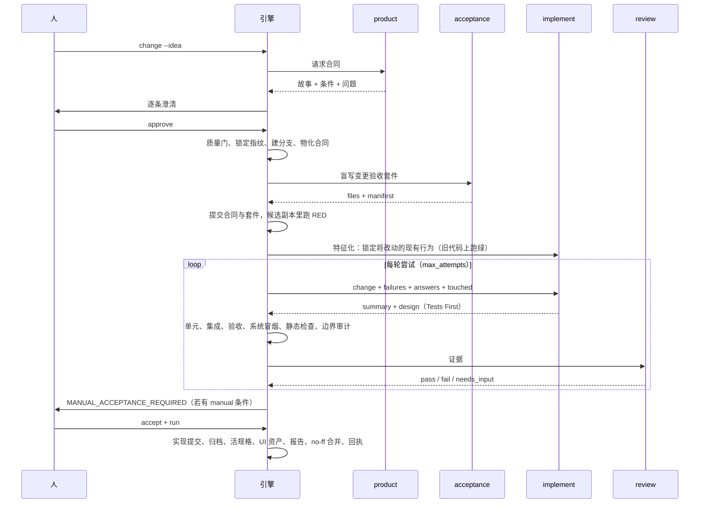

# StoryLoop 定位与概念手册

给第一次接触这个项目的人：先读这一篇，再跟着 [入门教程](tutorial.md) 跑一遍，最后按 [接入手册](onboarding-a-repository.md) 把自己的仓库接进来。

## 1. 它解决什么问题

让 AI 写代码不难，难的是**怎么相信它做完了**。常见做法是让同一个代理自己写测试、自己跑、自己宣布完成，证据链是断的：测试可能迁就实现，"已完成"可能只是一句话。

StoryLoop 把三件事强制分开，用一个放在仓库外面的 Loop 串起来：

| 分开的事 | 谁负责 | 怎么保证 |
|---|---|---|
| 需求是什么 | 人和产品角色共创，人批准 | 合同指纹锁定，任何修订让批准失效 |
| 怎么算做完 | 冒烟角色在实现之前盲写验收用例 | 用例和合同一起提交、受保护，先跑一次证明失败（RED） |
| 做没做完 | 外部进程跑回归、冒烟、独立审查 | 代理的"我做完了"不是证据；报告只接受真实命令结果 |

一句话：**验收驱动的 AI 开发闭环**。人做两件事，共创并批准合同、对机器判断不了的条件做人工验收；其余由引擎控制。

## 2. 术语表

按理解顺序排列，后面的概念依赖前面的。

**目标仓库**：一个已有的、工作树干净的 Git 仓库。引擎不要求拆仓库，也不改它的 CI 文件。monorepo 可以，构建系统在根目录或一级子目录都能被探测。

**底座（foundation）与可变区（module_roots）**：`storyloop init` 时把已跟踪文件的指纹记进 `.storyloop/baseline.json`。可变区里的文件是功能变更可以自由改的（可以是已有代码目录）；可变区之外的一切是底座。`pom.xml`、`package.json` 这类构建清单是**集成点**，哪怕在可变区里改动也会被单独识别。

**BASE 迭代**：功能变更碰到底座会停在 `BASE_CHANGE_REQUIRED` 并生成 `BASE-*` 提案；计划中的底座改动直接 `base-propose`。人在原分支独立提交提案里的路径，`base-update` 校验路径一致、回归通过后把底座版本加一。上游同步（subtree pull）也是一次 BASE 迭代。

**底座知识库（foundation survey）**：`survey` 角色只读摸底后写出的八份文档（`openspec/foundation/`）：模块组成、架构与运行机制、扩展机制、接口清单、能力清单、积木索引、测试基础设施，外加索引。它通过 BASE 迭代进入受保护的底座，跟着底座版本走；之后每个角色都先读它。它把"底座已经能做什么、新功能该怎么加"从代理各自翻代码变成一份共同的事实。

**产品变更（FEAT-*）**：从一句话意图开始的一次迭代。草案在 `.storyloop/drafts/<id>/`，批准后物化到 `openspec/changes/<id>/`。

**产品合同**：目标、非目标、用户故事（优先级、独立验证方式）、EARS 规则（WHEN … THE SYSTEM SHALL …）、Given/When/Then 验收条件、澄清记录、待决问题。结构沿用 spec-kit，纪律沿用 Gherkin。批准前有确定性的需求质量门（checklist.md）。

**澄清（clarification）**：产品角色把真实歧义提成选择题（每轮至多 5 个，带推荐项和理由）。终端里逐条回答，回答立即触发修订并记入合同的 `clarifications`。

**验收条件的两种 kind**：`automated` 必须被冒烟用例覆盖；`manual` 是机器判断不了的（体验、业务裁决），会让运行停在 `MANUAL_ACCEPTANCE_REQUIRED` 等人确认。

**能力（capability）**：一组变更共同演进的业务能力名，也是活规格的文件名。修改既有需求时沿用旧的需求标题，引擎据此做取代记录。

**变更验收套件（acceptance suite）**：`acceptance/changes/<id>/` 下由 acceptance 角色盲写的用例和 `manifest.json`，面向用户、跨前后端，接口优先、浏览器用例只覆盖核心链路，非功能条件也写在这里。它是合同的一部分，实现代理永远不能改。

**系统冒烟（system smoke）**：`acceptance/smoke/` 下项目级的核心链路套件，跨变更累积，每轮尝试、`ci`、`base-update` 都跑。功能变更不能改它；合并后由 acceptance 角色 `smoke-propose` 提议并入或更新，人 `smoke-apply` 批准。

**特征化测试（characterization）**：实现之前，characterize 角色为将被修改的既有文件写只断言"必须不变"行为的测试（扩展的列表用 contains），引擎要求它们在旧代码上跑绿、只改了 `test_roots` 内的文件，才允许开工；实现若改了未声明的既有文件，引擎还原、补锁、重试。

**单元与集成**：`unit_commands` 与 `integration_commands` 分开配置、分开放（不同目录或包）、分开出结论；`check_commands` 是静态检查层。

**验收级 RED**：实现之前在隔离候选副本里跑一次冒烟，只有"行为断言失败"算有效红灯；环境错误、跳过、超时都不算。没有 RED 就不会调用实现代理。这是引擎观察到的外部红灯，和实现代理内部的 TDD 是两回事。

**实现级先红后绿**：implement 角色内部的 TDD 纪律，先写会失败的单元测试，再写代码让它通过，再重构。它发生在一次实现尝试之内，产物是可变区里的单元测试和实现代码，由项目回归命令跑。implement 角色的提示词要求这样做，并在 design.md 的 Tests First 一节留下每个测试先失败后通过的记录；引擎不观察这个过程，只验收结果（回归通过、冒烟通过、审查通过）。

**候选副本（candidate）**：由 Git 可见且未忽略的文件构成的临时副本，环境只有 PATH 和临时目录变量。冒烟在副本里跑，写入副本即判失败，避免"先改实现再断言"的假绿。`candidate_allow` 放行名字看起来敏感但确实是配置的文件；`acceptance/ui/` 不进副本。

**六个角色**：`product`、`acceptance`、`characterize`、`implement`、`review`、`survey`。都是无状态进程调用：stdin 一个请求、stdout 一个 JSON。适配器可以是 Codex CLI（默认）、Claude Code（`examples/claude-code/`）或人工桥接（manual）。

**尝试（attempt）与预算**：一轮尝试 = 实现 → 回归 → 冒烟 → 边界审计 → 审查。`max_attempts` 是唯一的质量预算；`agent_timeout_seconds` 只是挂死保护；适配器的圈数上限只是检查点，到上限续同一会话。

**边界审计**：每轮尝试后，引擎对全树快照做分类：可变区内的改动是功能改动，集成点和底座改动转成 BASE 提案，未声明的被忽略文件、暂存、控制面改动判 `WORKSPACE_TAINTED`。`scratch_paths` 声明代理可以就地产生的构建产物。

**停点**：引擎只在明确的地方停下来，每个停点对应一个命令。

| 停点 | 含义 | 命令 |
|---|---|---|
| `NEEDS_INPUT` | 代理提出真实产品歧义 | 终端直接回答，或 `answer` |
| `MANUAL_ACCEPTANCE_REQUIRED` | 自动验收全过，等人工条件 | `accept` 逐条，再 `run` |
| `BASE_CHANGE_REQUIRED` | 功能触碰底座 | 独立提交后 `base-update`，再 `run` |
| `WORKSPACE_TAINTED` | 工作区出现不该有的改动 | 清理后 `reset`，再 `run` |
| `BUDGET_EXHAUSTED` | 尝试用尽 | 人判断：`acceptance-repair`、修订合同或放弃 |
| `CHARACTERIZATION_FAILED` | 特征化测试在旧代码上不绿 | 修测试，再 `run` |

**acceptance-repair**：验收用例本身有缺陷（定位器、时序、数据准备）时的唯一修复通道。acceptance 角色修自己的套件，引擎从合同提交重建候选副本重新证明 RED，之前的尝试作废、预算归零，理由写进 decisions.md。

**证据与指纹**：冒烟结果写入 `.storyloop/evidence/`，带套件字节指纹和**实现指纹**（Git 可见文件减去引擎产物）。人工验收记录也绑定实现指纹。报告的每条验收条件都追溯到真实命令、退出码、证据摘要、实现提交、合并提交。

**归档（OpenSpec 格式）**：批准时生成增量规格 `openspec/changes/<id>/specs/<capability>/spec.md`；完成时写 `design.md`（实现代理的方案）、`decisions.md`（引擎汇总的人为决策），并把增量并入活规格 `openspec/specs/<capability>/spec.md`。变更目录不会被移走，它是受保护的合同和追溯锚点。装了 `openspec` CLI 时结构校验是门。

**页面事实资产（历史遗留）**：`acceptance/ui/<capability>/` 里是早期用 Playwright Test Agents 生成的页面计划与用例，不进冒烟、不是证据；acceptance 角色盲写浏览器用例时可复用其中的定位器与流程。完成阶段不再生成它们。

**完成阶段**：实现提交 → 文档归档 → 活规格并入 → 报告 → 文档提交 → no-ff 合并 → 回执 → 基线推进；合并后由人触发系统冒烟维护。整个阶段幂等，崩溃后再次 `run` 不会重复调用代理、不会重复提交。

**遥测**：每次代理调用记录墙钟；适配器回报 `_telemetry` 时还记录轮数、token、费用。报告的"成本与耗时"一节按角色汇总。

## 3. 一次迭代长什么样

## 4. 十条设计理由

每条都有对应的决策记录，见 [docs/decisions/](decisions/README.md)。

1. 引擎在仓库外面，代理在仓库里面：代理拿不到判定权。
2. 验收用例在实现之前写、和合同一起提交：测试不能迁就实现。
3. 验收级 RED 必须被真实观察到：没有红灯就没有实现。实现级的先红后绿是代理内部的纪律，引擎不替它作证。
4. 测试分层各司其职：系统冒烟只含核心链路且只经人更新，变更验收先红，特征化先绿，单元与集成分开。
5. 代理的文字不是证据：只有命令结果、退出码和指纹。
6. 人只在明确停点介入：每个停点一个命令，不做半自动。
7. `max_attempts` 是唯一质量预算：时间和圈数只是保护和检查点。
8. 底座独立演进：功能变更不能顺手改工程入口。
9. 采用业内实践而非自造：spec-kit、EARS、Gherkin、OpenSpec、Playwright Test Agents。
10. 不 push、不删分支、不重写历史：引擎的 Git 只做本地、可审计的事。

## 5. 它不是什么

- 不是 CI 系统：只提供 `storyloop ci` 一条命令供任何 CI 调用。
- 不是沙箱：指纹能发现篡改，不能隔离同用户的恶意进程。需要强隔离时放进无凭证的容器。
- 不是部署工具：不 push、不发布。
- 不替代产品判断：机器检查证明"做了合同里的事"，不证明合同本身正确。`manual` 条件和独立审查保留给人。
