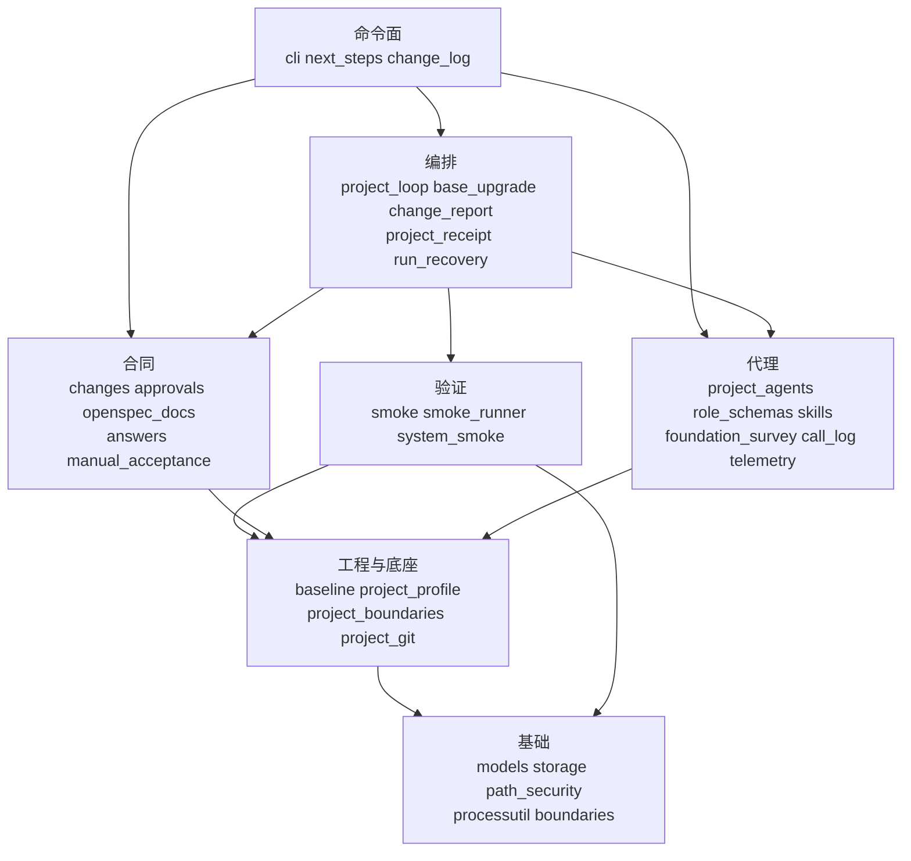

# 模块组成

对应引擎版本：0.1.0（`storyloop/__init__.py`），核对日期 2026-10-11。代码在 `storyloop/`，只用 Python 标准库。

## 一、模块清单

按依赖由低到高分层；上层可以调用下层，下层不调用上层（例外见第二节）。

| 层 | 模块 | 职责 | 对外提供 |
|---|---|---|---|
| 命令面 | `cli` | 解析参数、分发命令、终端澄清与问答、诚实退出码 | `main`、`dispatch`、`clarify_interactively`、`run_with_answers` |
| | `next_steps` | 每个停点与错误码对应的可复制下一步命令 | `next_step` |
| | `change_log` | `storyloop log`：从已有状态拼出一个变更的全过程 | `change_log`、`render_log` |
| 编排 | `project_loop` | 外部闭环状态机：RED、方案、特征化门、实现—分层验证—审查循环、人工验收停点、幂等完成阶段、`acceptance-repair` | `run_change`、`repair_smoke`、`LoopServices`、`layers_green` |
| | `project_loop_support` | 运行状态的持久化与控制面指纹 | `save_run`、`run_path`、`control_digest` |
| | `project_receipt` | 合并回执的崩溃安全生成与核验 | `ensure_merge_receipt`、`recover_completed_merge` |
| | `change_report` | 需求—故事—验收条件—测试—证据的追溯报告 | `generate_change_report` |
| | `run_recovery` | `reset`：把卡住的运行复位到 IMPLEMENTING，理由留痕 | `reset_run` |
| | `base_upgrade` | BASE 提案与回归门控的底座升级 | `propose_base_change`、`upgrade_baseline` |
| 代理 | `project_agents` | 七个角色的调用（codex / command / manual 适配器）、角色说明、结构修复、诊断记录 | `invoke_project_agent`、`instructions_for`、`conform` |
| | `role_schemas` | 每个角色返回值的 JSON Schema，引擎校验与 CLI 原生约束同源 | `schema_for`、`wire_schema`、`schema_errors` |
| | `project_contracts` | implement 与 review 返回值的语义校验 | `validate_agent_summary`、`validate_review` |
| | `skills` | 引擎自带技能包的安装、版本状态与文本加载 | `install_skills`、`skill_text` |
| | `foundation_survey` | survey 角色摸底，产物校验后写入 `openspec/foundation/` 并开 BASE 提案 | `survey_foundation`、`foundation_payload` |
| | `call_log` | 每次代理调用的诊断记录（不是证据） | `open_call`、`close_call` |
| | `telemetry` | 每个变更的调用账本：墙钟、轮数、token、费用 | `record_call`、`summarize` |
| 验证 | `smoke` | 第 2 层变更验收套件：安装、清单、字节保护 | `install_smoke_suite`、`load_smoke_manifest`、`suite_root` |
| | `smoke_runner` | 隔离候选副本里跑套件与回归命令，证据与指纹 | `run_smoke_isolated`、`run_commands_isolated`、`implementation_digest`、`run_ci` |
| | `system_smoke` | 第 1 层项目级系统冒烟：保护、隔离运行、`smoke-propose` / `smoke-apply` | `run_system_smoke_isolated`、`propose_smoke_update`、`apply_smoke_update` |
| 合同 | `changes` | 草案创建与修订、合同指纹、预览文件 | `create_change`、`revise_change`、`load_change`、`contract_digest` |
| | `requirement_checklist` | 批准前的确定性需求质量门 | `evaluate_checklist`、`blocking_items` |
| | `approvals` | 批准锁定、把草案物化到 `openspec/changes/<id>/` | `approve_change`、`materialize_approved_change` |
| | `openspec_docs` | 增量规格、活规格并入与取代、decisions.md、`openspec validate` 门、`document` | `render_delta_spec`、`merge_into_main_spec`、`document_change` |
| | `answers` | NEEDS_INPUT 问答账本 | `record_answers`、`pending_questions` |
| | `manual_acceptance` | 人工验收记录，绑定实现指纹 | `record_manual_acceptance`、`pending_manual_criteria` |
| 工程与底座 | `baseline` | `init`：锁定底座、写控制面配置；底座漂移检查 | `bootstrap_project`、`verify_baseline`、`load_project_config` |
| | `project_profile` | 技术栈中立的工程探测、settings 校验、测试分层命令 | `detect_project`、`validate_project_settings`、`layer_commands`、`matches_test_root` |
| | `project_boundaries` | 把每个 Git 可见改动分类为可变区 / 集成点 / 底座 / CI / 违规 | `audit_project_changes` |
| | `project_git` | 本地功能分支、只提交显式路径、no-ff 合并 | `start_feature`、`commit_paths`、`finish_feature` |
| 基础 | `boundaries` | 写入者停止后的全树快照与差异（拒绝链接、硬链接、采集中变化） | `capture_snapshot`、`snapshot_changes` |
| | `processutil` | 无 shell 的受限子进程：最小环境、输出与时间上限、进程树回收、凭证脱敏 | `run_process`、`redact` |
| | `windows_job` / `process_bootstrap` | Windows Job Object 进程树回收 | `WindowsJob` |
| | `linux_job` / `linux_supervisor` | Linux subreaper 进程树回收协议 | `start_linux` |
| | `storage` | 原子写、操作系统级互斥锁 | `load_json`、`write_json`、`locked` |
| | `path_security` | 跨平台的仓库相对路径校验，不跟随链接 | `repository_relative`、`safe_target` |
| | `models` | 错误类型、参数校验、产品合同结构校验 | `StoryLoopError`、`require`、`validate_product` |

随包发布的数据：`storyloop/skills/foundation-survey/`（`SKILL.md` + `references/`，见 `pyproject.toml` 的 `package-data`）。

## 二、依赖方向

- 代理调用只经 `project_agents.invoke_project_agent`；编排层通过 `LoopServices` 注入，测试用脚本化服务替换真实代理。
- 子进程经 `processutil.run_process`；已知例外是 `openspec validate`（`openspec_docs`）与 `git archive`（`smoke_runner` 构造历史提交的候选副本）直接用 `subprocess.run`。
- Git 命令统一经 `baseline._git`（禁用 hooks、最小环境、30 秒上限）；建分支、提交、合并只在 `project_git`。`project_loop` 与 `system_smoke` 另有几处 `git checkout -- <path>` 用于还原引擎产物或未锁定的改动。
- 状态文件只经 `storage` 写。
- 两处循环依赖用函数内局部导入化解：`baseline` → `system_smoke`（init 时采纳已提交的系统冒烟）、`foundation_survey` ↔ `project_agents`。新增代码不要再加循环。
- 禁止方向：基础层不导入任何上层模块；验证层不调用代理；`cli` 之外不读 `sys.argv`、不做终端交互。

## 三、目标仓库里的引擎区域

引擎作用于目标仓库，以下路径由引擎拥有（`project_profile.GENERATED_PATHS` 与控制面）：

| 路径 | 是否进 Git | 拥有者 |
|---|---|---|
| `.storyloop/` | 否（写进 `.git/info/exclude`） | 控制面：配置、底座、草案、运行状态、证据、账本 |
| `openspec/changes/<id>/` | 是 | 批准合同 + 完成时的 design.md / decisions.md |
| `openspec/specs/<capability>/` | 是 | 活规格，完成时由引擎并入 |
| `openspec/foundation/` | 是 | 底座知识库，survey 产出，BASE 保护 |
| `acceptance/changes/<id>/` | 是 | 变更验收套件，acceptance 角色写，受保护 |
| `acceptance/smoke/` | 是 | 系统冒烟，只经 `smoke-apply` 更新 |
| `reports/storyloop/<id>/` | 是 | 验收报告与合并回执 |
| `.claude/skills/`、`.codex/skills/` | 是 | `storyloop skills` 安装的技能包 |

## 四、仓库其他目录

| 目录 | 内容 |
|---|---|
| `tests/` | 单元与端到端测试，见 [testing.md](testing.md) |
| `examples/claude-code/` | Claude Code 的 command 适配器 |
| `examples/tools/` | 验收执行器积木 `smoke_harness.py`、前端构建走 scratch 的 `scratch_build.py` |
| `examples/todo-demo/` | 入门教程用的最小仓库 |
| `docs/` | 本知识库；`docs/decisions/` 决策记录，`docs/plans/` 历史计划（只读存档） |
| `.github/workflows/ci.yml` | 引擎自己的 CI |
