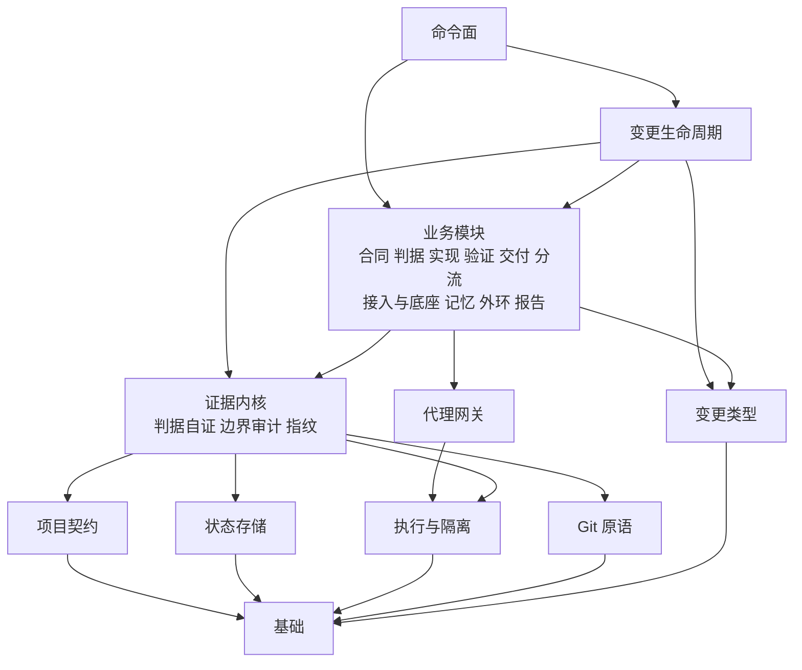

# 模块组成

对应引擎版本：0.1.0，核对日期 2026-10-23。代码在 `storyloop/`，只用 Python 标准库。

## 一、模块清单

分组与分区来自 `storyloop/architecture.toml`；表中模块按职责分组。
对外提供列列出被其他代码模块导入或通过模块属性引用的公开函数；无此类函数时记为“—”。`testing.smoke_harness` 汇总其13个模块。

| 架构模块 | 模块 | 分区 | 职责 | 对外提供 |
|---|---|---|---|---|
| 基础 | `models` | 底座 | 提供纯 JSON 合同原语 | `fields`、`identifier`、`require`、`strings`、`text` |
|  | `errors` | 底座 | 提供跨基础模块共享的安全工作流错误与断言 | `StoryLoopError`、`require` |
|  | `path_security` | 底座 | 跨平台仓库路径校验，拒绝跟随链接 | `forbidden_path_root`、`repository_relative`、`safe_absolute_target`、`safe_target` |
| 变更生命周期内核 | `run_transitions` | 底座 | 显式迁移表、状态元数据与唯一状态写入口 | `transition`、`set_change_status` |
| | `run_guards` | 底座 | 确定性守卫，不调用代理和停点视图 | `guard_g1`、`guard_g2`、`guard_g3`、`pending_manual_criteria` |
| 状态存储 | `initialization_transaction` | 底座 | 对显式控制面文件实施独占、按内容归属的初始化事务 | `initialization_transaction` |
|  | `run_state` | 底座 | 有界保存运行记录，不承担状态迁移判定 | `run_path`、`save_run` |
|  | `storage` | 底座 | 原子 JSON 与文本写入、可移植独占运行锁 | `load_json`、`locked`、`locked_file`、`write_bytes_atomic`、`write_json`、`write_text_atomic` |
| 执行与隔离 | `boundaries` | 底座 | 全部写入进程停止后检测可信工作区边界 | `capture_snapshot`、`snapshot_changes` |
|  | `linux_job` | 底座 | Linux 子进程收集完成协议的控制端 | `start_linux` |
|  | `linux_supervisor` | 底座 | Linux 子进程收集器，回收全部后代才确认完成 | — |
|  | `process_bootstrap` | 底座 | 等待 Windows Job Object 分配完成的可信启动器 | — |
|  | `processutil` | 底座 | 不经 shell 插值的有界子进程执行 | `redact`、`run_process` |
|  | `windows_job` | 底座 | 用于进程树隔离的最小 Windows Job Object 封装 | — |
| Git 原语 | `project_git` | 底座 | 对已批准产品变更执行安全的本地 Git 生命周期 | `commit_paths`、`current_branch`、`finish_feature`、`start_feature` |
|  | `git_command` | 底座 | 执行有界且禁用钩子的 Git 命令 | `git`、`git_failure` |
| 变更类型 | `change_types` | 底座 | 声明三种现有变更类型的判据、范围、阶段与档位策略 | `CHANGE_TYPES`、`definition_for`、`type_for_change_id`、`type_of` |
| 项目契约 | `onboarding_manifest` | 底座 | 校验接入声明，不执行工程钩子或读取凭证 | `load_manifest`、`validate_hooks`、`validate_onboarding` |
|  | `state_format` | 底座 | 集中状态格式枚举、接入清单与系统烟测路径、测试计数模式校验 | `criterion_expects_red`、`criterion_tier`、`is_system_smoke_path`、`validate_test_count_patterns` |
|  | `project_profile` | 底座 | 对既有工程执行技术栈中立的探测 | `detect_project`、`is_ci_path`、`layer_commands`、`matches_test_root`、`validate_project_settings` |
|  | `smoke` | 底座 | 管理按合同盲写、先证明 RED 且受保护的变更验收套件 | `install_smoke_suite`、`load_smoke_manifest`、`protection_path`、`smoke_digests`、`suite_relative`、`suite_root`、`validate_suite`、`without_manifest_echo` |
|  | `testing.smoke_harness` | 底座 | 汇总13个版本化冒烟执行器模块，受支持接口由 v1 导入 | `case_bytes`、`case_directory`、`evidence`、`free_port`、`protected_cases`、`python_cases`、`run_command`、`run_hooks`、`source_list`、`source_path`、`validate_cases`、`wait_http` |
| 证据内核 | `baseline` | 底座 | 管理既有 Git 仓库的逻辑底座基线 | `advance_repository_head`、`bootstrap_project`、`load_baseline`、`load_project_config`、`verify_baseline` |
|  | `characterization_locks` | 底座 | 以证据支持分流特征化门的覆盖声明 | `capture_locks`、`require_saved_coverage`、`routed_coverage`、`verified_locks` |
|  | `evidence_locations` | 底座 | 安全校验候选或合同提交中的仓库证据位置 | `evidence_location_exists` |
|  | `harness_command` | 底座 | 通过可信当前安装解析可移植冒烟执行器标记 | `expand_command`、`harness_counts` |
|  | `oracle_counts` | 底座 | 从测试执行器自身汇总解析实际执行数量 | `check_layers`、`count_tests`、`ensure_baseline`、`project_patterns`、`removal_paths`、`sample_layer`、`validate_patterns` |
|  | `project_boundaries` | 底座 | 审计单仓库的功能变更与底座边界 | `audit_project_changes`、`role_path_boundary` |
|  | `project_loop_guards` | 底座 | 限制外部闭环中每次代理调用可修改的内容 | `exists_at`、`read_only_call`、`require_control_unchanged`、`require_git_visible`、`verify_read_only_snapshot`、`write_safely` |
|  | `project_loop_support` | 底座 | 为外部闭环提供控制面完整性与文件枚举辅助 | `control_digest`、`relative_files`、`run_path`、`save_run`、`set_change_status` |
|  | `project_receipt` | 底座 | 崩溃安全地核验并持久化明确的功能合并回执字节 | `authoritative_report`、`ensure_merge_receipt`、`recover_completed_merge`、`verify_verified_artifacts` |
|  | `smoke_runner` | 底座 | 以 CI 中立方式执行受保护冒烟清单 | `candidate_digest`、`implementation_digest`、`run_commands`、`run_commands_at_commit`、`run_commands_isolated`、`run_smoke_isolated`、`visible_paths` |
| 代理网关 | `capability_protocol` | 底座 | 项目代理适配器的能力握手、响应与缓存格式 | `PROTOCOL`、`ROLES`、`probe`、`lane_metadata` |
|  | `agent_transport` | 底座 | 执行已组装的代理请求并校验角色回答 | `conform`、`invoke` |
|  | `role_schemas` | 底座 | 以统一 JSON Schema 校验引擎及适配器的角色最终回答 | `normalize`、`schema_errors`、`schema_for`、`wire_schema` |
|  | `run_services` | 底座 | 定义可注入的代理操作协议，不组装业务上下文 | `LoopServices` |
| 角色内容 | `adapter_profiles` | 可变区 | CLI 适配器的模型选择与如实报告单会话画像 | `diagnostic_fields`、`model_for`、`sequential_instructions`、`sequential_profile`、`tier_models` |
|  | `project_agents` | 可变区 | 组装产品级代理上下文并记录调用与诊断 | `instructions_for`、`invoke_project_agent` |
|  | `adapter_capabilities` | 可变区 | 编排角色配置、能力缓存与跨厂商检查 | `check`、`ensure_checked`、`ensure_for_run`、`require_role_target` |
|  | `claude_contract` | 可变区 | Claude Code 示例适配器共用的提示合同 | — |
|  | `claude_permissions` | 可变区 | Claude Code 画像权限及文件修改工具授权 | `profile_command` |
|  | `claude_profiles` | 可变区 | 独立于 CLI 入口的 Claude 画像编排辅助 | — |
|  | `cross_vendor` | 可变区 | 跨厂商可用性策略，能力不能代替实际用量遥测 | `invoke`、`policy`、`prepare_run`、`require_distinct` |
|  | `default_loop_services` | 可变区 | 组装默认角色请求与验收套件上下文 | — |
|  | `project_contracts` | 可变区 | 校验产品闭环代理回答的合同 | `validate_agent_summary`、`validate_review` |
|  | `role_instructions` | 可变区 | 项目代理角色的静态说明 | — |
|  | `role_profiles` | 可变区 | 解析各角色适配器请求，保留旧协议 | `build_profile`、`enabled`、`resolve_adapters`、`role_settings` |
|  | `role_subagents` | 可变区 | 从引擎掌握的分流状态一次解析分档任务分解 | `lane_metadata`、`routing_tier`、`subagents_for` |
|  | `semantic_repair` | 可变区 | 对通过角色 schema 但未满足引擎语义的回答重试一次 | `answer_with_repair` |
|  | `testing` | 可变区 | 受保护项目测试执行器的版本化工具命名空间 | — |
|  | `testing.mock_adapter` | 可变区 | 重放脚本化适配器回答，支持模块命令入口 | — |
| 合同 | `answers` | 可变区 | 按尝试记录人工回答，并传给后续尝试 | `load_answers`、`pending_questions`、`record_answers` |
|  | `product_contract` | 可变区 | 校验产品合同中的故事、规则与验收条件 | `nature_of`、`validate_product` |
|  | `approvals` | 可变区 | 人工批准与已批准 OpenSpec 合同的物化 | `approve_change`、`materialize_approved_change` |
|  | `changes` | 可变区 | 创建和修订 OpenSpec 形状的产品变更草案 | `contract_digest`、`create_change`、`draft_directory`、`load_change`、`revise_change`、`write_change_preview` |
|  | `requirement_checklist` | 可变区 | 确定性检查需求质量 | `blocking_items`、`evaluate_checklist`、`render_checklist` |
|  | `supersede` | 可变区 | 作废已停运行，以新变更 ID 重开修订合同 | `supersede_change` |
| 判据 | `acceptance_repair` | 可变区 | 修复单次变更验收套件缺陷的唯一命令通道 | `repair_smoke` |
|  | `oracle_skill_approval` | 可变区 | 为修改验收判据技能提供显式 CLI 授权 | `confirmed_upgrade`、`require_confirmation` |
|  | `system_smoke` | 可变区 | 管理每个变更必须保持通过的项目级系统冒烟层 | `adopt_system_smoke`、`apply_smoke_update`、`is_system_smoke_path`、`load_system_smoke`、`preflight_system_smoke`、`propose_smoke_update`、`run_system_smoke_isolated`、`system_smoke_digests`、`validate_manifest` |
| 实现 | `characterization_baseline` | 可变区 | 在已提交旧代码及声明锁定产物上证明特征化判据 | `run_characterization_baseline` |
|  | `base_design` | 可变区 | 将 base 代理方案与具名人工批准绑定到当前合同和运行 | `propose_design`、`approve_base_design` |
|  | `base_agent_execution` | 可变区 | 审计代理写入并由引擎提交单个 base 候选 | `implement_base_candidate` |
|  | `base_agent_worktree` | 可变区 | 为单次 base 代理调用创建、校验和清理独立 Git worktree | `create_agent_worktree`、`remove_agent_worktree` |
|  | `base_agent_inventory` | 可变区 | 对代理调用窗口前后文件建立无链接跟随的清单 | `inventory` |
|  | `engine_source_safety` | 可变区 | 代理调用前后比较引擎源码摘要并给出提醒 | `engine_source_digest`、`engine_warning` |
|  | `base_review` | 可变区 | 绑定跨厂商审查与单厂商人工替代 | `review_agent_candidate`、`human_substitute_fields` |
|  | `facts` | 可变区 | 记录并跨运行传递代理声明的安全代码事实位置 | `merge_facts`、`valid_location` |
|  | `failure_attribution` | 可变区 | 判定失败尝试的修复责任与闭环是否仍有进展 | `check_findings`、`failure_signature`、`finding_key`、`layer_attribution`、`location_file`、`next_mode`、`no_progress`、`route` |
|  | `planning` | 可变区 | 运行锁内、特征化与实现之前的 L2 分档方案 | `assess_plan`、`ensure_routing_plan`、`plan_projection`、`required_locks`、`review_focus`、`selected_option` |
|  | `planning_validation` | 可变区 | 结构化角色方案字段与确定性范围校验 | `option_scope`、`validate_plan` |
|  | `project_loop_failures` | 可变区 | 记录失败尝试并路由到问题责任方 | `apply_overrule`、`epoch_of`、`record_boundary`、`record_failure`、`require_routed_choice`、`route_review` |
|  | `project_loop_gates` | 可变区 | RED 与首次实现之间的方案、特征化两道门 | `characterize_paths`、`design_plan`、`ensure_characterization`、`ensure_design`、`resume_characterization`、`uncharacterized_paths` |
| 验证 | `consistency` | 可变区 | 批准后、特征化前的重档只读一致性审查 | `ensure_consistency`、`invalidate_consistency`、`overrule_consistency` |
|  | `guarded_calls` | 可变区 | 在工作区守护外维持勘误延后写入时机 | `read_only_call`、`write_safely` |
|  | `consistency_locations` | 可变区 | 限制方案 JSON 引用，不读取任意文件 | `validate_plan_location` |
|  | `finding_disposition` | 可变区 | 由引擎分类审查证据 | `check_checklist`、`dispose` |
|  | `manual_acceptance` | 可变区 | 把人工条件的验收绑定到已验证的实现提交 | `load_manual_acceptance`、`pending_manual_criteria`、`record_manual_acceptance` |
|  | `review_context` | 可变区 | 引擎内部调用上下文，适配器回答不能改变档位 | `strong_verification`、`verification_active` |
|  | `review_disposition` | 可变区 | 审查分类、语义修复与可恢复的强验证 | `perform_review` |
| 交付 | `openspec_docs` | 可变区 | 生成增量规格、合并活规格并记录变更决策 | `capability_of`、`document_change`、`merge_into_main_spec`、`render_decisions`、`render_delta_spec`、`validate_with_cli` |
|  | `project_loop_finish` | 可变区 | 幂等完成阶段：实现提交、报告、文档、合并与回执 | `complete_change`、`finalize_change`、`finish_merged`、`finish_receipting`、`finish_verified`、`passed_result` |
| 分流 | `assessment` | 可变区 | 校验产品角色上报的分流证据结构，不执行命令 | `validate_assessment` |
|  | `dependency_checks` | 可变区 | 用已提交依赖输入核验可信离线解析器 | `verify_dependencies` |
|  | `dependency_resolver` | 可变区 | 只解析纯 py3-none-any wheel 元数据，不导入、安装或解压 | — |
|  | `design_approval` | 可变区 | 把显式人工决策绑定到当前分流方案与评估 | `approval_matches`、`approve_continue_heavy`、`approve_design`、`current_binding`、`ensure_design_approval`、`replan` |
|  | `intake` | 可变区 | 只读 L1 分流评估及锁定的批准绑定核验 | `digest`、`project_intake`、`require_intake`、`validate_intake_record` |
|  | `principles` | 可变区 | 管理已提交项目原则、来源绑定及逐选项覆盖 | `check_principles`、`load_principles`、`validate_principles` |
|  | `routing_characterization` | 可变区 | 特征化崩溃期间对非锁定候选字节取指纹 | `candidate_manifest`、`verify_characterization_candidate` |
|  | `routing_evidence` | 可变区 | 从提交绑定的 Git 证据获取分流范围与引用信号 | `actual_scope`、`measure_scope` |
|  | `routing_policy` | 可变区 | 确定性、无副作用地评估分流策略 | `evaluate`、`max_tier`、`validate_policy` |
|  | `routing_report` | 可变区 | 为 CLI 和报告提供分流权威状态的只读投影 | `draft_stop`、`report_routing`、`routing_markdown`、`routing_options`、`routing_view` |
|  | `routing_restore` | 可变区 | 按路径预写 L3 恢复记录，不把源码复制到控制日志 | `fingerprint`、`prepare_restore`、`restore_lock_paths`、`resume_restore`、`retire_restore` |
|  | `routing_risks` | 可变区 | 校验实现与审查角色提供的正向分流风险事实 | `merge_routing_risks`、`validate_routing_risks` |
|  | `routing_state` | 可变区 | 提供纯分流快照及按版本区分的执行预算 | `advance_tier`、`is_routed`、`open_routing`、`run_config` |
|  | `routing_upgrade` | 可变区 | 单调升级 L3 范围评估并使旧方案失效 | `check_l3`、`enforce_forbidden_paths` |
| 接入与底座 | `base_upgrade` | 可变区 | 生成 base 草案、旧底座 G1 与历史回执兼容读取 | `propose_base_change`、`upgrade_baseline` |
|  | `base_build_config` | 可变区 | 在无在途批准时记录旧项目构建命令的人工确认 | `confirm_legacy_base_build` |
|  | `foundation_survey` | 可变区 | 受保护的底座知识库摸底与扩展说明 | `foundation_payload`、`survey_foundation` |
|  | `onboarding` | 可变区 | 两阶段仓库接入：先草案，再建立干净且已提交的底座 | `scaffold_project` |
|  | `onboarding_discovery` | 可变区 | 拒绝不安全显式构建标记后复用工程探测 | `safe_discovery` |
|  | `onboarding_install` | 可变区 | 完整暂存草案，再独占安装并按归属回滚 | `install`、`require_draft_state` |
|  | `onboarding_templates` | 可变区 | 提供确定性的随包接入草案，不执行命令或安装依赖 | `render` |
|  | `readiness` | 可变区 | 独立于变更及运行收集项目测试底座门状态 | `approve_readiness`、`inspect_readiness`、`readiness_status`、`require_readiness` |
|  | `readiness_lineage` | 可变区 | 以回执、实际报告与不变输入维护准备度沿革 | `advance_readiness` |
|  | `skills` | 可变区 | 把引擎随包技能安装到项目供 Claude Code 与 Codex 使用 | `install_skills`、`role_skill_versions`、`selected_snapshots` |
|  | `skill_custom` | 可变区 | 校验并合并团队与个人的技能定制 | `load_customization` |
| 记忆 | `drafts` | 可变区 | 统一、安全寻址的经验与勘误草案 | `create_draft`、`list_drafts`、`load_draft`、`reject_draft`、`set_draft_status` |
|  | `errata` | 可变区 | 校验底座更正，生成草案并通过 BASE 审批落地 | `capture_errata`、`defer_errata`、`land_errata`、`release_errata` |
|  | `lesson_landing` | 可变区 | 以限定路径的 Git 事务审批人工记忆草案 | `approve_draft`、`land_transaction` |
|  | `lesson_retrieval` | 可变区 | 选择冻结经验，区分代理声明使用与未知使用情况 | `change_id`、`claimed_lessons`、`lessons_payload`、`provided_ids` |
|  | `lesson_store` | 可变区 | 从不可变 Git 提交读取并评估经验 | `confirm_lesson`、`effective_status`、`lesson_source_commit`、`lessons_digest`、`list_lessons`、`load_lessons_at`、`require_idle_source`、`retire_lesson`、`stale_ids` |
|  | `lessons` | 可变区 | 解析、渲染与校验仓库经验条目 | `next_lesson_id`、`parse_lesson`、`render_lesson`、`scope_matches`、`validate_lessons` |
|  | `retrospective` | 可变区 | 运行后的只读学习，遥测仅作诊断而非判定权威 | `detect_signals`、`retrospect`、`retrospect_after_pass` |
| 外环 | `call_context` | 可变区 | 只记录实际交付的上下文引用，不保存文档正文 | `capability_for`、`context_manifest` |
|  | `call_log` | 可变区 | 记录代理调用诊断信息，不作为判定证据 | `call_folder`、`close_call`、`load_meta`、`open_call`、`record_context`、`record_lesson_evidence`、`record_lessons_skipped` |
|  | `ci_results` | 可变区 | 为跨变更指标提供有界 CI 结果产物 | `load_ci_results`、`record_ci_result` |
|  | `cost_limits` | 可变区 | 基于实际用量限制单个变更的失控调用 | `check_before_call`、`render_usage`、`stop_fields` |
|  | `cost_resume` | 可变区 | 跨成本停点保留候选证据，不消耗质量尝试 | `candidate`、`checkpoint`、`restore`、`stop` |
|  | `metrics` | 可变区 | 只读编排跨变更指标，并按显式请求持久化 | `build_metrics`、`save_metrics` |
|  | `metrics_collect` | 可变区 | 有界、只读地规范化持久化变更证据 | `collect` |
|  | `metrics_compute` | 可变区 | 计算跨变更指标，包含一个显式只读 Git 指标 | `attempts`、`contract_ratio`、`escapes`、`first_pass`、`forced_heavy`、`interventions`、`lessons`、`local_green_ci_red`、`overrule_rate`、`rework`、`stuck`、`upgrades` |
|  | `metrics_compute_support` | 可变区 | 指标计算共用的构造器与解析器 | `metric` |
|  | `metrics_cost` | 可变区 | 从报告汇总聚合 M11，必要时回退读取原始账本 | `cost` |
|  | `metrics_render` | 可变区 | 确定性地将跨变更指标呈现为 Markdown | `render_metrics` |
|  | `metrics_rules` | 可变区 | 校准已计算指标，并只读收集延后事项信号 | `deferred_signals`、`suggest`、`thresholds` |
|  | `telemetry` | 可变区 | 记录每次代理调用墙钟时间及适配器实际报告的用量 | `adopt_pending`、`ledger_entries`、`record_call`、`summarize` |
|  | `telemetry_summary` | 可变区 | 纯函数聚合有界的逐次调用账本 | `summarize_entries` |
| 报告 | `change_log` | 可变区 | 从引擎已有状态汇总单个变更的历史 | `change_log`、`render_log` |
|  | `change_report` | 可变区 | 生成关联需求的产品验收报告 | `correction_view`、`generate_change_report`、`merge_receipt_bytes`、`record_merge_commit` |
|  | `report_commands` | 可变区 | 将受保护执行 argv 投影为可复现的命令引用 | `execution_commands` |
|  | `report_evidence` | 可变区 | 为验收报告呈现提供有界只读证据快照 | `collect_evidence` |
|  | `report_focus` | 可变区 | 构造确定性机器审查引用，不消费代理叙述 | `build_focus` |
|  | `report_git` | 可变区 | 以 NUL 分隔、有界时间及输出获取 Git 诊断事实 | `git_snapshot` |
|  | `report_items` | 可变区 | 读者报告各节共用的有界呈现原语 | `effective_tier`、`item`、`recorded_statement`、`selected_plan` |
|  | `report_markdown` | 可变区 | 纯函数渲染冻结报告的 Markdown | `render_presentation` |
|  | `report_markdown_sections` | 可变区 | 面向读者的决策、审查重点与过程报告模板 | `legend`、`render_reader_section` |
|  | `report_memory` | 可变区 | 构造冻结验收报告的诊断记忆节 | `memory_items` |
|  | `report_presentation` | 可变区 | 持久化报告前构造冻结的七节呈现快照 | `build_presentation` |
|  | `report_reconciliation` | 可变区 | 纯函数对照持久化运行证据与拟生成报告 | `reconcile` |
|  | `report_roles` | 可变区 | 追加角色诊断，适配器声明不能成为验证证据 | `conclusion_items`、`cost_items`、`finding_refs`、`protection_items` |
|  | `report_sections` | 可变区 | 明确区分人工、代理与引擎来源的报告章节 | `conclusion`、`header`、`process`、`proof` |
|  | `run_hints` | 可变区 | 生成变更与草案的下一步命令，供业务与命令面共用 | `append_pending_memory`、`draft_next`、`next_step`、`supersede_revision_next` |
|  | `run_stops` | 可变区 | 构造停止报告、保存停点并返回恢复命令 | `pause`、`pause_for_boundary` |
|  | `stop_report` | 可变区 | 构造并渲染各显式停点共用的证据报告 | `build_entry_stop`、`build_stop`、`failure_view`、`render_stop`、`stop_of` |
| 变更生命周期 | `project_loop` | 可变区 | 已批准产品变更的外部自治闭环 | `load_run_state`、`run_change` |
|  | `base_execution` | 可变区 | 在统一状态机上编排 base 人工和代理实现与恢复 | `run_base_change` |
|  | `base_run_open` | 可变区 | 选择 base 实现者并打开兼容旧运行的分支状态 | `_open_state`、`choose_implementer` |
|  | `base_finalization` | 可变区 | 合并后幂等推进底座版本并恢复断点 | `finalize_base_baseline` |
|  | `run_attempts` | 可变区 | 编排每轮校验、审查与人工验收 | `run_checks_safely`、`perform_review`、`manual_acceptance_gate` |
|  | `project_preparation` | 可变区 | 物化合同并建立实现前不可变证据 | — |
|  | `routing_execution` | 可变区 | 按序执行分流中的方案、批准、一致性及锁迁移 | `candidate_l3`、`prepare_execution` |
|  | `run_recovery` | 可变区 | 显式人工恢复卡住的产品运行，并保留审计轨迹 | `reset_run` |
| 命令面 | `__main__` | 可变区 | 以 python -m storyloop 启动命令面（入口模块无 docstring） | — |
|  | `ci_command` | 可变区 | 执行 CI 并可选记录结果的命令适配器 | `run_ci`、`run_ci_command` |
|  | `cli` | 可变区 | 提供公共命令行接口与如实反映结果的机器退出码 | `main`、`run_with_answers` |
|  | `product_cli` | 可变区 | 编排产品变更创建、修订与命令处理 | `change`、`dispatch` |
|  | `cli_output` | 可变区 | 渲染 CLI 人类可读输出与完整 JSON | `display` |
|  | `memory_cli` | 可变区 | 仓库经验命令的接线与呈现 | `add_memory_arguments`、`dispatch_memory`、`render_memory` |
|  | `next_steps` | 可变区 | 为命令面保留变更与草案提示的兼容导出 | `append_pending_memory`、`draft_next`、`next_step`、`supersede_revision_next` |
|  | `onboarding_cli` | 可变区 | 保留 init 原签名并编排烟测预检、采纳与代理检查 | `add_init_arguments`、`bootstrap_with_project_checks`、`initialize` |
|  | `routing_cli` | 可变区 | 校验并分发显式分流命令，批准接口只记录决策 | `dispatch_routing` |

随包技能数据见 `storyloop/skills/` 与 `pyproject.toml` 的 `package-data`。

## 二、依赖方向

目标结构见[设计 §5.3](superpowers/specs/2026-10-21-架构收敛-design.md#53-静态结构与依赖方向)。

规则由 `tests/test_architecture.py` 守护；现有37条分层豁免和48个环成员登记在 `storyloop/architecture.toml`，豁免只减不增。局部导入与类型检查块内的导入同样计入依赖。
阶段 A 只声明并守护当前结构，后续阶段逐步消除现有违规；本图是设计目标，不表示现有代码已经完成搬迁。

## 三、目标仓库里的引擎区域

引擎作用于目标仓库，以下路径由引擎拥有（`project_profile.GENERATED_PATHS` 与控制面）：

| 路径 | 是否进 Git | 拥有者 |
|---|---|---|
| `.storyloop/` | 否（写进 `.git/info/exclude`） | 控制面：配置、底座、草案、运行状态、证据、账本 |
| `openspec/changes/<id>/` | 是 | 批准合同 + 完成时的 design.md / decisions.md |
| `openspec/specs/<capability>/` | 是 | 活规格，完成时由引擎并入 |
| `openspec/foundation/` | 是 | 底座知识库，survey 产出，BASE 保护 |
| `acceptance/changes/<id>/` | 是 | 变更验收套件，acceptance 角色写，受保护 |
| `acceptance/smoke/` | 是 | 系统冒烟，只经 `smoke-apply` 更新 |
| `reports/storyloop/<id>/` | 是 | 验收报告与合并回执 |
| `.claude/skills/`、`.codex/skills/` | 是 | `storyloop skills` 安装的技能包 |

## 四、仓库其他目录

| 目录 | 内容 |
|---|---|
| `tests/` | 单元与端到端测试，见 [testing.md](testing.md) |
| `examples/claude-code/` | Claude Code 的 command 适配器 |
| `examples/tools/` | 验收执行器积木 `smoke_harness.py`、前端构建走 scratch 的 `scratch_build.py` |
| `examples/todo-demo/` | 入门教程用的最小仓库 |
| `docs/` | 本知识库；`docs/decisions/` 决策记录，`docs/plans/` 历史计划（只读存档） |
| `.github/workflows/ci.yml` | 引擎自己的 CI |
