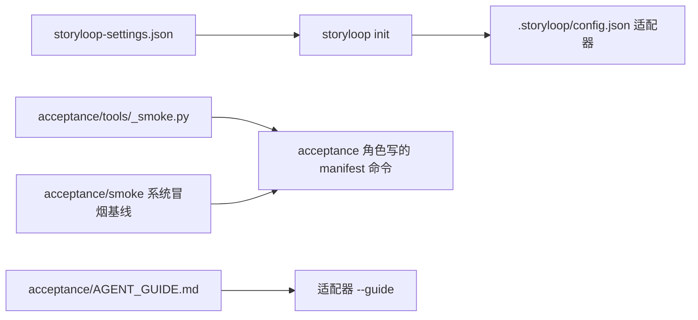

# 新底座接入手册

把一个已有仓库接进 StoryLoop 需要准备三样项目侧的东西：**settings**（告诉引擎什么能改、怎么回归）、**冒烟执行器**（把候选副本跑起来并执行用例）、**代理规范**（告诉各个角色这个仓库的约定）。引擎本身不知道你的技术栈。参考实现是 RuoYi 底座仓库 `ruoyi-platform/acceptance/`，下文以它为例。



## 1. 仓库准备

- 单一 Git 根目录，工作树干净，处在有名字的本地分支。多个上游用 `git subtree add --squash` 引进来（`backend/`、`frontend/`），上游同步就是一次 BASE 迭代。
- 能离线构建和跑测试。冒烟在候选副本里执行，环境只有 `PATH`、`SYSTEMROOT`、`TEMP`、`TMP`，依赖必须已经在本机（Maven `-o`、`node_modules` 已装）。
- 决定可变区。业务新增放哪里、哪些已有目录允许功能变更改（例如 `backend/ruoyi-modules`、`frontend/src`、`frontend/public`、`sql/biz`），其余都是底座。
- 把仓库自己会生成的被忽略文件列出来（`target`、`node_modules`、`dist`、`logs`、`__pycache__`、unplugin 生成的 `auto-imports.d.ts`），它们要进 `scratch_paths`。

## 2. settings

放在仓库里（例如 `acceptance/storyloop-settings.json`），`init --settings` 时读取：

```json
{
  "unit_commands": [["mvn", "-q", "-o", "-f", "backend/pom.xml", "-Dmaven.test.skip=false", "-DskipTests=false", "-pl", "ruoyi-admin", "-am", "test"],
                    ["{python}", "acceptance/tools/frontend_unit.py"]],
  "integration_commands": [["mvn", "-q", "-o", "-f", "backend/pom.xml", "-Dmaven.test.skip=false", "-DskipTests=false", "-DskipITs=false", "-pl", "ruoyi-modules/ruoyi-biz", "failsafe:integration-test", "failsafe:verify"]],
  "check_commands": [["mvn", "-q", "-o", "-f", "backend/pom.xml", "-pl", "ruoyi-modules/ruoyi-biz", "spotless:check"],
                     ["mvn", "-q", "-o", "-f", "backend/pom.xml", "-pl", "ruoyi-modules/ruoyi-biz", "checkstyle:check"],
                     ["{python}", "acceptance/tools/frontend_check.py"],
                     ["gitleaks", "detect", "--no-git", "--source", ".", "--config", ".gitleaks.toml", "--redact", "--exit-code", "1"]],
  "test_roots": ["backend/**/src/test/**", "frontend/src/**/*.test.ts"],
  "module_roots": ["backend/ruoyi-modules", "frontend/src", "frontend/public", "sql/biz"],
  "integration_paths": ["backend/pom.xml", "backend/ruoyi-modules/pom.xml", "frontend/package.json", "frontend/pnpm-lock.yaml"],
  "candidate_allow": ["frontend/.env.development", "frontend/.env.production"],
  "scratch_paths": ["target", "node_modules", "dist", "logs", "__pycache__", ".flattened-pom.xml",
                    "frontend/src/types/auto-imports.d.ts", "frontend/src/types/components.d.ts"]
}
```

| 字段 | 含义 | 常见错误 |
|---|---|---|
| `unit_commands` | 单元测试命令 argv（旧名 `test_commands`），`{python}` 会替换成解释器；每种语言一条，前端的 vitest 和后端一样是这一层（候选副本没有 `node_modules`，前端命令要走 scratch，参考 `frontend_unit.py`）；Windows 的 `.cmd/.bat/.ps1` 包装器不会执行 | 用 shell 字符串；依赖网络；漏掉前端 |
| `integration_commands` | 集成测试命令，与单元分开出结论；代码里也要分开放（Maven：单元 `*Test` 走 surefire，集成 `*IT` 放 `…/integration/` 包走 failsafe） | 混在一条命令里 |
| `check_commands` | 静态检查，每轮尝试在隔离候选副本里跑，因此只能放离线、确定性、几十秒内完成的工具：格式（Spotless）、编码约束（Checkstyle 或 PMD p3c）、前端 lint 与类型（oxlint / Biome、vue-tsc）、密钥扫描（gitleaks）。依赖漏洞（Trivy、OWASP Dependency-Check）和 SAST（Semgrep、CodeQL）依赖外部数据，放项目自己的 CI | 候选副本没有 `node_modules`，直接 `pnpm exec` 会失败：前端工具要先同步到 scratch 再跑（参考 `frontend_check.py`） |
| `test_roots` | 测试文件所在目录或通配；implement / characterize 可写，特征化门据此判断"只改了测试" | 没配，导致特征化门被跳过、代理加测试撞底座 |
| `module_roots` | 可变区。可以是已有代码目录；测试目录用 `test_roots` 声明，不必放进来 | 范围太窄，代理在可变区外新建文件判 `BOUNDARY_VIOLATION` |
| `integration_paths` | 构建清单，改动一律转 BASE 提案 | monorepo 里嵌套的 pom/package.json 没列 |
| `candidate_allow` | 名字敏感（`.env*`、`*.key`、`credentials.json`）但确实是已跟踪配置的文件，放进候选副本 | 把真正的密钥文件放进仓库 |
| `scratch_paths` | 代理可以就地产生的被忽略位置（目录名或相对路径） | 漏掉一个，第一次运行就 `WORKSPACE_TAINTED` |

`storyloop init PATH --settings FILE` 锁定底座（要求在仓库根目录、工作树干净、处于一个有名字的分支）。**init 之后再改底座文件**走 BASE 迭代：`storyloop base-propose PATH --path … --reason …` → 在源分支单独提交 → `storyloop base-update`。`test_roots`、`scratch_paths`、`candidate_allow` 和各层命令存在 `.storyloop/config.json` 的 `profile` 里，可以直接编辑；`module_roots`、`integration_paths` 锁在底座里，只有在没有进行中变更时才能删掉 `.storyloop` 重新 init。运行参数（`max_attempts`、`design_min_stories`、适配器等）见 [api.md 的配置一节](api.md#三配置)。

## 3. 适配器

`init` 生成的 `.storyloop/config.json` 默认 `codex`。用 Claude Code 时改成：

```json
{
  "adapter": "command",
  "agent_command": ["{python}", "/abs/path/storyloop/examples/claude-code/claude_agent.py",
                    "--bash", "mvn:*", "--bash", "pnpm:*", "--bash", "npx:*",
                    "--guide", "/abs/path/my-project/acceptance/AGENT_GUIDE.md",
                    "--implement-lanes", "backend=backend/ruoyi-modules/,frontend=frontend/src/,sql=sql/biz/"],
  "max_attempts": 4,
  "agent_timeout_seconds": 14400,
  "check_timeout_seconds": 1200,
  "design_min_stories": 2
}
```

- `--bash` 只放行构建和测试工具的前缀；不要放行 `git -C:*` 这类能绕到写操作的前缀。
- `design_min_stories`：故事数达到它才运行 design 角色（默认 2，单故事变更跳过）；全栈或跨模块变更通常故事更多，自然会触发。
- `max_attempts` 是质量预算。全栈故事通常 2 到 4 轮；`agent_timeout_seconds` 只防挂死，别用它限制代理。
- 用 `--dry-run` 看适配器实际拼出的 `claude` argv。

## 4. 验收执行器

acceptance 角色写的变更验收 manifest 命令形如：

```json
["{python}", "acceptance/tools/ruoyi_smoke.py", "acceptance/changes/<id>/test_x.py", "acceptance/changes/<id>/x.spec.ts"]
```

执行器要做的事，按顺序：

1. **从候选副本同步到 scratch**：候选副本不能写，把 Git 可见文件同步到 `/tmp/storyloop-<stack>-smoke` 之类的目录（`examples/tools/smoke_harness.py` 有 `sync` 积木，它会删除源里消失的文件）。
2. **构建**：离线，例如 `mvn -o package`。
3. **准备数据**：临时数据库（RuoYi 用 `docker exec` 建一个带时间戳的库，先导上游 SQL 再按文件名顺序导 `sql/biz/*.sql`），这要求业务 SQL 可重复执行。
4. **启动**：空闲端口、专用 profile（RuoYi 用 `dev,smoke`，smoke profile 关掉验证码和接口加密），HTTP 就绪轮询。
5. **跑用例**：Python 用例用 unittest 按路径加载，环境里给 `SMOKE_BASE_URL`；浏览器用例起前端 dev server 指向临时后端，再跑 Playwright。只跑 manifest 里列出的文件，**不要**把别处的用例（例如 `acceptance/ui/`）附加进来。项目级系统冒烟（`acceptance/smoke/manifest.json`）用同一个执行器，条目多一个 `description`。
6. **清理并映射退出码**：0 通过、1 行为失败、2 环境错误。RED 阶段只有 1 是有效红灯，环境错误会阻断而不是被当成红灯。

给 acceptance 角色一个客户端积木（RuoYi 是 `ruoyi_client.py`：登录、带 token 请求、解析 `{code,msg,data}`），用例就不会各写各的登录。

**自测**：执行器自己带一组 self-test（`selftest_backend.py`、`selftest_ui.spec.ts`），接入完成后先跑通它们，再接引擎。

## 5. 代理规范 AGENT_GUIDE.md

Claude 适配器用 `--guide` 把这份文件附到每个角色的提示里，写这些内容：

- 可变区与底座：哪些目录能改，改底座时不要动手而是在 summary/questions 里说明。
- 后端约定：一个业务表对应哪些文件、放哪个包、权限串格式、跨模块调用方式，指向仓库里的参考实现。
- 数据库与菜单：表名前缀、审计字段、菜单 SQL 模板、ID 区段、SQL 必须可重复执行。
- 前端约定：api/types/views 的位置和写法，路由由谁下发。
- 验收（acceptance 角色）：客户端积木怎么用、返回结构、manifest 命令统一形态、超时下限、`acceptance/ui/` 里的页面事实可以复用但不会跟着跑。
- 单元与集成怎么分：目录或包、命名（`*Test` / `*IT`）、各自的运行命令、默认被跳过的开关、标签要求。
- 特征化（characterize 角色）：测试放哪、怎么只锁"必须不变"的行为、扩展的列表用 contains。
- 实现（implement 角色）：可以在仓库里跑哪些编译和检查命令、哪些产物已声明为 scratch、git 只读命令要原样单条执行（`git diff` 可以，`git -C x diff`、管道都会被拒）、questions 只用于产品歧义、完成后自检清单。

规范越具体，代理提问越少。RuoYi 的版本约 70 行。

## 6. 系统冒烟基线

第一个变更 PASSED 之后：`storyloop smoke-propose --change <id>` 让 acceptance 角色从变更验收套件里挑出核心链路提议为项目级系统冒烟，草案在 `.storyloop/drafts/smoke/<id>/`；人审核后 `storyloop smoke-apply --change <id>`，引擎安装到 `acceptance/smoke/`、隔离跑绿、提交。之后每个变更合并后都可以这样并入或更新。需要浏览器用例时，在草案阶段用项目自己的工具（例如 Playwright Test Agents）生成，再审核。

## 6b. 底座摸底

接入完成、第一个变更之前先 `storyloop skills` 装技能包（走一次 BASE 迭代），再跑 `storyloop survey`，让代理写出 `openspec/foundation/` 知识库并走一次 BASE 迭代把它保护起来。人工检查产物：模块和扩展机制是否与你的理解一致、有没有把配置值抄进去（引擎会拒绝凭证样式的内容，但仍要看）。之后 `AGENT_GUIDE.md` 只保留"怎么写"的约定，"有什么、怎么扩展"交给知识库。

## 7. 接入自检清单

- [ ] `storyloop init` 后 `git status` 干净，`.storyloop/` 只在 `.git/info/exclude` 里。
- [ ] `storyloop init` 输出的 warnings 为空或已理解。
- [ ] 执行器 self-test 通过；故意改坏一个断言能得到退出码 1；停掉数据库能得到退出码 2。
- [ ] 适配器 `--dry-run` 的 argv 正确，`--guide` 文件存在。
- [ ] 所有 dev server 已停（残留的 vite 会重写 `auto-imports.d.ts` 触发 `WORKSPACE_TAINTED`）。
- [ ] `storyloop survey` 已跑、产物已审、已 `base-update`。
- [ ] 第一个变更选一个单表、无界面依赖的小功能，跑通后再做全栈故事。
- [ ] 第一个变更合并后，把运行中发现的规范缺口用一次 BASE 迭代补进 AGENT_GUIDE。

## 8. 接入过程中常见的 BASE 迭代

按 RuoYi 的经验，前几个变更之后通常会有这些底座改动，都走 `base-propose` → 提交 → `base-update`：

- 根 `.gitignore` 补上运行产生的目录（`logs/`）。
- 开发端口、profile、代理规范的修订。
- 冒烟执行器的行为修正。
- `openspec/specs/` 的补生成（`storyloop document`）。
- 上游同步（`git subtree pull --squash`，提案加 `--allow-mutable`）。

## 9. CI

引擎不写流水线；项目自己的 CI 由人通过 `storyloop base-propose --allow-ci` 纳入底座（代理永远碰不到）。RuoYi 底座的 `.github/workflows/ci.yml` 可以当模板，它和闭环里的分层一一对应，只是把离线命令换成在线命令：

| 作业 | 内容 | 对应层 |
|---|---|---|
| backend | `mvn install`（父 pom 默认跳过测试，显式打开）→ surefire 单元 → failsafe 集成 → `spotless:check` → `checkstyle:check` | 单元、集成、静态检查 |
| frontend | pnpm 安装 → `frontend_check.py --in-place`（oxlint + 只对业务文件判失败的 vue-tsc；用一次短暂的 vite 启动生成 unplugin 声明） | 静态检查 |
| security | gitleaks（docker，`.gitleaks.toml`）→ Semgrep（只扫业务目录） | 只适合 CI 的第五层 |
| backend（续） | Trivy 依赖漏洞：用刚构建好的本地 Maven 仓库离线解析依赖树；HIGH/CRITICAL 且已有修复版本的**阻断合入**，没有修复版本的只记录，结果同时上传 Security 标签页 | 依赖漏洞门 |
| smoke | `docker compose up` 起中间件 → 预热 Maven 仓库 → Playwright chromium → `run_manifest.py acceptance/smoke/manifest.json` | 系统冒烟 |
| CodeQL（单独 workflow） | 每周 + 手动，Java 与 TypeScript | 深度 SAST |

依赖漏洞的处理方式：升级走 BASE 迭代，在根 pom 的 `dependencyManagement` 开头钉修复版本（BOM 先声明者优先、显式条目优先于 BOM），上游升级后再逐条删除；确有理由不升的例外写进 `.trivyignore` 并注明原因。RuoYi 底座首次接入时 Spring Boot 4.1.0 传递引入的 netty、tomcat、httpcore5、postgresql、commons-beanutils 共 16 个组件有修复版本，一次 BASE 迭代全部钉平。

`storyloop ci` 依赖本地控制面（`.storyloop/state/suites/` 的保护摘要），在 CI 机器上没有；所以 CI 直接用 `acceptance/tools/run_manifest.py` 执行受保护的清单文件，效果相同但不做字节指纹校验（指纹校验由闭环在合并前完成）。变更验收套件（`acceptance/changes/<id>/manifest.json`）也可以用同一个脚本按需在 CI 里跑。
