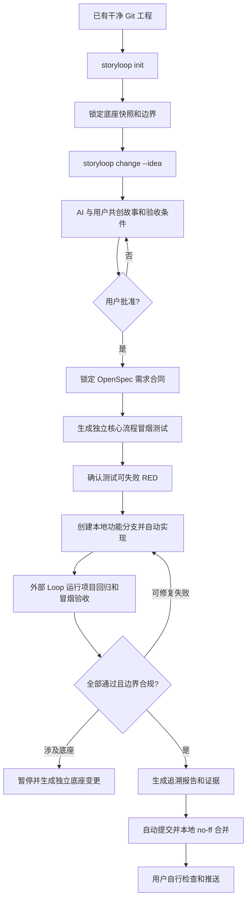
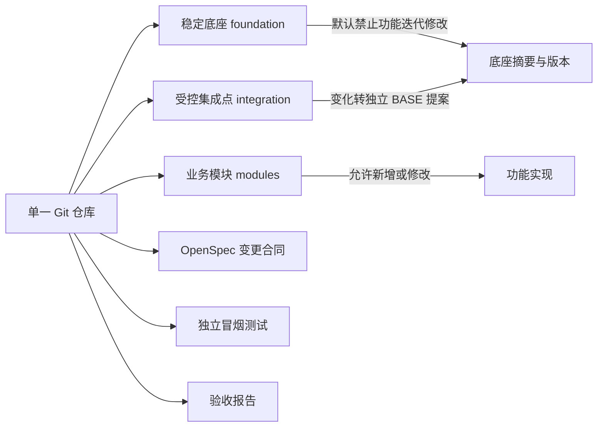

# StoryLoop 产品迭代闭环设计

日期：2026-09-16  
状态：已确认

## 1. 目标

StoryLoop 面向已有、干净的 Git 工程提供一个通用的外部研发闭环。使用者只需要与 AI 共创产品层面的用户故事和验收用例，并在最终审核后批准；批准后的实现、验证、证据收集、报告生成和本地合并由 Loop 自动完成。

系统必须满足以下约束：

- 不要求使用者编写技术设计、任务拆分或详细实现文档。
- 使用 OpenSpec 风格的变更目录管理每次业务迭代。
- 验收测试由工程外部的 StoryLoop 控制，业务实现不能自行宣布通过。
- 同一 Git 仓库内明确区分稳定底座、业务扩展模块和少量受控集成点。
- 底座变更必须独立建项、独立审核、执行完整回归并产生新底座版本。
- 冒烟测试提供独立命令，不创建或覆盖 GitHub Actions、GitLab CI、Jenkins 文件。
- StoryLoop 控制器只操作本地 Git：功能分支、自动提交、通过后 `--no-ff` 合并；控制器不调用 push。自定义原生进程需由外部无网络/无凭证沙箱提供更强隔离。
- 验收报告必须建立需求、用户故事、验收条件、测试、执行结果、证据和代码提交之间的映射。

## 2. 用户工作流



## 3. 单仓库分层模型

底座不是另一个仓库，而是初始化时当前 Git 提交及其受保护文件摘要构成的逻辑基线。



初始化时记录：

- 基准提交、默认分支、底座版本。
- 已跟踪文件的 SHA-256 摘要。
- 底座保护路径。
- 允许业务扩展的模块根目录。
- 识别构建清单、模块注册表等集成点；它们属于独立底座版本边界。
- 通用工程探测得到的构建、回归和冒烟命令。

功能实现代理只能修改模块区；当前 OpenSpec、冒烟测试和报告由外部 Loop 自己生成。若需要修改底座保护路径或声明过的集成点，Loop 不会偷偷放行，而是生成一个 `BASE-*` 变更建议并暂停当前功能迭代。独立提交通过完整回归后，再由 `base-update` 提升底座版本。

## 4. 仓库内产物

```text
<project>/
├─ .storyloop/
│  ├─ config.json
│  ├─ baseline.json
│  └─ state/
├─ openspec/
│  └─ changes/<change-id>/
│     ├─ proposal.md
│     ├─ stories.json
│     ├─ acceptance.json
│     ├─ traceability.json
│     └─ approval.json
├─ acceptance/
│  └─ smoke/<change-id>/
│     ├─ manifest.json
│     └─ ...生成的测试文件
└─ reports/
   └─ storyloop/<change-id>/
      ├─ report.json
      └─ report.md
```

`.storyloop` 是控制面；`openspec` 是经批准的需求合同；`acceptance/smoke` 是由外部 Loop 管理的黑盒/核心流程测试；`reports` 是可审计结果。

## 5. 产品需求共创与审批

变更草案只要求用户输入一句产品意图。产品代理输出结构化内容：

- 产品目标和非目标。
- 一条或多条用户故事。
- 每条故事的可观察验收条件（Given/When/Then 或同等结构）。
- 核心流程、异常流程和明确排除项。
- 仍需用户决策的问题。

用户可以重复对话修改草案。只有明确执行批准命令后，Loop 才计算审批摘要并锁定合同。批准后若故事或验收条件发生变化，原批准立即失效，必须再次审批。

## 6. 独立冒烟验收

冒烟测试不是单元测试替代品，也不接管 CI 配置。它是一个稳定入口：

```powershell
storyloop ci C:\path\to\project --change FEAT-20260916-001
```

CI 平台只需调用该命令。StoryLoop 不创建或覆盖以下文件：

- `.github/workflows/*`
- `.gitlab-ci.yml`
- `Jenkinsfile`
- 其他现有流水线配置

冒烟清单声明每个验收条件对应的测试 ID、命令、超时和证据文件。命令以参数数组执行，禁止 shell 拼接。生成测试后必须先证明测试能够因功能缺失而失败；无法形成有效 RED 的测试不得进入自动实现阶段。

## 7. 自动执行与停止条件

需求合同批准后，Loop 自动完成：

1. 锁定故事、验收条件和摘要。
2. 生成并校验核心流程冒烟测试。
3. 从原分支建立 `feature/<change-id>` 本地分支。
4. 调用实现代理在允许路径内迭代。
5. 运行项目自身回归测试和独立冒烟测试。
6. 对普通失败自动反馈并重试。
7. 运行独立审查，验证边界、需求覆盖和证据真实性。
8. 生成 JSON 和 Markdown 报告。
9. 自动提交；全部通过时切回原分支并执行本地 `--no-ff` 合并。

只有以下情况暂停等待人工处理：

- 发现必须修改底座。
- 已批准需求之间存在不可消解的冲突。
- 操作越过安全边界或需要新的外部权限。
- 达到配置的迭代预算仍无法通过。
- 验收条件明确标记为人工验收。

## 8. Git 安全策略

- 初始化和运行前必须是干净工作树。
- 不执行 `push`、不删除分支、不改写历史。
- 所有 Git 调用使用参数数组，不经过 shell。
- 自动提交禁用 Git hooks，避免执行未知仓库脚本。
- 合并前再次验证分支、工作树、测试证据和底座边界。
- 失败时保留功能分支、状态和报告，便于人工检查与继续。

## 9. 可追溯报告

每条最终记录必须包含：

| 层级 | 必填字段 |
|---|---|
| 需求 | change ID、标题、审批摘要 |
| 用户故事 | story ID、角色、目标、价值 |
| 验收条件 | criterion ID、可观察断言 |
| 测试 | test ID、测试文件、执行命令 |
| 结果 | 状态、退出码、开始/结束时间 |
| 证据 | 日志摘要、报告文件 SHA-256 |
| 实现 | 功能提交 SHA、合并提交 SHA（合并后补写） |

最终判定只由外部 Loop 根据实际执行结果产生。代理输出的“已完成”不能替代测试证据。

## 10. 通用工程适配

默认通过常见清单探测 Maven、Gradle、npm/pnpm/yarn、Python 等工程，但不会假设特定语言。探测结果写入配置，用户可显式覆盖。未知工程仍可使用，只需提供参数数组形式的回归命令和冒烟命令。

通用模式优先提供小而稳定的协议，不内置庞大的语言模板：

- 工程测试命令返回进程退出码。
- 冒烟测试遵守 manifest 协议。
- 代理只写允许路径。
- 所有证据使用文件摘要验证。

## 11. 成功标准

- 在一个已有干净 Git 工程中，一条初始化命令即可产生可检查的底座清单。
- 一句产品意图可以形成可反复修改、最终由用户批准的故事和验收条件。
- 批准后无需用户继续输入即可完成或明确暂停在有限的人工决策点。
- 现有 CI 文件保持字节级不变。
- 功能迭代不能静默修改底座。
- 每个通过的验收条件都能追溯到真实执行命令、退出码、证据摘要和实现提交。
- 全部通过后只在本地完成 `--no-ff` 合并，远端状态不发生变化。
