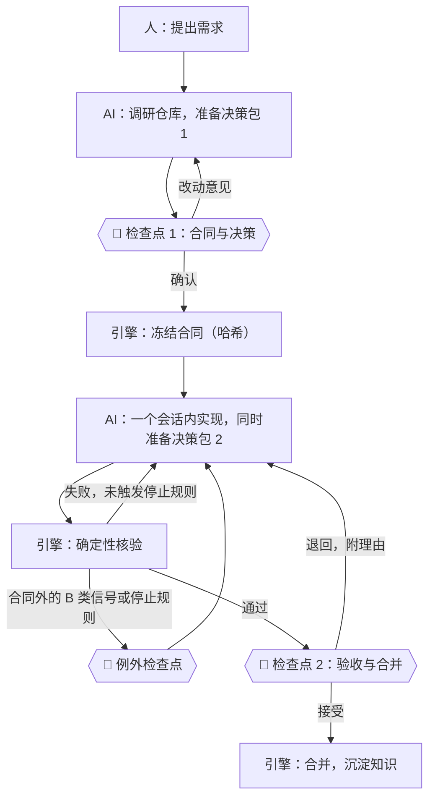

# 流程重新设计：AI 准备，人决策，引擎核验

状态：设计稿，待人审。依据是 `docs/validation/2026-11-22-对照实验结果.md`，参考了 HelixHarness 和 SuperAgent 的做法。

## 为什么要重新设计

对照实验表明：在需求清楚的中小改动上，直接用 Claude Code 和用 StoryLoop 的正确率持平，而 StoryLoop 贵 17～31 倍。成本来自设计、刻画、先写验收测试、多视角审查这些"用 AI 管 AI 干活方式"的角色。这些角色没有拦下过 C 组会犯的错，反而制造了 ORACLE_DEFECT、方案修订这类新的停点。

但实验没有测到人的判断。需求都很清楚，人的答案也是事先冻结的。重新设计的前提是：**有些判断 AI 干不好，必须由人的检查点来区分。**

## 三条原则

1. **AI 干不好的判断交给人，其余交给 AI。** 每个人的检查点都要说得出它在防哪一类 AI 失误。
2. **能由 AI 和人协作的，AI 先把资料准备好，人只做决策。** AI 快，人的精力有限。设计的优化目标是**每个决策花掉的人的分钟数**，不是检查点的数量。
3. **AI 的产出不由 AI 判定，由引擎用确定性检查核验。** 代理的自报不算证据。

## AI 干不好的判断

| 类别 | 例子 | 证据 | 归属 |
|---|---|---|---|
| A. 意图、范围、非目标 | 要不要顺带支持某个参数 | 仓库里没有这些信息，AI 只能猜 | 人决策，AI 准备选项 |
| B. 带隐藏约束的取舍 | 已有数据或状态是否兼容、公开行为是否改变、安全、不可逆的迁移 | dogfood6 v2.2 里，设计角色选了不兼容已保存停点的方案 | 人决策，AI 准备影响分析 |
| C. 判断自己做得对不对 | 声称测试全绿 | C 组 dogfood6 测试没跑完就结束了 | 引擎核验，人看证据 |
| D. 知道什么时候该停 | replan 和修复之间来回打转 | S 组 dogfood3 花了 $49.6 | 引擎按规则停，人决策 |
| E. 无法自动判定的验收 | 文档、措辞、体验 | sqlite 两例的 MANUAL_ACCEPTANCE | 人决策，AI 准备好要看的东西 |
| F. 对外、不可逆的动作 | 合并、发布、删除 | 授权问题 | 人决策 |

其余工作（读代码、选实现方法、写测试、跑测试、修失败）由 AI 在一个会话里完成，不规定方法，也不拆角色。

## 流程

## 决策包：AI 为人准备什么

每个检查点给人的是一个**决策包**，不是一份文档。决策包里的每一项都要能让人直接选，不需要人再去查代码或跑命令。

### 决策卡（所有检查点通用）

| 字段 | 内容 |
|---|---|
| 问题 | 一句话 |
| 为什么需要人 | 属于 A～F 中的哪一类 |
| 选项 | 2～4 个，每个都写出对行为、已有数据、兼容性、成本的影响 |
| 推荐 | 推荐哪一个，以及理由 |
| 证据 | 代码位置、现有测试、相关的历史决策 |
| 不决策的后果 | 默认走哪个选项 |

人的操作只有三种：选一个选项、改写、退回并附理由。

### 决策包 1：合同与决策

1. 需求复述，加非目标。
2. 验收条件。每条写明验证命令，并标出是自动核验还是需要人看。
3. 决策卡，覆盖所有 A、B 类问题。B 类问题由引擎按风险信号**强制**列出（是否有已保存的数据或状态、是否改动公开接口或输出格式、是否涉及安全或迁移），不由 AI 自己决定提不提。
4. AI 做出的假设。每条附上证据，人可以逐条推翻。
5. 影响扫描：预计会改动哪些文件、公开接口和已有数据，由引擎根据仓库结构计算。

### 决策包 2：验收与合并

1. 证据表：每条验收条件对应引擎实际执行的命令和结果。
2. 合同中的每项决策是否被遵守，以及对应在哪里。
3. AI 偏离或补充了什么，并说明理由。
4. 按意图分组的改动摘要。
5. 需要人看的条目。AI 要把要看的东西直接准备好：渲染后的文档片段、命令的样例输出、截图、改动前后的对照。人不需要自己跑。
6. 风险提示，以及推荐接受还是退回。

决策包 2 在 AI 实现的过程中就同步准备，人不用等。

### 例外决策包

写明：发生了什么、试过哪些方法、为什么停下（命中了哪条停止规则或哪个 B 类信号），再给出选项（附提示后继续、修改合同、放弃）和推荐。

## 引擎的确定性核验

- 在干净的工作区里跑验收命令和全量测试。
- 范围检查：是否修改了冻结的验收测试、是否删除或改动了已有测试、是否动了公开接口、schema 或迁移文件。命中后面三项，就进入例外检查点。
- 停止规则：
  - 同一失败连续 2 轮修不掉；
  - 达到轮次上限；
  - 达到花费上限。
- 审查默认不开。只有命中安全或数据风险时，才开一个审查者，用另一家厂商的模型。它的意见只作参考，只有附带可复现证据的问题才阻断。

## 与现有流程的对照

| 现有 | 新流程 |
|---|---|
| product 角色起草合同，人批准 | 保留，改为产出决策包 1 |
| design 角色，人批准方案 | 去掉。其中的取舍并入决策包 1 的决策卡 |
| characterize | 去掉 |
| acceptance 角色先写验收测试（RED） | 去掉单独的角色。验收条件和验证命令在合同里冻结，测试由实现会话来写，引擎负责核验 |
| implement | 保留，改为一个会话完成全部实现和修复 |
| 多视角审查 | 默认去掉，只在命中风险时开一个不同厂商的审查者 |
| light/standard/heavy 三档 | 去掉，流程本来就薄 |
| 引擎：合同冻结、验证执行器、停止点、触达账 | 保留并复用 |

预计成本：C 组的成本，加上一次准备决策包的调用，每个变更约 $1～4。

## 衡量指标

| 指标 | 含义 |
|---|---|
| 正确率 | 隐藏 Gold 是否通过 |
| 每个决策花掉的人的分钟数 | 决策包准备得好不好 |
| 决策改变结果的比例 | 人的检查点有没有起作用：人的选择和 AI 推荐不一致、且影响 Gold 的比例 |
| 推荐被采纳率 | 太低说明 AI 准备得不好，接近 100% 说明这个检查点也许可以去掉 |
| 费用、墙钟 | 与 C 组比较 |

## 验证实验

专门选 AI 容易做错 A、B 类判断的样本：

- **样本来源**：上游开源项目中维护者在评审时要求改变行为的 PR，以及类似 dogfood6、涉及已有状态的需求。
- **两组**：
  - C 组：直接用 Claude，不能问人；
  - 新流程：由真人在检查点上做决策，并记录花了多少分钟。
- **Gold**：最终合并的版本。

## 待人确认

1. A～F 这份"AI 干不好"的清单是否要增减。
2. 检查点的形态：固定 2 个，加按需的例外检查点。
3. 是否接受去掉 design、characterize、单独的验收先行角色、多视角审查和三档分级。
