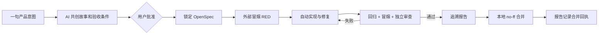

# StoryLoop 通用工程迭代使用指南

## 1. 适用场景

该模式用于一个已经存在、工作树干净的 Git 仓库。底座、业务模块、OpenSpec、冒烟测试和报告都在同一仓库中；StoryLoop 只在逻辑上锁定底座，不要求拆成多个仓库。

StoryLoop 不会推送远端、不部署，也不会创建或覆盖 GitHub Actions、GitLab CI、Jenkins 等流水线文件。

## 2. 一次初始化

```powershell
storyloop init C:\work\my-project
```

初始化要求：

- 路径是 Git 仓库根目录。
- 当前位于有名称的本地分支。
- 已跟踪和未跟踪文件都为空，即工作树干净。

命令会在仓库根目录和一级子目录（monorepo 的 `backend/`、`frontend/` 等）探测 Maven、Gradle、Node、Python 等常见工程，子目录的回归命令自动带上 `-f sub/pom.xml`、`--dir sub` 等参数，记录当前提交、已跟踪文件 SHA-256、模块根目录、构建集成点和回归命令。`.storyloop/` 写入 `.git/info/exclude`，所以本地控制状态不会污染业务提交。

默认业务扩展目录是 `modules/` 和 `features/`。初始化时已跟踪文件均属于稳定底座；常见构建清单（如 `pom.xml`、`build.gradle`、`package.json`、`pyproject.toml`）会被识别为集成点，但任何修改都会转入独立底座迭代，避免功能代理整体改写工程入口。

Windows 上 `.cmd`、`.bat`、`.ps1` 包装器不会被自动执行；对应回归命令会显示 warning，并在报告中明确标记为 `SKIPPED`。如需指定安全的原生可执行程序或显式解释器 argv，可准备：

```json
{"test_commands":[["{python}","-m","unittest","discover"]],"module_roots":["modules","features"],"integration_paths":["pyproject.toml"],"candidate_allow":["frontend/.env.production"]}
```

`scratch_paths` 列出代理可以在工作区里产生的被忽略位置（目录名或相对路径，如 `target`、`node_modules`、`dist`、`__pycache__`），用于就地构建和测试；未列出的被忽略文件一旦出现即判 `WORKSPACE_TAINTED`。只读的 `git status`/`git diff` 造成的 `.git/index` 刷新总是被容忍，任何暂存、提交或切换分支都会被检测。

`candidate_allow` 列出名字看起来敏感（`.env*`、`*.key`、`*.pem`、`credentials.json`、`secrets.yaml`）但确实是已跟踪配置的文件；未列出的这类文件不会进入冒烟和回归的隔离候选副本。

然后一次初始化：

```powershell
storyloop init C:\work\my-project --settings C:\work\storyloop-settings.json
```

## 3. 用一句话创建产品变更

```powershell
storyloop change C:\work\my-project --idea "增加订单取消功能，已发货订单不能取消"
```

AI 返回产品目标、非目标、用户故事、业务规则、Given/When/Then 验收条件和待决问题。草案位于：

```text
.storyloop/drafts/<change-id>/
```

该目录是本地控制面，不进入 Git。先审核：

- `proposal.md`
- `stories.json`
- `acceptance.json`
- `traceability.json`

需要调整时继续共创，change ID 保持不变：

```powershell
storyloop change C:\work\my-project `
  --change FEAT-20260916-001 `
  --message "取消原因必须填写，管理员也不能取消已发货订单"
```

只要还有未决问题，就不能批准。

### 合同的结构与澄清方式

产品合同沿用 spec-kit 的结构：故事带优先级 P1/P2/P3 和"独立验证方式"，规则用 EARS 句式（WHEN 触发 THE SYSTEM SHALL 行为），验收条件是 Given/When/Then，按 Gherkin 纪律一条一个可观察行为。合同规模跟着请求走：小改动只有一两个故事。

未决的产品歧义以选择题形式提出：每轮最多 5 个，每个 2 到 5 个互斥选项、一个推荐项和一句"为什么重要"。在终端里执行 `change` 时会逐条提问（回车选推荐项，输入序号或自由文本，`q` 结束本轮），回答立即触发一次修订，代理据此改写规则和验收条件，回答本身进入合同的 `clarifications`（按会话日期记录，之后的修订不会丢失），并出现在 proposal.md 的"澄清记录"里。任何回答都会改变合同摘要，因此旧批准自动失效。`--no-interactive` 或无终端时问题保持开放，用 `change --message` 回答。

## 4. 批准后自动完成

```powershell
storyloop approve C:\work\my-project --change FEAT-20260916-001
```

批准是唯一的人工闸门。执行后 StoryLoop 自动：

1. 锁定产品合同摘要。
2. 建立 `feature/<change-id>` 本地分支。
3. 将批准合同物化到 `openspec/changes/<change-id>/`。
4. 生成 `acceptance/smoke/<change-id>/` 核心流程测试。
5. 先证明测试因功能缺失而失败（RED）。
6. 调用实现代理，运行项目回归和外部冒烟测试，失败则自动重试。
7. 审计底座、模块、集成点、测试和 CI 边界；集成点变化转为底座提案。
8. 进行独立审查。
9. 生成 `reports/storyloop/<change-id>/report.json` 和 `report.md`。
10. 自动提交，并切回原分支执行本地 `--no-ff` 合并。
11. 将合并提交写回验收报告，提交合并回执并推进基线血缘；中断后可幂等恢复。

StoryLoop 控制器本身不执行 `git push`。



## 5. 在现有 CI 中调用

StoryLoop 只提供一个独立冒烟入口：

```powershell
storyloop ci C:\work\my-project --change FEAT-20260916-001
```

在任何 CI 平台中添加一个普通命令步骤即可。StoryLoop 不会修改以下内容：

- `.github/workflows/*`
- `.gitlab-ci.yml`
- `Jenkinsfile`
- `.circleci/config.yml`
- `azure-pipelines.yml`

命令退出码为 `0` 时冒烟通过；失败、环境错误、超时、测试篡改或缺少证据时返回 `2`。执行使用由 Git 可见且未被忽略的文件构成的隔离副本，测试对候选代码的任何写入都会被视为污染，不能通过“先改实现再断言”的方式制造假绿。

## 5b. 每个变更留下的文档（OpenSpec 格式）

- `openspec/changes/<id>/proposal.md`：目标、非目标、用户故事（优先级、独立验证）、澄清记录、待决问题。
- `openspec/changes/<id>/specs/<capability>/spec.md`：批准时生成的增量规格，OpenSpec 格式（`## ADDED/MODIFIED Requirements`，每个故事一个 `### Requirement`，规则为 SHALL 语句，每条验收条件一个 `#### Scenario` 带 GIVEN/WHEN/THEN）。它随合同一起提交并受保护。
- `openspec/changes/<id>/design.md`：实现代理完工时写的方案记录（Context、Goals、Decisions 含备选方案、Risks、Files），随报告一起提交。
- `openspec/changes/<id>/decisions.md`：引擎生成的人为决策归档：产品修订消息、澄清回答、代理提问的回答、人工验收备注、复位记录。
- `openspec/specs/<capability>/spec.md`：活规格。完成时引擎把增量并入（新增追加、同名需求替换并标注来源变更），格式与 `openspec archive` 的产物一致，`openspec list --specs`、`openspec validate` 可直接使用。变更目录不会被移动到 archive，因为它是受保护的合同与追溯锚点。

### 规格的一致性：三道门与两条出路

- **需求质量门**（批准时）：引擎按 spec-kit 的 checklist 思路对合同做确定性检查，结果写入 `openspec/changes/<id>/checklist.md`（`- [x]` 自动通过，`- [ ]` 需要人判断）。阻断项（未解决的 `[NEEDS CLARIFICATION]`、没有验收条件的故事、未回答的问题）会让 `approve` 拒绝；警告项（缺优先级、缺独立验证方式、规则不是 SHALL 语句、结果含"适当/尽快"之类含糊词、只有单一场景、只有人工条件）记录在案，由批准者权衡。
- **OpenSpec 结构门**（运行时）：装了 `openspec` CLI 时，合同物化后校验增量规格，完成时校验并入后的活规格，不通过就停下不提交；没装则跳过并在运行状态里记为 skipped。
- **取代记录**（完成时）：一个变更修改既有需求（同标题）时，增量规格里的 Scenario 名固定为验收条件 ID，新块没有重述的旧 Scenario 由引擎原样带过来并标注来源；被重述的旧 Scenario 在旧变更的 traceability.json 里记 `superseded_by`，它们的冒烟用例不再代表当前行为。

事后发现规格与代码不一致只有两条出路，引擎不会自动改规格去迁就代码：代码错了，开一个功能变更修；规格过时了，开一个文档型底座变更（`storyloop document` 重新生成后走 `base-propose` / `base-update`）。

### 5c. 实现后的 UI 回归资产（可选）

Playwright Test Agents 这类"对着运行中的应用探索并生成用例"的工具，产出的用例第一次执行必然通过，因此不能作为验收证据；它们的位置是回归资产和页面行为的活文档。引擎提供一个通用挂点：

```json
"ui_regression": {"command": ["{python}", "acceptance/tools/ui_regression.py"], "timeout_seconds": 3600}
```

审查通过、实现提交之后，引擎以只读调用运行该命令（stdin 为 `storyloop.ui-regression.v1` 请求：变更、能力、suite_root、故事），命令返回 `{files:[{path,content}]}`，引擎把文件写到 `acceptance/ui/<capability>/` 并与报告一起提交。命令内部怎么起应用、怎么驱动 planner/generator/healer 由项目自定；命令本身不得改动工作区。未配置时跳过。

约束：healer 只能修 `acceptance/ui/` 下的回归用例，绝不能碰 `acceptance/smoke/` 里的合同用例；冒烟角色会把 `acceptance/ui/` 里已验证的页面事实（定位器、文案、流程）当作盲写时的素材。

## 6. 查看状态与报告

```powershell
storyloop status C:\work\my-project --change FEAT-20260916-001 --json
storyloop report C:\work\my-project --change FEAT-20260916-001
```

报告的每条记录包含：

```text
需求 → 用户故事 → 验收条件 → 冒烟测试 → 实际命令 → 退出码 → 证据 SHA-256 → 实现提交 → 合并提交
```

任何验收条件没有真实通过证据，报告都不能标记为 `PASSED`。

## 7. 底座变更如何处理

普通功能迭代修改初始化时的底座文件会暂停为 `BASE_CHANGE_REQUIRED`，并在 `.storyloop/base-proposals/` 生成独立 `BASE-*` 提案。它不会自动把底座路径放宽成业务路径。

底座变更应独立审核、跑完整回归并提升底座版本；处理完成后再回到原功能变更。CI 文件始终受保护，即使它在底座文件中也不会被普通功能代理修改。

计划中的底座改动（升级上游、改构建配置、改代理规范等）不需要先让功能变更撞上边界，直接开提案：

```powershell
storyloop base-propose C:\work\my-project --path pom.xml --path docs/guide.md --reason "升级依赖"
```

上游同步（如 `git subtree pull --squash`）会同时改动可变区里的上游文件，提案加 `--allow-mutable`，这些路径记为 `UPSTREAM_MUTABLE`；路径列表用同步前后的 `git diff --name-only` 得到。

在原分支独立实现并提交提案中的底座路径，确认工作树干净后执行：

```powershell
storyloop base-update C:\work\my-project --proposal BASE-20260916-001
```

该命令要求实际提交路径与提案完全一致、原底座提交仍是祖先、至少一个回归命令真实通过，并把底座补丁版本加一。StoryLoop 不会自动丢弃或搬移功能分支上的未提交内容；这一步由用户按团队 Git 流程处理。

## 8. 适配器

默认使用本机已安装并登录的 Codex CLI，不保存 API 密钥。Codex 会话持久化在本机（不再 `--ephemeral`），代理以非 JSON 文本结束时引擎用 `codex exec resume` 在同一会话里让它补出 JSON，最多两次；token 用量从事件流记入成本账本（Codex 不报告金额）。`.storyloop/config.json` 也支持：

- `command`：以 argv 数组启动可信本地代理，stdin 输入请求 JSON，stdout 返回一个 JSON。`examples/claude-code/` 提供驱动 Claude Code 的现成适配器，`examples/tools/scratch_build.py` 让实现代理在临时目录构建而不污染工作区。
- `manual`：请求写入 `.storyloop/requests/`，将匹配 `request_id` 的结果写到 `.storyloop/responses/` 后重跑原命令。

实现代理具有仓库写权限，但外部 Loop 会在每次尝试后重新检查 Git 变化和保护摘要；代理自己的“已完成”声明不构成验收证据。

`command` 适配器和项目回归命令是当前用户权限下的原生进程，必须来自可信来源。StoryLoop 可检测本地文件与 Git 状态变化，但不能替代操作系统级网络隔离；如需证明进程无法访问远端，请在无网络且不挂载 SSH/API 凭证的容器或 CI 沙箱中运行。

每次代理调用的墙钟时间都会记录；适配器若在结果里附带 `_telemetry`（费用、轮数、时长、token、模型，`examples/claude-code` 已实现），引擎会剥离并一起记录到 `.storyloop/state/telemetry/<change-id>.json`。验收报告的『成本与耗时』一节汇总每个角色的调用次数、轮数、耗时和费用，以及闭环墙钟和实现尝试轮数；`status --json` 的 `telemetry` 字段给出同样的数据。

预算的含义：`max_attempts` 是唯一的质量预算，连续几轮完整尝试都过不了验收就停下来交给人；`agent_timeout_seconds` 只是进程挂死保护（默认 4 小时），不是用来判断代理能不能做完的；适配器内部的圈数上限是检查点，到上限续同一会话而不是失败。

## 9. 明确停止点

只有以下情况需要人工介入：

- `BASE_CHANGE_REQUIRED`：功能依赖底座修改。
- `NEEDS_INPUT`：已批准合同仍出现真实产品歧义。在终端里执行 `run` 或 `approve` 时会直接逐条提问并继续（回车表示让代理按现有约定自行决定）；非交互环境用 `storyloop answer PATH --change ID --answer "…"`。回答按尝试号记录在 `.storyloop/state/answers/`，随后的实现和审查都能看到问答配对；问题未回答前 `run` 拒绝续跑，`--no-interactive` 可关闭终端提问。
- `WORKSPACE_TAINTED`：代理或其他进程在工作区里产生了不该有的改动（未声明的被忽略文件、暂存、控制面文件）。这是终态：人先判断原因（常见：残留的 dev server、未声明的构建目录），处理后执行 `storyloop reset PATH --change ID --reason "…"` 再 `storyloop run`。复位不动任何文件，被中断的那一轮不计入尝试预算，理由写入运行状态。
- `MANUAL_ACCEPTANCE_REQUIRED`：自动验收、回归和独立审查都已通过，但合同里有 `manual` 验收条件。此时功能分支上的代码就是待验收版本；逐条执行 `storyloop accept PATH --change ID --criterion A2 --note "看到了什么"`，再 `storyloop run PATH --change ID` 生成报告并合并。验收记录与当时的代码指纹绑定，代码一变就失效。
- `BOUNDARY_VIOLATION`：代理写到了未授权路径。
- `BUDGET_EXHAUSTED`：达到自动尝试上限。
- 存在 `manual` 验收条件：必须提供真实人工证据，不能由 AI 代签。

失败时功能分支和本地状态保留，StoryLoop 不删除分支、不重写历史、不丢弃用户文件。
