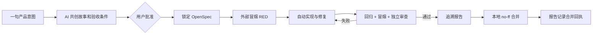

# StoryLoop 通用工程迭代使用指南

## 1. 适用场景

该模式用于一个已经存在、工作树干净的 Git 仓库。底座、业务模块、OpenSpec、冒烟测试和报告都在同一仓库中；StoryLoop 只在逻辑上锁定底座，不要求拆成多个仓库。

StoryLoop 不会推送远端、不部署，也不会创建或覆盖 GitHub Actions、GitLab CI、Jenkins 等流水线文件。

## 2. 一次初始化

```powershell
storyloop init C:\work\my-project
```

初始化要求：

- 路径是 Git 仓库根目录。
- 当前位于有名称的本地分支。
- 已跟踪和未跟踪文件都为空，即工作树干净。

命令会探测 Maven、Gradle、Node、Python 等常见工程，记录当前提交、已跟踪文件 SHA-256、模块根目录、构建集成点和回归命令。`.storyloop/` 写入 `.git/info/exclude`，所以本地控制状态不会污染业务提交。

默认业务扩展目录是 `modules/` 和 `features/`。初始化时已跟踪文件均属于稳定底座；常见构建清单（如 `pom.xml`、`build.gradle`、`package.json`、`pyproject.toml`）会被识别为集成点，但任何修改都会转入独立底座迭代，避免功能代理整体改写工程入口。

Windows 上 `.cmd`、`.bat`、`.ps1` 包装器不会被自动执行；对应回归命令会显示 warning，并在报告中明确标记为 `SKIPPED`。如需指定安全的原生可执行程序或显式解释器 argv，可准备：

```json
{"test_commands":[["{python}","-m","unittest","discover"]],"module_roots":["modules","features"],"integration_paths":["pyproject.toml"]}
```

然后一次初始化：

```powershell
storyloop init C:\work\my-project --settings C:\work\storyloop-settings.json
```

## 3. 用一句话创建产品变更

```powershell
storyloop change C:\work\my-project --idea "增加订单取消功能，已发货订单不能取消"
```

AI 返回产品目标、非目标、用户故事、业务规则、Given/When/Then 验收条件和待决问题。草案位于：

```text
.storyloop/drafts/<change-id>/
```

该目录是本地控制面，不进入 Git。先审核：

- `proposal.md`
- `stories.json`
- `acceptance.json`
- `traceability.json`

需要调整时继续共创，change ID 保持不变：

```powershell
storyloop change C:\work\my-project `
  --change FEAT-20260916-001 `
  --message "取消原因必须填写，管理员也不能取消已发货订单"
```

只要还有未决问题，就不能批准。

## 4. 批准后自动完成

```powershell
storyloop approve C:\work\my-project --change FEAT-20260916-001
```

批准是唯一的人工闸门。执行后 StoryLoop 自动：

1. 锁定产品合同摘要。
2. 建立 `feature/<change-id>` 本地分支。
3. 将批准合同物化到 `openspec/changes/<change-id>/`。
4. 生成 `acceptance/smoke/<change-id>/` 核心流程测试。
5. 先证明测试因功能缺失而失败（RED）。
6. 调用实现代理，运行项目回归和外部冒烟测试，失败则自动重试。
7. 审计底座、模块、集成点、测试和 CI 边界；集成点变化转为底座提案。
8. 进行独立审查。
9. 生成 `reports/storyloop/<change-id>/report.json` 和 `report.md`。
10. 自动提交，并切回原分支执行本地 `--no-ff` 合并。
11. 将合并提交写回验收报告，提交合并回执并推进基线血缘；中断后可幂等恢复。

StoryLoop 控制器本身不执行 `git push`。



## 5. 在现有 CI 中调用

StoryLoop 只提供一个独立冒烟入口：

```powershell
storyloop ci C:\work\my-project --change FEAT-20260916-001
```

在任何 CI 平台中添加一个普通命令步骤即可。StoryLoop 不会修改以下内容：

- `.github/workflows/*`
- `.gitlab-ci.yml`
- `Jenkinsfile`
- `.circleci/config.yml`
- `azure-pipelines.yml`

命令退出码为 `0` 时冒烟通过；失败、环境错误、超时、测试篡改或缺少证据时返回 `2`。执行使用由 Git 可见且未被忽略的文件构成的隔离副本，测试对候选代码的任何写入都会被视为污染，不能通过“先改实现再断言”的方式制造假绿。

## 6. 查看状态与报告

```powershell
storyloop status C:\work\my-project --change FEAT-20260916-001 --json
storyloop report C:\work\my-project --change FEAT-20260916-001
```

报告的每条记录包含：

```text
需求 → 用户故事 → 验收条件 → 冒烟测试 → 实际命令 → 退出码 → 证据 SHA-256 → 实现提交 → 合并提交
```

任何验收条件没有真实通过证据，报告都不能标记为 `PASSED`。

## 7. 底座变更如何处理

普通功能迭代修改初始化时的底座文件会暂停为 `BASE_CHANGE_REQUIRED`，并在 `.storyloop/base-proposals/` 生成独立 `BASE-*` 提案。它不会自动把底座路径放宽成业务路径。

底座变更应独立审核、跑完整回归并提升底座版本；处理完成后再回到原功能变更。CI 文件始终受保护，即使它在底座文件中也不会被普通功能代理修改。

在原分支独立实现并提交提案中的底座路径，确认工作树干净后执行：

```powershell
storyloop base-update C:\work\my-project --proposal BASE-20260916-001
```

该命令要求实际提交路径与提案完全一致、原底座提交仍是祖先、至少一个回归命令真实通过，并把底座补丁版本加一。StoryLoop 不会自动丢弃或搬移功能分支上的未提交内容；这一步由用户按团队 Git 流程处理。

## 8. 适配器

默认使用本机已安装并登录的 Codex CLI，不保存 API 密钥。`.storyloop/config.json` 也支持：

- `command`：以 argv 数组启动可信本地代理，stdin 输入请求 JSON，stdout 返回一个 JSON。
- `manual`：请求写入 `.storyloop/requests/`，将匹配 `request_id` 的结果写到 `.storyloop/responses/` 后重跑原命令。

实现代理具有仓库写权限，但外部 Loop 会在每次尝试后重新检查 Git 变化和保护摘要；代理自己的“已完成”声明不构成验收证据。

`command` 适配器和项目回归命令是当前用户权限下的原生进程，必须来自可信来源。StoryLoop 可检测本地文件与 Git 状态变化，但不能替代操作系统级网络隔离；如需证明进程无法访问远端，请在无网络且不挂载 SSH/API 凭证的容器或 CI 沙箱中运行。

## 9. 明确停止点

只有以下情况需要人工介入：

- `BASE_CHANGE_REQUIRED`：功能依赖底座修改。
- `NEEDS_INPUT`：已批准合同仍出现真实产品歧义。
- `BOUNDARY_VIOLATION`：代理写到了未授权路径。
- `BUDGET_EXHAUSTED`：达到自动尝试上限。
- 存在 `manual` 验收条件：必须提供真实人工证据，不能由 AI 代签。

失败时功能分支和本地状态保留，StoryLoop 不删除分支、不重写历史、不丢弃用户文件。
