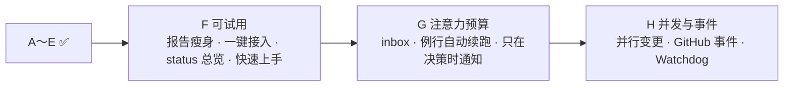

# 路线图

更新：2026-11-16（以 `origin/main` `86ecc7b` 为准）。历史计划在 `docs/plans/`，当前演进计划在 `docs/superpowers/`。

## 已完成

- 通用工程模式：init 锁底座、change/approve/run、隔离候选副本冒烟、RED 证明、边界审计、no-ff 合并与回执、`storyloop ci`。
- 底座演进：`base-propose`（含 `--allow-mutable` 上游同步）、`base-update`。
- 停点与恢复：`NEEDS_INPUT` 终端提问与 `answer`、`MANUAL_ACCEPTANCE_REQUIRED` 与 `accept`、`WORKSPACE_TAINTED` 与 `reset`、`acceptance-repair`（原 smoke-repair）、幂等完成阶段。
- 需求与规格：spec-kit 结构的合同、选择题澄清、checklist 质量门、OpenSpec 增量与活规格、design.md/decisions.md、`openspec validate` 门、取代记录、`document` 补生成。
- 代理：Claude Code 与 Codex 适配器的会话恢复、预算语义、遥测账本与报告成本节。
- 测试分层（决策 0015）：系统冒烟 + 变更验收 + 特征化门 + 单元/集成分开 + 静态检查；`ui_regression` 撤掉。
- 底座知识库：`foundation-survey` 技能包（`storyloop skills` 装进项目，Claude Code 与 Codex 通用）摸底产出 `openspec/foundation/`，BASE 保护，每个角色先读（决策 0013、0014）。
- 验证：RuoYi 底座三个功能变更、七次 BASE 迭代、上游同步。
- 角色按权限边界划分（决策 0016，2026-09-24）：新增 design（架构师）角色，`design_min_stories`（默认 2）让单故事变更跳过方案；Claude 适配器的 review 四视角并行子代理、implement 按层拆通道。
- Windows 回归：GitHub Actions 的 windows-latest 作业全量通过（2026-09-24，与 Linux 同为必过作业）。修掉的三类问题：套件指纹按 LF 规范化、候选副本控制文件按解析后的路径定位（8.3 短名）、交互提示在 cp1252 控制台安全输出。
- 精简（2026-09-30）：角色返回结构由 CLI 原生约束（`--output-schema` / `--json-schema`）；调用诊断记录与 `storyloop log`；每个停点与报错附带可复制的下一步命令；`CHARACTERIZATION_FAILED` 退出码改为 2；删除早期实例模式与 v2 Stage/DAG 引擎（约 4000 行，存档于本地 tag `archive/legacy-modes`）。
- 停点修复（2026-10-11，文档核对时发现）：`CHARACTERIZATION_FAILED` 可就地修正测试后续跑（引擎重新验证，不再调用代理）；`EXISTING_GREEN`（套件在实现前就已通过，全部或部分条件）成为可记录、可续跑的停点，`acceptance-repair` 可从这里加强套件；`acceptance-repair` 返回 `ACCEPTANCE_REPAIRED`、提交为 `repair acceptance suite`；`BUDGET_EXHAUSTED` 的提示不再建议修订合同；`smoke-apply` 失败与 `EXISTING_GREEN` 退出码为 2；`init --settings` 帮助列全八个键；实现指纹范围以代码为准补决策 0017；`project_loop.py` 拆成 loop / gates / guards / finish / acceptance_repair，每个文件都在 500 行以内；删掉测试里已删除模式的遗留夹具。
- 子项目 1 变更性质与判据（2026-10-13）：fix 与 refactor 走通闭环；验收矩阵行类型决定实现前状态（新增 `ORACLE_DEFECT` 停点）；判据自证（执行数统计、基线、零执行与下降判失败）；快重两级判据；`oracle-craft` 技能包；技能包目录保护；报告新增判据自证一节。顺带修复：实现删除已跟踪文件时候选副本构造报错。
- 预算语义修复（2026-10-12）：代理进程没给出回答（超时、限流、崩溃）时报 `AGENT_UNAVAILABLE`，实现循环里这一轮交还、不计入 `max_attempts`，记入 `run.agent_failures`。
- 文档知识库（2026-10-11）：`docs/` 按模块、架构、扩展、接口、能力、积木、测试重组，并对照代码修正漂移。
- 子项目 2a 纠偏：失败归属、作废重开与判据修复已合入；无单独验收文件，[设计 §13](superpowers/specs/2026-10-14-子项目2a-纠偏-design.md#13-实现差异与验收状态)同时记录设计差异与验收状态。
- 子项目 2b 分流：三档、重档审批、拆分建议与 L3 升档已合入；见[设计](superpowers/specs/2026-10-16-子项目2b-分流-design.md#13-实施接口补充与当前边界)和[真实验证](validation/2026-10-17-子项目2b-真实验证.md)。
- 子项目 3 报告：同源 JSON/Markdown 分层报告与调用对账已合入；见[设计](superpowers/specs/2026-10-18-子项目3-报告-design.md)和[验收记录](superpowers/reports/2026-10-18-子项目3-验收.md)。
- 子项目 4 角色画像：角色档次、适配器握手、成本上限与置信度分流已合入；见[设计](superpowers/specs/2026-10-19-子项目4-角色画像-design.md#13-实现差异与验收状态)和[验收记录](superpowers/reports/2026-10-19-子项目4-验收.md)。
- 子项目 5 分层记忆：经验、勘误、审批、取用与复发统计已合入；T2 在 PR #17 补齐自然草案及批准后取用的限定验收，已合入，见下节。详见[设计](superpowers/specs/2026-10-19-子项目5-分层记忆-design.md#14-实现差异与验收状态)和[真实验收](validation/2026-10-20-子项目5-真实验收.md)。
- 子项目 6 外环：指标、规则建议、CI 结果记录和 `metrics` 命令已合入；见[设计](superpowers/specs/2026-10-19-子项目6-外环-design.md#12-实现差异与验收状态)和[验收记录](validation/2026-10-20-子项目6-验收.md)。

- **T3 知识库补充（PR18 已合入）**：技能 1.1.0 实现七类覆盖、逐事实来源、可重放抽检及人工双文本补证；本机专项/core/full 通过。两适配器真实自然产物仍有质量缺口，保留原始结果，见[验收](validation/2026-10-21-知识库补充-验收.md)。
- **T4 接入模板化（PR19 已合入）**：两阶段草案、独占初始化事务及版本化可信 helper，公开 Python/Java+Node 样本与远程 Linux/Windows CI 通过。模板的 Maven 插件路径、真实 RuoYi 接入及半天收益未验证，见[验收](validation/2026-10-21-接入模板化-验收.md)。

- **T5 红魔品牌替换样板（本地闭环完成，待PR合入）**：真实 RuoYi 变更 `FEAT-20261021-002` 完成合同、RED、特征化、GREEN、审查与回执；单元112项、品牌/登录浏览器17项、系统冒烟13项unittest加2项Playwright通过。首轮SUPERSEDED、4次验收修复及代理切换均单列，不声称无人干预首过或T4接入迁移；见[验证报告及metrics](validation/2026-10-21-样板变更-品牌替换.md)。
- **架构收敛 A–D（PR #24、#26、#28、#31）**：架构声明与守护、生命周期归一、声明式变更类型表、底座闭合；分层违规与豁免从 37 条清零，底座内部无环。见[设计](superpowers/specs/2026-10-21-架构收敛-design.md)与 `docs/validation/2026-10-2*-架构收敛-*.md`。
- **设计已批准**：[链路骨架](superpowers/specs/2026-10-23-链路骨架-design.md)（PR #30）、需求共创技能（PR #32）。
- **链路骨架 ①（[计划 PR #33](https://github.com/jinlin725168-ai/storyloop/pull/33)、[实现 PR #37](https://github.com/jinlin725168-ai/storyloop/pull/37)）**：功能短名 ID、调用执行画像和批准时版本快照已合入；旧序号 ID 继续有效。见[第 1 批计划](superpowers/plans/2026-10-24-链路骨架-第1批.md)。
- **spec-craft 第 1 批（[PR #34](https://github.com/jinlin725168-ai/storyloop/pull/34)、[设计修正 PR #35](https://github.com/jinlin725168-ai/storyloop/pull/35)）**：对话入口技能已安装验证，反例与行类型按旧代码红绿分别判定；[一次真实模型试用](validation/2026-10-24-spec-craft-第1批试用.md)只验证了提问与草稿，临时样本在 readiness 门停下，未验证正式合同或真实产品判断。
- **CI 调整（[PR #36](https://github.com/jinlin725168-ai/storyloop/pull/36)、[PR #39](https://github.com/jinlin725168-ai/storyloop/pull/39)）**：只改中文文件名文档时正确跳过测试；main 推送两平台跑 core；加入仅检查 F/E9 的 ruff 与 CodeQL。PR 上 Windows 改跑 core 见本次 CI 修复。
- **spec-craft 第 2 批（[计划 PR #41](https://github.com/jinlin725168-ai/storyloop/pull/41)、[实现 PR #42](https://github.com/jinlin725168-ai/storyloop/pull/42)）**：团队/个人定制、受保护路径与控制面视图已合入；[一次真实试用](validation/2026-10-24-spec-craft-第2批试用.md)发现行类型、表外假设和问句计数问题。**[PR #44](https://github.com/jinlin725168-ai/storyloop/pull/44)** 已修订技能和测试，未重跑真实试用，不能据此宣称实际模型输出已验证。
- **架构收敛 E1（[计划 PR #38](https://github.com/jinlin725168-ai/storyloop/pull/38)、[评审修订 PR #40](https://github.com/jinlin725168-ai/storyloop/pull/40)、[实现 PR #43](https://github.com/jinlin725168-ai/storyloop/pull/43)）**：base 合同、旧底座绿证据、人工实现与具名人审、回归验收和幂等版本推进已交付并在独立样本实跑，见[验证记录](validation/2026-10-24-架构收敛-阶段E1-验证.md)。评审中人决定：旧项目使用人工确认的补充配置声明构建命令；合并前中断一律作废本次尝试、保留人的候选后重验。E1 不含代理实现、跨厂商审查或判据注入跑红，也未完成 I13。
- **架构收敛 E2a：已取消并移除代码（[计划 PR #46](https://github.com/jinlin725168-ai/storyloop/pull/46)、[实现 PR #47](https://github.com/jinlin725168-ai/storyloop/pull/47)、[移除 PR #59](https://github.com/jinlin725168-ai/storyloop/pull/59)）**：曾以预览交付代理实现、跨厂商审查，并有[一次真实试用](validation/2026-10-27-E2a-真实试用.md)走通；试用发现 6 个问题。2026-10-29 的[决策 0018](decisions/0018-base-human-only.md)改为 base 只由人实现；E2b [PR #57](https://github.com/jinlin725168-ai/storyloop/pull/57) 已关闭。
- **架构收敛 E3（[计划 PR #54](https://github.com/jinlin725168-ai/storyloop/pull/54)、[实现 PR #55](https://github.com/jinlin725168-ai/storyloop/pull/55)）**：功能变更撞底座后生成关联 base 草案，base 通过后合并新底座并重证 RED；[三组真实 Maven 项目试用](validation/2026-10-28-架构收敛E3-真实试用.md)的 base 与功能变更均到 `PASSED`，实现与审查使用测试适配器。阶段 E 以 E1 + E3 收尾；人工 base 判据路径用例保留守卫由 [PR #60](https://github.com/jinlin725168-ai/storyloop/pull/60) 落地，I13 声明仍为 `pending`。
- **自举障碍修复（PR [#75](https://github.com/jinlin725168-ai/storyloop/pull/75)、[#81](https://github.com/jinlin725168-ai/storyloop/pull/81)、[#84](https://github.com/jinlin725168-ai/storyloop/pull/84)、[#85](https://github.com/jinlin725168-ai/storyloop/pull/85)）**：特征化隔离新测试并处理冲突锁定；同一测试文件可声明多条行为；RED 前提错误不再算行为失败，停点展示有界失败摘要；设计规划会列出固定旧行为的测试和快照文件（legacy 的 `touched` 仍只含非测试文件）。
- **自举产出并回（PR [#78](https://github.com/jinlin725168-ai/storyloop/pull/78)、[#83](https://github.com/jinlin725168-ai/storyloop/pull/83)、[#79](https://github.com/jinlin725168-ai/storyloop/pull/79)）**：底座暂存提示及已有测试改动提示已并回，CLI 冒烟非零退出正确归为行为失败；命令无法启动等仍归环境错误。
- **StoryLoop 自身 dogfood 1～6**：六次尝试中四次到 `PASSED`；dogfood6 全 Codex（实现与审查）54 分钟到 `PASSED`，验收修复 1 次、实现一轮、审查一次通过。实现与审查同厂商，独立性较弱；2026-11-05 人决定长期使用 Codex，避免占用 Claude 额度（见 [#65](https://github.com/jinlin725168-ai/storyloop/issues/65)）。数据来自共享工作区未入库的 `storyloop-dogfood-findings.md` 和 `storyloop-dogfood3-findings.md` 第 34 条；dogfood6 代码并回另见 [PR #87](https://github.com/jinlin725168-ai/storyloop/pull/87)，不计入本页 main 基线。
- **自举纠偏 PR [#89](https://github.com/jinlin725168-ai/storyloop/pull/89)、[#93](https://github.com/jinlin725168-ai/storyloop/pull/93)、[#94](https://github.com/jinlin725168-ai/storyloop/pull/94)、[#95](https://github.com/jinlin725168-ai/storyloop/pull/95)、[#96](https://github.com/jinlin725168-ai/storyloop/pull/96)、[#97](https://github.com/jinlin725168-ai/storyloop/pull/97)、[#98](https://github.com/jinlin725168-ai/storyloop/pull/98)、[#99](https://github.com/jinlin725168-ai/storyloop/pull/99)、[#100](https://github.com/jinlin725168-ai/storyloop/pull/100)**：补全 heavy RED 与命令式前提错误证据；验收修复后沿用有效方案、自动修复夹具并重证 RED；修正 intake 下一步、临时目录规则、方案证据与审查噪声、验收修复路径和 readiness 失败摘要。
- **dogfood7～11**：7/8 在验收夹具与方案审查中反复返工，止损改由直接实现；9 到 `PASSED`，但有 3 次非例行介入；10 在 39 分钟内以**零非例行介入**到 `PASSED`；11 对同一 AC 连续逐层追问，约 5 次非例行介入后止损改由直接实现。共性根因是验证入口未进合同：验收用例选的入口与方案修改路径不一致。证据见共享工作区 `storyloop-dogfood3-findings.md:89-146`。
- **①a 最小评测底座（PR [#103](https://github.com/jinlin725168-ai/storyloop/pull/103)、[#104](https://github.com/jinlin725168-ai/storyloop/pull/104)、[#105](https://github.com/jinlin725168-ai/storyloop/pull/105)、[#113](https://github.com/jinlin725168-ai/storyloop/pull/113)）**：L1 把人工介入记为例行/非例行事件；`storyloop bench` 冻结五个 Case（Base、合同、参考 Solution、隐藏 Gold），校准只跑 Gold；真实执行按 `--scope base-only|paired`、默认 `--suite-source generated`（验收由引擎正常生成，冻结套件只作隐藏 Gold）。用法见 [bench.md](bench.md)。
- **①b 验证入口与审查收敛（PR [#106](https://github.com/jinlin725168-ai/storyloop/pull/106)、[#107](https://github.com/jinlin725168-ai/storyloop/pull/107)、[#108](https://github.com/jinlin725168-ai/storyloop/pull/108)、[#109](https://github.com/jinlin725168-ai/storyloop/pull/109)）**：新变更必填 `verification_entries`；manifest `entry_ids`、方案 `entry_paths` 与审查三方核对；审查意见稳定 ID 与 MUST_FIX/DECISION_NEEDED/ADVISORY 三级，同一 AC 连续判强度不足按 `ORACLE_DEFECT` 收敛；v2 Case 批准绑定合同哈希。
- **①c 技能融合与知识维护（PR [#110](https://github.com/jinlin725168-ai/storyloop/pull/110)、[#111](https://github.com/jinlin725168-ai/storyloop/pull/111)、[#112](https://github.com/jinlin725168-ai/storyloop/pull/112)）**：新增 `tdd`、`impact-analysis`、`systematic-debugging`、`foundation-use` 技能，扩展 spec-craft/oracle-craft/review/foundation-survey；`knowledge-propose` / `authorize-knowledge` 提供 PASSED 后的 foundation 精确 diff 增量通道。
- **试跑与门槛暴露问题的修复（PR [#114](https://github.com/jinlin725168-ai/storyloop/pull/114)～[#126](https://github.com/jinlin725168-ai/storyloop/pull/126)）**：
  - bench 工具链：每次 attempt 独立 venv、readiness 与停机证据留存、缺美元成本不阻断判定（[#114](https://github.com/jinlin725168-ai/storyloop/pull/114)）；模拟人每次 attempt 纠正一次并继续（[#115](https://github.com/jinlin725168-ai/storyloop/pull/115)）；停机状态以 run state 为准（[#116](https://github.com/jinlin725168-ai/storyloop/pull/116)）。
  - 引擎证据：harness 用例级诊断（[#116](https://github.com/jinlin725168-ai/storyloop/pull/116)）、可编辑安装不再使 harness 启动失败并保留 RED 环境错误证据（[#118](https://github.com/jinlin725168-ai/storyloop/pull/118)）、subTest 按测试方法计数（[#119](https://github.com/jinlin725168-ai/storyloop/pull/119)）、RED 只按具体执行信号判环境错误（[#120](https://github.com/jinlin725168-ai/storyloop/pull/120)）。
  - 判据质量：已有测试/快照与合同冲突时由方案声明 `regression_updates` 受控修改（[#117](https://github.com/jinlin725168-ai/storyloop/pull/117)）；三类确定性验收缺陷（保持性行实现前失败、用例越界、未经声明入口）自动退回 acceptance、计为例行（[#121](https://github.com/jinlin725168-ai/storyloop/pull/121)）；oracle-craft 明确"准备 / 执行 / 观察"，设计证据重试耗尽停 `DESIGN_REVISION_REQUIRED`（[#122](https://github.com/jinlin725168-ai/storyloop/pull/122)）；保持性 AC 的 `entry_paths` 不必经过改动文件、合同批准时校验入口覆盖（[#123](https://github.com/jinlin725168-ai/storyloop/pull/123)）；RED 前判据强度预审（[#124](https://github.com/jinlin725168-ai/storyloop/pull/124)）。
  - Case v2.1：dogfood3/5/6 补公开入口、dogfood9 AC-4 改在守卫入口观察，人重新批准并重新校准（[#125](https://github.com/jinlin725168-ai/storyloop/pull/125)、[#126](https://github.com/jinlin725168-ai/storyloop/pull/126)）。
- **门槛运行 1～3（v2，base-only，generated，Codex `gpt-6-sol`）**：均未达标，但瓶颈逐次后移。记录在 bench 输出目录 `.storyloop/bench/runs/`。

  | 运行 | 引擎 | PASSED（10 次） | 两次均过的 Case | 主要阻断 |
  |---|---|---|---|---|
  | 门槛 1 | `910bb3a` | 1 | 0 | RED 误判环境错误 4 次；验收质量 5 次 |
  | 门槛 2 | `d7da1e1` | 1 | 0 | 验收绕过声明入口 7 次；断言强度约 6 次 |
  | 门槛 3 | `4ddf964` | 3 | 1（dogfood10） | 合同入口覆盖不足致 design 提问 5 次；断言强度约 5 次；1 次假通过（dogfood9 漏测嵌套路径，Gold 失败） |

- **门槛 4（Case v2.1）**：引擎含 #123/#124，PASSED 1/10，非例行介入合计 13，未达标；作为后续对比的 v2.1 基线。
- **自迭代阶段（2026-11-13～16）**：门槛 4 后不再用 bench 驱动日常修复，改由 StoryLoop 对自身真实需求迭代。退出标准为连续 3 个真实变更 `PASSED`、每个非例行介入不超过 1、合并后 main CI 绿；C（`bench report` 汇总，[#153](https://github.com/jinlin725168-ai/storyloop/pull/153)）、D（`metrics` 介入统计，[#156](https://github.com/jinlin725168-ai/storyloop/pull/156)）、E（`log` 介入时间线，[#159](https://github.com/jinlin725168-ai/storyloop/pull/159)）以 1、1、0 次非例行达标，计数由产品自身 L1 给出。内部机制类变更（需在测试中模拟代理角色）不计入，另行实现。
- **真实运行暴露的引擎修复**：入口定位不含程序名（[#152](https://github.com/jinlin725168-ai/storyloop/pull/152)）、阻断意见变化后解除重试耗尽（[#154](https://github.com/jinlin725168-ai/storyloop/pull/154)）、技能补跨平台要求（[#155](https://github.com/jinlin725168-ai/storyloop/pull/155)）、引擎自动重规划不计人工（[#157](https://github.com/jinlin725168-ai/storyloop/pull/157)）、NEEDS_INPUT 停点给出规则原因（[#158](https://github.com/jinlin725168-ai/storyloop/pull/158)）、预审把过严断言归为建议（[#164](https://github.com/jinlin725168-ai/storyloop/pull/164)）、产品角色一轮问完确认题（[#165](https://github.com/jinlin725168-ai/storyloop/pull/165)）、自动修复重生成相同套件时记为无进展（[#166](https://github.com/jinlin725168-ai/storyloop/pull/166)）。
- **里程碑 bench（2026-11-16，Case v2.2）**：dogfood3/5/6 修订为 v2.2，去掉不可观察入口（[#160](https://github.com/jinlin725168-ai/storyloop/pull/160)、[#161](https://github.com/jinlin725168-ai/storyloop/pull/161)）。Codex 额度在第 4 次尝试后耗尽，有效样本 4 个：3 个 `PASSED`，非例行合计 4（同 Case 的门槛 4 为 1/4、5）。人决定以有效样本作为里程碑结论，不补跑。代理不可用改记为不可比较、连续两次即中止（[#163](https://github.com/jinlin725168-ai/storyloop/pull/163)）。
- **测试体系**：定时全量长期为红且无人跟进，修复潜伏回归并在 main/定时失败时自动开 `ci-red` issue（[#166](https://github.com/jinlin725168-ai/storyloop/pull/166)）；按改动选取受影响测试，PR 跑 core/platform + 受影响模块、main 跑 Linux full（[#167](https://github.com/jinlin725168-ai/storyloop/pull/167)）；子进程退出即返回，单条受监督 git 命令 50.7ms → 16.9ms，core 327s → 212s（[#169](https://github.com/jinlin725168-ai/storyloop/pull/169)）。

## 已知问题

- **main 推送 CI 长期为红（已修复）**：[#131](https://github.com/jinlin725168-ai/storyloop/pull/131) 修复 Windows 路径、编码与测试夹具等根因，main 推送 CI 已全绿；PR 上 Windows 也改跑 `core`，防止同类失败到 main 才暴露。
- 本机 WSL 的 `tests.test_acceptance_fixture_retry.test_approve_repairs_precondition_failure` 环境依赖已由 [#131](https://github.com/jinlin725168-ai/storyloop/pull/131) 修复。
- 此前偶发 Git 可见性保护错误仍待捕获具体触发路径，诊断已增强，保护规则未放宽。I13 声明仍为 `pending`；E3 试用的限制见[验证记录](validation/2026-10-28-架构收敛E3-真实试用.md)。

新发现的代码与文档不一致记在这里，修复后移到"已完成"。

## 下一步

2026-11-16 评估：核心判定（外环持有判定权、实现前盲写受保护验收、候选副本 RED、特征化锁、合同中的验证入口）合理且保持不变；但**判据一刀切过严，尚不能落地**。三个 100～280 行的命令行输出变更（C/D/E）因"改了输出即外部契约"全部分流为 heavy，每个 14～19 次代理调用、57～82 分钟；审查与验收占调用 61%，实现只占 8%。引擎约 3 万行，规则随事故叠加，一周内修了 10 余个规则缺陷和 2 次修复带入的回归。路线据此重排为 **A → B → C → D → E**：

1. **A 收尾**：测试体系 P2 的慢模块提速与特征化测试生命周期。
2. **B 按风险分档减负**（首要）：核心判定不动。
   - B1 改动分级：引擎按确定性规则把改动分为 safe / review / breaking（新增字段、命令、输出段为 safe），只有 breaking 或高风险进入 heavy。
   - B2 真正的 light 通道：不做设计审批；验收照写、RED 照证；判据预审只对 breaking 或状态类改动；最后一次合并审查。
   - B3 收敛 AI 判断类审查：减少层数，每层最多一轮阻断后转为建议；把引擎规则逐条归为确定性或判断，判断类移入技能。
   - B4 目标与护栏：safe 小改动 ≤8 次调用、≤25 分钟、0 次非例行；Gold 失败率与漏出缺陷不得上升，用 bench 与自迭代共同验证。
3. **C 可靠与可迭代**：代理可用性预检（登录、额度、连通，结构化原因码）；按角色路由与备用适配器，记录实际路由；停点分类（配置 / 基础设施 / 契约 / 判据质量 / 需要人工）；嵌套项目测试夹具，使内部机制类变更也能自迭代。
4. **D 充分性**：能力覆盖清单（每个公开命令与停点类型对应正向与边界测试，CI 校验）；技能发布门（技能版本变更须通过评测样本才算"已验证"）；链路骨架第 2 批先做 fix 溯源（引入变更与逃逸分类），规则 ID 与需求登记随后；spec-craft 第 3～5 批在此之后按决策树复核。
5. **E 落地验证**：选一个不依赖 Docker 的真实开源项目，用真实需求跑 L3 观察。RuoYi 多故事与真实模型撞底座待本机 Docker 恢复后再做。

**进展（2026-11-17）**：B1～B3 已合并（[#171](https://github.com/jinlin725168-ai/storyloop/pull/171)、[#172](https://github.com/jinlin725168-ai/storyloop/pull/172)）。E 选定 sqlite-utils（纯 Python CLI，约 1500 个测试），用 Claude 适配器跑真实需求：

| 需求 | 结果 | 调用 | 代理耗时 | 非例行 | 暴露的引擎缺陷 |
|---|---|---|---|---|---|
| #478 `tables` 按表名过滤 | `PASSED` | 25（无缺陷路径约 7） | 31.6 分钟 | 4（均为缺陷恢复） | 6 |
| #516 `insert`/`upsert --summary` | `PASSED` | 13 | 19.2 分钟 | 1（缺陷恢复，L1 未记录） | 2 |
| #474 `insert`/`upsert --headers` | `PASSED` | 13（无缺陷路径约 9） | 24.2 分钟 | 1（缺陷后刷新草案） | 2 |
| #444 `--extras-key`/`--ignore-extras` | `PASSED` | 17（误分 heavy） | 30.5 分钟 | 0 | 2 |
| #352 `insert`/`upsert --extract` | `PASSED` | 18 | 34.0 分钟 | 0（BLOCKED 后人工续跑 1 次） | 3 |

前三项按 ADDITIVE-CONTRACT 分流为 standard、跳过判据预审；#444 因产品角色把新增选项的用法校验判为 `risks.guard` 而进入 heavy（两轮判据预审与设计审批，费用 $34.6，约为 standard 的 2.4 倍），spec-craft 1.4.7 已补 guard 定义。四项上游测试均全绿。15 个缺陷都只在"非 StoryLoop 项目 + Claude 适配器"下出现（入口解析、追加测试判定、验收收集、文档特征化、修复轮、主审格式、入口描述前缀、代理找不到 pytest、方法命令找不到项目 venv 内程序、新建测试文件被当作范围扩大而两次自动重规划、guard 风险无定义、推荐项写选项标签触发修复轮、设计把自建文件列为禁止路径且不可修复、文档被要求标代码符号、standard 先实现后补特征化），均已修复。C 已开始：停点类别与 L1 按类别计数、代理不可用原因（登录 / 额度 / 网络 / 超时 / 缺失 / 崩溃）、bench 遇登录失效立即止损、合并后沿用测试基础缺口批准。B4 的 ≤8 次调用尚未在真实项目上达成：#516 多出的是一轮审查返修（根因是代理跑不了测试），#474 多出的是两次自动重规划；#352 多出的是三轮设计修复与一次作废的实现（standard 先实现后补特征化，#516/#474 同样各多一次实现）。均已修复，待下一个真实需求复测。

**C 完成（2026-11-17）**：停点类别与代理不可用原因（[#179](https://github.com/jinlin725168-ai/storyloop/pull/179)）、备用适配器路由与嵌套项目夹具（[#185](https://github.com/jinlin725168-ai/storyloop/pull/185)）。夹具的验证：StoryLoop 用 Claude 适配器自迭代一个内部机制变更（BLOCKED 停点给恢复选项）到 `PASSED`，5 个验收文件全部用夹具写成——此前这类变更因验收难写不能自迭代。该变更分流 heavy（改动符号被 33 处引用），16 次调用、57 分钟，1 次非例行（一致性审查发现两处设计缺陷后重新规划）。

**D 进行中**：D1 能力覆盖清单 `tests/coverage_manifest.py`，31 个命令各对应正向与报错测试、26 种停点各对应到达测试，核心套件中审计其与 CLI 和停点类别一致、引用的测试确实调用对应命令。首次审计发现的缺口按原因登记在清单里，已补 `report` 命令与 `EXPLORATION_RECOMMENDED` 停点。D2 技能发布门：每个技能声明代表性用例，`evals/skills/<技能>/<版本>.json` 按内容摘要记录各用例结论与证据，core 检查改了技能不能沿用旧结果；当前 7 个技能 verified（证据为 #481、#352 与自迭代），`foundation-survey` pending。D3 fix 溯源：缺陷新增 `escape_class`（漏过缺陷的门），根因行最近由 StoryLoop 变更改过时清单点名候选 `origin_change`，逃逸指标按类计数。需求登记（链路骨架第 2 批其余部分）：批准时分配需求/规则/例子稳定 ID，合并前写按变更追加的登记记录并对照目标分支复核版本，`storyloop requirements` 查询，活规格带 ID，fix 的 `defect.rules` 计入规则。spec-craft 第 3、4 批：`storyloop assess`（建变更前三问与人的结论，放弃不建变更）、`change --assessment` / `--from-draft`（对话草稿交接，人确认的内容原样保留）、合同 `assumptions` 与例子 `polarity`、清单新增项、批准时写共创记录；`map-propose` / `map-apply` 为已有项目起草并安装需求地图，现有需求以 `REQ-<日期>-requirements-bootstrap` 迁入登记，有地图后合同须声明模块。spec-craft 第 5 批：product 角色说明中的写作方法论（结构、EARS、Gherkin、UI 上限、规模）原文迁入技能，角色说明只留结构与引擎规则；5 样本对比两版等价（[对比记录](validation/2026-11-18-spec-craft-第5批对比.md)）。

**A～E 完成后的重新规划（2026-11-18）**：对照两个内部参考项目与 Super-agent（Router/Worker、事件驱动、"人的注意力才是瓶颈"）的做法，核心判定（盲写验收、RED 证明、特征化、合同中的验证入口）是 StoryLoop 独有的，保持不变；差距在"用起来"：每个停点都要人敲命令、一次只能跑一个变更、没有事件入口、报告过大（一个一行级 CLI 改动入库约 8800 行）。路线据此定为 **F → G → H**：

1. **F 可试用**（首要）：报告瘦身（入库一页摘要 + `report --full` 按需生成）；一键接入（`init --detect` 推断工程画像、`--agent` 配置代理、确认后自动跑准备度）；跨变更 `status` 总览；[快速上手](quickstart.md)。退出标准：另一个人在自己的仓库从接入跑到一个需求 `PASSED`，人只在做决定时介入。
2. **G 注意力预算**：跨变更决策收件箱 `storyloop inbox`；例行停点自动续跑；只在需要决定时通知；"每个变更人工触达次数"成为核心指标。
3. **H 并发与事件**：Router/Worker 式在隔离工作区并行多个变更；事件先只接 GitHub（issue 标签 → 评估草稿、CI 红 → 修复草稿、PR 评论 → 修订）；Watchdog 按墙钟与费用发现卡住的运行。

**F 进展（2026-11-18）**：报告 v2（`report.json` 不再存渲染副本，`report.md` 由约 2000 行降到约 60 行，旧报告的回执字节不变）；`init --detect --yes --agent claude|codex|auto`（在 sqlite-utils 上推断结果与手写设置一致）；Claude 适配器随包发布为 `python -m storyloop.claude_agent`（旧脚本路径保留）；`status <项目>` 跨变更总览；快速上手文档。试用（sqlite-utils 全新克隆，`rows --exclude`）`PASSED`，人工触达 7 次，其中 4 次是决定；暴露的 8 个问题已修复，修复后预计 5 次触达、4 次是决定，剩余一次（intake 停点自动退回）记入 G（[试用记录](validation/2026-11-18-F-试用.md)）。

审查角色在此期间由开发者直接完成（Codex 暂停派发）；base 人工通道不变（[决策 0018](decisions/0018-base-human-only.md)）。

## 明确不做

- 不做 CI 系统、部署、push。
- 不做操作系统级沙箱；需要强隔离时用容器。
- 不让引擎自动修改规格迁就代码。
- 暂不处理 [#80](https://github.com/jinlin725168-ai/storyloop/issues/80) 与 [#56](https://github.com/jinlin725168-ai/storyloop/issues/56) 的底座合并后边界恢复（以底座向后兼容为前提）；E2a/E2b 已取消，[PR #50](https://github.com/jinlin725168-ai/storyloop/pull/50) 的敏感输出处理设计已由人于 2026-11-13 合入为设计文档，是否及何时实施待后续评估。
