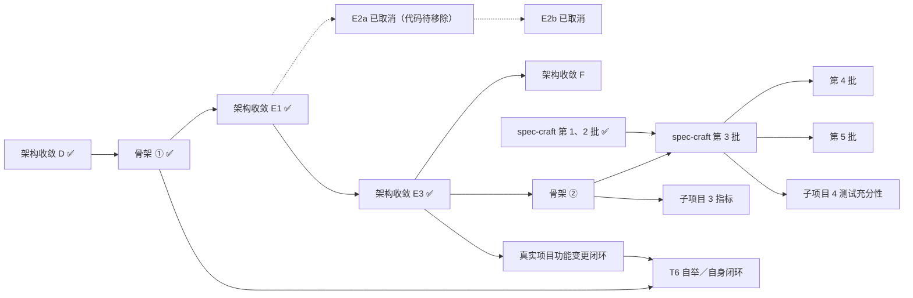

# 路线图

更新：2026-10-29（以 `origin/main` `1b2c26a` 为准）。历史计划在 `docs/plans/`，当前演进计划在 `docs/superpowers/`。

## 已完成

- 通用工程模式：init 锁底座、change/approve/run、隔离候选副本冒烟、RED 证明、边界审计、no-ff 合并与回执、`storyloop ci`。
- 底座演进：`base-propose`（含 `--allow-mutable` 上游同步）、`base-update`。
- 停点与恢复：`NEEDS_INPUT` 终端提问与 `answer`、`MANUAL_ACCEPTANCE_REQUIRED` 与 `accept`、`WORKSPACE_TAINTED` 与 `reset`、`acceptance-repair`（原 smoke-repair）、幂等完成阶段。
- 需求与规格：spec-kit 结构的合同、选择题澄清、checklist 质量门、OpenSpec 增量与活规格、design.md/decisions.md、`openspec validate` 门、取代记录、`document` 补生成。
- 代理：Claude Code 与 Codex 适配器的会话恢复、预算语义、遥测账本与报告成本节。
- 测试分层（决策 0015）：系统冒烟 + 变更验收 + 特征化门 + 单元/集成分开 + 静态检查；`ui_regression` 撤掉。
- 底座知识库：`foundation-survey` 技能包（`storyloop skills` 装进项目，Claude Code 与 Codex 通用）摸底产出 `openspec/foundation/`，BASE 保护，每个角色先读（决策 0013、0014）。
- 验证：RuoYi 底座三个功能变更、七次 BASE 迭代、上游同步。
- 角色按权限边界划分（决策 0016，2026-09-24）：新增 design（架构师）角色，`design_min_stories`（默认 2）让单故事变更跳过方案；Claude 适配器的 review 四视角并行子代理、implement 按层拆通道。
- Windows 回归：GitHub Actions 的 windows-latest 作业全量通过（2026-09-24，与 Linux 同为必过作业）。修掉的三类问题：套件指纹按 LF 规范化、候选副本控制文件按解析后的路径定位（8.3 短名）、交互提示在 cp1252 控制台安全输出。
- 精简（2026-09-30）：角色返回结构由 CLI 原生约束（`--output-schema` / `--json-schema`）；调用诊断记录与 `storyloop log`；每个停点与报错附带可复制的下一步命令；`CHARACTERIZATION_FAILED` 退出码改为 2；删除早期实例模式与 v2 Stage/DAG 引擎（约 4000 行，存档于本地 tag `archive/legacy-modes`）。
- 停点修复（2026-10-11，文档核对时发现）：`CHARACTERIZATION_FAILED` 可就地修正测试后续跑（引擎重新验证，不再调用代理）；`EXISTING_GREEN`（套件在实现前就已通过，全部或部分条件）成为可记录、可续跑的停点，`acceptance-repair` 可从这里加强套件；`acceptance-repair` 返回 `ACCEPTANCE_REPAIRED`、提交为 `repair acceptance suite`；`BUDGET_EXHAUSTED` 的提示不再建议修订合同；`smoke-apply` 失败与 `EXISTING_GREEN` 退出码为 2；`init --settings` 帮助列全八个键；实现指纹范围以代码为准补决策 0017；`project_loop.py` 拆成 loop / gates / guards / finish / acceptance_repair，每个文件都在 500 行以内；删掉测试里已删除模式的遗留夹具。
- 子项目 1 变更性质与判据（2026-10-13）：fix 与 refactor 走通闭环；验收矩阵行类型决定实现前状态（新增 `ORACLE_DEFECT` 停点）；判据自证（执行数统计、基线、零执行与下降判失败）；快重两级判据；`oracle-craft` 技能包；技能包目录保护；报告新增判据自证一节。顺带修复：实现删除已跟踪文件时候选副本构造报错。
- 预算语义修复（2026-10-12）：代理进程没给出回答（超时、限流、崩溃）时报 `AGENT_UNAVAILABLE`，实现循环里这一轮交还、不计入 `max_attempts`，记入 `run.agent_failures`。
- 文档知识库（2026-10-11）：`docs/` 按模块、架构、扩展、接口、能力、积木、测试重组，并对照代码修正漂移。
- 子项目 2a 纠偏：失败归属、作废重开与判据修复已合入；无单独验收文件，[设计 §13](superpowers/specs/2026-10-14-子项目2a-纠偏-design.md#13-实现差异与验收状态)同时记录设计差异与验收状态。
- 子项目 2b 分流：三档、重档审批、拆分建议与 L3 升档已合入；见[设计](superpowers/specs/2026-10-16-子项目2b-分流-design.md#13-实施接口补充与当前边界)和[真实验证](validation/2026-10-17-子项目2b-真实验证.md)。
- 子项目 3 报告：同源 JSON/Markdown 分层报告与调用对账已合入；见[设计](superpowers/specs/2026-10-18-子项目3-报告-design.md)和[验收记录](superpowers/reports/2026-10-18-子项目3-验收.md)。
- 子项目 4 角色画像：角色档次、适配器握手、成本上限与置信度分流已合入；见[设计](superpowers/specs/2026-10-19-子项目4-角色画像-design.md#13-实现差异与验收状态)和[验收记录](superpowers/reports/2026-10-19-子项目4-验收.md)。
- 子项目 5 分层记忆：经验、勘误、审批、取用与复发统计已合入；T2 在 PR #17 补齐自然草案及批准后取用的限定验收，已合入，见下节。详见[设计](superpowers/specs/2026-10-19-子项目5-分层记忆-design.md#14-实现差异与验收状态)和[真实验收](validation/2026-10-20-子项目5-真实验收.md)。
- 子项目 6 外环：指标、规则建议、CI 结果记录和 `metrics` 命令已合入；见[设计](superpowers/specs/2026-10-19-子项目6-外环-design.md#12-实现差异与验收状态)和[验收记录](validation/2026-10-20-子项目6-验收.md)。

- **T3 知识库补充（PR18 已合入）**：技能 1.1.0 实现七类覆盖、逐事实来源、可重放抽检及人工双文本补证；本机专项/core/full 通过。两适配器真实自然产物仍有质量缺口，保留原始结果，见[验收](validation/2026-10-21-知识库补充-验收.md)。
- **T4 接入模板化（PR19 已合入）**：两阶段草案、独占初始化事务及版本化可信 helper，公开 Python/Java+Node 样本与远程 Linux/Windows CI 通过。模板的 Maven 插件路径、真实 RuoYi 接入及半天收益未验证，见[验收](validation/2026-10-21-接入模板化-验收.md)。

- **T5 红魔品牌替换样板（本地闭环完成，待PR合入）**：真实 RuoYi 变更 `FEAT-20261021-002` 完成合同、RED、特征化、GREEN、审查与回执；单元112项、品牌/登录浏览器17项、系统冒烟13项unittest加2项Playwright通过。首轮SUPERSEDED、4次验收修复及代理切换均单列，不声称无人干预首过或T4接入迁移；见[验证报告及metrics](validation/2026-10-21-样板变更-品牌替换.md)。
- **架构收敛 A–D（PR #24、#26、#28、#31）**：架构声明与守护、生命周期归一、声明式变更类型表、底座闭合；分层违规与豁免从 37 条清零，底座内部无环。见[设计](superpowers/specs/2026-10-21-架构收敛-design.md)与 `docs/validation/2026-10-2*-架构收敛-*.md`。
- **设计已批准**：[链路骨架](superpowers/specs/2026-10-23-链路骨架-design.md)（PR #30）、需求共创技能（PR #32）。
- **链路骨架 ①（[计划 PR #33](https://github.com/jinlin725168-ai/storyloop/pull/33)、[实现 PR #37](https://github.com/jinlin725168-ai/storyloop/pull/37)）**：功能短名 ID、调用执行画像和批准时版本快照已合入；旧序号 ID 继续有效。见[第 1 批计划](superpowers/plans/2026-10-24-链路骨架-第1批.md)。
- **spec-craft 第 1 批（[PR #34](https://github.com/jinlin725168-ai/storyloop/pull/34)、[设计修正 PR #35](https://github.com/jinlin725168-ai/storyloop/pull/35)）**：对话入口技能已安装验证，反例与行类型按旧代码红绿分别判定；[一次真实模型试用](validation/2026-10-24-spec-craft-第1批试用.md)只验证了提问与草稿，临时样本在 readiness 门停下，未验证正式合同或真实产品判断。
- **CI 调整（[PR #36](https://github.com/jinlin725168-ai/storyloop/pull/36)、[PR #39](https://github.com/jinlin725168-ai/storyloop/pull/39)）**：只改中文文件名文档时正确跳过测试；PR 的 Linux 跑 core、Windows 跑 platform，main 推送两平台仍跑 core；加入仅检查 F/E9 的 ruff 与 CodeQL。
- **spec-craft 第 2 批（[计划 PR #41](https://github.com/jinlin725168-ai/storyloop/pull/41)、[实现 PR #42](https://github.com/jinlin725168-ai/storyloop/pull/42)）**：团队/个人定制、受保护路径与控制面视图已合入；[一次真实试用](validation/2026-10-24-spec-craft-第2批试用.md)发现行类型、表外假设和问句计数问题。**[PR #44](https://github.com/jinlin725168-ai/storyloop/pull/44)** 已修订技能和测试，未重跑真实试用，不能据此宣称实际模型输出已验证。
- **架构收敛 E1（[计划 PR #38](https://github.com/jinlin725168-ai/storyloop/pull/38)、[评审修订 PR #40](https://github.com/jinlin725168-ai/storyloop/pull/40)、[实现 PR #43](https://github.com/jinlin725168-ai/storyloop/pull/43)）**：base 合同、旧底座绿证据、人工实现与具名人审、回归验收和幂等版本推进已交付并在独立样本实跑，见[验证记录](validation/2026-10-24-架构收敛-阶段E1-验证.md)。评审中人决定：旧项目使用人工确认的补充配置声明构建命令；合并前中断一律作废本次尝试、保留人的候选后重验。E1 不含代理实现、跨厂商审查或判据注入跑红，也未完成 I13。
- **架构收敛 E2a：已取消，代码将移除（[计划 PR #46](https://github.com/jinlin725168-ai/storyloop/pull/46)、[实现 PR #47](https://github.com/jinlin725168-ai/storyloop/pull/47)）**：曾以预览交付代理实现、跨厂商审查，并有[一次真实试用](validation/2026-10-27-E2a-真实试用.md)走通；试用发现 6 个问题。2026-10-29 的[决策 0018](decisions/0018-base-human-only.md)改为 base 只由人实现，E2a 代码另由 PR 移除；E2b [PR #57](https://github.com/jinlin725168-ai/storyloop/pull/57) 已关闭。
- **架构收敛 E3（[计划 PR #54](https://github.com/jinlin725168-ai/storyloop/pull/54)、[实现 PR #55](https://github.com/jinlin725168-ai/storyloop/pull/55)）**：功能变更撞底座后生成关联 base 草案，base 通过后合并新底座并重证 RED；[三组真实 Maven 项目试用](validation/2026-10-28-架构收敛E3-真实试用.md)的 base 与功能变更均到 `PASSED`，实现与审查使用测试适配器。阶段 E 以 E1 + E3 收尾；判据路径用例保留守卫另行实现，I13 尚未登记为 guarded。

## 已知问题

此前偶发 Git 可见性保护错误仍待捕获具体触发路径，诊断已增强，保护规则未放宽。E2a 代理代码移除前，其独立树与主仓共享 `.git` 的风险仍在，见[PR #47 的已知问题](https://github.com/jinlin725168-ai/storyloop/pull/47)及[试用记录](validation/2026-10-27-E2a-真实试用.md)。改动判据路径时保留原有全部用例的守卫尚未实现，I13 尚未登记为 guarded；E3 试用的限制见[验证记录](validation/2026-10-28-架构收敛E3-真实试用.md)。

新发现的代码与文档不一致记在这里，修复后移到"已完成"。

## 下一步

目标是两件事：StoryLoop 能在真实项目及自身上完成一次功能变更闭环（T6 是自举的 1.0 可用性标准），以及每次迭代都能用指标看出能力变好还是变差。后者分四个子项目：1 链路骨架 → 2 需求共创技能 → 3 能力指标 → 4 测试充分性（调研见共享工作区 `research_notes/规格与测试充分性调研/`）。骨架 ①、E1、E3 和 spec-craft 第 1、2 批已完成；E2a、E2b 已取消，base 只走人工通道（[决策 0018](decisions/0018-base-human-only.md)）。

**主线（改引擎，按顺序）**

1. **真实项目的功能变更闭环**：在 E1 + E3 底座通道上验证主线，保留失败与人工介入记录；改动判据路径时保留全部原有用例的守卫另行实现。
2. **T6 自举与自身功能变更闭环**：推进引擎分离与自身变更的端到端验证；设计可与链路骨架 ② 并行。
3. **子项目 3 能力指标**：用真实迭代数据判断能力变化；子项目 4 测试充分性随后推进。
4. **架构收敛 F**：补记“底座来自架构声明”的后续编号决策、修订 0004，更新 `architecture.md`、`concepts.md`。
5. **链路骨架 ②**：需求登记，模块、需求、规则、例子的 ID，fix 溯源，docs 类型。排在 E 之后。
6. **spec-craft 第 3 → 4 → 5 批**：合同新字段与 `--from-draft`、需求地图起草、product 角色说明迁移。

**旁线（不碰引擎）**：spec-craft 第 1、2 批及两次 Claude Code 试用已完成；试用发现已写回技能说明，第 3 批仍须验证正式负责人判断与引擎交接。

按需启动：老仓库迁移工具、上游同步自动化、多变更并行、Windows 真实产品迭代闭环。仅在真实需求或外环信号出现时启动总体设计列出的其他延后项。

## 明确不做

- 不做 CI 系统、部署、push。
- 不做操作系统级沙箱；需要强隔离时用容器。
- 不让引擎自动修改规格迁就代码。
