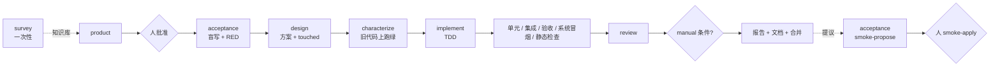

# 角色目录：岗位 → 角色 → 权限 → 输入 → 输出 → 门

引擎里的角色按**权限边界**划分，不按组织架构：一个角色能写什么、能看什么、它的结论是不是门，这三点至少有一点不同才单独成角色。只是关注点不同的分工放在角色内部用子代理完成（适配器那一侧组织，引擎不感知）。

| 岗位 | 角色 | 能写 | 只看到 | 产出 | 是门吗 |
|---|---|---|---|---|---|
| 架构师 / 技术负责人（摸底） | `survey` | 无（只读） | 整个仓库 | `openspec/foundation/` 底座知识库（经 BASE 迭代受保护） | 否，是所有角色的输入 |
| 产品经理 / BA | `product` | 无 | 意图、知识库的能力清单与活规格、澄清回答 | 合同：故事、EARS 规则、Given/When/Then 条件、澄清记录 | 人批准才生效 |
| 测试 / QA | `acceptance` | `acceptance/changes/<id>/`（仅生成与修复时） | 合同、知识库的 testing 与 building-blocks | 变更验收套件：feature 的验收用例、fix 的复现测试、refactor 的结构断言；按行类型应红的先红、应绿的先绿；合并后的系统冒烟提议 | 套件是门；提议需人 `smoke-apply` |
| 架构师（方案） | `design` | 无 | 合同、知识库的 extension / building-blocks / modules、既有代码 | 方案：Files、Data And Interfaces、Decisions、Risks，以及将修改的既有文件 `touched` | 否，但 `touched` 喂特征化门，方案是审查的对照物；故事数少于 `design_min_stories`（默认 2）时跳过 |
| 开发（开工前） | `characterize` | `test_roots` | 合同、完整方案（含 `touched`）、`test_roots`、已锁定清单、需补锁的路径 | 锁定现有行为的特征化测试，在旧代码上跑绿 | 是（机器验证）；没配置 `test_roots` 或 `unit_commands` 时跳过 |
| 开发 | `implement` | 可变区 + `test_roots`；特征化门生效时，未锁定的既有文件改动会被还原、补锁并计一轮失败 | 合同、方案、失败证据、答案、特征化结果 | 代码；`design` 记录（Tests First、Decisions） | 由各层验证判定 |
| 代码评审 | `review` | 无（只读 + 受限命令） | 合同、各层证据（含功能红层）、方案、实现记录、知识库 | verdict + findings | 是；判断失败属于实现、判据还是合同，但不能用 pass 覆盖红层 |
| 产品负责人 | 人 | 批准、回答、人工验收、应用冒烟、批准底座 | 一切 | 决定 | 是 |

## 每个变更里角色出场的顺序

## 纠偏时各角色的职责

- **review**：功能测试失败时仍读取原始分层证据，判断根因属于实现、判据还是合同；纯环境错误由引擎直接记录，不调用 review。每条发现标注 `target: implementation/oracle/contract`，非实现归属给出合同条件 ID 与 `path:line`，可用 `evidence` 补充解释。引擎核验条件、位置和范围后分流，合同问题优先；`evidence` 非空不是分流的强制条件。任何红层都不会因 review 返回 pass 而通过。
- **implement**：读取历轮 `failures` 与 `facts`。`mode: root_cause` 时先解释相同失败为何反复出现，再依据定位修改；不得放宽合同或改验收套件来制造通过。
- **design、implement、review**：可返回 `{statement, location}` 事实，供同轮后续角色与下一轮使用。引用位置必须存在，陈述仍属于代理判断，不能冒充已通过的测试。
- **product**：`change --supersede` 时只读参考旧合同、停止报告、事实与修订意见，生成新草案。旧合同仍锁定，新合同重新由人批准；旧方案与事实带旧变更来源，仅供新设计参考。
- **product、acceptance、design**：回答符合结构但未满足合同语义时，读取 `previous_response` 与 `validation_errors`，最多一次补正；基础设施或安全错误由引擎停下处理。

## 角色内部的子代理（适配器侧，可选）

- `review`：正确性、安全、架构合规（对照 design_plan、extension.md 与 building-blocks.md）、测试质量（Tests First 是否真实）四个视角并行，主评审汇总 verdict。Claude 适配器已实现（默认开启，`--review-perspectives` 可调）。
- `implement`：全栈变更按方案拆后端、前端、SQL 通道并行，主实现者集成并跑分层检查。Claude 适配器已实现（`--implement-lanes name=前缀,…`，需要 design_plan；少于两条通道自动退回单会话）。
- `acceptance`：接口用例与浏览器用例分开写（规划中，Claude 适配器尚未实现）。

这些不改引擎协议：引擎只看到角色的返回结构。

## 明确不设的角色

- DevOps / 发布：合并、回执、CI 由引擎与流水线机械完成。
- 技术文档：design.md、decisions.md、活规格、报告由引擎生成。
- UX：先用 `manual` 验收条件承接，由人核对。
- 底座升级提议者（依赖升级、上游同步）：需要时再加，模式与 `smoke-propose` 相同：代理提议、人批准。

## 判据相关角色的技能包

product、acceptance、characterize、review 的角色说明里嵌入 `oracle-craft` 技能包（行类型、特征化写法、结构断言、执行器退出码）。项目可以在 `.claude/skills/` 或 `.codex/skills/` 放同名副本覆盖；这两个目录属于底座，实现者不能修改，运行状态的 `skills_used` 记录本次实际使用的版本。

`spec-craft` 用于在 Claude Code、Codex 对话里与人共创需求和规格，运行 `storyloop skills <项目路径>` 安装。团队和个人可以分别在 `storyloop-custom/spec-craft.toml`、`storyloop-custom/spec-craft.user.toml` 追加定制；有定制时运行 `storyloop skills <项目路径> --view spec-craft`，让对话代理读取 `.storyloop/skills-view/spec-craft.md` 末尾的项目定制。安装副本仍是技能本体，定制不能改“只能由人判断的事”。目前 spec-craft 不下发给任何引擎角色，命令行的 product 角色不受影响；对话草稿仍经现有 `storyloop change` 流程进入引擎。
