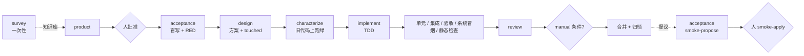

# 角色目录：岗位 → 角色 → 权限 → 输入 → 输出 → 门

引擎里的角色按**权限边界**划分，不按组织架构：一个角色能写什么、能看什么、它的结论是不是门，这三点至少有一点不同才单独成角色。只是关注点不同的分工放在角色内部用子代理完成（适配器那一侧组织，引擎不感知）。

| 岗位 | 角色 | 能写 | 只看到 | 产出 | 是门吗 |
|---|---|---|---|---|---|
| 架构师 / 技术负责人（摸底） | `survey` | 无（只读） | 整个仓库 | `openspec/foundation/` 底座知识库（经 BASE 迭代受保护） | 否，是所有角色的输入 |
| 产品经理 / BA | `product` | 无 | 意图、知识库的能力清单与活规格、澄清回答 | 合同：故事、EARS 规则、Given/When/Then 条件、澄清记录 | 人批准才生效 |
| 测试 / QA | `acceptance` | `acceptance/changes/<id>/`（仅生成与修复时） | 合同、知识库的 testing 与 building-blocks | 变更验收套件（先红）；合并后的系统冒烟提议 | 套件是门；提议需人 `smoke-apply` |
| 架构师（方案） | `design` | 无 | 合同、知识库的 extension / building-blocks / modules、既有代码 | 方案：Files、Data And Interfaces、Decisions、Risks，以及将修改的既有文件 `touched` | 否，但 `touched` 喂特征化门，方案是审查的对照物 |
| 开发（开工前） | `characterize` | `test_roots` | 合同、方案的 `touched` | 锁定现有行为的特征化测试，在旧代码上跑绿 | 是（机器验证） |
| 开发 | `implement` | 可变区 + `test_roots`，既有文件只限 `touched` | 合同、方案、失败证据、答案、已锁定路径 | 代码；`design` 记录（Tests First、Decisions） | 由各层验证判定 |
| 代码评审 | `review` | 无（只读 + 受限命令） | 合同、各层证据、方案、实现记录、知识库 | verdict + findings | 是 |
| 产品负责人 | 人 | 批准、回答、人工验收、应用冒烟、批准底座 | 一切 | 决定 | 是 |

## 每个变更里角色出场的顺序

## 角色内部的子代理（适配器侧，可选）

- `review`：正确性、安全、架构合规（对照 design_plan、extension.md 与 building-blocks.md）、测试质量（Tests First 是否真实）四个视角并行，主评审汇总 verdict。Claude 适配器已实现（默认开启，`--review-perspectives` 可调）。
- `implement`：全栈变更按方案拆后端、前端、SQL 子代理并行，主实现者集成并跑分层检查。
- `acceptance`：接口用例与浏览器用例分开写。

这些不改引擎协议：引擎只看到角色的返回结构。

## 明确不设的角色

- DevOps / 发布：合并、回执、CI 由引擎与流水线机械完成。
- 技术文档：design.md、decisions.md、活规格、报告由引擎生成。
- UX：先用 `manual` 验收条件承接，由人核对。
- 底座升级提议者（依赖升级、上游同步）：需要时再加，模式与 `smoke-propose` 相同：代理提议、人批准。
