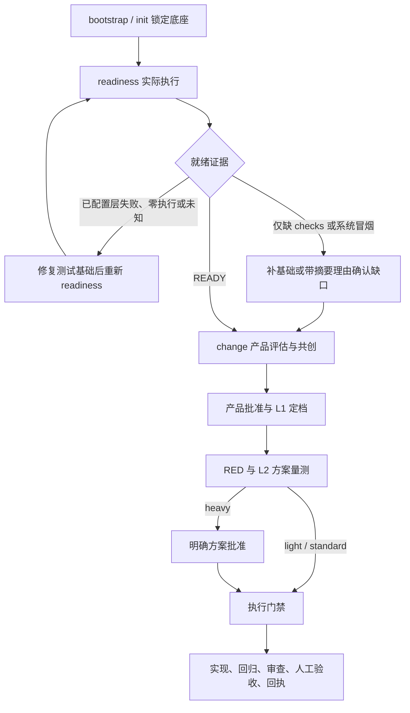

# 分流、审批与恢复

本页描述子项目 2b 的工作分支实现。自动化回归与真实代理验收分开记录；Task 12 的真实样例验收尚未完成。

## 接入顺序



```bash
storyloop init /path/project --settings /path/settings.json
storyloop readiness /path/project --json
# 仅当报告允许缺口确认：复制实际 DIGEST，并写明接受缺口的理由
storyloop approve /path/project --readiness DIGEST --reason '已评估缺少系统冒烟的影响'
storyloop change /path/project --idea '可验证的业务目标'
storyloop approve /path/project --change ID
# 仅在 DESIGN_APPROVAL_REQUIRED 时，审核报告中的实际方案与 ID
storyloop approve /path/project --change ID --design PLAN_ID
storyloop run /path/project --change ID
```

CLI 的 approve 会记录决定后续跑；Python `approve_change`、`approve_design` 与 `approve_continue_heavy` 只记录决定，调用者再运行 `run_change`。重复 run、answer、交互回车均不替代方案批准。产品批准可用 `--tier standard|heavy` 提高下限，不能指定 light 强行降档。

readiness 在隔离副本执行命令。unit、integration、system smoke 中每个已配置计数命令都必须有正的实际执行数；0、全部跳过或未知不是成功。checks 按命令成功判定，不要求测试计数。至少有一层自动测试真实执行；已配置的失败、超时不能被缺口确认豁免。确认缺口后项目可以 READY，但缺失层仍是 MISSING，绝不显示 PASSED。

新建 CLI change 在付费 product 前要求就绪；直接 API 的产品批准和新 run 也有门禁。产品缺少 assessment 或判据方法不完整会停止，不自动退回旧协议。只读 status 展示已保存证据，不重跑检查或批准；已存在阻断 run 返回真实状态，查询也可能退出 2，脚本须读取 JSON 的 status。READY 为 0；人工验收停点沿用既有退出语义。

## 三档与预算

| 档位 | 方案与审查 | 缺省实现轮次 |
|---|---|---|
| light | 引擎精简方案；不完整或配置原则时调用 design；聚合审查重点 | 2 |
| standard | design 提交可量测方案；四视角重点 | 3 |
| heavy | 用户批准方案；批准后额外一致性审查；锁定将修改的既有行为 | 4 |

轻/标准 feature/fix 没有强制锁路径时，前置特征化记 DEFERRED，不调用空范围角色。首次实际修改未锁的既有路径时，先确认服务与测试配置，再恢复该路径、真实补锁，保留本轮成本后重新实现；缺配置会阻断且不覆盖候选。heavy/refactor 与 L3 已恢复路径仍强制前置锁。

所有档位都保留 RED、执行数、基线下降检查、隔离回归、重检查收尾、边界保护、独立审查和 manual 条件。refactor 即使非 heavy 也保留行为锁。档位只升不降，升档不扩大可写路径。

显式 `.storyloop/config.json` 的 max_attempts 优先于档位默认值；省略时才使用 2/3/4。显式提高预算允许恢复，降低不退还已用轮次。规划、重规划和等待批准不消耗实现轮次；实现调用之后发现 L3 风险仍保留已消耗轮次。AGENT_UNAVAILABLE 仅沿用未完成调用的原有归还规则。legacy 缺省仍是 3，design_min_stories 只控制旧协议路径。

## 拆分、重规划与 L3

```bash
storyloop approve /path/project --change ID --continue-heavy ASSESSMENT_ID --reason '必须一次交付的原因'
storyloop approve /path/project --change ID --design PLAN_ID --option OPTION_ID
storyloop run /path/project --change ID --replan --reason '修订方案的原因'
```

SPLIT_RECOMMENDED 是停点，不是第四档。continue-heavy 仅解除同一评估摘要的拆分停点，仍须明确批准方案。方案含一个主选项和至多两个真实备选；不传 --option 就选择 main_option，不猜测其他选项。切换到扩大范围的选项可能再次要求拆分决定和方案批准。旧摘要或空理由拒绝。

L3 在实现或审查后发现风险/范围扩大，保存 consumed_attempt 与候选绑定，先回到规划门。需要补锁时只恢复相应既有路径，保留其他候选文件；恢复日志只保存路径及 blob/mode 摘要。恢复后已有有效 GREEN 锁可复用；锁定改变绑定时必须再次批准。未经授权的候选漂移会停止，不能拿旧批准覆盖用户编辑。已完成恢复日志移入历史，重规划不重新覆盖已授权实现。该机制不是通用实现事务系统；未知的中断代理结果仍保守停止。

NEEDS_SPEC_FIX、ORACLE_DEFECT 必须走已有合同修复/判据修复或带理由驳回，方案批准与 replan 不能解除它们。acceptance-repair 更换受保护套件、重证 RED 后会清理失效方案与一致性证据，重新规划/批准。BASE 变化经正式 BASE 流程处理；新摘要同样使方案批准失效。人工验收继续用 `accept`，记录与实际实现指纹绑定。

## 原则和依赖证据

原则来自受信 `baseline.source_head` 的 `openspec/principles.json`：`{version:1, principles:[{id,text}]}`。无配置显示 NOT_CONFIGURED；已配置必须逐条遵守或说明偏离。HEAD、索引、工作区不能用候选修改替换原则；正式 BASE 更新后重新规划批准。方案绑定包括 baseline_digest、principles_digest、合同、源码、范围、套件与策略摘要。

目前依赖验证只支持**已提交、无传递依赖的纯 Python wheel 的精确元数据解析**。verification.check_index 指向 profile.check_commands 中以下精确的 9 项 argv：

```text
[sys.executable, '-I', '/绝对安装路径/storyloop/dependency_resolver.py',
 '--wheel', 'vendor/demo-1.0-py3-none-any.whl',
 '--cache-dir', '.cache/resolver', '--output', '.cache/resolver/result.json']
```

解释器与引擎脚本必须是可信精确路径，三个输入路径须为安全相对路径。引擎将缓存和输出重写到隔离临时目录，绑定 wheel、命令及解析器摘要；不安装、不联网、不执行 wheel 代码。其他生态、传递解析、任意 shell/wrapper 均停 NEEDS_INPUT。元数据可解析不证明安装或运行兼容，更不代表完成外部漏洞审计。

## 兼容和就绪证书

旧 DRAFT/APPROVED 与已有 run 没有 routing version，继续 legacy 协议，保留合同摘要、生成产物和历史预算，不在恢复中补插新审批。显式 revise/supersede 是新合同，会进入新协议；不要手工删除版本字段逃避门禁。

就绪缓存绑定源码、配置、基线及受保护系统套件。普通漂移必须重采。只有完整验证的合并回执及每条命令的通过/正执行证据，才能继承既有 READY；原缺口 approval 原样保留，由单独 lineage 记录来源，不伪造新的用户决定。缺层、未知计数、命令不匹配或无法证明回执时不推进证书。
