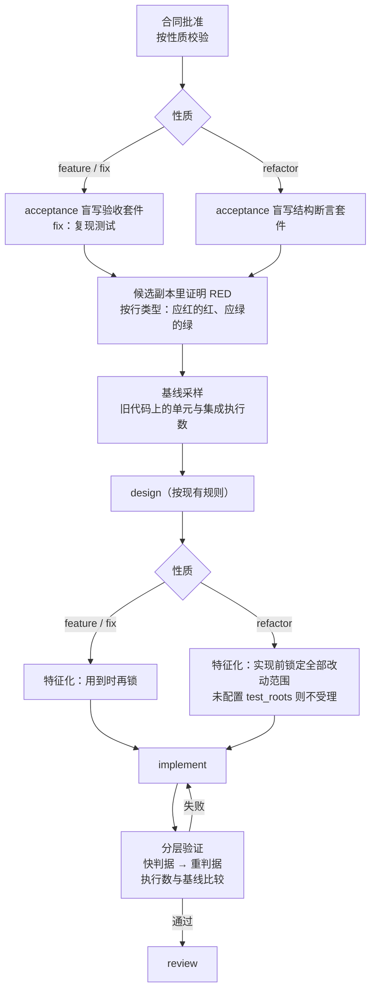

# 子项目 1：变更性质与判据

- 状态：草案，待评审
- 上位文档：[演进体系总体设计](2026-10-12-演进体系-design.md) §6（变更性质与判据）、§13（子项目顺序）
- 前置：无。本子项目是后续子项目的基础。

## 1. 目标与范围

**目标。** 把引擎的核心不变量从"验收先红后绿"扩展为"判据先于实现确立、按变更性质选择、并能自证有效"，让缺陷修复和重构两类变更也能走通闭环。

**本期范围：**

| 项 | 内容 |
|---|---|
| 变更性质 | `feature`（现状）、`fix`、`refactor:structure`、`refactor:dependency-swap` |
| 各性质的合同 | fix 的缺陷描述与根因；refactor 的范围、不变行为、结构目标、迁移映射表 |
| 各性质的判据与流程 | fix 走复现测试先红；refactor 走"行为先绿 + 结构先红" |
| 判据自证 | 测试执行数统计；与旧代码基线比较；执行数为 0 或下降判失败 |
| 判据分级 | 验收清单里的测试分快、重两级，重的在快的全绿后才跑 |
| 验收矩阵 | 验收条件带行类型与判据类别；不适用的行类型写理由；批准前确定性检查 |
| 消费端矩阵 | 合同列出消费端；范围内的每个消费端都要被验收条件覆盖 |
| 技能包 | 新增 `oracle-craft`：特征化写法、验收矩阵行类型、结构断言写法 |
| 保护 | 技能包目录不能被配置成可变区；运行状态记录本次使用的技能包版本 |

**不在本期**（归属见总体设计）：

| 内容 | 归属 |
|---|---|
| 档位、入口四道门、`NATURE_MISMATCH` 停点、失败归属、作废并修订重开 | 子项目 2 |
| 报告模板改版（本期只把新数据写进运行状态和现有报告的追加段落） | 子项目 3 |
| 判据强度审查视角、审查发现的严重度 × 置信度 | 子项目 4 |
| 外部 CI 结果导入为证据；`upgrade`、`perf`、`docs`、`port` 性质 | 后续 |

## 2. 需要确认的设计取舍

| # | 取舍 | 推荐 | 理由 |
|---|---|---|---|
| Q1 | 结构判据由谁写 | **由 acceptance 角色从合同的结构目标盲写**，作为 refactor 的"变更验收套件"。这与总体设计 §6.2"由 design 写"不同，评审通过后回写总体设计 | design 是只读角色，让它写文件会破坏权限边界。由 acceptance 写，就能原样复用现有的"套件受保护、在旧代码上证明 RED、实现者改不了"整条机制，refactor 不需要另造一套判据通道 |
| Q2 | refactor 是否必须有结构断言 | **本期必须至少一条**。说不出可断言的结构目标的重构（例如"让代码更好读"）不受理 | 没有结构断言时，refactor 只剩"没弄坏"，判断不了"做没做到"，完成与否只能靠审查者的主观判断。先要求可断言，以后有需要再放宽 |
| Q3 | 测试执行数怎么统计 | **引擎内置常见测试工具的输出解析**（Maven Surefire、Gradle、pytest、unittest、Jest、Vitest、Go），settings 可以按命令补充正则。统计不出来时不设门，在运行状态和报告里标"未能统计" | 引擎保持技术栈中立。统计不出来就硬判失败会误杀；静默放过又会重演"0 个用例执行却显示成功"。所以明确标出"未能统计"，让人知道这一层没有自证 |
| Q4 | 测试执行数下降算不算失败 | **算**。实现后单元层或集成层的执行数低于旧代码基线，就判这一层失败 | 实现者删测试，和改测试一样是在削弱判据。确实需要删的测试（例如随死代码一起删），应在合同里声明，由人批准 |
| Q5 | 变更 ID 前缀 | **按性质区分**：`FEAT-`、`FIX-`、`REF-`。功能分支仍统一用 `feature/<ID>` | 从 ID 一眼看出性质，便于报告和外环统计。分支前缀保持不变，以免影响现有的分支校验和用户的 Git 习惯 |
| Q7 | 行类型决定实现前应有的状态（§3.4） | **采用**：断言新行为的必须红，断言保持不变的（回归、状态保持、非目标未宣称）必须绿，RED 证明两边都核对 | 现有规则要求每条自动验收条件都先红，与"保持不变"类条件天然冲突，会让带这些条件的变更全部卡在 `EXISTING_GREEN`。这一条改变了现有的 RED 规则，所以单列出来确认 |
| Q6 | "不适用的行类型"写在哪一级 | **按变更一级写**，不按故事 | 第一期合同里的故事数通常只有 1–3 个，按故事写会大量重复；以后如有需要，再细化到故事级 |

## 3. 合同模型

### 3.1 新增字段（产品合同 `version: 1` 保持，新增字段均为可选，缺省值兼容旧合同）

```json
{
  "nature": "fix",
  "defect": {
    "observed": "导出的 CSV 少了最后一行",
    "expected": "导出全部记录",
    "reproduction": ["准备 3 条订单", "点击导出", "打开 CSV，只有 2 行"],
    "reporter_hypothesis": "可能是分页参数从 1 开始",
    "root_cause": [
      {"statement": "导出循环用 < total - 1 作为终止条件", "location": "modules/orders/export.py:42"}
    ],
    "confirmed": ["终止条件少算一行"],
    "unconfirmed": ["是否还有其他导出入口有同样问题"],
    "sibling_entries": ["modules/orders/report.py:88"],
    "origin_change": "FEAT-20260920-001"
  },
  "refactor": {
    "subtype": "dependency-swap",
    "scope": ["modules/orders/**"],
    "invariants": ["所有对外接口的请求与响应不变"],
    "structural_goals": ["modules/orders 下不再引用 legacy_http"],
    "migration_map": [
      {"from": "legacy_http.get(url)", "to": "httpx.get(url)", "assertion": "grep 'legacy_http' 计数为 0"}
    ]
  },
  "consumers": [
    {"id": "C1", "consumer": "订单列表页的导出按钮", "trigger": "点击导出",
     "path": "web → /api/orders/export → export.py", "in_scope": true, "verification": "接口用例"}
  ],
  "coverage_exemptions": [
    {"row_type": "form_parity", "reason": "导出只有一种调用形态"}
  ],
  "test_removals": []
}
```

验收条件新增四个可选字段：

```json
{"id": "A1", "given": "…", "when": "…", "then": "…", "kind": "automated",
 "row_type": "positive", "oracle_class": "auto-fast", "consumers": ["C1"], "reproduces_defect": true}
```

### 3.2 字段规则

| 字段 | 规则 |
|---|---|
| `nature` | `feature` / `fix` / `refactor`；缺省为 `feature`（旧合同） |
| `defect` | `nature=fix` 时必填；`root_cause` 1–5 条，每条带 `path:line`；`reporter_hypothesis` 只作背景，角色说明明确不把它当需求 |
| `refactor` | `nature=refactor` 时必填；`subtype` 为 `structure` 或 `dependency-swap`；`structural_goals` 至少 1 条（Q2）；`dependency-swap` 必须有 `migration_map` |
| `row_type` | `positive`、`degradation`、`unknown_state`、`form_parity`、`regression`、`state_preservation`、`non_goal`；缺省为 `positive`。行类型决定实现前应有的状态，见 §3.4 |
| `oracle_class` | `auto-fast`、`auto-heavy`、`manual`；缺省时由 `kind` 推出（`automated` → `auto-fast`） |
| `consumers` | 合同级列表；验收条件用 `consumers` 字段引用消费端 ID |
| `reproduces_defect` | 只用于 fix：标出复现缺陷的验收条件，它必须是应红的行类型 |
| `coverage_exemptions` | 某个行类型不适用时写明理由；引擎检查每个行类型要么有验收条件，要么有豁免 |
| `test_removals` | 本次允许删除的既有测试（路径加理由）；不在列表里的测试被删，执行数下降，按失败处理（Q4） |

不同性质的故事与验收条件：

| 性质 | stories 怎么写 |
|---|---|
| feature | 现状：用户故事 + EARS 规则 + 验收条件 |
| fix | 一个故事描述期望行为；至少一条标 `reproduces_defect: true` 的自动验收条件（行类型为 `positive`，实现前必须红），加上其他行类型 |
| refactor | 一个故事描述结构目标；每条结构目标对应一条 `automated` 验收条件（实现前必须红）；行为不变由特征化、回归和系统冒烟保证，不写成验收条件 |

### 3.3 批准前的确定性检查（`requirement_checklist` 新增项）

| 检查 | 级别 |
|---|---|
| `nature` 合法；对应的 `defect` / `refactor` 块存在且完整 | error |
| fix 的 `root_cause` 每条 `path:line` 在合同提交时的基线上存在：文件存在，行号不越界 | error |
| fix 至少一条 `reproduces_defect: true` 的自动验收条件 | error |
| refactor 至少一条结构目标；每条结构目标都有对应的自动验收条件 | error |
| refactor 的仓库配置了 `test_roots` 与 `unit_commands`（特征化是它的主判据） | error |
| feature 与 fix：七个行类型中，每个要么有验收条件，要么有豁免理由（refactor 不做这项检查，它的判据是结构断言加特征化） | error |
| 范围内的每个消费端至少被一条验收条件引用 | error |
| 验收条件的文字里出现疑似类名、函数名（驼峰或带括号的标识符） | warning |
| `reporter_hypothesis` 的内容原样出现在 EARS 规则里 | warning |

### 3.4 行类型决定实现前应有的状态

现有的 RED 规则要求每一条自动验收条件在旧代码上都失败。但有些行类型断言的是"保持不变"，在旧代码上本来就该通过。所以按行类型区分：

| 行类型 | 实现前应有的状态 | 含义 |
|---|---|---|
| `positive`、`degradation`、`unknown_state`、`form_parity` | **红** | 断言新的或改变的行为 |
| `regression`、`state_preservation`、`non_goal` | **绿** | 断言保持不变的行为，或没做的事不被宣称 |

RED 证明同时核对两边：

- 应红的条件，每一条都至少有一个测试失败（即现有规则，只是范围收窄到这几类）。
- 应绿的条件，在旧代码上必须全部通过。应绿的条件在旧代码上就失败，说明用例写错了，作为判据缺陷停下，交给 `acceptance-repair`。
- 应红的条件在旧代码上已经通过，仍然停在 `EXISTING_GREEN`。

实现之后两类都必须是绿。验收清单的测试按条件分组时，一个测试只能覆盖同一种预期状态的条件，便于逐条判定。

## 4. 各性质的流程



| 步骤 | feature | fix | refactor |
|---|---|---|---|
| 变更验收套件 | 验收条件 | 复现测试 + 其他行类型 | 结构断言 |
| RED 证明 | 按行类型核对：应红的红、应绿的绿（§3.4） | 同 feature；复现条件必须红 | 结构断言必须红 |
| 基线采样 | 新增 | 新增 | 新增 |
| 特征化 | 现状（未配置 `test_roots` 时跳过） | 同 feature | 实现前锁定全部改动范围；未配置则批准时就拒绝 |
| 执行数比较 | 新增 | 新增 | 新增 |
| 完成判定 | 各层全绿 | 同 feature | 各层全绿，其中结构断言变绿，特征化、回归、系统冒烟保持绿 |

**基线采样。** RED 证明之后，在合同提交的候选副本上跑一次单元层和集成层，记录每条命令的执行数，存进运行状态的 `oracle.baseline`。特征化门本身也会在旧代码上跑单元层，那时用它的结果更新基线（特征化测试新增的用例计入基线）。

## 5. 判据自证

### 5.1 执行数统计

- 每条回归命令（单元、集成）和每个验收测试命令执行后，用解析器从输出中提取 `discovered`、`executed`、`failed`、`skipped`，统计不出来的项记为 `null`。
- 内置解析器：

| 工具 | 识别的输出 |
|---|---|
| Maven Surefire / Failsafe | `Tests run: N, Failures: F, Errors: E, Skipped: S` |
| Gradle | `N tests completed, F failed, S skipped`（Gradle 默认只在有失败时打印；全部通过时需要项目开启 `testLogging` 的汇总，或在 settings 里补自定义模式，否则记为"未能统计"） |
| pytest | `N passed`、`F failed`、`S skipped`（结尾汇总行） |
| unittest | `Ran N tests`、`FAILED (failures=…, errors=…)` |
| Jest / Vitest | `Tests: … N passed, N total` |
| Go | 加 `-v` 时统计 `--- PASS` / `--- FAIL` 行；不加 `-v` 时输出里没有用例数，记为"未能统计" |

- settings 新增 `test_count_patterns`：`[{"match": <命令首个参数或子串>, "executed": <带命名组的正则>}]`，用来补充或覆盖内置解析。
- 多个解析器同时命中时取执行数最大的一个，并记录用的是哪个。

### 5.2 判定规则

| 情况 | 判定 |
|---|---|
| 某条命令退出码为 0，但 `executed == 0` | 这一层失败："执行数为 0" |
| `executed` 低于基线，且差额不能由 `test_removals` 解释 | 这一层失败："执行数从 N 降到 M" |
| 统计不出来（`null`） | 不设门，运行状态记 `uncounted`，报告标"未能统计，这一层没有自证" |
| 验收套件的测试命令退出码为 1 但执行数为 0 | RED 证明不成立：这是环境或收集错误，不是行为失败 |

### 5.3 "因缺陷而红"

沿用现有约定：验收执行器退出码 1 表示行为失败，其他非零表示环境错误，只有 1 算有效 RED。本期新增两点：

- 统计出来的 `executed == 0`，即使退出码是 1，也不算有效 RED，因为它多半是收集或导入失败。
- 技能包要求执行器把收集、导入、夹具类错误映射为退出码 2（`examples/tools/smoke_harness.py` 已提供 `env_error`）。

## 6. 判据分级

- 验收清单的每个测试新增可选字段 `tier`：`fast`（默认）或 `heavy`。
- 每轮尝试的变更验收层：先跑 `fast`；全部通过后再跑 `heavy`；`fast` 有失败时 `heavy` 记为"未运行（快判据未通过）"。
- RED 证明阶段同样只要求快判据证明 RED。`heavy` 测试在旧代码上也跑一次，结果写进证据，但不参与 RED 判定，以免慢测试拖垮每个变更的开场。
- `oracle_class: auto-heavy` 的验收条件必须由 `tier: heavy` 的测试覆盖，`auto-fast` 的必须由 `fast` 的覆盖，在安装套件时校验。

## 7. 角色说明与技能包

| 角色 | 改动 |
|---|---|
| product | 输出 `nature` 及对应的块；fix 要先追调用链再写根因（每条带 `path:line`），把报告者的猜测单列；refactor 要写可断言的结构目标；所有性质都写消费端矩阵、行类型和豁免理由 |
| acceptance | 按性质生成：fix 写复现测试；refactor 写结构断言（判定到 import 或全限定名；普查范围等于合同陈述的范围）；为每个测试标 `tier`；遵循 `oracle-craft` 技能包 |
| characterize | 遵循 `oracle-craft` 的特征化写法；refactor 时 `touched` 必须覆盖合同 `refactor.scope` 内会被改动的全部既有文件 |
| implement | 不得删除不在 `test_removals` 里的既有测试；refactor 不得改变行为，结构目标以外的"顺手改进"不做 |
| review | 本期只在角色说明里加入"检查弱断言、检查是否删了测试"，独立的判据强度视角在子项目 4 实现 |

**`oracle-craft` 技能包**（`storyloop/skills/oracle-craft/`，`roles: [product, acceptance, characterize, review]`）：

- 特征化写法：总体设计 §6.5 的全部规则。
- 验收矩阵：七个行类型各举一个正反例；"未知不等于否定"；状态保持的往返写法。
- 结构断言：grep 或 import 扫描的写法；同名误报与注释的处理；"再扫为零"的普查范围。
- 执行器退出码约定：0 通过、1 行为失败、2 环境错误。

角色挑选技能包的通用机制（`roles`、`stacks` 元数据）在子项目 4 实现；本期 `oracle-craft` 按现有方式（同 `foundation-survey`）随引擎安装，并由对应角色的说明直接引用。

## 8. 保护

- `validate_project_settings` 拒绝把 `.claude/skills`、`.codex/skills` 或它们的上级目录配置进 `module_roots` 与 `test_roots`。
- 这两个目录在 `init` 时属于底座（它们是已跟踪文件，不在可变区），实现者改动会被底座漂移检查和边界审计拦下。本期为这一点补一条测试，把现有的隐含保证固定下来。
- 运行状态记录本次每个角色使用的技能包名称与版本（`skills_used`），供子项目 3 的报告使用。

## 9. 对代码的影响

| 模块 | 改动 |
|---|---|
| `models.py` | `validate_product` 支持 `nature`、`defect`、`refactor`、`consumers`、`coverage_exemptions`、`test_removals`，以及验收条件的新字段 |
| `role_schemas.py` | product 与 acceptance 的 schema 同步新增字段（可为 null）；acceptance 清单的测试增加 `tier` |
| `requirement_checklist.py` | §3.3 的检查项；`root_cause` 位置的核对需要读基线文件，新增一个只读的辅助函数 |
| `changes.py` | 按性质生成 ID 前缀（`_next_id`）；预览文件显示性质与对应的块 |
| `smoke.py` | 清单校验支持 `tier`，并检查 `oracle_class` 与 `tier` 的对应关系；一个测试只能覆盖同一种预期状态的条件 |
| `smoke_runner.py` | 快、重两级执行；RED 证明只看快判据，并按行类型分别核对应红与应绿；结果里带执行数 |
| `oracle_counts.py`（新） | 测试输出解析器、settings 自定义模式、与基线的比较 |
| `project_loop.py` / `project_loop_gates.py` | 基线采样；refactor 的特征化前置与范围要求；各层结果与基线比较 |
| `project_profile.py` | 新 settings 键 `test_count_patterns`；`module_roots` 与 `test_roots` 不得包含技能包目录 |
| `project_agents.py` | product、acceptance、characterize、implement、review 的角色说明按 §7 更新 |
| `skills/oracle-craft/` | 新技能包 |
| `change_report.py` | 在现有报告末尾追加"判据自证"一节：基线、各层执行数、未能统计的命令（完整改版在子项目 3） |
| 文档 | 概念手册、使用指南、api.md、roles.md、capabilities.md 同步；总体设计 §6.2 回写 Q1 的决定 |

## 10. 测试计划

| 测试 | 证明什么 |
|---|---|
| 合同：三种性质各一份合法合同、各缺一个必填块的非法合同；旧合同（无 `nature`）照常通过 | 合同模型与兼容性 |
| 检查表：根因位置不存在、行类型既没有条件也没有豁免、范围内消费端未被覆盖，分别报 error | 批准前的确定性检查 |
| fix 端到端：复现测试在旧代码上红、实现后绿，报告与 ID 前缀为 `FIX-` | fix 闭环 |
| refactor 端到端：结构断言在旧代码上红；特征化前置；实现后结构变绿、特征化保持绿 | refactor 闭环 |
| refactor 未配置 `test_roots`：批准被拒绝 | 主判据缺失时不受理 |
| 执行数：单元层退出 0 但执行数为 0 判失败；实现删除一个测试导致执行数下降判失败；`test_removals` 里声明的删除不判失败；无法解析时记 `uncounted` | 判据自证 |
| RED：退出码 1 但执行数为 0 不算有效 RED | 收集错误不冒充 RED |
| RED 按行类型：`regression` 条件在旧代码上通过、`positive` 条件失败时 RED 成立；`regression` 条件在旧代码上失败时停下并提示 `acceptance-repair` | 应绿与应红分开核对 |
| 分级：快判据失败时重判据记"未运行"；重判据只在快判据全绿后运行；`oracle_class` 与 `tier` 不匹配时安装套件被拒 | 判据分级 |
| 解析器：每种内置格式各一个样本输出；settings 自定义模式覆盖内置 | 统计正确 |
| 保护：`module_roots` 包含 `.claude/skills` 时 init 被拒；实现改动技能包文件被拦下 | 判据输入受保护 |

所有测试沿用现有夹具：临时 Git 仓库、脚本化的 `LoopServices`，不需要模型账号。

## 11. 兼容与迁移

- 没有 `nature` 的旧合同按 `feature` 处理，行为与现在一致；新字段全部可选。
- 旧合同没有 `row_type` 与豁免：检查表对旧合同只给 warning，不给 error，避免已批准的旧变更在续跑时被卡住。新合同严格检查。
- 已存在的 `FEAT-` 变更 ID 不改；只有新创建的变更按性质取前缀。
- 没有 `test_count_patterns`、也解析不出执行数的仓库：行为与现在一致，只是多了"未能统计"的标注。

## 12. 完成标准

- 在 `examples/todo-demo` 上完成三个真实变更：一个 feature、一个 fix（复现测试先红后绿）、一个 refactor（结构断言先红后绿、特征化保持绿）。三个变更都能从干净仓库按文档跑通。
- 人为让单元层执行数为 0（例如测试发现规则失效）时，闭环判失败并给出明确原因。
- 全量测试通过；新增测试覆盖 §10 的每一行。
- 实现完成后，补一张"设计与实现差异表"，写明原因，并回写总体设计。
