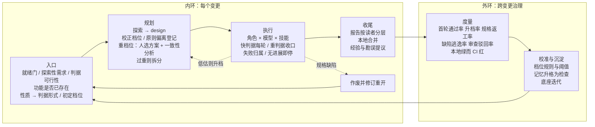

# StoryLoop 演进体系：总体设计

- 状态：已评审（2026-10-12 第一版；同日第二版吸收课程经验），作为后续子项目的共同依据；各子项目另写设计文档。
- 范围：产品定位、设计原则、决策分层、停点目录、六个子项目的设计要点与顺序。安全（威胁模型、隔离、不可信输入）作为独立模块另行设计，不在本文范围内。
- 依据：
  - 当前引擎 0.1.0（见 [docs/README.md](../../README.md) 的知识库）；
  - 业界调研（本地，未入库）；
  - 作者的实践：`eng-workflows` 技能集（refactor、stack-rewrite、project-survey、perm-init、feature-dev）、官方 feature-dev 插件、在 oryxos 上使用 spec-kit 的过程（oryxos-lab：837 个提交、约 55 个特性）；
  - 作者的 AI 编程课程（68 节）：方法论与工作流、Loop 与 Harness、在 Dify 和 mq9 等存量开源项目上用 OpenSpec 与纯提示词做事、OryxOS 各模块的设计与构建。

## 1. 背景与定位

**问题。** 让 AI 从需求写出代码已经不稀缺，缺的是**证明代码写对了**：

- 代理能改测试时，约一半会作弊（ImpossibleBench）；
- 用了 AI 之后，审查时间增加 91%（Faros）；
- 只有 33% 的开发者信任 AI 的输出（Stack Overflow 2025）；
- 作者自己在重构中遇到过：测试框架不匹配，用例执行数为 0，构建却显示成功。

业界四类产品（自主编码代理、规格驱动开发工具、一句话生成应用、多代理框架）没有一家公开做全这条链：

> 判据在实现前确立 → 实现者改不了 → 机器给出结论 → 每条验收标准都有证据

规格驱动开发的代表 Spec-Kit 自己也承认，它不适合小改动和大型存量改造。

大规模成功的 AI 编码也不是 AI 自主写完的。Bun 用 6 天迁移 96 万行，靠的是三件事：事先写好的 300 条迁移规则、每一段迁移都跑测试的闭环、人留在决策层。

**定位。** 让 AI 在已有代码仓库上的每一次改动，都带着"实现之前就定好、AI 自己改不了"的判据，以及审查者 30 秒就能看懂的证据交付。

AI 编程正在沿 Vibe → Context → Harness → Loop Engineering 演进：SDD（规格驱动开发）管想，Harness（约束与反馈机制）管做，Loop（自动循环）管循环。StoryLoop 是 **Harness 和 Loop Engineering 在存量仓库上的产品化**：它把 SDD 的规格变成实现前就固定、实现者改不了的可执行判据。

StoryLoop 只管执行的两端，执行本身交给厂商的编码代理：

- 前端：把人的判断固化成判据；
- 后端：把结果变成证据。

整体上，StoryLoop 是包在自主代理外面的**确定性外壳**。

## 2. 核心价值与能力

### 2.1 核心价值

| 价值 | 解决的问题 |
|---|---|
| 可信交付 | AI 说"做完了"，但其实没做完，甚至改测试来作弊 |
| 存量仓库安全演进 | 生成类产品止步于从零新建；在已有代码上改动会破坏隐式行为 |
| 审查成本可控 | 审查成为 AI 编码的新瓶颈 |
| 流程与风险相称 | 重流程拖累小改动，轻流程放过大风险 |
| 经验资产留在团队仓库里 | 同样的坑反复踩，文档和代码脱节。规格、判据、经验都是团队仓库里的版本化文件，不锁在任何厂商的代理记忆中，换模型也带得走 |
| 厂商中立、可审计 | 被单一模型厂商锁定，同一个模型自己审自己。每次调用都有结构化留痕，适配器也可以接私有或本地模型 |

### 2.2 核心能力

| 能力 | 内容 | 对应章节 |
|---|---|---|
| 需求合同共创 | 选择题澄清、确定性质量门、消费端矩阵、验收矩阵、入口四道门 | §6、§7 |
| 判据工程 | 按变更性质生成判据；判据自证有效；按成本分级；实现者改不了 | §6 |
| 分类与分流 | 性质 × 档位；按规模、维度、可验证性取最重的一档；只升不降；必要时拆分 | §7 |
| 失败归属与纠偏 | 失败先归属；事实可以更新；规格缺陷时作废并修订重开；无进展就停 | §7.9、§5 |
| 角色编排 | 按权限边界划分角色；上下文隔离；模型档次、技能包、子代理随档位伸缩 | §8 |
| 隔离验证与边界审计 | 候选副本里分层验证；全树快照；底座边界 | 已有 |
| 证据报告 | 每句话标明来源；审查重点由引擎计算 | §9 |
| 分层记忆 | 核心、事实、行为、经验、事件；按角色和路径取用；勘误与经验晋升 | §10 |
| 外环治理 | 度量、校准、规则演进；人是决策者 | §11 |

### 2.3 不做什么

- 不做编码代理，那是模型厂商的主场。
- 不做托管、数据库、应用生成。
- 不做 CI 系统，不做部署。
- 不做多角色互相对话的团队模拟。
- 不转售 token。
- 不做双轨整体重写（新栈独立建工程、最后一次性切换）。它和"在现有仓库上做单一性质的变更"不兼容。
- 暂不做向第三方仓库提交 PR 的协作出口（产物外置、PR 正文、PR 发出后的反馈闭环）。见 §13 的延后项。

## 3. 设计原则（不变量）

1. **判据先于实现确立。** 判据可执行，在实现之前固定，实现者改不了。判据的形式由变更性质决定（§6），任何档位都不裁剪判据。
2. **影响判据的输入同样受保护。** 技能包、经验条目、底座原则会影响后续判据的写法，所以与合同一起冻结指纹，实现者改动它们按越界处理。
3. **判据自证有效。** 判据必须证明自己真的运行过、真的有约束力：
   - 执行数不能为 0，也不能比基线骤降；
   - 该红的时候必须红；
   - 新增的检查要先在一个故意注入的违规上跑红，才能采纳。
4. **确定性优先，只升不降。** 能从代码事实算出来的，由引擎计算；需要判断的，由代理建议、人批准。分类和档位在运行中只能升级。
5. **区分证据型门和成本型步骤。**
   - 证据型门：判据、边界审计、回归、报告只认真实结果。
   - 成本型步骤：方案、子代理、模型档次、报告详略。
   - 只裁剪成本型步骤。
6. **合同和判据冻结，事实可以更新。** 运行中新发现的事实写回事实记录；规格本身有缺陷时作废并修订重开，不在运行中改合同（§7.9）。
7. **预算只衡量质量。** `max_attempts` 只为"引擎能判定的回答"计数；代理进程没给出回答属于基础设施失败，不消耗预算（已于 2026-10-12 修复）。失控成本另设硬上限，作为挂死保护。
8. **报告的每句话标明来源**：机器事实、人工记录、代理陈述。
9. **引擎角色按权限边界划分。** 专业化通过"模型档次 × 技能包 × 子代理"在角色内部完成（延续决策 0016）。
10. **内环执行规则，外环修改规则。** 外环的决策者是人。
11. **同一件事只有一条通道。** 草案和审批统一为一套机制（§10.4）。出现第二条通道，迟早行为不一致。

## 4. 体系总览

### 4.1 两个环



### 4.2 决策分层

| 层 | 何时 | 决策点 | 依据 | 谁拍板 | 能否撤回 |
|---|---|---|---|---|---|
| L0 项目 | 接入时，低频 | 底座边界、敏感路径、底座原则、档位阈值、角色画像、跨厂商审查；接入就绪门 | 仓库事实、外环建议 | 人 | 经 BASE 迭代或改配置 |
| L1 入口 | 每个变更一次 | 是否先做探索；判据是否可行；功能是否已存在；性质；初定档位；是否建议拆分 | 意图、知识库、活规格 | product 提议，人随合同批准 | 运行开始后合同不可修订；规格缺陷时作废并修订重开 |
| L2 规划 | 批准后、实现前 | 生效档位；是否特征化；原则偏离；重档位选方案；超重时拆分还是强行继续 | 探索结果、design 的 `touched`/`creates`、规模、维度、可验证性 | 引擎按规则计算；重档位由人选方案；强行继续由人写理由 | 只升不降 |
| L3 执行 | 每轮尝试 | 模型档次、技能包、子代理；跑哪些判据；失败归属；审查发现的去向；是否无进展就停 | 生效档位、角色画像、严重度 × 置信度 | 引擎按配置执行；规格缺陷交给人 | 发现低估就升档 |
| L4 收尾 | 每个变更结束 | 报告详略；经验与勘误提议 | 证据、失败记录、审查发现 | 引擎生成报告；经验和勘误由人批准 | 本地合并，push 前可以回退 |
| L5 演进 | 跨变更，定期 | 规则校准、经验升级为检查、过时记忆清理、延后项是否启动 | 外环指标、延后项的触发信号 | 人 | 随时调整 |

## 5. 停点目录

所有停点使用统一的停止报告，包含：阶段、已完成内容、最后一次判官结果、尝试过的方案、阻塞点、需要人决定的问题、恢复命令。只报"失败，请重试"是不允许的。

| 停点 | 触发 | 给人看的证据 | 人的选项 | 恢复 | 状态 |
|---|---|---|---|---|---|
| `NEEDS_INPUT` | 代理提出真实歧义 | 问题与上下文 | 回答 | `run` | 已有 |
| `ORACLE_DEFECT` | 应当保持成立的验收条件在旧代码上就失败 | 失败的条件与输出 | `acceptance-repair` 修正用例 | `run` | 已有（子项目 1） |
| `EXISTING_GREEN` | 判据在实现前就已通过 | 结果与没能失败的条件 | 放弃 / `acceptance-repair` / 改判为 refactor | `run` | 已有 |
| `CHARACTERIZATION_FAILED` | 特征化在旧代码上不绿 | 失败断言 | 就地修正测试 | `run` | 已有 |
| `BOUNDARY_VIOLATION` | 越界写入 | 路径与写入的调用 | 还原；或经 BASE 迭代扩大范围 | `run` | 已有 |
| `BASE_CHANGE_REQUIRED` | 碰到底座 | BASE 提案 | 独立提交后 `base-update` | `run` | 已有 |
| `WORKSPACE_TAINTED` | 控制面、暂存区或未声明的产物 | 改动清单 | 清理 | `reset` → `run` | 已有 |
| `BUDGET_EXHAUSTED` | 预算用尽 | 每轮失败与归属 | 提高预算 / 修复判据 / 作废重开 | `run` | 已有 |
| `MANUAL_ACCEPTANCE_REQUIRED` | 有人工条件 | 待验条件与操作路径 | 逐条 `accept` | `run` | 已有 |
| `AGENT_UNAVAILABLE`（错误码） | 代理进程没有给出回答 | 调用记录与 stderr | 处理基础设施问题 | `run` 重试同一轮 | 已有（2026-10-12） |
| `DESIGN_APPROVAL_REQUIRED` | 重档位方案待选 | 主方案与备选、各自的档位 | 选择 / 要求修改 | `approve --design` | 新增 |
| `SPLIT_RECOMMENDED` | 超重 | 拆分建议 | 拆分 / 写理由后强行继续 | 新变更或 `approve` | 新增 |
| `NEEDS_SPEC_FIX` | 失败归属为合同缺陷 | 合同哪一条与哪个事实或判据矛盾 | 作废并修订重开 / 驳回归属 | `change --supersede` | 新增 |
| `NO_PROGRESS` | 根因调查后失败特征不变、没有新通过的断言 | 各轮的失败特征 | 同 `BUDGET_EXHAUSTED` | `run` | 新增 |
| `ORACLE_INFEASIBLE` | 拿不出能在本地稳定验证的判据 | 原因（需要等待多日、依赖生产账号等） | 改需求 / 改走人工验收 / 放弃 | `change` | 新增 |
| `NATURE_MISMATCH` | 性质一致性检查失败（§6.7） | 不一致的事实 | 改判性质并作废重开 | `change --supersede` | 新增 |

命令名在各子项目设计中最终确定；审批类动作统一沿用 `approve` 加参数（§10.4）。

## 6. 子项目 1：变更性质与判据

### 6.1 一个变更只有一种性质

混合需求必须拆开，按顺序依次合并。为新功能顺手调整既有代码不算混合：feature 本身就同时包含"新行为先红"和"既有行为先绿（特征化）"两种判据。

### 6.2 性质与判据

| 性质 | 判据（实现前确立） | 谁来写 | 实现前 | 通过条件 | 阶段 |
|---|---|---|---|---|---|
| feature | 变更验收套件 + 既有文件的特征化测试 | acceptance、characterize | 验收红，特征化绿 | 都绿 | 已有 |
| fix | 能复现缺陷的测试 | acceptance，只看缺陷报告盲写 | 红，并且是因为缺陷本身而红：只有断言失败算数，导入、收集、夹具类错误不算 | 变绿，回归不破 | 第一期 |
| refactor:structure | 行为判据：特征化、回归、系统冒烟；结构判据（第一期必须至少一条）：结构断言 | characterize；结构断言由 acceptance 从合同的结构目标盲写（子项目 1 Q1、Q2） | 行为绿；结构红 | 行为仍绿，结构变绿 | 第一期 |
| refactor:dependency-swap | 行为判据同上；结构判据默认"再扫为零"（被移除目标的全限定名 grep 计数为 0，依赖树无残留）；迁移映射表 | 同上 | 同上 | 同上 | 第一期 |
| upgrade | 全量回归、系统冒烟、构建；黄金快照对拍 | 已有测试资产 | 绿 | 仍绿 | 第二期，经 BASE 迭代 |
| perf、docs、port | 基准与阈值；结构校验加人工；与参考实现的行为对拍 | — | — | — | 延后（§13） |

### 6.3 判据自证与分级

**自证**
- 每次运行判据都记录测试的发现数和执行数，与基线比较。执行数为 0、比基线骤降、某个判据文件里有用例没被执行，一律判失败。
- 结构断言判定到 import 或全限定名，避免同名误报和注释干扰。普查范围必须等于合同里陈述的目标范围。
- 新增的检查（结构断言、由经验升级的检查、底座原则检查）要先在一个故意注入的违规上跑红，才能采纳。
- 判据强度视角检查弱断言：只断言字段存在、值非空，而没有断言值本身。

**按成本分级**

| 级别 | 内容 | 何时跑 |
|---|---|---|
| 快 | 单元、快速集成、lint、结构断言、变更验收里的接口用例 | 每轮尝试 |
| 重 | 端到端、浏览器、长时间运行的用例 | 快判据全绿之后跑一次收口 |
| 外部 | 项目自己的 CI | 结果绑定实现指纹后，作为 🔧 机器事实导入 |

外环统计"本地绿、CI 红"的比例，用来衡量本地判据有多弱。

### 6.4 验收矩阵

合同中的验收条件按固定的**行类型**组织。每一类要么有用例，要么写明不适用的理由，引擎检查不允许有空行：

| 行类型 | 含义 |
|---|---|
| 正向 | 目标行为 |
| 降级与失败隔离 | 依赖失败时明确失败，不静默兜底，主流程不受影响 |
| 未知态 | 加载中或读取失败时，不等同于否定结论（"未知不等于不支持"） |
| 回归 | 既有契约不变 |
| 形态一致 | 同一能力的不同用法（例如独立应用与工作流节点）都覆盖 |
| 状态保持 | 已保存的状态"载入 → 交互 → 保存"之后，除目标字段外完全相等；新代码对持久状态只读 |
| 非目标未宣称 | 没做的事不被报告为已支持 |

负向用例（降级、未知态）**从第一期开始就要求**。

**消费端矩阵**列：消费端、触发方式、代码路径、是否在范围内、验证方式。

- 每个在范围内的行至少一条验收用例。
- refactor 和 dependency-swap 由 design 产出"改动单元 → 消费端"矩阵，系统冒烟按矩阵逐条打到真实路径。只做"能启动"的冒烟不够。

**关键失败模式。** 标准档和重档的合同或方案要列出关键失败模式，每条映射到一个测试，或者写明"未覆盖"。判据里禁止写覆盖率指标。

**判据类别。** 每条验收条件标注 auto-fast / auto-heavy / manual，作为可验证性维度的输入（§7.3）。

### 6.5 特征化测试的写法（写进 characterize 角色的技能包）

- 期望值来自实测，不靠读代码推断。
- 按行为面分三类：请求-响应用录制回放；随身份变化的按身份 × 数据范围断言；触发副作用的断言副作用本身。
- 至少一条非管理员身份的用例。
- 写操作比对落库的数据。
- 列出非确定性来源（时钟、无序结果集、易变字段、LLM 调用）。LLM 打桩按用例键匹配，不按提示词字节匹配。
- 会被扩展的集合用 contains 断言，不用 equals。
- 集成判据用真实依赖，不用 mock 顶替；用了 mock 的用例在报告里标为 🤖 AI 构造。
- 断言密度按风险分 T1–T3，由 design 给每个改动单元标注：
  - T1：一条非特权身份的主路径；
  - T2：加泄漏点样本；
  - T3：全套。

### 6.6 不同性质的合同模板

| 性质 | 合同主体 |
|---|---|
| feature | 用户故事 + EARS 规则 + 验收矩阵 + 消费端矩阵 |
| fix | 观察到的现象；报告者的猜测和建议方案（标明不作为需求）；根因陈述（不超过 5 行，每行附文件:行号，引擎核对路径和符号确实存在）；已确认和待确认的清单；同一业务规则所在的其他入口的普查；引起缺陷的原始变更（可选） |
| refactor | 范围、必须不变的行为、结构目标、子类；dependency-swap 加迁移映射表："旧用法 → 新用法 → 对应的结构断言" |

另外两条要求：

- 合同里给人看的理由，与给代理执行的规格分开，避免理由部分诱导代理越界实现。
- 验收条件里出现类名或函数名时给出警告：验收条件写的是可观察的行为，不是实现办法。

### 6.7 性质的一致性检查

| 声明的性质 | 引擎检查 | 不一致时 |
|---|---|---|
| feature / fix | 判据实现前必须红 | `EXISTING_GREEN` |
| refactor | 不生成验收套件；实现后系统冒烟、回归、特征化都绿；对外接口清单不变 | `NATURE_MISMATCH`，提示改走 feature |
| upgrade | 只能改集成点和底座 | `NATURE_MISMATCH`，提示拆成"升级"和"适配"两个变更 |

## 7. 子项目 2：分类、档位与纠偏

### 7.1 入口的四道门

1. **接入就绪门（L0，一次性）。** 基线测试的发现数和执行数已记录；`check_commands` 和系统冒烟在基线上全绿。不满足时不允许开第一个变更。没有自动化测试的仓库，先引导补特征化测试。
2. **探索性需求。** 需求还没定、未决问题占比过高时，建议先做一次验证性的小实验（不合并），不进入闭环。
3. **判据可行性。** 拿不出能在本地稳定验证的判据（例如要等待多日、依赖生产账号）时，停在 `ORACLE_INFEASIBLE`。
4. **功能是否已存在。** 对照知识库、活规格和探索结果，给出"已存在 / 部分存在 / 不存在"的判断，附文件:行号证据。部分存在的要重新判定性质。product 出澄清问题时也基于这些代码事实。

### 7.2 档位分两次计算

| 时机 | 信号 | 用途 |
|---|---|---|
| L1 入口 | 性质与子类、故事数、验收条件数与类别、未决问题数、风险标记 | 初定档位，人随合同批准（只能手动升档） |
| L2 规划 | 探索结果；`touched` 与 `creates`；波及面（`git grep` 引用计数）；热点（`git log` 改动频率）；敏感路径（`sensitive_paths`）；守卫代码路径；隐式行为命中（第二期）；原则偏离 | 生效档位 = max(初定, 按规模, 按维度下限, 按可验证性下限) |
| L3 执行中 | 改到了方案没列的既有文件；事实记录里出现需要改协议或做迁移的新事实 | 只能升级，并记录原因 |

### 7.3 规则表

阈值放在 `.storyloop/config.json`，由外环校准。判断线：**看取舍能不能写进一份短记录，而不是看改了多少行。**

| 档位 | 条件（满足任一即可） |
|---|---|
| 超重 → 建议拆分 | 故事数 > 6；改动文件 > 15；涉及的接口 > 8 |
| 重 | 敏感路径；数据结构迁移；对外接口、输出契约、序列化、协议变更；改到的既有文件 ≥ 8；波及面最大的文件引用 ≥ 30；故事数 ≥ 4；横切类变更（鉴权链、序列化、统一响应、连接池、框架大版本）；原则偏离；**难验证且代价高**（并发一致性、故障切换、资金、安全）；manual 条件占比超过阈值 |
| 标准（下限） | `refactor:dependency-swap`、`upgrade`；**存在两种以上可行的产品行为、需要人取舍**；**读写用户已保存的状态或配置** |
| 升档并列入审查重点 | 改到守卫代码：类型或输出校验器、权限装饰器、契约检查器 |
| 轻 | 只有 1 个故事；改到的既有文件 ≤ 2；不碰敏感路径和集成点；性质是 fix 或 feature；不触发上述任何下限 |
| 标准 | 其余情况 |

### 7.4 各档位裁剪什么

| 步骤 | 轻 | 标准 | 重 |
|---|---|---|---|
| 判据（按性质） | ✔ | ✔ | ✔ |
| 合同模板 | 薄合同：意图、硬约束、风险对应的护栏、正反向验收映射、不做什么 | 完整 | 完整 |
| 探索子代理 | — | 1–2 个 | 2–3 个 |
| design | 跳过 | ✔ | 主方案 + 至多 2 个备选，人选择 |
| 一致性分析 | — | — | ✔ |
| 特征化（feature） | 用到时再锁 | 用到时再锁 | 实现前锁定全部 `touched` |
| 重判据 | 收口时跑 | 收口时跑 | 收口时跑 |
| 审查 | 1 个视角 | 4 个视角 | 4 个视角 + 判据强度视角 |
| `max_attempts` 默认 | 2 | 3 | 4 |
| 报告 | 摘要版 | 标准版 | 完整版，含风险清单 |

refactor 在任何档位都要在实现前锁定特征化。

### 7.5 原则偏离登记

底座原则（带版本号，见 §10.6）由 design 逐条声明"遵守"或"偏离 + 理由"，不允许留空。有偏离就自动升到重档位，交给人批准。

### 7.6 重档位的方案与审批

- **方案数量。** 一个主方案（复用最多、改动既有文件最少），外加至多两个备选。每个方案标出改动的既有文件数和波及面，引擎算出它会落到哪个档位。不采用"最小 / 干净 / 务实"三方案：在存量仓库里"干净"往往意味着顺手重构。
- **方案模板：**
  - 决策表；接口契约；数据模型；可执行的验收步骤；
  - 职责边界（负责什么、不管什么）；
  - 坑清单（每个坑对应一条回归测试）与"先别做"清单；
  - 现状链路与目标链路（画到真实 I/O 为止）；
  - 不能动的文件清单（交给边界审计执行）；
  - 兜底分支与死代码路径检查；
  - 各改动单元的 T 级；
  - 新引入的依赖（由机器校验能否解析）。
- **人工门**：`DESIGN_APPROVAL_REQUIRED`。
- **一致性分析**：方案选定后，review 角色以只读的分析模式检查"合同 ↔ 方案 ↔ 判据"是否对得上；严重问题阻断。

### 7.7 拆分

- 阈值见 §7.3。超重时停在 `SPLIT_RECOMMENDED`：拆分，或写明理由后按重档位继续。
- 默认按功能纵向切。只有同时满足三个条件时才允许按层切：公共契约已冻结、每层都有真实依赖的判据、临时替身已登记（第二期）。
- 横切行为放第一个；高风险的早做；先串行做通一个，再并行同类的。
- 多维度变更生成有序的变更链：
  - 换语言 → 换框架 → 改结构；
  - 先收口，再换实现；
  - 先清理废弃用法，再升大版本；
  - 被动升级的依赖先钉回旧版。

### 7.8 记录

- 合同记录初定档位和理由。
- 运行状态记录生效档位与每次升级。
- 报告写明"为什么走这个档位、裁掉了哪些步骤"。

### 7.9 失败归属与纠偏

- **归属。** 每轮失败标明归属：implement / oracle（验收用例缺陷）/ contract（规格缺陷）/ base / environment。能确定的由引擎判定（例如环境错误、越界），其余由 review 提议。
- **合同缺陷。** 停在 `NEEDS_SPEC_FIX`，附矛盾证据：合同哪一条与哪个事实或判据冲突。人确认后用"作废并修订重开"：复制合同供修改，重新批准后从原始基线在干净副本里重跑；新旧变更互相链接，复用已有的探索结果，并产出修订记录（问题、改了合同的哪里、为什么）。
- **事实记录。** 每个运行维护一份事实记录，属于代理陈述，附文件:行号。运行中发现的新事实写回，下一轮请求带上更新后的版本。新事实意味着要改协议或做迁移时，触发升档或拆分。
- **修复纪律。** 同一失败特征连续两轮修不好，下一轮先回到根因调查。根因调查后失败特征仍然不变、而且没有新通过的断言，停在 `NO_PROGRESS`，不耗尽预算。
- **基础设施失败。** 代理进程没有给出回答（`AGENT_UNAVAILABLE`）时，这一轮交还，不计入 `max_attempts`，记录在 `run.agent_failures`（已于 2026-10-12 实现）。另设按变更的失控成本上限，作为挂死保护（第一期，归入子项目 4）。

## 8. 子项目 4：角色画像

### 8.1 引擎描述需求，适配器决定实现

每次请求附带 `role_profile`：

```json
"role_profile": {
  "tier": "strong",
  "skills": ["java-spring-backend"],
  "subagents": {"perspectives": ["correctness", "security", "architecture", "tests"]},
  "writable_paths": ["modules/orders/**", "tests/**"],
  "forbidden_paths": ["modules/orders/legacy/**"],
  "fast_checks": [["{python}", "-m", "ruff", "check", "."]],
  "profile": "standard"
}
```

- 档次到具体模型的映射写在适配器配置里。init 时校验映射，映射不到直接报错，不静默回落到默认模型。
- **适配器必须在 `_telemetry` 里回报实际生效的 model、vendor 和 `tier_applied`。** 没回报的，报告标"档次未生效"，也不进外环统计。
- **中间防线。** 适配器有能力时，按 `writable_paths` 和 `forbidden_paths` 在执行中拦截越界写入，并在会话内跑 `fast_checks`，不必等一整轮结束才被边界审计发现。事后的边界审计仍是证据型门。

### 8.2 各角色的默认档次与权限

越是给出判定的角色，越要用强模型：

| 角色 | 默认档次 | 写权限 |
|---|---|---|
| acceptance、review、design、product | strong | review 的分析模式、复盘模式只读；acceptance 只写本变更的套件 |
| implement | 轻档 standard，标准和重档 strong | 可变区与 `test_roots` |
| characterize、survey、探索子代理 | standard | characterize 只写 `test_roots`；其余只读 |

- 每个角色的有效工具集做"不多不少"的断言测试。
- 命令前缀收窄要补绕过用例：`;`、`&&`、`$( )`、`..`、软链。
- 跨厂商审查按配置启用。

### 8.3 技能包

- frontmatter 增加 `roles` 与 `stacks`，引擎按"角色 + 技术栈"挑选。
- 请求里只传名字和路径。
- **项目技能包受保护**：与合同一起冻结指纹，只能经 BASE 迭代修改。覆盖判据相关角色技能包的变更需要人批准。
- 报告第 3 节列出本次各角色使用的技能包版本。
- 第一批技能包：特征化写法（§6.5）、判据自证与结构断言、验收矩阵的行类型。第二期：技术栈 profile（Spring 的隐式行为清单）。

### 8.4 子代理随档位伸缩

| 角色 | 轻 | 标准 | 重 |
|---|---|---|---|
| 探索 | — | 1–2 个 | 2–3 个：相似功能、调用链（到真实 I/O）、测试与扩展点 |
| review | 单会话 | 4 个视角 + 主评审 | 4 个视角 + 判据强度视角 + 主评审 |
| implement | 单会话 | 单会话 | 方案跨越多个层时按层拆通道 |
| acceptance | 单会话 | 单会话 | 接口用例与浏览器用例分开写 |

**降级语义：**

- 适配器不支持子代理时，在单会话里按视角依次跑。
- 第二家适配器不可用时，按配置二选一：降级并在报告中用 🔧 注明；或者停下（fail-closed）。

### 8.5 审查发现：严重度 × 置信度

- **字段**：严重度（P0 / P1 / P2 / 提问）、置信度（0–100）、文件:行号、触发条件、可观察影响、证据、修复建议。
- **老问题**：不是本次改动引入的，置信度一律记 0。
- **去向**：

| 条件 | 去向 |
|---|---|
| 置信度 ≥ 80 | 经强模型复核后进入修复环，修复同样受边界审计约束 |
| 置信度 50–79 | 写进报告的审查重点 |
| 置信度 < 50 且严重度为 P0 / P1 | 转成"给人的问题"，不丢弃 |
| 其余 | 丢弃 |
| 超出本次范围 | "移出范围，建议另开变更"，写进报告的后续清单 |

- 审查清单从方案的决策逐条生成，逐条标"通过 / 有问题 / 待确认"。
- 审查必须列出覆盖面（检查过什么）。
- 阈值由外环按驳回率校准。

### 8.6 上下文隔离与溯源

- 任何角色只拿到其他角色的结果，拿不到推理过程。
- 每次调用记录：实际提供了哪些文档、经验、技能（路径与哈希），截掉了哪些，代理实际读了哪些（从工具调用轨迹提取）。恢复运行时比对哈希，不一致就重新提供，不盲目续跑。

### 8.7 测试支撑

- 适配器一致性测试套件：参数化跑遍所有适配器，覆盖协议新增的字段。
- 一个不需要密钥的模拟适配器，能按脚本回放 `creates`、审查发现、复盘与分析模式，让完成标准能进 CI。

## 9. 子项目 3：报告

### 9.1 来源标记

| 标记 | 来源 |
|---|---|
| 🔧 机器事实 | 命令结果、Git 差异、指纹、引擎计算出的信号 |
| 👤 人工记录 | 批准、回答、人工验收、强行继续的理由 |
| 🤖 代理陈述 | 细分为"代码推断""AI 构造的样本（代表性未确认）" |

### 9.2 结构

| 节 | 回答的问题 | 内容 |
|---|---|---|
| 0. 头部 | 这是什么变更 | 变更 ID、性质与子类、档位（初定 → 生效 + 理由）、结果、提交 |
| 1. 结论 | 30 秒：能不能放行 | 目标；判据结果；测试发现数、执行数、新增数；验收矩阵与消费端矩阵的状态；门禁一览；完成度 x/y；非目标与已知限制；还需要人确认的事项 |
| 2. 审查重点 | 5 分钟：该看哪里 | 核心路径改动排第一；改到的既有文件按风险排序；与方案的偏差（到文件和决策两级）；代理自行拍板、未经人批准的设计决策；机器没验证到的部分（"环境缺口导致未验证"与"按档位跳过"分开列）；并发敏感路径标注"运行时行为未被判据覆盖"；会过期的硬编码；人工验证项（精确到操作路径）；可直接复制的验证命令；refactor 的"行为差异待裁决"队列；审查发现中的给人问题与中置信度条目；残余风险 |
| 3. 证据 | 凭什么说做对了 | 追溯链；按性质的判据细节；分层验证；外部判据（CI）的结果；所用技能包的版本 |
| 4. 过程 | 中间发生过什么 | 每轮失败与归属；`agent_failures`；档位升级；事实记录的变化；人的决策；修复与复位 |
| 5. 成本 | 花了多少 | 按角色：档次、实际模型与厂商、轮数、token、费用、墙钟；失败的调用也计入 |
| 6. 记忆 | 留下了什么 | 提议的经验与勘误、待审核状态 |

第 2 节的主体由引擎计算，不由代理撰写。另外：

- 量化的性能结论必须附基准证据，否则删掉。
- 检查只改了空白或格式的代码块。
- 运行对账：应有的痕迹（各阶段的调用记录、账本行、报告各节、证据文件）不多不少，作为 🔧 写进第 1 节。

### 9.3 详略与输出

- 轻档：第 0、1、3 节精简版。标准档：第 0–6 节。重档：第 0–6 节，第 2 节展开为完整风险清单，每条风险对应覆盖它的测试，或者明确写"未覆盖"。
- 输出 `report.md` 与 `report.json`。
- 所有档位在审查通过后自动本地合并，人在 push 之前看报告。

## 10. 子项目 5：分层记忆

### 10.1 记忆分层

| 层 | 内容 | 位置 | 谁写 | 保护 |
|---|---|---|---|---|
| 核心 | 全仓库通用、必须始终在场的少量条目 | `openspec/lessons/`（`tier: core`） | 人批准 | 同经验层 |
| 通用 | 技术栈专业知识、技术栈 profile | 技能包 | 引擎维护者、项目 | 版本号；项目技能包受保护（§8.3） |
| 事实 | 底座是什么、怎么扩展、底座原则 | `openspec/foundation/` | survey；勘误通道 | BASE 迭代 |
| 行为 | 系统现在应该怎么表现 | `openspec/specs/` | 引擎在完成时并入 | 引擎产物 |
| 经验 | 在这个仓库里怎么干活、哪里有坑 | `openspec/lessons/` | review 复盘模式提议，人批准 | 自己的保护摘要，与合同一起冻结指纹 |
| 事件 | 每个变更发生了什么 | `openspec/changes/`、报告、调用记录 | 引擎 | 合同保护、证据摘要 |

### 10.2 经验条目

```yaml
id: L-0007
summary: WSL2 下时钟回拨会让雪花 ID 报错，验收前先校时
tier: normal            # core | normal
scope: ["backend/**"]
roles: [acceptance, implement]
strength: prose         # check | config | knowledge | prose
source: FEAT-20260920-001
baseline_commit: 3f2a9c1
status: active          # active | needs-review | retired
```

**入选标准**："删掉这条，下一个 AI 冷读代码会得出错误结论吗？"答案是否定的就不收。

### 10.3 积累

- **触发。** 收尾时自动提议，只在出现过问题信号时：失败后修好的尝试、`acceptance-repair`、`reset`、反复出现的审查发现、能推广的回答、`NEEDS_SPEC_FIX`。
- **谁提议。** review 的复盘模式（只读），优先更新已有条目。
- **按强度分流：**

| 强度 | 落点 |
|---|---|
| check | 系统冒烟用例或 `check_commands`（先证明会红） |
| config | settings |
| knowledge | 底座知识库 |
| prose | `openspec/lessons/` |

- **原子性。** 落地涉及多个落点时原子写入，失败回滚。手工编辑与审批命令走同一个校验器。

### 10.4 统一的草案与审批

经验、勘误、系统冒烟、BASE 提案、方案选择，全部走 `.storyloop/drafts/<种类>/<id>/`，审批统一沿用 `approve` 加参数，只是落点不同。现有的 `smoke-propose` / `smoke-apply`、`base-propose` 保留为别名，逐步并入。

### 10.5 事实层勘误

任何角色发现知识库与代码事实不符时，当场提议勘误，不需要"出过问题"这个条件。被推翻的结论标记废弃，并指向新的结论。

### 10.6 取用、新鲜度与底座原则

**取用**
1. 核心层条目始终注入，有大小上限，不占名额。
2. 其余条目按角色、路径、状态筛选，再按强度和更新时间排序，最多 10 条，只传摘要和路径。
3. 不使用向量检索。重新评估的触发信号：经验条数超过 200；或者 scope 命中并提供给代理后，同类失败的复发率仍高于 30%。

**新鲜度**
- 条目作用范围内的文件在其记录之后被改过，标为 `needs-review`。
- `base-update` 时同样处理。
- 提供给代理后同类失败仍复发的，提示升级为检查。

**底座原则**
- 带版本号和变更记录。
- 能写成检查的写成检查，接入 `check_commands`（先证明会红）。
- 收尾时检查本次是否引入了知识库没有覆盖的新概念。

**知识库补充**（第二期改 survey 技能包）
- 必含节：身份与权限档位、测试账号、行为开关、所有可运行单元、贡献与提交规范、版本基线 commit、需求类型路由表（需求类型 → 第一站 → 再追什么）。
- 每条结论带来源状态：引用已确认 / 仅凭名称推测 / 文档声称。
- 定期随机抽检 N 条结论，在当前代码上核对，对不上的进入勘误通道。

## 11. 子项目 6：外环

| 指标 | 回答的问题 | 校准对象 |
|---|---|---|
| 首轮通过率、平均尝试轮数 | 流程是否够用 | `max_attempts` |
| 运行中升档的比例 | 入口分类是否经常低估 | L1 规则 |
| 规格返工率（`NEEDS_SPEC_FIX` ÷ 变更数）、失败归属分布 | 问题出在需求还是实现 | 合同模板、澄清 |
| `NO_PROGRESS` 次数、`agent_failures` 次数 | 卡住和基础设施问题有多频繁 | 修复纪律、适配器 |
| 缺陷逃逸率 | 轻流程是否放过了问题 | 轻档门槛 |
| 本地绿、CI 红的比例 | 本地判据有多弱 | 判据分级 |
| 强行继续的超重变更后来的结果 | 拆分建议是否合理 | 拆分阈值；可按实现角色的模型档次分别校准 |
| 审查发现被驳回的比例 | 阈值是否合适 | §8.5 |
| 合同行数 ÷ 实现改动行数 | 流程是否过重 | 档位与模板 |
| 人工介入次数（按停点） | 人在哪里花的时间最多 | 自动化方向 |
| 成本与时间（按角色、档次） | 钱花在哪了 | 默认档次 |
| 经验提供后的复发率；提供了但没被读的比例 | 经验是否管用 | 经验强度与取用 |

新增 `storyloop metrics PATH [--since 日期]`。引擎给出调整建议，由人决定是否修改规则。

## 12. 对现有架构的影响

| 方面 | 变化 |
|---|---|
| 合同 | 新增：`nature`（含子类）、初定档位与风险标记、验收矩阵行类型与判据类别、消费端矩阵、关键失败模式、功能是否已存在的结论；fix 与 refactor 的模板；理由与执行规格分开 |
| 运行状态 | 新增：生效档位与升级记录、判据自证记录、方案选择、失败归属、事实记录、上下文溯源、`agent_failures`（已实现） |
| 停点 | 见 §5 |
| 代理协议 | 请求新增 `role_profile`（含可写路径、禁改路径、快速检查）与相关记忆；`_telemetry` 必须回报实际生效的模型、厂商、档次；design 返回新增 `creates`、原则声明、备选方案；review 新增复盘模式与分析模式；审查发现带严重度与置信度 |
| 配置 | `.storyloop/config.json` 新增 `roles`、档位阈值、失控成本上限；settings 新增 `sensitive_paths`、守卫代码路径 |
| 保护 | `openspec/lessons/`、项目技能包、底座原则纳入保护，与合同一起冻结指纹 |
| 命令 | 统一的 `approve` 参数；`change --supersede`；`metrics`；草案通道 |
| 取代 | `design_min_stories` 由档位规则取代 |
| 兼容 | 没有 `nature` 的老合同按 feature 处理；没有 `role_profile` 的适配器行为不变，但报告标"档次未生效" |

## 13. 子项目与顺序

| 顺序 | 子项目 | 依赖 | 第一期范围 | 完成标准 |
|---|---|---|---|---|
| 1 | 变更性质与判据 | — | feature、fix、refactor 两个子类；判据自证（含"先证明会红"）；判据分级；验收矩阵行类型（含负向）；消费端矩阵；fix 合同字段；特征化写法技能包；技能包与经验纳入保护 | 一次重构变更有结构断言并走通；一次修复变更的复现测试因断言失败而红、之后变绿；执行数为 0 时判红 |
| 2a | 纠偏（[设计](2026-10-14-子项目2a-纠偏-design.md)） | 1 | 失败归属、`NEEDS_SPEC_FIX`、作废并修订重开、事实记录、`NO_PROGRESS`；统一停止报告 | 一次合同缺陷经作废重开后通过；指向判据的审查发现第一轮即停 |
| 2b | 分流 | 2a | 入口四道门；两次计算与规则表（含维度、可验证性下限）；重档位方案与审批；一致性分析；拆分 | 轻、标准、重三档各跑通一次 |
| 3 | 报告 | 1、2 | §9 全部内容 | 审查者用第 1–2 节就能判断是否放行；第 2 节没有代理撰写的部分；运行对账通过 |
| 4 | 角色画像 | 2 | `role_profile` 与回报；中间防线；技能包元数据；探索子代理；严重度 × 置信度；降级语义；适配器一致性测试与模拟适配器；失控成本上限 | 账本按角色记录实际模型；跨厂商审查可以配置启用 |
| 5 | 分层记忆 | 3 | §10 全部内容（知识库补充除外） | 一个出过问题的变更产生经验草案，批准后在下一个相关变更中被取用，并能看出是否被读 |
| 6 | 外环 | 1、3、5 | §11 全部内容 | 对至少十个变更输出指标表与调整建议 |

**每个子项目共同的完成标准：**
- 能从一个干净仓库按文档从零跑通；
- 实现完成后补一张"设计与实现差异表"，写明原因，回写到本文的偏离登记。

**延后项与触发信号**（出现信号再启动，由外环 L5 判断）：

| 延后项 | 触发信号 |
|---|---|
| upgrade 性质、黄金快照对拍 | 出现第一个依赖升级或平台升级需求 |
| 隐式行为检测与技术栈 profile | 第一个 Spring 仓库接入；或者出现一次"文件少但影响大"的缺陷逃逸 |
| 安全模块：威胁模型、隔离档位（容器或 bwrap 加出口白名单）、不可信输入与提示注入防护 | 基础功能做全之后作为独立模块设计；或者开始在不受信任的代码、接近生产的环境上使用 |
| 变更链执行语义、临时替身登记、按层切 | 出现第一条多于 2 个环节的变更链 |
| 故事级检查点 | 多故事变更因后面的故事失败而整轮重来的次数，在外环里显著 |
| 跨仓库的经验晋升 | 同一技术栈有两个以上仓库在用 |
| 顺利完成的变更也提议沉淀为系统冒烟 | 系统冒烟长期为空或增长停滞 |
| 协作出口（产物外置、PR 正文、PR 反馈闭环） | 开始向第三方仓库贡献代码 |
| perf、docs、port 性质 | 分别出现第一个对应需求 |
| 非确定性判据重复执行 | 出现第一个时序或并发相关的判据不稳定 |
| 知识库补充（survey 技能包） | 子项目 5 完成后 |

## 14. 讨论中已做的决定

| 日期 | 决定 | 选项 |
|---|---|---|
| 2026-10-12 | 判据按变更性质选择，取代"一律先红" | 同意 |
| 2026-10-12 | 一个变更一种性质 | 混合需求拆分 |
| 2026-10-12 | 重档位要人批准方案 | 加 |
| 2026-10-12 | 跨厂商审查 | 可选，按配置启用 |
| 2026-10-12 | 经验提议的触发 | 收尾时自动，只在出过问题时 |
| 2026-10-12 | 重档位合并前人审报告 | 不加，自动本地合并，push 前人看报告 |
| 2026-10-12 | 档位依据 | max(规模, 维度下限, 可验证性下限) |
| 2026-10-12 | 影响判据的输入（技能包、经验、原则）受保护 | 同意 |
| 2026-10-12 | 安全（威胁模型、隔离、不可信输入） | 目前只用于开发、输入可控，作为独立模块延后，先做全基础功能 |
| 2026-10-12 | 失败归属、事实可更新、作废并修订重开 | 同意 |
| 2026-10-12 | 适配器回报实际生效的模型与档次 | 同意 |
| 2026-10-12 | 代理没给出回答不消耗预算 | 同意，已实现 |
| 2026-10-12 | 协作出口 | 暂不做，列为延后项 |
| 2026-10-12 | 方案审批命令 | 沿用 `approve` 加参数 |
| 2026-10-13 | 子项目 1 的七个取舍（结构断言由 acceptance 写且 refactor 必须有、执行数统计与下降判失败、ID 按性质分前缀、行类型决定实现前状态等） | 全部按推荐，见子项目 1 设计第 2 节 |
| 2026-10-12 | 课程中"每任务人工审查""规格变化下游全部重生成""代理自写记忆"等做法 | 不采纳，理由见各节 |

## 15. 待定问题

1. 档位阈值的初值没有实测依据，需要先用 RuoYi 底座上已有的变更数据校准一次。
2. 变更 ID 目前按本地已有的变更取号，多分支并行时可能重号。支持多变更并行时一并解决。
3. 探索子代理的数量与分工，用外环数据调整。
4. ~~结构断言的表达形式~~：已定（子项目 1），由 acceptance 写成受保护的测试文件，判定到 import 或全限定名。
5. ~~变更 ID 前缀~~：已定（子项目 1），`FEAT-`、`FIX-`、`REF-`，分支仍为 `feature/<ID>`。
6. 失败归属中，哪些可以由引擎确定性判定、哪些需要代理提议，在子项目 2 中确定。
7. 失控成本上限的默认值，以及没有费用回报的适配器（例如 Codex）怎样按 token 估算。

## 16. 实现偏离登记

各子项目实现后的设计与实现差异，详情见各自设计文档的差异表。

| 子项目 | 日期 | 偏离与转交 | 详情 |
|---|---|---|---|
| 1 | 2026-10-13 | RED 一律在合同提交上证明（含续跑与修复后）；修复后的套件证明不了 RED 记为停点；基线在提交树上采样并排除声明的删除；`oracle-craft` 增补四条规则。转交子项目 2：语义校验失败不在会话内修复、指向判据的审查发现不应回喂实现者；转交子项目 3：`skills_used` 续跑后失准 | [子项目 1 §13](2026-10-12-子项目1-变更性质与判据-design.md) |

