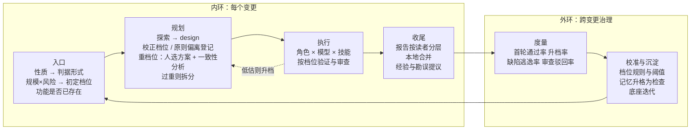

# StoryLoop 演进体系：总体设计

- 状态：已评审（2026-10-12），作为后续六个子项目的共同依据；各子项目另写设计文档。
- 范围：产品定位、设计原则、决策分层、六个子项目的设计要点与顺序。
- 依据：
  - 当前引擎 0.1.0（见 [docs/README.md](../../README.md) 的知识库）；
  - 业界调研（本地，未入库）；
  - 作者的实践：`eng-workflows` 技能集（refactor、stack-rewrite、project-survey、perm-init、feature-dev）、官方 feature-dev 插件、在 oryxos 上使用 spec-kit 的过程（oryxos-lab：837 个提交、约 55 个特性）。

## 1. 背景与定位

**问题。** 让 AI 从需求写出代码已经不稀缺，缺的是**证明代码写对了**。

- 代理能改测试时，约一半会作弊（ImpossibleBench）。
- 用了 AI 之后，审查时间增加 91%（Faros）。
- 只有 33% 的开发者信任 AI 的输出（Stack Overflow 2025）。
- 作者自己的实践也遇到过：测试框架不匹配，用例执行数为 0，构建却显示成功。

业界四类产品，没有一家公开做全这条链：

> 判据在实现前确立 → 实现者改不了 → 机器给出结论 → 每条验收标准都有证据

这四类产品是：自主编码代理、规格驱动开发工具、一句话生成应用、多代理框架。

**定位。** 让 AI 在已有代码仓库上的每一次改动，都带着"实现之前就定好、AI 自己改不了"的判据，以及审查者 30 秒就能看懂的证据交付。

## 2. 核心价值与能力

### 2.1 核心价值

| 价值 | 解决的问题 |
|---|---|
| 可信交付 | AI 说"做完了"，但其实没做完，甚至改测试来作弊 |
| 存量仓库安全演进 | 生成类产品止步于从零新建；在已有代码上改动会破坏隐式行为 |
| 审查成本可控 | 审查成为 AI 编码的新瓶颈 |
| 流程与风险相称 | 重流程拖累小改动，轻流程放过大风险 |
| 越用越懂这个仓库 | 同样的坑反复踩，文档和代码渐渐脱节 |
| 厂商中立 | 被单一模型厂商锁定；同一个模型自己审自己 |

### 2.2 核心能力

| 能力 | 内容 | 对应章节 |
|---|---|---|
| 需求合同共创 | 选择题澄清、确定性质量门、消费端矩阵、入口检查功能是否已存在 | §5、§6 |
| 判据工程 | 按变更性质生成判据；判据自证有效；实现者改不了 | §5 |
| 分类与分流 | 性质 × 档位；按规模和维度取较重的一档；只升不降；必要时拆分 | §6 |
| 角色编排 | 按权限边界划分角色；上下文隔离；模型档次、技能包、子代理随档位伸缩 | §7 |
| 隔离验证与边界审计 | 候选副本里分层验证；全树快照；底座边界 | 已有 |
| 证据报告 | 每句话标明来源；审查重点由引擎计算 | §8 |
| 分层记忆 | 事实、行为、经验、事件；按角色和路径取用；勘误与经验晋升 | §9 |
| 外环治理 | 度量、校准、规则演进；人是决策者 | §10 |

### 2.3 不做什么

- 不做编码代理，那是模型厂商的主场。
- 不做托管、数据库、应用生成。
- 不做 CI 系统，不做部署。
- 不做多角色互相对话的团队模拟。
- 不转售 token。
- 不做双轨整体重写：新栈独立建工程、最后一次性切换，和"在现有仓库上做单一性质的变更"不兼容。
- 自动化流程绝不访问生产环境。

## 3. 设计原则（不变量）

1. **判据先于实现确立。** 判据是可执行的，在实现之前固定，实现者改不了。判据的形式由变更性质决定（§5），任何档位都不裁剪判据。原来的不变量"先红后绿"是其中一种形式。
2. **判据自证有效。** 判据必须证明自己真的运行过、真的有约束力：执行数不能为 0、不能比基线骤降；该红的时候必须红。
3. **确定性优先，只升不降。** 能从代码事实算出来的，由引擎计算；需要判断的，由代理建议、人批准。分类和档位在运行中只能升级。
4. **区分证据型门和成本型步骤。** 只裁剪成本型步骤：方案、子代理、模型档次、报告详略。
   - 证据型门：判据、边界审计、回归、报告只认真实结果。
5. **报告的每句话标明来源。** 机器事实、人工记录、代理陈述三类分开。
6. **引擎角色按权限边界划分。** 专业化通过"模型档次 × 技能包 × 子代理"在角色内部完成，不增加引擎层的角色（延续决策 0016）。
7. **内环执行规则，外环修改规则。** 外环的决策者是人。

## 4. 体系总览

### 4.1 两个环



### 4.2 决策分层

| 层 | 何时 | 决策点 | 依据 | 谁拍板 | 能否撤回 |
|---|---|---|---|---|---|
| L0 项目 | 接入时，低频 | 底座边界、敏感路径、底座原则、档位阈值、角色画像、跨厂商审查 | 仓库事实、外环建议 | 人 | 经 BASE 迭代或改配置 |
| L1 入口 | 每个变更一次 | 性质（一个变更一种）、功能是否已存在、初定档位、是否建议拆分 | 意图、知识库、活规格 | product 提议，人随合同批准 | 运行开始后合同不能修订，只能另开新变更 |
| L2 规划 | 批准后、实现前 | 生效档位；要不要特征化；原则偏离；重档位选方案；超重时拆分还是强行继续 | 探索结果、design 的 `touched`/`creates`、规模与维度信号 | 引擎按规则计算；重档位由人选方案；强行继续由人写理由 | 只升不降 |
| L3 执行 | 每轮尝试 | 每个角色的模型档次、技能包、子代理；跑哪些验证层；审查发现进不进修复环 | 生效档位、角色画像、置信度 | 引擎按配置执行 | 发现低估就升档 |
| L4 收尾 | 每个变更结束 | 报告详略；有没有经验或勘误值得提议 | 证据、失败记录、审查发现 | 引擎生成报告；经验和勘误由人批准 | 本地合并，push 前可以回退 |
| L5 演进 | 跨变更，定期 | 规则校准、经验升级为检查、过时记忆清理 | 外环指标 | 人 | 随时调整 |

## 5. 子项目 1：变更性质与判据

### 5.1 一个变更只有一种性质

混合需求必须拆开，按顺序依次合并。为新功能顺手调整既有代码不算混合：feature 本身就同时包含"新行为先红"和"既有行为先绿（特征化）"两种判据。需要拆开的只是独立的重构目标。

### 5.2 性质与判据

| 性质 | 判据（实现前确立） | 谁来写 | 实现前 | 通过条件 | 阶段 |
|---|---|---|---|---|---|
| feature | 变更验收套件，加既有文件的特征化测试 | acceptance、characterize | 验收红，特征化绿 | 都绿 | 已有 |
| fix | 能复现缺陷的测试 | acceptance，只看缺陷报告盲写 | 红，而且必须因为缺陷本身而红 | 变绿，回归不破 | 第一期 |
| refactor:structure | 行为判据：特征化、回归、系统冒烟；结构判据（可选）：结构断言 | characterize；结构断言由 design 写 | 行为绿；结构红 | 行为仍绿，结构变绿 | 第一期 |
| refactor:dependency-swap | 行为判据同上；结构判据默认"再扫为零"：被移除目标的全限定名（含伴生库和传递依赖）grep 计数为 0，依赖树里没有残留 | 同上 | 同上 | 同上 | 第一期 |
| upgrade | 全量回归、系统冒烟、构建；黄金快照对拍 | 已有测试资产 | 绿 | 仍绿 | 第二期，经 BASE 迭代 |
| perf、docs | 基准与阈值；结构校验加人工 | — | — | — | 暂不做 |

### 5.3 判据自证

- 每次运行判据时，都记录测试的**发现数**和**执行数**，并与基线比较。执行数为 0、比基线骤降，或某个判据文件里有用例没被执行，一律判失败。
- 对 upgrade 和 dependency-swap 尤其关键：这两类变更会动到测试基础设施本身。测试框架的版本和插件要纳入升级的影响范围。
- 结构断言判定到 import 或全限定名，避免同名类误报和注释干扰。普查范围必须等于合同里陈述的目标范围，不能在自选的子范围里宣布完成。

### 5.4 消费端矩阵

合同新增一节"消费端矩阵"，列包括：消费端、触发方式、走的代码路径、是否在范围内、验证方式。

- acceptance 角色为每个在范围内的行至少写一条验收用例。
- refactor 和 dependency-swap 由 design 产出"改动单元 → 消费端"矩阵，系统冒烟按矩阵逐条打到真实路径。只做"能启动"的冒烟不够：静态初始化类问题要到第一次调用才会暴露。
- 报告里矩阵每一行要么已验证（附机器证据），要么是人工待验（附具体操作路径）。引擎检查不允许有空行。

### 5.5 特征化测试的写法（写进 characterize 角色的技能包）

- **期望值来自实测，不靠读代码推断。** "在旧代码上必须绿"已经在机器层面保证了这一点。
- **按行为面分三类：**
  - 请求-响应：录制回放；
  - 随身份变化：按身份 × 数据范围逐一断言，录制会把多种身份坍缩成录制时的那一个；
  - 触发副作用：用夹具触发，断言副作用。
- **身份：** 至少一条非管理员身份的用例，避免管理员账号的假绿。
- **写操作：** 比对落库的数据，不只比对响应。
- **非确定性来源：** 时钟、没有排序的结果集、易变字段、LLM 调用。LLM 打桩按用例键匹配，不按提示词字节匹配。
- **会被本次变更扩展的集合用 contains 断言，不用 equals。**
- **断言密度按风险分层（与档位正交）：**
  - T1：一条非特权身份的主路径；
  - T2：再加泄漏点的定点样本；
  - T3：主路径、边界、异常、身份枚举全套。
  - design 给每个改动单元标出 T 级，作为 characterize 的验收要求。

### 5.6 不同性质的合同模板

| 性质 | 合同主体 |
|---|---|
| feature | 现有的用户故事 + EARS 规则 + Gherkin 验收条件，加消费端矩阵 |
| fix | 现象、期望、复现步骤；引起缺陷的原始变更（可选，用于统计缺陷逃逸） |
| refactor | 范围、必须不变的行为、结构目标、子类（structure / dependency-swap） |

### 5.7 性质的一致性检查

| 声明的性质 | 引擎检查 | 不一致时 |
|---|---|---|
| feature / fix | 验收套件实现前必须红 | 已经是绿的：停在 `EXISTING_GREEN`（已有），由人判断是"行为早已存在"还是"其实是 refactor" |
| refactor | 不生成验收套件；实现后系统冒烟、回归、特征化都绿；对外接口清单（知识库的 api.md）不变 | 停下，提示改走 feature |
| upgrade | 只能改集成点和底座 | 停下，提示拆成"升级"和"适配"两个变更 |

## 6. 子项目 2：分类与档位

### 6.1 入口检查：功能是否已存在

product 起草合同之前，先对照知识库和活规格（以及 §7.4 的探索结果）判断：功能是否已存在、部分存在还是不存在，并给出文件:行号证据。部分已存在的要重新判定性质，防止重复造轮子，也防止把重构误判成 feature。product 出澄清问题时，也应基于这些代码事实，而不是只看需求文本。

### 6.2 档位分两次计算

| 时机 | 信号 | 用途 |
|---|---|---|
| L1 入口 | 性质与子类、故事数、验收条件数、未决问题数；product 声明的风险标记（数据结构迁移、权限或安全、对外接口变更） | 初定档位，写进合同，人随合同批准（只能手动升档） |
| L2 规划 | 探索结果；design 的 `touched` 与 `creates`（design 返回结构新增 `creates`）；波及面（`git grep` 引用计数）；热点（`git log` 改动频率）；敏感路径（settings 新增 `sensitive_paths`）；隐式行为命中（第二期）；原则偏离 | 生效档位 = max(初定, 按规模算出的档位, 按维度设的下限) |
| L3 执行中 | 实现改到了方案没列的既有文件 | 重新计算，只能升级，并记录原因 |

### 6.3 规则表

阈值放在 `.storyloop/config.json`，由外环校准。下面的数值是起点：

| 档位 | 条件（满足任一即可） |
|---|---|
| 超重 → 建议拆分 | 故事数 > 6；改动文件 > 15；涉及的接口 > 8 |
| 重 | 敏感路径；数据结构迁移或对外接口变更；改到的既有文件 ≥ 8；波及面最大的文件引用 ≥ 30；故事数 ≥ 4；**横切类变更**（鉴权链、序列化、统一响应、连接池、框架大版本）；**原则偏离** |
| 标准（下限） | `refactor:dependency-swap`、`upgrade` |
| 轻 | 只有 1 个故事；改到的既有文件 ≤ 2；不碰敏感路径和集成点；性质是 fix 或 feature |
| 标准 | 其余情况 |

按维度设下限的理由：框架和依赖的风险在隐式行为（事务、序列化、默认值），不体现在改动的文件数上。维度拿不准时取更重的一档。

### 6.4 各档位裁剪什么

| 步骤 | 轻 | 标准 | 重 |
|---|---|---|---|
| 判据（按性质） | ✔ | ✔ | ✔ |
| 合同模板 | 薄合同：意图、硬约束、验收映射、不做什么 | 完整 | 完整 |
| 探索子代理 | — | 1–2 个 | 2–3 个 |
| design | 跳过 | ✔ | 主方案 + 至多 2 个备选，由人选择 |
| 一致性分析 | — | — | ✔ |
| 特征化（feature） | 用到时再锁 | 用到时再锁 | 实现前锁定全部 `touched` |
| 审查 | 1 个视角 | 4 个视角 | 4 个视角 + 判据强度视角 |
| `max_attempts` 默认 | 2 | 3 | 4 |
| 报告 | 摘要版 | 标准版 | 完整版，含风险清单 |

"用到时再锁"：feature 的 design 判断只新增文件、不改既有文件时，跳过 characterize 调用；实现中途真的改到既有文件，再由现有的还原、补锁、重试机制兜底。refactor 在任何档位都要在实现前锁定，特征化是它的主判据。

### 6.5 原则偏离登记

底座原则（类似 spec-kit 的"宪法"，带版本号，见 §9.6）由 design 逐条声明"遵守"或"偏离 + 理由"，不允许留空。有偏离就自动升到重档位，交给人批准。

### 6.6 重档位的方案与审批

- **方案数量。** 一个主方案（复用最多、改动既有文件最少），外加至多两个备选。每个方案标出改动的既有文件数和波及面，引擎算出它会落到哪个档位；人选择后，档位仍然只升不降。
  - 不采用"最小 / 干净 / 务实"三方案：在存量仓库里"干净"往往意味着顺手重构，违反"一个变更一种性质"。
- **方案模板（重档位）：**
  - 决策表（选择、理由、备选）；
  - 接口契约；数据模型；
  - 可执行的验收步骤；
  - 现状链路和目标链路（mermaid，画到请求真正发出、数据真正落库为止）；
  - 不能动的文件清单（交给边界审计机器执行）；
  - 兜底分支和死代码路径检查；
  - 各改动单元的 T 级。
- **人工门。** design 之后停在 `DESIGN_APPROVAL_REQUIRED`，人选择方案或要求修改后才开始实现。命令形态在子项目设计中确定。
- **一致性分析。** 方案选定后，review 角色以"分析模式"只读检查一遍"合同 ↔ 方案 ↔ 判据"是否对得上，看覆盖缺口和歧义。严重问题阻断，其余写进报告。

### 6.7 拆分

- **阈值**：见 §6.3。算出超重时停在 `SPLIT_RECOMMENDED`，人有两个选择：
  - 按拆分建议另开几个变更；
  - 写明理由，按重档位继续。理由进 decisions.md，外环统计这类强行继续的结果。
- **拆分方式：**
  - 按功能纵向切，不按层切（按层切会把黑盒判据推迟到最后一层）；
  - 横切行为（权限、租户）放第一个；
  - 高风险的早做；
  - 先串行做通一个，再并行同类的。
- **多维度变更生成有序的变更链：**
  - 换语言 → 换框架 → 改结构；
  - 先抽防腐层或单点收口（refactor），再换实现；
  - 先清理废弃用法，再升大版本；
  - 被动升级的依赖先钉回旧版，保证每次只动一个变量。

### 6.8 记录

- 合同里记初定档位和理由。
- 运行状态里记生效档位，以及每次升级的时间、原因、触发者。
- 报告里写明"为什么走这个档位、裁掉了哪些步骤"。

## 7. 子项目 4：角色画像

### 7.1 引擎描述需求，适配器决定实现

每次请求附 `role_profile`：

```json
"role_profile": {
  "tier": "strong",
  "skills": ["java-spring-backend"],
  "subagents": {"perspectives": ["correctness", "security", "architecture", "tests"]},
  "profile": "standard"
}
```

- 引擎只描述档次（`strong` / `standard` / `economy`）。档次到具体模型的映射写在适配器的配置里，换模型、换厂商不改引擎。
- 老适配器可以忽略这个字段。

### 7.2 各角色的默认档次

越是给出判定的角色，越要用强模型：

| 角色 | 默认档次 |
|---|---|
| acceptance、review、design、product | strong |
| implement | 轻档位 standard，标准和重档位 strong |
| characterize、survey、探索子代理 | standard |

可以在 `.storyloop/config.json` 的 `roles` 段按角色覆盖档次和适配器。**跨厂商审查按配置启用**：配置了第二个适配器时，review 用与 implement 不同厂商的模型，报告里写明各角色实际使用的厂商和模型。

### 7.3 技能包

- 技能包的 frontmatter 增加 `roles` 和 `stacks` 两个字段。引擎按"角色 + 技术栈"挑选，技术栈来自 `init` 探测到的 `kinds`。
- 项目自带的技能包可以覆盖引擎自带的同名包。
- 请求里只传技能的名字和路径，不把全文塞进提示词，由代理按需加载。
- 第一批技能包：
  - characterize 的写法规范（§5.5）；
  - 判据自证与结构断言；
  - 技术栈 profile：Spring 的隐式行为 grep 清单与跨栈必验差异点，第二期。

### 7.4 子代理随档位伸缩

| 角色 | 轻 | 标准 | 重 |
|---|---|---|---|
| 探索（design 之前） | — | 1–2 个 | 2–3 个：相似功能、调用链（追到真实 I/O）、测试与扩展点 |
| review | 单会话 | 4 个视角 + 主评审 | 4 个视角 + 判据强度视角 + 主评审 |
| implement | 单会话 | 单会话 | 方案跨越多个层时按层拆通道 |
| acceptance | 单会话 | 单会话 | 接口用例和浏览器用例分开写 |

探索子代理的产出是带文件:行号的关键文件清单，作为机器事实交给 design、characterize、review，也是档位计算的输入。

### 7.5 审查发现的置信度

- 每条发现带 0–100 的置信度、文件:行号、违反的规则或缺陷机理、修复建议。不是本次改动引入的老问题一律 0 分。
- ≥80 分的发现，经强模型复核（去重、复现）后进入修复环；修复同样受边界审计约束。
- 50–79 分只写进报告的审查重点，不阻断。
- <50 分丢弃。
- 阈值由外环根据"审查发现被人驳回的比例"校准。

### 7.6 修复纪律与上下文隔离

- 同一失败特征连续两轮修不好，下一轮的实现请求要求先回到根因调查，不允许继续小修小补。引擎按失败特征计数。
- 任何角色都只拿到其他角色的结果，拿不到推理过程。例如 review 拿到的是代码、证据和方案，拿不到 implement 的会话记录。

## 8. 子项目 3：报告

### 8.1 来源标记

| 标记 | 来源 |
|---|---|
| 🔧 机器事实 | 命令结果、Git 差异、指纹、引擎计算出的信号 |
| 👤 人工记录 | 批准、回答、人工验收、强行继续的理由 |
| 🤖 代理陈述 | 细分为"代码推断"与"AI 构造的样本（代表性未确认）" |

### 8.2 结构

| 节 | 回答的问题 | 内容 |
|---|---|---|
| 0. 头部 | 这是什么变更 | 变更 ID、性质与子类、档位（初定 → 生效 + 理由）、结果、提交 |
| 1. 结论 | 30 秒：能不能放行 | 目标（引自合同）；判据结果；**测试发现数、执行数、新增数**；**消费端矩阵状态**；门禁一览（通过 / 跳过 + 原因）；完成度 x/y；还要人确认的事项 |
| 2. 审查重点 | 5 分钟：该看哪里 | 改到的既有文件按风险排序；实际改动与方案的偏差；机器没验证到的部分；**会过期的硬编码**；人工验证项（精确到操作路径）；**可直接复制的验证命令**；refactor 的"行为差异待裁决"队列；置信度 50–79 的审查发现；残余风险 |
| 3. 证据 | 凭什么说做对了 | 每条验收条件的追溯链；按性质的判据细节；分层验证结果 |
| 4. 过程 | 中间发生过什么 | 每轮失败原因；档位升级；人的决策；修复与复位 |
| 5. 成本 | 花了多少 | 按角色：档次、实际模型与厂商、轮数、token、费用、墙钟时间 |
| 6. 记忆 | 留下了什么 | 提议的经验与勘误，以及待审核状态 |

第 2 节的主体由引擎计算（偏差、风险排序、未验证项），不是由代理撰写。

### 8.3 详略与输出

- 轻档位：第 0、1、3 节精简版。标准档位：第 0–6 节。重档位：第 0–6 节，第 2 节展开为完整风险清单，方案里每条风险都要说明由哪个测试覆盖，或者明确写"未覆盖"。
- 输出 `report.md`（给人看）和 `report.json`（给外环读）。模板只描述内容，不绑定格式，以后加"开 PR"出口时可以直接用第 0–2 节生成 PR 描述。
- 合并方式不变：所有档位都在审查通过后**自动在本地合并**，人在 push 之前看报告（讨论中已定，不加"合并前审报告"的门）。

## 9. 子项目 5：分层记忆

### 9.1 记忆分层

| 层 | 内容 | 位置 | 谁写 | 保护 |
|---|---|---|---|---|
| 通用 | 技术栈专业知识、技术栈 profile | 技能包 | 引擎维护者、项目 | 版本号 |
| 事实 | 底座是什么、怎么扩展、底座原则 | `openspec/foundation/` | survey；勘误通道 | BASE 迭代 |
| 行为 | 系统现在应该怎么表现 | `openspec/specs/` | 引擎在完成时并入 | 引擎产物 |
| 经验 | 在这个仓库里怎么干活、哪里有坑 | `openspec/lessons/`（新增） | review 复盘模式提议，人批准 | 自己的保护摘要 |
| 事件 | 每个变更发生了什么 | `openspec/changes/`、报告、调用记录 | 引擎 | 合同保护、证据摘要 |

### 9.2 经验条目

```yaml
id: L-0007
summary: WSL2 下时钟回拨会让雪花 ID 报错，验收前先校时
scope: ["backend/**"]
roles: [acceptance, implement]
strength: prose
source: FEAT-20260920-001
baseline_version: 1.0.4
status: active
```

- `scope`：路径通配，只有改到这些路径时才提供给代理。
- `strength`：可选 `check` / `config` / `knowledge` / `prose`。
- `status`：可选 `active` / `needs-review` / `retired`。

**入选标准**："删掉这条，下一个 AI 冷读代码会得出错误结论吗？"答案是否定的就不收。

### 9.3 积累

- **触发。** 收尾时自动提议，但只在运行中出现过问题信号时：失败后修好的尝试、`acceptance-repair`、`reset`、反复出现的审查发现、能推广的回答。一切顺利的变更不提议。
- **谁提议。** review 角色的复盘模式。优先更新已有条目，不新增重复的条目。
- **按强度分流。** 能升级的尽量升级，留在 `openspec/lessons/` 的只是确实无法自动化的部分：

| 强度 | 落点 | 通道 |
|---|---|---|
| check | 系统冒烟用例或 `check_commands` | `smoke-propose` / `smoke-apply`、`base-propose` |
| config | settings | 改配置或 BASE 迭代 |
| knowledge | 底座知识库 | BASE 迭代 |
| prose | `openspec/lessons/` | `lessons-apply` |

- **命令**：`lessons-propose` 生成草案到 `.storyloop/drafts/lessons/<id>/`；人审核修改；`lessons-apply` 按强度分流并提交。

### 9.4 事实层勘误通道

任何角色发现知识库与代码事实不符时，当场提议勘误。勘误不需要"出过问题"这个触发条件，与经验层并列。被推翻的旧结论标记废弃，并指向新的结论；人确认后经 BASE 迭代生效。

### 9.5 取用

引擎在每次调用角色前确定性地计算相关记忆：

1. 按角色筛：条目的 `roles` 里有当前角色。
2. 按路径筛：`scope` 命中本次的改动路径。design 之前用合同涉及的模块，design 之后用 `touched` 加 `creates`。
3. 按状态筛：只取 `active` 的条目。
4. 按强度和更新时间排序，最多取 10 条。请求里只放摘要和路径，代理按需读全文。

不使用向量检索：结果可复算，也守得住引擎只用标准库的约束。

### 9.6 新鲜度与底座原则

- **新鲜度。** 经验条目作用范围内的文件，在该条目记录之后被改过，就标为 `needs-review`，暂不提供给代理。`base-update` 时同样处理。
- **重复踩坑就升级。** 某条经验已经提供给代理，同类失败仍然发生，就提示人把它升级为检查或配置。
- **底座原则。** 放在事实层，带版本号和变更记录。能写成检查的写成检查，接入 `check_commands`，每轮尝试都跑。收尾时检查本次是否引入了知识库没有覆盖的新概念，有则提议补充。
- **知识库必含的节**（第二期改 survey 技能包）：身份与权限档位、测试账号、行为开关、所有可运行单元。

## 10. 子项目 6：外环

| 指标 | 回答的问题 | 校准对象 |
|---|---|---|
| 首轮通过率、平均尝试轮数 | 这一档的流程是否够用 | `max_attempts` 默认值 |
| 运行中升档的比例 | 入口分类是否经常低估 | L1 规则 |
| 缺陷逃逸率（fix 合同指回的原始变更） | 轻流程是否放过了问题 | 轻档位门槛 |
| 强行继续的超重变更后来的结果 | 拆分建议是否合理 | 拆分阈值 |
| 审查发现被人驳回的比例 | 置信度阈值是否合适 | §7.5 阈值 |
| 合同行数 ÷ 实现改动行数 | 流程是否过重 | 档位与模板 |
| 人工介入次数（按停点类型） | 人在哪里花的时间最多 | 下一步自动化方向 |
| 成本与时间（按角色、档次） | 钱花在哪了 | 角色默认档次 |
| 经验提供后同类失败是否再次出现 | 文字提醒是否管用 | 经验强度 |

新增 `storyloop metrics PATH [--since 日期]` 输出上表。引擎可以给出调整建议，由人决定是否修改规则。

## 11. 对现有架构的影响

| 方面 | 变化 |
|---|---|
| 合同 | 新增 `nature`（含子类）、初定档位与风险标记、消费端矩阵、功能是否已存在的结论；fix 和 refactor 的合同模板 |
| 运行状态 | 新增生效档位与升级记录、判据自证记录、方案选择 |
| 新停点 | `DESIGN_APPROVAL_REQUIRED`、`SPLIT_RECOMMENDED` |
| 代理协议 | 请求新增可选的 `role_profile` 和相关记忆；design 返回结构新增 `creates`、原则声明、备选方案；review 新增复盘模式和分析模式；审查发现带置信度 |
| 配置 | `.storyloop/config.json` 新增 `roles`、档位阈值；settings 新增 `sensitive_paths` |
| 引擎区域 | `openspec/lessons/` 加入 `GENERATED_PATHS`，有自己的保护摘要 |
| 新命令 | `lessons-propose`、`lessons-apply`、`metrics`；方案审批命令（名称在子项目中确定） |
| 取代 | `design_min_stories` 由档位规则取代 |
| 兼容 | 没有 `nature` 的老合同按 feature 处理；没有 `role_profile` 的适配器行为不变 |

## 12. 子项目与顺序

| 顺序 | 子项目 | 依赖 | 第一期范围 | 完成标准 |
|---|---|---|---|---|
| 1 | 变更性质与判据 | — | feature、fix、refactor:structure、refactor:dependency-swap；判据自证；消费端矩阵；特征化写法技能包 | 一次重构变更（例如拆分 `project_loop.py` 这类任务）能走通，判据有结构断言；一次修复变更的复现测试先红后绿；执行数为 0 时判红 |
| 2 | 分类与档位 | 1 | 两次计算、规则表与维度下限、入口检查、原则偏离、重档位方案与审批、一致性分析、拆分、薄合同 | 同一个仓库上，轻、标准、重三档变更各跑通一次，报告里写明档位理由 |
| 3 | 报告 | 1、2 | §8 的全部内容 | 审查者用第 1–2 节就能判断是否放行；第 2 节没有代理撰写的部分 |
| 4 | 角色画像 | 2 | `role_profile`、档次映射、按角色指定适配器、技能包元数据、探索子代理、审查置信度、修复纪律 | 账本按角色记录档次与实际模型；跨厂商审查可以配置启用 |
| 5 | 分层记忆 | 3 | 经验层、复盘模式、提议与批准、勘误通道、取用、新鲜度、底座原则 | 一个出过问题的变更收尾时产生经验草案，批准后在下一个相关变更里被取用 |
| 6 | 外环 | 1、3、5 | `metrics`、缺陷逃逸关联、校准建议 | 对至少十个变更输出指标表和调整建议 |

第二期：upgrade（经 BASE 迭代，由代理实现）、黄金快照对拍、隐式行为检测与技术栈 profile、负向验证、软停点、"不重写既有方法"检查、知识库必含节。

## 13. 讨论中已做的决定

| 决定 | 选项 |
|---|---|
| 判据按变更性质选择，取代"一律先红" | 同意 |
| 一个变更一种性质 | A：一种，混合需求拆分 |
| 重档位要人批准方案 | 加 |
| 跨厂商审查 | 可选，按配置启用 |
| 经验提议的触发 | 收尾时自动，只在出过问题时 |
| 重档位合并前要不要人审报告 | 不加，所有档位自动本地合并，push 前人看报告 |
| 档位只按规模算 | 修正为 max(规模, 维度下限) |

## 14. 待定问题

1. 档位阈值的初值没有实测依据，需要用 RuoYi 底座上已有的变更数据先校准一次。
2. 变更 ID 目前是 `FEAT-日期-序号`，按本地已有的变更取号。多分支并行时可能重号，oryxos-lab 出现过五组重号。目前一个仓库一次只跑一个变更，暂不处理；支持多变更并行时一并解决。
3. 探索子代理的数量和分工先按 §7.4 实现，用外环数据调整。
4. 结构断言的表达形式（脚本、grep 规则还是测试文件）在子项目 1 中确定。
5. 引擎的变更 ID 前缀 `FEAT-` 是否按性质区分（例如 `FIX-`、`REF-`），在子项目 1 中确定。
6. 方案审批（`DESIGN_APPROVAL_REQUIRED`）的命令形态：沿用 `approve` 加参数，还是新增命令，在子项目 2 中确定。
