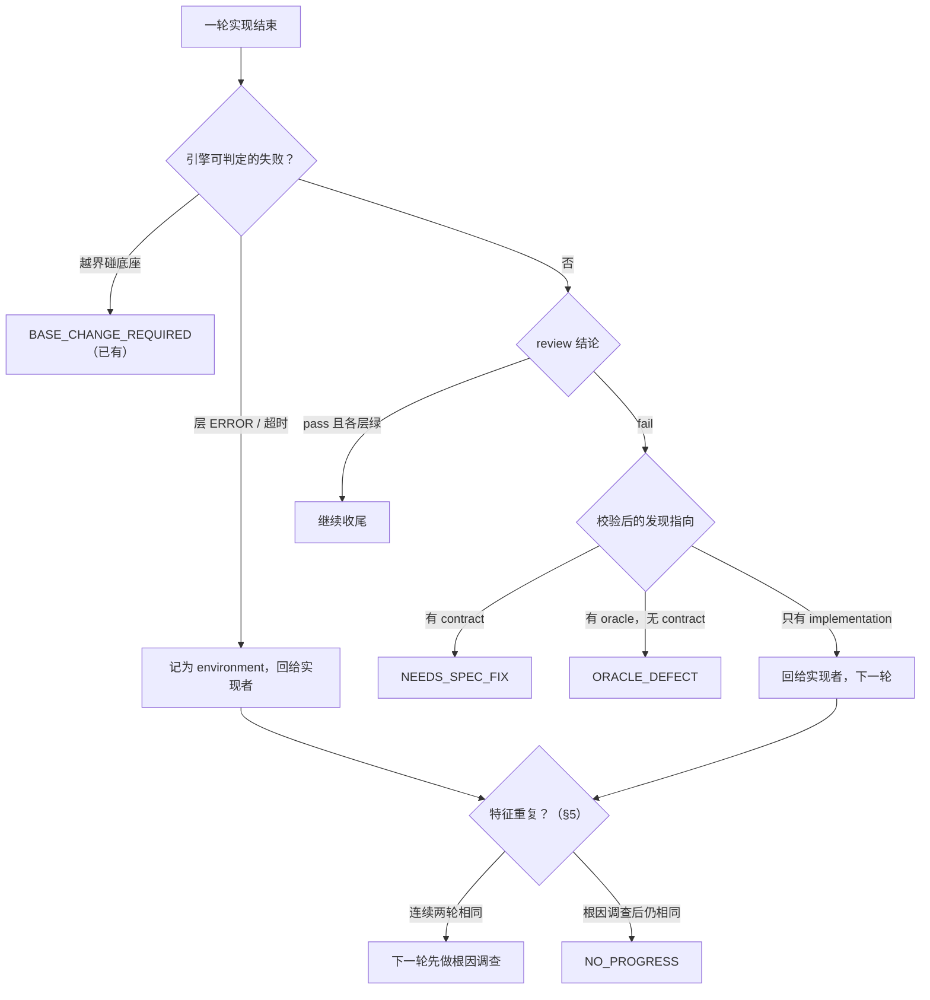
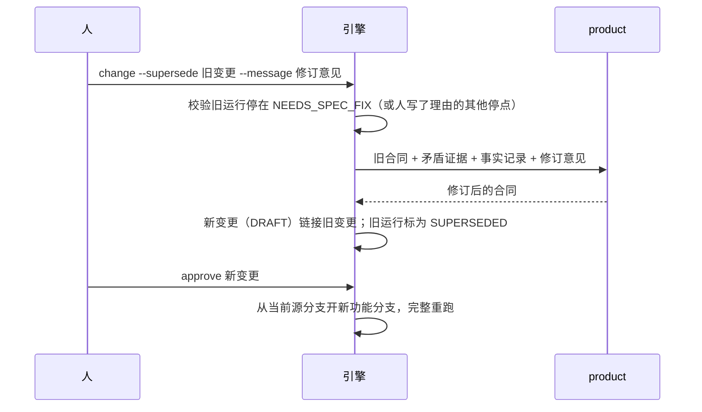

# 子项目 2a：纠偏

- 状态：草案（2026-10-14），待评审 §2 的 Q1–Q8
- 上位文档：[演进体系总体设计](2026-10-12-演进体系-design.md) §5（停点目录）、§7.9（失败归属与纠偏）、§13（子项目顺序）
- 前置：[子项目 1](2026-10-12-子项目1-变更性质与判据-design.md)（行类型、`ORACLE_DEFECT`、判据自证）
- 拆分：总体设计的子项目 2 拆成 2a 纠偏（本文）与 2b 分流（入口四道门、档位、裁剪、重档位审批、拆分）。纠偏先做：子项目 1 的真实验收已经给出了它的代价证据，而档位阈值还没有实测数据（总体设计待定问题 1），等 2a 的失败归属数据积累后再定更稳。

## 1. 目标与范围

**目标。** 一轮失败之后，引擎知道"该谁改"：实现的问题回给实现者，判据和合同的问题停下来交给人，环境问题不冒充实现失败；同一个问题反复修不好时及时停下，不把预算耗光。每个停点都给人一份同样结构的停止报告。

**动机（子项目 1 真实验收的证据）：**

| 现象 | 代价 | 本文的对策 |
|---|---|---|
| refactor 的 A33 判据空心通过，审查连续三轮指出"问题在判据"，引擎仍把发现回喂实现者，实现者改不了判据 | 三轮实现 + 审查，约 $5，最后预算耗尽 | 审查发现标注指向；指向判据的发现第一次出现就停在 `ORACLE_DEFECT`（§3） |
| product 的合同语义校验失败（`reproduces_defect` 标错行），整次调用作废，只能人工重跑 | 一次 product 调用 + 人工介入 | 语义校验失败在引擎内带着错误重试一次（§7） |
| 实现者的角色说明里没有提 `failures`，上一轮失败原因能不能被读到全看模型 | 难以度量，可能多耗轮次 | 角色说明写明怎么读失败记录，失败记录带归属与特征（§3、§5） |
| 停点只有状态名和一句固定提示，`log` 也不显示代理失败记录 | 人要自己翻运行状态 | 统一停止报告（§6） |

**本期范围：**

| 项 | 内容 |
|---|---|
| 失败归属 | 每轮失败标注 `implement` / `oracle` / `contract` / `base` / `environment`；引擎能确定的直接判定，其余由 review 按发现提议，引擎校验证据 |
| 按归属分流 | 指向判据 → `ORACLE_DEFECT`；指向合同 → `NEEDS_SPEC_FIX`；人可以驳回归属，发现回给实现者 |
| 作废并修订重开 | `change --supersede`：新变更复制旧合同供修改，互相链接，从当前源分支重跑 |
| 事实记录 | 角色返回带文件:行号的事实，引擎校验位置后逐轮传递 |
| 修复纪律 | 失败特征；同一特征连续两轮 → 下一轮先做根因调查；根因调查后仍不变 → `NO_PROGRESS` |
| 统一停止报告 | 所有停点用同一结构；CLI、`log`、运行状态共用 |
| 合同语义校验的会内修复 | product 等角色的返回通过格式校验但语义校验失败时，带着错误重试一次 |

**不在本期：**

| 内容 | 归属 |
|---|---|
| 入口四道门（含 `ORACLE_INFEASIBLE`）、档位、按档位裁剪、`DESIGN_APPROVAL_REQUIRED`、`SPLIT_RECOMMENDED`、`NATURE_MISMATCH`、执行中升档 | 2b |
| 事实记录触发升档或拆分（本期只记录并在停止报告里展示） | 2b |
| 审查发现的严重度 × 置信度 | 子项目 4 |
| 报告模板改版（本期只在现有报告追加"失败归属"一节） | 子项目 3 |
| 失控成本上限 | 子项目 4 |

## 2. 需要确认的设计取舍

| # | 取舍 | 推荐 | 理由 |
|---|---|---|---|
| Q1 | 归属由谁判定 | **引擎能确定的直接判定；其余由 review 在每条发现上标 `target`，引擎校验证据**。实现者不参与归属 | 实现者是被评判的一方，让它声称"是判据错了"有逃避的动机。review 是独立的只读角色，已经在逐条读代码和证据。引擎校验证据（引用的条件编号存在、文件:行号存在），防止 review 随口甩锅 |
| Q2 | 指向判据或合同的发现何时停 | **第一次出现就停**，不等它重复 | A33 的教训：问题不在实现时，多跑的每一轮都白花。停下来的代价只是一次人工判断，人可以驳回（Q3） |
| Q3 | 人怎么驳回归属 | **`run --overrule "<理由>"`**：这些发现改为指向实现、回给实现者，驳回理由写进运行状态和 `decisions.md` | 沿用"审批类动作加参数"的约定；必须写理由，保证驳回可追溯 |
| Q4 | 作废并修订重开的形态 | **开一个新变更 ID**（如 `FEAT-20261014-002`），`supersedes` / `superseded_by` 互相链接；旧运行标为 `SUPERSEDED`，旧功能分支保留不合并、不删除 | 同一 ID 重开会让"批准后合同不可修订"这条不变量出现例外，证据与指纹也会混在一起。新 ID 让两次运行的证据各自完整。旧分支留给人对照，删除是不可逆操作，交给人 |
| Q5 | 失败特征怎么定义 | **只用确定性信息**：失败的层与用例编号集合、边界违规路径集合、审查发现的"文件:条件编号"集合；不比较消息文本 | 消息文本每轮措辞不同，比较不可靠。用例编号、路径和条件编号是稳定的 |
| Q6 | 无进展的判定 | **同一特征连续两轮 → 第三轮先做根因调查；根因调查轮的特征仍相同、且没有任何原先失败的用例转绿 → `NO_PROGRESS`**。不耗尽剩余预算 | 与总体设计 §7.9 一致。"没有用例转绿"排除了"在推进但还没修完"的情况 |
| Q7 | 事实记录本期做到哪 | **只做记录与传递**：design、implement、review 可以返回事实，引擎校验位置、去重、逐轮传给后续调用，并在停止报告和 `NEEDS_SPEC_FIX` 证据里展示。触发升档或拆分留给 2b | 事实记录是 `NEEDS_SPEC_FIX` 证据的来源，也让第 2 轮知道第 1 轮发现了什么；升档依赖 2b 的档位 |
| Q8 | 本期的真实验收 | **在 todo-demo 上跑两个真实变更**：一个故意写入与代码事实矛盾的合同条款，验证 `NEEDS_SPEC_FIX` → `--supersede` → 新变更通过；一个复现 A33 型的判据缺陷，验证第一轮就停在 `ORACLE_DEFECT`。`NO_PROGRESS` 和驳回只用自动化测试覆盖 | 真实模型不容易稳定地制造"反复修不好"，用假代理的测试更可靠；而前两种场景能在真实模型上构造出来 |

## 3. 失败归属

### 3.1 归属值

| 归属 | 含义 | 谁判定 | 处理 |
|---|---|---|---|
| `implement` | 实现没满足合同 | 引擎默认值；review 的 `target: implementation` | 失败记录回给实现者，下一轮（计入预算） |
| `oracle` | 验收用例或特征化测试本身写错 | review 的 `target: oracle`（引擎校验后）；实现前的 `ORACLE_DEFECT` / `EXISTING_GREEN` 已由子项目 1 判定 | 停在 `ORACLE_DEFECT` |
| `contract` | 合同条款之间、或与代码事实矛盾，按合同做不出来 | review 的 `target: contract`（引擎校验后） | 停在 `NEEDS_SPEC_FIX` |
| `base` | 需要改底座 | 引擎：边界审计的 `FOUNDATION_CHANGE` | 已有 `BASE_CHANGE_REQUIRED` |
| `environment` | 判据跑不起来：环境错误（退出码 2）、超时、命令无法启动 | 引擎：层结果为 ERROR 或超时 | 记录归属；计入预算，参与无进展判定（§5） |

`AGENT_UNAVAILABLE` 已经是"这一轮交还、不计入预算"，本期只在停止报告和 `log` 里展示它，不改行为。

### 3.2 审查发现的新字段

`FINDING` 增加两个可选字段，缺省视为指向实现，旧适配器不受影响：

```json
{
  "message": "A33 的判据在候选副本里无法运行 git diff，降级成只检查文件存在后通过",
  "target": "oracle",
  "criterion_id": "A33",
  "evidence": "acceptance/changes/REF-20261013-001/test_existing_suites.py:70",
  "location": "acceptance/changes/REF-20261013-001/test_existing_suites.py:70"
}
```

| 字段 | 取值 | 引擎的校验（不通过则按 `implementation` 处理，并在审查记录里注明"归属证据不足"） |
|---|---|---|
| `target` | `implementation` / `oracle` / `contract` | — |
| `criterion_id` | 合同里的验收条件编号或故事编号 | `oracle`、`contract` 必填，且编号存在于合同 |
| `location` | 文件:行号 | `oracle` 必须指向受保护的验收套件或特征化测试文件；`contract` 必须指向合同文件或给出与之矛盾的代码位置；文件在合同提交或当前候选里存在 |

review 角色说明与 `oracle-craft` 技能包同步写明：什么时候该标 `oracle`（断言与合同不符、依赖候选副本里没有的东西、引用本次变更才新建的文件），什么时候该标 `contract`（两条验收条件互相矛盾、条件与必须保持的既有行为冲突、按合同无法实现），并要求给出可核对的位置。

### 3.3 分流



- 同一轮里指向不同的发现同时存在时，`contract` 优先于 `oracle`，`oracle` 优先于 `implementation`：合同错了，判据和实现都要跟着变；判据错了，实现再改也通不过。
- 停下时，同一轮指向实现的发现一并保存在停止报告里。驳回或修复后的下一轮，实现者会收到它们。
- 这一轮实现照常计入预算。之后 `acceptance-repair` 会作废之前的轮次（已有行为）；驳回则从下一轮继续计数。

### 3.4 驳回归属

```bash
storyloop run <project> --change <ID> --overrule "A33 的检查确实应该通过 git 之外的方式实现，判据没错"
```

- 只在 `ORACLE_DEFECT`（实现后由审查判定的那种）和 `NEEDS_SPEC_FIX` 停点可用；实现前由引擎判定的 `ORACLE_DEFECT` 是确定性的，不能驳回。
- 被驳回的发现改为 `implementation`，回给实现者；理由记入 `run.overrules`，并进入 `decisions.md`。
- 同一条发现（同一 `criterion_id` + `location`）被驳回后，后续轮次里 review 再次以同样的指向提出它时，引擎不再停，只在审查记录里标注"已被人驳回"。

## 4. 作废并修订重开

### 4.1 流程



### 4.2 规则

- **触发。** 通常在 `NEEDS_SPEC_FIX` 之后；在其他停点（例如 `BUDGET_EXHAUSTED`）也可以用，但必须加 `--reason` 说明为什么是合同的问题。
- **新变更。** 按性质取新 ID，草案内容由 product 角色在旧合同基础上修订，走正常的澄清与批准。新旧合同互相链接：`supersedes` / `superseded_by`。
- **旧运行。** 状态改为 `SUPERSEDED`（终态），不能再 `run`。旧功能分支保留，不合并、不删除。
- **复用。** 旧运行的事实记录和 design 方案摘要作为修订上下文交给 product，并作为参考交给新运行的 design 角色；判据、特征化和实现都在新运行里重新产生，不复用。
- **修订记录。** 新变更的 `decisions.md` 增加"修订记录"：问题（矛盾证据）、改了合同的哪几条、为什么。
- **范围。** 旧运行还没有合并（状态不是 `MERGED`、`FINALIZING`、`PASSED`）时才可用。已经合并的变更，修订应作为一个新的变更提出。

## 5. 修复纪律

### 5.1 失败特征

每条失败记录增加 `signature`：由下列确定性信息排序后计算的摘要。

| 失败来源 | 进入特征的信息 |
|---|---|
| 分层验证 | 每个非绿层的层名、命令或用例编号、状态（FAILED / ERROR / TIMEOUT）；验收层附失败用例编号 |
| 特征化 | 未锁定的路径集合 |
| 边界审计 | 违规路径与类别 |
| 审查 | 每条发现的 `target` + `criterion_id` + `location` 中的文件部分 |
| 合同或结构错误 | 错误码 |

### 5.2 规则

- 同一特征连续出现两轮，下一轮的实现请求带 `mode: "root_cause"`：角色说明要求先定位根因、在实现记录里写出根因与证据，再改代码。
- 根因调查轮结束后，如果特征仍与前两轮相同，并且没有任何原先失败的用例转绿，停在 `NO_PROGRESS`，不再消耗剩余预算。
- 有用例转绿就算有进展：清零连续计数，继续正常轮次。
- 被 `acceptance-repair` 作废的轮次和交还的轮次（`AGENT_UNAVAILABLE`）不参与计数。

### 5.3 实现者如何读到失败

implement 角色说明新增一段：`payload.failures` 按轮次列出每轮失败的归属、特征与证据；先读最近一轮，同一问题反复出现时先找根因；`mode: "root_cause"` 时必须在实现记录的"根因"一节写出结论与文件:行号。

## 6. 统一停止报告

### 6.1 结构

所有停点（总体设计 §5 的全部状态）都由同一个构造函数生成，保存在运行状态的 `stop` 字段，CLI 输出、`log`、`status --json` 共用：

```json
{
  "status": "ORACLE_DEFECT",
  "phase": "verify",
  "completed": ["contract", "acceptance_red", "design", "characterization", "implement:1", "layers:1"],
  "last_verdict": {"gate": "review", "summary": "A33 的判据在候选副本里无法运行 git diff…"},
  "attempts": [
    {"attempt": 1, "attribution": "oracle", "signature": "3f1e…", "summary": "审查：1 条指向判据（A33）"}
  ],
  "blocker": "A33 的判据有缺陷，实现无法让它正确地通过",
  "evidence": ["acceptance/changes/REF-…/test_existing_suites.py:70"],
  "facts": [{"statement": "候选副本不含 .git", "location": "storyloop/smoke_runner.py:212"}],
  "questions": [],
  "options": [
    {"action": "修正判据", "command": "storyloop acceptance-repair <project> --change <ID> --reason <原因>"},
    {"action": "驳回归属", "command": "storyloop run <project> --change <ID> --overrule <理由>"}
  ],
  "resume": "storyloop run <project> --change <ID>"
}
```

- `phase` 取值：`contract`、`prepare`（RED、design、特征化）、`implement`、`verify`、`finish`。
- `options` 来自停点目录（总体设计 §5 的"人的选项"列），每项带可直接复制的命令。现有 `next_steps.py` 的提示文字并入这里，`next` 字段保留为 `resume` 的同义字段，兼容现有调用方。
- 人类可读的输出按"阻塞点 → 证据 → 选项 → 恢复"的顺序打印，不再只打印状态名。

### 6.2 `log` 的补充

- 失败一节每轮显示归属与特征的前 8 位。
- 新增"代理未回答"一节，列出 `agent_failures`。
- 最后打印停止报告的阻塞点与选项。

## 7. 合同语义校验的会内修复

- 适用范围：product、acceptance、design 等角色的返回通过了格式校验（schema），但没通过引擎的语义校验（例如 `validate_product` 的行类型规则、`reproduces_defect` 只能标在必须红的行上）。
- 引擎把校验错误原文与上一次的返回一起交给同一角色重试一次（新的调用，载荷带 `previous_response` 与 `validation_errors`）。重试仍失败才报错停下。
- 重试计入调用账本，`log` 里标为 `repair`。

## 8. 数据与接口变化

| 位置 | 变化 |
|---|---|
| `role_schemas.FINDING` | 增加可选 `target`、`location` |
| design / implement / review 的返回 | 增加可选 `facts: [{statement, location}]` |
| `state["failures"][*]` | 增加 `attribution`、`signature`；旧记录缺省 `implement`、无特征 |
| 运行状态 | 新增 `stop`、`facts`、`overrules`、`progress`（连续计数）、`superseded_by` |
| 合同 | 新增可选 `supersedes`、`superseded_by` |
| 新停点 | `NEEDS_SPEC_FIX`、`NO_PROGRESS`；新终态 `SUPERSEDED` |
| CLI | `run --overrule <理由>`；`change --supersede <ID> --message <意见> [--reason <理由>]` |
| 报告 | 现有报告追加"失败归属"一节：每轮的归属、特征、驳回与修订链接 |
| 文档 | 概念手册、使用指南（新停点与命令）、api.md、roles.md；总体设计 §5 的停点状态改为"已有（子项目 2a）" |

## 9. 对代码的影响

| 文件 | 改动 |
|---|---|
| `storyloop/failure_attribution.py`（新） | 归属判定、发现校验、分流优先级、失败特征 |
| `storyloop/stop_report.py`（新） | 统一停止报告的构造与人类可读渲染；吸收 `next_steps.py` 的选项文字 |
| `storyloop/supersede.py`（新） | 作废并修订重开 |
| `storyloop/project_loop.py` | 审查失败后按归属分流；根因调查模式；`NO_PROGRESS`；`--overrule` 恢复 |
| `storyloop/project_loop_support.py` | `pause()` 改为通过停止报告构造 |
| `storyloop/project_agents.py` | implement 读失败与根因模式；review 标 `target`；语义校验失败重试一次 |
| `storyloop/change_log.py`、`storyloop/change_report.py` | 归属、特征、代理未回答、停止报告 |
| `storyloop/cli.py`、`storyloop/changes.py` | 新参数；supersede 链接 |
| `storyloop/skills/oracle-craft/` | review 如何标注判据与合同问题（版本升到 1.1.0） |

## 10. 测试计划

| 场景 | 期望 |
|---|---|
| review 第一轮给出校验通过的 `oracle` 发现 | 停在 `ORACLE_DEFECT`，实现者没有被第二次调用 |
| `oracle` 发现引用不存在的条件编号或非受保护文件 | 按 `implementation` 处理，审查记录注明"归属证据不足" |
| 同一轮同时有 `contract` 与 `oracle` 发现 | 停在 `NEEDS_SPEC_FIX` |
| `--overrule` 后 | 发现回给实现者；同一发现再次出现不再停；理由进入 `decisions.md` |
| 层 ERROR | 归属 `environment` |
| 同一特征连续两轮 | 第三轮请求带 `mode: "root_cause"` |
| 根因调查轮特征不变且无用例转绿 | `NO_PROGRESS`，剩余预算未消耗 |
| 根因调查轮有用例转绿 | 继续，计数清零 |
| `acceptance-repair` 作废的轮次、`AGENT_UNAVAILABLE` 交还的轮次 | 不参与无进展计数 |
| `change --supersede` | 新 ID、互相链接、旧运行 `SUPERSEDED` 且不能再 `run`、旧分支仍在、新运行从源分支重跑并通过 |
| 已合并的变更执行 `--supersede` | 拒绝 |
| 每一种停点 | 都带完整的停止报告字段；`options` 的命令可执行 |
| product 返回语义无效、重试后有效 | 草案正常生成，账本里有一次 `repair` |
| 旧运行状态（无 `attribution`、无 `stop`） | 能续跑，按 `implement` 处理 |

## 11. 兼容与迁移

- 所有新字段都是可选的；旧适配器不返回 `target` 时，行为与现在一致（全部回给实现者），只是多了特征与无进展检测。
- 旧运行状态没有 `stop` 字段：`status` 和 `log` 读取时按当前状态临时构造。
- `next` 字段继续输出，避免破坏依赖它的脚本。

## 12. 完成标准

- §10 的每一行都有自动化测试覆盖，全量测试通过。
- Q8 的两个真实变更在 todo-demo 上跑通：合同矛盾 → `NEEDS_SPEC_FIX` → `--supersede` → 新变更 PASSED；A33 型判据缺陷 → 第一轮停在 `ORACLE_DEFECT` → `acceptance-repair` → PASSED。
- 能从干净仓库按文档跑通；实现完成后补"设计与实现差异表"，回写总体设计 §16。
