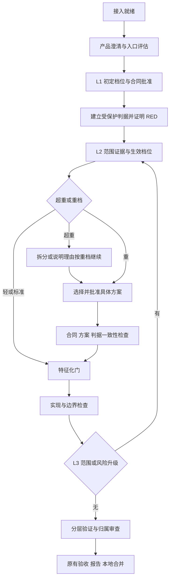

# 子项目 2b：分流

- 状态：设计已批准（2026-10-16，用户“按草案进入详细实施计划”）；详细计划已编写，尚未修改引擎或接口。
- 依据：[演进体系 §7、§13](2026-10-12-演进体系-design.md)。继承 2a 的失败归属、停止报告与恢复机制。
- 工作分支：`codex/subproject-2b`，基于 2a 的 `54a6cd5`；2a 尚未合并。
- 目标：小改动减少规划开销，复杂或难验证的改动在实现前暴露风险；所有档位保持相同的通过底线。

## 1. 本期边界与方案选择

采用确定性规则引擎计算档位，代理提供带来源的事实与方案。每条命中记录规则 ID、输入、证据和结果。代理不能直接指定最终档位，也不能通过改写说明绕过检查。

另两种选择：让代理直接定档，实现较短但难以复核；一次引入完整角色调度平台，能提供并行探索，但超出本期目标。两者均不采用。

本期交付：入口四道门，L1 初定与 L2 生效档位，L3 只升不降，重档方案审批与一致性检查，超重拆分建议，最小分流报告，以及旧运行兼容。分成独立可验证的实现批次，但三档全部跑通才算 2b 完成。

本期不实现自动变更链执行、按层拆分、多代理探索调度、角色模型分配、完整报告改版、分层记忆或阈值自学习。复用 product/design/review 角色，新增受 schema 约束的模式；角色调度归子项目 4，完整报告归子项目 3。

## 2. 当前代码与需要解决的缺口

| 现状 | 2b 的改变 |
|---|---|
| `bootstrap_project` 锁定底座，不执行完整接入就绪检查 | 增加可重用的就绪证据，不能把锁定成功解释为测试通过 |
| `approve_change` 锁定产品摘要，CLI 随后立即 `run` | 批准前核对入口结果和初定档位；重档另批具体方案 |
| `ensure_design` 仅按 `design_min_stories` 跳过设计 | 新变更按档位决定；轻档也须有可信的范围清单 |
| design 仅返回 `touched` 与 Markdown | 补充 `creates`、风险、方案选项与结构化约束 |
| `max_attempts` 是统一预算 | 支持三档默认值，同时保留显式预算覆盖 |
| 运行中未锁定文件会还原、补特征化，再重试 | 在这一步之前识别范围扩张与升档，必要时暂停审批 |
| `project_loop.py` 接近 500 行 | 把准备阶段的编排移到专门模块，主循环只保留调用点 |

不回退子项目 1 的判据方案：refactor 仍有结构验收套件并证明结构目标实现前为 RED。总体设计 §6.7 的“不生成验收套件”已被子项目 1 的设计取代。

## 3. 历史样本与阈值初值

2026-10-16 只读提取 RuoYi 已完成变更的工程元数据。故事与验收数量来自 change state；文件数量来自 `contract_commit..implementation_commit`，关闭重命名折叠。排除 `openspec/`、`acceptance/`、`reports/`；测试文件单列，识别规则为 test/tests 目录或 `.test.` / `.spec.` 文件名。

| 变更 | 故事 | 验收条件 / 人工 | 既有业务文件 | 新增业务文件 | 测试文件 | 仅按可观察规模的回看结果 |
|---|---:|---:|---:|---:|---:|---|
| FEAT-20260918-001 | 7 | 33 / 1 | 0 | 12 | 0 | 建议拆分：故事数 > 6 |
| FEAT-20260920-001 | 8 | 35 / 1 | 0 | 18 | 0 | 建议拆分：故事数 > 6、业务文件 > 15 |
| FEAT-20260921-001 | 5 | 48 / 1 | 8 | 2 | 0 | 重：故事数 ≥ 4、既有文件 ≥ 8 |
| FEAT-20260923-001 | 2 | 20 / 1 | 10 | 0 | 2 | 重：既有文件 ≥ 8 |
| FEAT-20260923-002 | 2 | 35 / 1 | 1 | 0 | 2 | 至少标准 |
| FEAT-20260924-001 | 2 | 47 / 0 | 3 | 0 | 4 | 至少标准 |
| FEAT-20260924-002 | 2 | 33 / 1 | 1 | 0 | 2 | 至少标准 |
| FEAT-20260928-002 | 2 | 15 / 0 | 2 | 0 | 4 | 至少标准 |

这是事后回看，不是 L1 当时就能知道的预测。8 个样本均为旧版 feature 合同，缺少统一风险标签和轻档样本；不根据尝试次数反推正确档位，不据此声称已验证轻档或人工占比阈值。FEAT-20260928-001 是未完成草案，排除。

初值保留总体设计的 6 / 15 / 8 / 30 等规模边界；人工占比阈值暂定 25%，待真实新样本校准。验收条件数量只展示，不单独升档，避免拆细用例反而受到惩罚。历史数据目前不足以支持更精细的分数模型。

## 4. 入口四道门

### 4.1 L0：接入就绪

新增 `storyloop readiness <project> --json`，在隔离候选中运行配置的基线检查；`change` 首次进入时复用或生成该证据。没有就绪证据时先停在这里，不先付费调用 product。

- 至少一个自动测试层实际执行测试，执行数必须可解析且大于 0；配置的测试、静态检查和系统冒烟若失败、超时或零执行，均不能进入闭环。
- 无测试的仓库先在接入阶段补特征化测试；就绪报告给出缺失项，不自动修改仓库或替用户生成并信任测试。
- 记录发现数、执行数及解析器来源。工具不报告发现数时记为未知，不伪造数字；执行数未知仍阻断。
- **已批准的缺口策略**：缺少静态检查或系统冒烟时列为缺口，必须有人工理由确认才能继续；缺口不标成 PASSED。已配置但失败的检查不可豁免。静态检查按命令结果判断，不要求测试计数；自动测试层必须满足实际执行数要求。
- 缺口确认使用 `approve --readiness <digest> --reason <理由>`，只接受当前缺失项集合的摘要；非交互模式不能自行确认。
- 就绪缓存绑定底座版本、受检提交、测试配置与套件指纹。引擎完成变更且对应层通过后可推进证据；外部提交、BASE 更新、配置或套件变化必须重检。不是只保存永久有效的 `ready=true`。
- 失败使用 `PROJECT_NOT_READY`，缺口待确认使用 `READINESS_APPROVAL_REQUIRED`；二者发生在 run 创建前，单独保存 readiness 状态并返回统一停止报告，不伪造运行轮次。

### 4.2 探索性需求

product 以只读方式读取知识库、活规格和相关代码，返回探索结果。尚无可检验目标，或未决问题至少 2 个且 `问题数 / (问题数 + 故事数) ≥ 0.5` 时，给出 `EXPLORATION_RECOMMENDED`。

草案仍为 DRAFT，可用原有 `change --change ID --message ...` 继续澄清。建议的小实验只输出范围、待验证假设和退出条件，不自动执行或合并。任何未回答问题仍禁止批准，不会因比例小而放行。

### 4.3 判据可行性

每条条件列出本地自动验证方式或可执行的人工验证方式。需要生产凭证、无法获得的真实依赖、长时间等待且没有可接受替代判据时，停 `ORACLE_INFEASIBLE`。

“manual”不等于不可行；人工操作也要有具体步骤和可观察结果。代理的可行性判断标为建议，引擎核对条件覆盖、命令结构与可用能力；实际 RED 仍是后续独立门禁。

### 4.4 功能是否已存在

按条件返回 `exists / partial / absent / unknown`，附代码位置或明确的检索范围。存在性是有来源的代理判断，不能冒充运行证据。

全部已存在或部分存在但性质未厘清时，先停 `NEEDS_INPUT` 修改草案；不得直接把 feature 改成 refactor。`unknown` 不能作为轻档依据。即使入口判断 absent，实现前的 `EXISTING_GREEN` 仍保持原语义。

入口评估绑定产品摘要、源码提交及规则版本，合同或源码变化使评估失效。直接通过 Python API 创建草案也必须在批准/首次执行处经过这些门，不能只把检查放在 CLI。

## 5. 定档规则与输入口径

`light < standard < heavy`。拆分是 heavy 之上的停点，不是第四种执行档位。最终档位取所有下限的最大值。

| 规则 | 命中条件 | 结果 |
|---|---|---|
| SPLIT-SIZE | 故事 > 6，或业务改动文件总数 > 15，或受影响接口 > 8 | heavy + SPLIT_RECOMMENDED |
| HEAVY-SIZE | 故事 ≥ 4，或既有业务文件 ≥ 8，或单文件被引用的不同业务文件数 ≥ 30 | heavy |
| HEAVY-RISK | 敏感路径、数据迁移、对外协议/输出/序列化变化、横切行为、原则偏离、难验证且失败代价高 | heavy |
| HEAVY-MANUAL | manual 条件数 / 全部条件数 > 0.25 | heavy |
| STANDARD-FLOOR | dependency-swap，持久状态/配置读写，或曾需要人在多个产品行为中取舍 | 至少 standard |
| GUARD | 涉及校验器、权限守卫、契约检查器等守卫路径 | 在其他规则算出的档位上升一级，最高 heavy；加入审查重点 |
| LIGHT | 恰好 1 个故事、feature/fix、既有业务文件 ≤ 2，无其他下限，范围和风险资料完整；守卫规则在最后单独处理 | light |
| DEFAULT | 不满足 LIGHT，或必要资料未知 | standard；未知项必须在设计中补齐 |

风险字段采用 `yes / no / unknown`，每项含依据来源。模型说“no”不是安全证明；配置的敏感/守卫路径、Git 实测规模和已批准的高风险声明不能被模型否认。没有证据的 unknown 不得判轻；高风险疑点尚未消解时暂停澄清，不带着未知进入实现。

修复代码以重新符合既有输出契约，不等于改变输出契约；否则几乎所有 fix 都会误升重档。修改契约本身或新增对外接口才命中相应重档规则。`sensitive_paths` / `guard_paths` 使用现有路径匹配规则，拒绝绝对路径与父目录跳转，并进入规则摘要。

文件口径：`touched` 含修改/删除的既有业务文件，`creates` 含新增业务文件；测试单列，判据、报告和 OpenSpec 产物不计业务规模。重命名按旧路径和新路径保守计数并记录原因。路径必须归一化、相对、安全，存在性以受检提交为准。

接口按消费端可观察的入口标识去重，例如 HTTP 方法+路径、CLI 子命令或公共库符号；不能用方法行数替代接口数。引用数使用有界 `git grep -F` 对结构化符号查找，按不同文件去重，是保守的文本指标，不宣称等同完整调用图；截断或失败标为未知，不能按零计算。历史热点记录最近 90 天触及次数，仅提示审查，不额外定档，避免小样本叠加假精度。

阈值放在可选的 `routing` 配置块，含 `policy_version`。类型、正值、边界顺序与比例范围由引擎验证。本次运行冻结规则副本及摘要，配置变动不得在恢复时静默降档。

## 6. L1、L2、L3 与执行流程

**L1。** 产品草案记录初定档位、理由和证据。`approve --tier standard|heavy` 允许升档，禁止低于规则结果；批准锁定合同摘要、入口评估和规则版本。选择升档不能代替回答产品问题。

**L2。** 标准/重档调用 design 形成范围和方案，再用机器可核对的输入计算。轻档不生成完整设计文档，但 product 的范围清单必须足够完整，且经过相同的路径、规模、风险核验；缺失或失效就升标准并调用 design。L2 不允许降到 L1 之下。重档未提供足够方案结构时不得进入实现，不能因缺少 design 服务静默跳过。

**L3。** 先运行安全与边界检查。越界仍按原停点处理，升档不能授予改底座、合同或判据的权限。把实际既有文件与新增文件都与范围清单比较，不能只检查 touched 而漏掉大量 creates。发现范围扩大，或有经过位置校验的结构化迁移/协议风险更新时，停止当前实现阶段，重新计算范围；标准补设计，重档重新审批。范围扩大但仍同档也要更新方案与保护清单。

L3 触发所在的真实实现轮保留并计入已用尝试数，不重置预算，不伪装成代理不可用。未锁定文件沿现有机制还原到合同版本并补特征化，之后才能再次实现；其他候选改动保留。规划停点不写作可触发 `NO_PROGRESS` 的重复实现失败。恢复过程必须幂等，避免同一轮被重复扣预算。

## 7. 三档执行差异

| 项目 | 轻 | 标准 | 重 |
|---|---|---|---|
| 合同展示 | 精简展示，底层验收/消费端字段保持统一 | 完整 | 完整 |
| 完整 design | 跳过，保留核验后的范围清单 | 必须 | 必须，主方案+最多两个有实际取舍的备选 |
| 人工方案审批 | 无 | 无 | 必须 |
| 一致性分析 | 无独立调用 | 无独立调用 | 选定方案后只读 review 分析 |
| feature 特征化 | 首次碰到既有文件时锁定 | 同左 | 实现前锁定全部 touched |
| refactor 特征化 | 不允许 refactor 为轻档 | 实现前锁定 | 实现前锁定 |
| review 重点 | 一组综合检查 | 四个明确视角 | 四视角加判据强度 |
| 默认质量预算 | 2 | 3 | 4 |

视角是一次 review 请求中的检查清单，本期不声称已经有四个独立代理。所有档位都保留判据保护、RED/实现前基线、零执行拦截、重判据收口、人工验收条件、安全边界和实现后审查。轻档不是取消这些门。

现有显式 `max_attempts` 优先，来源写入报告，不把用户原设定悄悄改成三档默认。新的初始化配置不再自动写入一个无法区分“默认/人为设置”的全局值；缺省时才使用 2/3/4。已存在的全局值（包括旧初始化产生的 3）按显式覆盖保留。升档只提高缺省预算，不清零尝试；显式覆盖需人自行提高。原有提高预算后 `run` 的恢复方式继续有效。

## 8. 重档方案、审批与一致性

design 的每个选项有稳定 ID、摘要、touched/creates、接口与风险、职责边界、禁止改动路径、迁移/回归安排和结构化可核验的约束。Markdown 负责解释，路径与门禁不得只藏在文本里。没有实质备选时允许只给一个主方案并解释，不编造方案凑数。

原则来源仅使用已有、带版本/摘要的底座原则清单，逐条给出遵守或偏离理由；未配置则明确显示“未配置”，不假装检查过。版本化原则库的管理仍归后续记忆阶段。新增依赖在隔离环境只检查可解析性，不自动安装到用户全局环境。

`approve --design <plan-id>` 绑定具体方案摘要、合同摘要、源码基点、范围、判据指纹和规则摘要；L3 的方案还绑定当时未提交候选的实现指纹。状态不匹配、ID 过期或内容被改动时拒绝。重复相同审批返回同一结果。审批本身只记录选择，CLI 随后调用 `run` 继续。普通 `run`、`--no-interactive`、自动回答都不能替代这一审批。

一致性分析复用 review 的 `mode=consistency`，独立 schema 返回 `coherent / blocked / needs_input`，每条问题含对象、条件 ID、位置和阻断等级。引擎验证引用后处理：合同错误走 2a 的 `NEEDS_SPEC_FIX`，判据错误走 `ORACLE_DEFECT`，方案错误走 `DESIGN_REVISION_REQUIRED`；问题未解决不得放行。无效引用先做既有的一次语义补正，仍无效则协议错误，不能将无效发现当通过。

`run --replan --reason <修改意见>` 请求重新生成方案，使旧方案批准与一致性结果失效。只用于规划/方案审批相关停点，不允许在完成阶段重开设计，也不能修改已经批准的产品合同。改产品仍使用 supersede。判据修复、BASE 更新或方案输入变化后，重档审批和一致性检查都要按摘要失效规则重新判断。

## 9. 拆分与恢复

超重首先停 `SPLIT_RECOMMENDED`，报告命中规则、拆分边界及建议顺序。默认按可独立验收的功能纵向切；横切依赖在先，高风险优先。不自动建立、批准或执行子变更。

选择继续时使用 `approve --continue-heavy <assessment-id> --reason <理由>`，显式指向用户看到的超重评估摘要，旧 ID 拒绝。范围再次扩大使旧确认失效。它仅解除拆分停点，随后仍须选择并批准重档方案。

拆分时使用既有 `change` 创建子变更；对于已开始的旧变更，可通过扩展后的 supersede 流程关闭旧运行并保留来源。子变更逐个明确批准并串行执行，完整的多变更链协议不在本期实现。

## 10. 数据、模块与兼容

拟新增模块按职责拆分，避免继续堆大主循环：

| 模块 | 职责 |
|---|---|
| `readiness.py` | 执行、缓存和确认就绪证据 |
| `intake.py` | 入口评估、有效期与停点 |
| `routing_policy.py` | 纯函数规则、档位合并与规则理由 |
| `routing_evidence.py` | 路径、规模、引用、热点等机器取证 |
| `planning.py` | L2/L3 编排、结构化方案与失效判断 |
| `design_approval.py` | 重档选择、拆分确认与审批幂等 |

产品的评估信息作为新增可选字段；新草案标记 `routing_version=1`。引擎生成并保存 L1 评估，批准绑定其摘要。run 记录初定/生效档位、规则快照、命中理由、升档历史、范围和预算来源。所有角色来源与机器证据明确分开。

旧的已批准合同、已有运行及其续跑保持 legacy 路径，不重算摘要、不补扣预算、不在恢复中突然插入审批。旧草案经显式修订后升级到新协议；新建和 supersede 生成的新草案使用新协议。缺少新字段的旧适配器可继续服务 legacy 运行；对于新协议，关键范围或评估字段缺失必须报错或要求补齐，不能静默获得轻档。

CLI 已实现：`readiness`，`approve --readiness/--tier/--design/--continue-heavy/--reason`，`run --replan/--reason`，设计选项使用 `--option OPTION_ID`。各审批模式互斥，普通产品批准行为保留。既有公共函数的位置参数保持兼容，新增行为优先独立函数；确需扩展时仅加可选关键字参数并补调用契约测试。无数据库 schema 或核心依赖升级。

新增就绪和入口停点不冒充 run.status；已有 run 的方案审批/拆分停点必须加入 resume、reset、supersede、停止报告和 CLI 退出码的完整覆盖。停止报告沿用 2a 的统一格式，说明当前状态、证据、有效命令与恢复条件。

## 11. 实现批次与完成标准

1. **规则与证据。** 纯函数、边界值、历史样本回看；暂不接入运行状态机。
2. **入口与 L1。** readiness、产品评估、批准摘要和 legacy 兼容；停止报告可恢复。
3. **L2 与裁剪。** 范围校验、三档预算、按档规划与特征化，轻档不可降低通过底线。
4. **重档与拆分。** 方案选择、一致性分析、输入失效、重规划和超重继续理由。
5. **L3 与收尾。** 执行中升档、恢复幂等、报告中的档位来源、教程和真实验证。

关键自动测试矩阵：

- 阈值边界 6/7 故事、15/16 文件、7/8 既有文件、29/30 引用、25%/超过 25% 人工；规则叠加取最高，守卫只升一级且不重复累计。
- 无测试、未知执行数、零执行、已配置检查失败、缺项确认、旧确认摘要失效；所有入口/API 均不可绕过。
- 轻档缺资料转标准；持久状态读写不能轻档；新文件多但既有文件少仍触发拆分；测试/报告文件不误计业务规模。
- 重档无审批不得调用 implement；旧 plan-id 拒绝；审批重复幂等；判据修复与范围变化使批准失效。
- 一致性分别发现合同、判据、方案错误；无效引用不能放行；重规划不改产品合同。
- L3 范围增加、风险增加、越界优先、补锁、预算不清零、暂停/恢复不重复消耗轮次；保留 2a 的事实与无进展语义。
- 老合同/状态/适配器、显式 max_attempts、三档默认预算，以及新的 CLI 模式互斥。

真实验证用隔离样例三档各一次：轻档为不涉及持久化或外部输出契约的局部修复；标准为单一已保存状态行为变更；重档为明确对外输出契约改变，实际停在方案审批后再恢复通过。另以受控超范围实现验证 L3 升档。每项分别记录真实调用、回放/注入部分及未配置检查，不能以模型自报档位作为通过证据。

2026-10-17 至 2026-10-18 的真实验收已确认：标准档以 2 轮和 8 次真实角色调用到达 `PASSED`；轻档在真实 L3 与 characterization 后形成独立待批方案；重档旧方案获批后被一致性检查正确拦下，fresh 样例重新形成与既有 unit/smoke 相容的待批方案；受控 L3 将 8 个既有业务文件从 standard 升到 heavy，保留 attempt=1、逐项恢复并形成完整覆盖 actual scope 的待批方案。验收发现并修复了 `test_roots` 被误列为 foundation，以及 L3 角色说明和缺失路径诊断不充分的问题。三个新摘要均已分别展示，但尚未收到明确批准，不能计为通过。完整证据见[真实验证记录](../../validation/2026-10-17-子项目2b-真实验证.md)。

三档全部走通、审批和升档停点可恢复、全量回归通过、文档与总体偏离登记更新，才算 2b 完成。2a 的偶发 Git 可见性错误继续单独跟踪；本期不放宽其保护，也不把它列作已经修复。

## 12. 评审决定与实施入口

1. L0 缺少静态检查/系统冒烟时，允许带摘要和理由的人工缺口确认；已配置失败永不豁免。用户批准草案，采用推荐方案。
2. 轻档采用统一合同数据的精简展示；多代理探索和完整报告改版留给后续阶段。
3. 采用以上 CLI/角色协议扩展、三档缺省预算与 legacy 迁移规则；规模阈值保留总体初值，人工占比暂用 25%。

用户于 2026-10-16 授权“按草案进入详细实施计划”。[详细实施计划](../plans/2026-10-16-子项目2b-分流.md) 将上述范围拆成 5 批、12 项任务，附接口、测试、恢复和真实验收步骤。设计和计划完成不计为 2b 功能完成。

## 13. 实施接口补充与当前边界

任务 1–11 已完成；Task 12 的 standard 已 `PASSED`，light、fresh heavy 与 fresh 受控 L3 均已到达可审阅的方案审批停点。三个方案仍待各自真人决定，尚未继续到最终实现、审查与 `PASSED`，所以 2b 不计整体完成。嵌套 assessment/option 字段、配置分类证据、阶段化未知值、原则的 baseline.source_head 信任、精确离线 wheel 支持、L3 checkpoint/恢复退休及只读 status 退出语义见 [分流实施契约](../../routing-contract.md)。实际接入命令见 [分流指南](../../routing-guide.md)。
