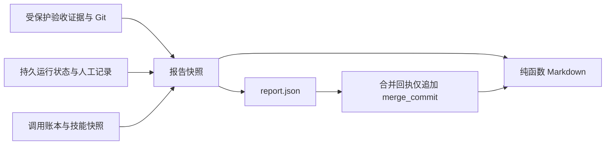

# 子项目 3：可追溯的分层报告

依据：`2026-10-12-演进体系-后续子项目.md` §9。用户已授权继续设计、继续实施，沿用逐任务子代理实现和独立审查。

## 目标与范围

读者用结论和审查重点判断是否放行，工程师可从证据追溯到判据、命令、提交和调用。报告不能将代理观点包装成机器事实，不能把费用或验证信息缺失包装成零或通过。产物仍是 `report.json` 和 `report.md`，不增加外部服务、依赖、模型调用或数据库。

不实现子项目 4 的角色配置，也不实现子项目 5 的记忆生成。外部 CI 无权威记录时标 `NOT_AVAILABLE`；记忆标 `MEMORY_MODULE_NOT_IMPLEMENTED`。不改变 API 签名、验收门、自动本地合并和回执恢复语义。

## 方案选择

1. 让代理写总结：容易失实、不可复现，不采用。
2. 在 Markdown 中现场查询：无法稳定恢复合并回执，不采用。
3. 在报告提交前构造结构化快照，纯函数渲染 Markdown：采用。新增 `presentation.version=1`，顶层旧字段/version 保持兼容；没有 presentation 的旧报告走原渲染器，字节不变。

## 数据契约

`presentation` 包含 `version`、`tier`、`sections`（字符串键 `0` 至 `6`）和 `reconciliation`。每节包含 `title`、`items`；每条 item 使用 `{id, source, availability, data, reason?}`。source 枚举为 `machine/human/agent_code/agent_sample`。availability 为 `AVAILABLE/NOT_AVAILABLE/PENDING`，未知是 null 或显式缺失原因，不能用空列表表示未知。

`machine` 表示引擎可验证的事实或确定性计算，并不将其输入中的代理声明升级为事实。动态字符串须经过现有脱敏并在 Markdown 安全转义。不得读取原始请求、响应、环境变量、凭证。报告快照有界，路径必须限制在仓库内，不跟随越界符号链接。纯渲染器不读文件、时间或当前配置。

## 0–6 节

| 节 | 内容与来源 |
|---|---|
| 0 头部 | change、nature/subtype、initial/effective tier、升档理由、结果、implementation/merge commit |
| 1 结论 | 目标、判据、测试计数及口径、AC/consumer 矩阵、门禁、完成比例、非目标、人工确认、对账结论 |
| 2 审查重点 | 引擎根据 Git 路径差异、计划路径、层状态和引用生成固定结构；核心路径优先，已有路径按风险排序，偏差、未覆盖、人工验证和可复制命令分开 |
| 3 证据 | traceability、oracle、分层验证、证据哈希、逐次技能版本/内容哈希、CI 状态 |
| 4 过程 | failures/agent_failures、事实及来源、升档、人工回答/批准/overrules/resets/repairs；没有持久历史则说明限制 |
| 5 成本 | 逐角色 calls/failed/wall/turns/tokens/model/vendor/tier，逐维度 coverage，已知费用小计和完整总计分开 |
| 6 记忆 | 未实现状态；不将 facts 自动变成经验或待审批项 |

JSON 三档结构一致。轻档 Markdown 显示 0/1/3（其中保留未知和来源），标准及重档显示全部。重档逐项列出持久风险、关联显式测试或 `UNCOVERED`；路径重叠不能证明语义覆盖。没有权威来源的硬编码到期、运行时并发、决策级偏差、事实演变历史、行为差异和历史审查问题明确标未知，不猜测。

第 2 节不接收代理正文。只包含引擎生成的标题、原因码、路径、命令和记录引用。检测 whitespace-only 使用 Git 可证口径，不称之为完整格式化检测。性能结论只允许来自明确 benchmark；无记录不输出性能改进断言。测试 discovered/added 不从 executed 推算；无可比数据时标未知。

## 调用、技能与对账

每次实际构造角色指令时，冻结实际交付的技能 name/path/version/content SHA-256，与本次 call 关联；续跑使用新版本产生新快照，不能读取最终磁盘冒充历史。adapter 返回值不可覆盖引擎技能来源。旧 run 的 skills_used 仅作为 `STALE_POSSIBLE` 开始时快照。

账本保留实际返回的 model/vendor/tier_applied，缺失不按配置猜测。每项数值排除 bool、NaN、Infinity、负数；费用部分回报时总计未知，已知小计单列，失败调用包含在内。

对账基于当前冻结点（实现提交后、报告提交前）：检查账本 call 与诊断 meta 双向一致、重复/孤儿/缺失/未结束调用，允许 pending product 被收编；检查五层、受保护 evidence 摘要和显式声明的证据路径；确认 0–6 节齐全。尚未发生的 report/merge commit 为 PENDING。诊断记录不是裁决证据，对账不能覆盖原验收门。

对账返回 `MATCH/MISMATCH/NOT_AVAILABLE` 和逐项 check。完整性与结论分开：所有可检查项目匹配但历史调度清单缺失，仍展示该覆盖限制，不能宣称所有理论阶段调用均已对账。新调用使用调用开始记录作为实际调用清单；未持久的理论调度次数不倒推。不把定制测试 callback 未产生 telemetry 视为产品验收失败。

## 生命周期和验证

生成入口保持现有强门，随后构建快照并写双格式。合并时只从 report_commit 的权威 JSON 追加 merge_commit，冻结内容不变。保留旧 renderer，防止历史回执逐字节检查漂移。

验证覆盖：未知与零、部分费用、失败调用、技能续跑漂移、恶意 adapter 来源覆盖、双向对账及安全路径、三档渲染、来源隔离、实际 Git diff、v1 旧回执字节、新回执部分写恢复、伪造回执拒绝、完整本地闭环。最终运行 unittest 全量；不把确定性 adapter 测试称为真实模型实跑。
