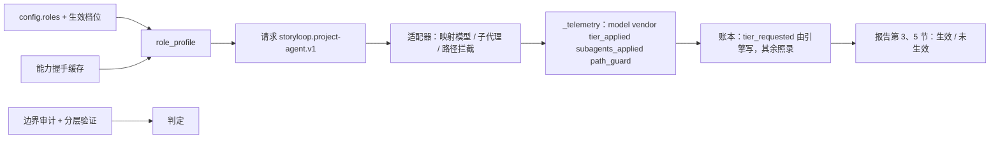

# 子项目 4：角色画像

- 状态：已批准（2026-10-19，Q1–Q8 按推荐）；实施计划见 [plans/2026-10-19-子项目4-角色画像.md](../plans/2026-10-19-子项目4-角色画像.md)。
- 依据：[演进体系后续子项目 §8](2026-10-12-演进体系-后续子项目.md#8-子项目-4角色画像)、[总体设计 §3、§7.9、§13、§15](2026-10-12-演进体系-design.md)。继承 2a 的失败归属与停止报告、2b 的档位、3 的调用来源与报告快照。
- 工作分支：`codex/subproject-4-roles`，基于 `codex/subproject-3-reports` 的 `809fa1c`；2a、2b、3 均未合入 main。
- 完成标准（总体设计 §13）：账本按角色记录实际模型；跨厂商审查可以配置启用。另加共同标准：能从干净仓库按文档跑通；实现后补差异表。

## 1. 目标与边界

引擎只描述"这个角色需要什么"：档次、技能、子代理、可写范围、快速检查。适配器决定怎么实现，并回报实际生效的结果。引擎不信任回报来做判定：边界审计、分层验证、报告对账照旧是证据型门；回报只决定报告里写"生效"还是"未生效"，以及外环能不能统计。

本期交付：

1. `role_profile` 请求字段与适配器能力握手；
2. 档次 → 模型映射、实际 model/vendor/tier 回报、"档次未生效"标记；
3. 按角色选适配器，跨厂商审查与降级语义；
4. 中间防线（适配器有能力时按路径拦写入）；
5. 技能包 frontmatter 的 `roles`/`stacks` 选择；
6. 子代理随档位伸缩：探索、审查视角、实现分通道，一处配置；
7. 审查发现的严重度 × 置信度与去向；
8. 每次调用的上下文清单；
9. 按变更的失控成本上限与新停点 `COST_LIMIT_REACHED`；
10. 模拟适配器与适配器一致性测试套件。

不做：

- 不从工具调用轨迹提取"代理实际读了哪些"，归子项目 5（它的完成标准就是"能看出是否被读"）；
- 不做复盘模式的内容，归子项目 5；模拟适配器只是能按脚本回放任意 mode；
- 不按价目表估算没有费用回报的调用（见 Q6）；
- acceptance 按接口/浏览器拆分写用例：没有对应的浏览器判据样本，延后；
- 不改判据、验收门、合并与回执语义。

## 2. 现状与缺口

| 现状（`809fa1c`） | 缺口 |
|---|---|
| `config.adapter` 只有一个，所有角色共用 | 不能让 review 走另一家厂商 |
| 请求没有 `role_profile`；Codex 内置适配器 `--ignore-user-config` 且不传 `-m`，用 CLI 默认模型 | 档次无从表达；实际模型取决于运气 |
| 账本白名单已有 `model/vendor/tier_applied`，但没有一个适配器回报 `vendor`/`tier_applied`；Claude 示例只回报 `model` | 报告第 5 节档次一栏永远未知 |
| `ROLE_SKILLS` 写死在 `skills.py`；`_skill_root` 只认引擎自带的技能包 | 项目自己的技能包用不上；无法按技术栈挑 |
| 审查视角有两套名字：`planning.review_focus` 发 `engineering/product/security/quality`，Claude 示例自己跑 `correctness/security/architecture/tests` | 违反"同一件事只有一条通道"（原则 11）；报告说的视角和实际跑的不是一回事 |
| 实现分通道由 Claude 示例的 `--implement-lanes` 决定，与档位无关 | 轻档也可能分通道，重档也可能不分 |
| 审查发现只有 `message/perspective/criterion_id/evidence/target/location`；`verdict` 由代理决定 | 低把握的发现也会让整轮失败、耗预算；老问题无法区分 |
| 越界写入只在一轮结束后由边界审计发现 | 代理能写一整轮才被叫停 |
| 只有单次调用的 `agent_timeout_seconds`（默认 4 小时） | 没有按变更的总量上限；总体设计 §15 第 7 条待定 |
| 测试里已有确定性命令适配器（`tests/test_reports_e2e.py`），但不是可复用组件；Claude/Codex 适配器各有单测，没有共用的协议断言 | 协议字段一变，适配器各自漂移 |

## 3. 方案选择

- **A. 引擎直接选模型**：引擎按角色写死模型名传给 CLI。简单，但把厂商知识塞进引擎，第三方适配器无法参与，不采用。
- **B. 引擎发档次，适配器映射并回报，能力握手兜底**：引擎只认 `strong/standard` 两档；映射在适配器配置里；引擎开跑前问适配器"你能做什么"，做不到的按配置降级或停下。采用。
- **C. 只加回报，不加握手**：省一个协议，但"映射不到直接报错，不静默回落"（§8.1）只能在调用之后才发现，钱已经花了。不采用。



## 4. 配置

`.storyloop/config.json` 新增三个键，全部可缺省；缺省时行为与现在逐字节一致（§10）。

```json
{
  "adapters": {
    "claude": {"kind": "command",
               "agent_command": ["{python}", "/abs/claude_agent.py", "--tier-model", "strong=opus",
                                 "--tier-model", "standard=sonnet"]},
    "codex":  {"kind": "codex", "models": {"strong": "<模型名>", "standard": "<模型名>"}}
  },
  "roles": {
    "default_adapter": "claude",
    "review": {"adapter": "codex"},
    "implement": {"tier": {"light": "standard", "standard": "strong", "heavy": "strong"}}
  },
  "cross_vendor_review": {"enabled": true, "on_unavailable": "fail_closed"},
  "limits": {"max_calls": 80, "max_agent_wall_seconds": 28800,
             "max_tokens": null, "max_cost_usd": null}
}
```

- `adapters`：命名的适配器。`kind` 取 `manual/command/codex`，即现有三种实现。旧的顶层 `adapter`/`agent_command` 视为一个名叫 `default` 的适配器。
- `roles`：每个角色可覆盖 `adapter` 与 `tier`。`tier` 可写一个值，或按 `light/standard/heavy` 写映射。没写的取 §5.2 的默认表。
- `cross_vendor_review`：见 §6。
- `limits`：见 §8。`null` 表示不设该项。
- 新键都受控制面保护（已有：`.storyloop/config.json` 在保护清单里）。

## 5. 请求协议

### 5.1 `role_profile`

协议名保持 `storyloop.project-agent.v1`，请求新增可选字段，旧适配器忽略即可：

```json
"role_profile": {
  "version": 1,
  "tier": "strong",
  "routing_tier": "standard",
  "skills": [{"name": "oracle-craft", "path": ".claude/skills/oracle-craft/SKILL.md",
              "version": "1.1.0", "sha256": "…"}],
  "subagents": {"perspectives": ["correctness", "security", "architecture", "tests"],
                "explore": ["similar-features", "call-chain"], "lanes": false},
  "writable_paths": ["modules/orders/**", "tests/**"],
  "forbidden_paths": ["modules/orders/legacy/**"],
  "fast_checks": [["{python}", "-m", "ruff", "check", "."]]
}
```

- `tier` 只有 `strong` 与 `standard` 两值。
- `writable_paths`/`forbidden_paths` 由引擎从现有的可变区、`test_roots`、受保护路径、方案的 `forbidden_paths` 算出，与边界审计用同一套来源，不另起一份。只读角色的 `writable_paths` 为空。
- `fast_checks` 默认取 settings 的 `check_commands`（静态检查），可由 `roles.<role>.fast_checks` 覆盖；只给写入型角色。代理在会话内自查用，结果不作判定。
- `skills` 只是清单。技能正文仍嵌在 `instructions` 里交付（Q3）。

### 5.2 默认档次与权限

| 角色 | 默认档次 | 写权限 |
|---|---|---|
| product、acceptance、design、review | strong | 只读（acceptance 的文件由引擎写入套件目录） |
| implement | 轻档 standard；标准、重档 strong | 可变区与 `test_roots` |
| characterize | standard | 只写 `test_roots` |
| survey、探索子代理 | standard | 只读（survey 的文档由引擎写入） |

配置只能把判定类角色（product、acceptance、design、review）调低到 standard 时要写 `"reason"`，报告第 5 节以 👤 列出。

### 5.3 能力握手

新增协议 `storyloop.adapter-capabilities.v1`。引擎向适配器发 `{"protocol": "storyloop.adapter-capabilities.v1"}`，适配器只回：

```json
{"vendor": "anthropic", "tiers": ["strong", "standard"],
 "subagents": true, "path_guard": true, "fast_checks": true, "modes": ["*"]}
```

- 新命令 `storyloop adapters check <project> [--json]`：对每个配置里的适配器握手，校验 `roles` 用到的每个 (角色, 档次) 都能映射，结果写 `.storyloop/state/adapters.json`，绑定 config 摘要与适配器 argv 摘要。
- `init` 与 `change` 在配置了 `adapters` 或 `roles` 时自动做一次；摘要变了就重做。映射不到直接报 `ADAPTER_PROFILE_UNSUPPORTED`，不回落到默认模型（§8.1）。
- `manual` 适配器视为 `{"tiers": [], …}`：档次一律未生效，不报错。
- 握手结果只用来提前发现配置问题和报告"能力未生效"，不作判定依据。

### 5.4 回报

`_telemetry` 新增必报项 `vendor`、`tier_applied`，可报项 `subagents_applied`（例如 `{"perspectives": 4, "explore": 2, "lanes": 0, "mode": "parallel"|"sequential"}`）、`path_guard`（`"enforced"|"unsupported"`）。

账本由引擎另写 `tier_requested`、`adapter`（配置里的适配器名），这两项不接受适配器覆盖，与子项目 3 处理 `skills` 的方式一致。

报告：

- 第 5 节每行加"请求档次 → 实际档次"。`tier_applied` 缺失，或与 `tier_requested` 不同，标"档次未生效"，该行不进外环统计；
- 第 3 节加"中间防线：生效 / 不支持"与"子代理：并行 / 依次 / 未生效"；
- 都是 🔧，但写明是"适配器回报"，不说成已经被验证的事实。

## 6. 按角色选适配器与跨厂商审查

- 每次调用按 `roles.<role>.adapter` 选适配器，缺省用 `default_adapter`。
- `cross_vendor_review.enabled=true` 时，review 的适配器握手所报 `vendor` 必须不同于 implement 的；否则 `adapters check` 直接报错。
- 运行中 review 那家不可用（握手失败，或调用得到 `AGENT_UNAVAILABLE`）时，按 `on_unavailable`：
  - `fail_closed`（默认）：停在 `AGENT_UNAVAILABLE`，details 带 `cross_vendor: true`；不计入 `max_attempts`（沿用 2026-10-12 的语义）。
  - `degrade`：改用 implement 的适配器跑这一轮审查，账本记 `degraded: "cross_vendor"`，报告第 1 节以 🔧 写明"本次审查与实现同一厂商"。
- 事后核对：调用后，review 回报的 `vendor` 与 implement 实际回报的 `vendor` 相同，或任一方没回报，报告标"跨厂商未生效"，不改判定。

## 7. 子代理、技能包与中间防线

### 7.1 子代理一处配置

`role_profile.subagents` 是唯一来源。`planning.review_focus` 改为生成它，Claude 示例的 `--review-perspectives`、`--implement-lanes` 只在请求里没有 `role_profile` 时生效（老引擎）。

| 角色 | 轻 | 标准 | 重 |
|---|---|---|---|
| 探索（design 前） | — | `["similar-features", "call-chain"]` | 再加 `"tests-extension"` |
| review 视角 | `[]`（单会话） | `correctness/security/architecture/tests` | 再加 `oracle-strength` |
| implement | `lanes:false` | `lanes:false` | 方案的 `touched` 跨越两个以上已配置通道时 `lanes:true` |

- 视角名统一为 `correctness/security/architecture/tests/oracle-strength`，文案取 Claude 示例现有四段，`oracle-strength` 取 `oracle-craft` 技能包里"弱断言、删测试、mock 顶替集成判据"那一条。
- 通道的路径前缀仍在适配器配置里（与仓库布局有关，与档位无关）；档位只决定开不开。
- 探索结果作为 design 请求的 `payload.exploration` 交给主会话，由适配器在同一次调用内完成，引擎侧仍是一次 design 调用。

**降级**：适配器不支持子代理（握手 `subagents:false`，例如 Codex 内置适配器）时，在单会话里按视角依次做：引擎把视角清单写进 instructions，回报 `subagents_applied.mode="sequential"`。

### 7.2 技能包按角色与技术栈挑选

- frontmatter 增加 `roles: [acceptance, review]` 与 `stacks: [python]`（可缺省，缺省等于任何技术栈）。
- 挑选：`roles` 含本角色，且 `stacks` 与 settings 新增的 `stacks` 有交集或为空。来源依次为项目 `.claude/skills`、`.codex/skills`、引擎自带；同名以项目副本为准（现有规则）。
- 去掉 `ROLE_SKILLS` 常量；`oracle-craft`、`foundation-survey` 的 frontmatter 补上与现在完全相同的角色，结果不变。
- 项目自有技能包已经在 BASE 保护内（子项目 1）。新增一条：被选中给 product/acceptance/characterize/review 的项目技能包，指纹变化时 `base-update` 必须带 `--confirm-oracle-skills`，由人显式确认（§8.3"覆盖判据相关角色技能包的变更需要人批准"）。
- 每次调用最多嵌入 6 个技能包、总计 200 KB；超出时报错，不悄悄截断。

### 7.3 中间防线

- Claude 示例：写入型角色不再用 `--permission-mode acceptEdits` 放行整个工作目录，改为 `Edit(<pattern>)`/`Write(<pattern>)` 允许规则加 `forbidden_paths` 的拒绝规则；`fast_checks` 的 argv 加进预批准的 Bash 前缀。
- Bash 仍能写文件，所以这道防线是尽力而为，回报 `path_guard:"enforced"` 也只表示"编辑类工具已收窄"。事后的边界审计照旧是证据型门，任何越界照旧停 `BOUNDARY_VIOLATION`。
- Codex 内置适配器没有按路径拦截的能力，回报 `unsupported`，靠事后审计。
- 必补测试（§8.2）：每个角色的有效工具集"不多不少"；命令前缀含 `;`、`&&`、`$( )`、`..`、软链时被拒。

## 8. 审查发现与失控成本上限

### 8.1 严重度 × 置信度

FINDING 新增字段（新协议下必填，老回答缺省）：`severity`（`P0/P1/P2/question`）、`confidence`（0–100 整数）、`introduced`（布尔：本次改动引入）、`trigger`、`impact`、`fix`。review 另返回 `coverage: [string]`（检查过什么），有已批准方案时另返回 `checklist: [{decision, status: pass|issue|unconfirmed}]`，引擎核对每条方案决策都有一行。

引擎按下表决定去向，`verdict` 从此由引擎计算，代理给的值只记录：

| 条件（按顺序取第一条） | 去向 |
|---|---|
| `introduced=false` | 置信度按 0 处理，进报告"老问题"清单 |
| 超出本次范围（`target` 新增值 `out_of_scope`） | 报告后续清单："移出范围，建议另开变更" |
| 置信度 ≥ 80 | 按 2a 的归属：implementation 进修复环；oracle/contract 停在 `ORACLE_DEFECT`/`NEEDS_SPEC_FIX` |
| 置信度 50–79 | 报告第 2 节审查重点 |
| 置信度 < 50 且 P0/P1 | 报告第 1 节"还需要人确认的事项" |
| 其余 | 丢弃，只在调用记录里保留，报告给出丢弃条数 |

- 进修复环与停点的发现，如果出自 standard 档的 review 调用，先以 strong 档做一次复核调用（review 新 mode `verify`，只回每条发现的 `confirmed` 与理由），确认的才生效（Q4）。
- 阈值 80/50 放在 `config.review_thresholds`，留给外环校准。
- 第 2 节只引用发现的 id、文件:行号、严重度、置信度；发现正文放第 4 节并标 🤖，维持子项目 3 "第 2 节没有代理撰写的部分"。
- 兼容：没有 `confidence` 的老发现按 100、`introduced=true` 处理，即现在的行为。

### 8.2 失控成本上限

- 在每次调用**之前**，按本变更账本累计 `calls`、`agent_wall_seconds`、`input+output tokens`、已知 `cost_usd`，任一达到 `limits` 就不再发起调用，停在新停点 `COST_LIMIT_REACHED`。
- 失败的调用、`AGENT_UNAVAILABLE` 都计入：它们不消耗质量预算，但真花了钱和时间，挂死保护正是为它们设的。
- `max_cost_usd` 只累计回报了费用的调用；有调用没回报费用时，停止报告写明"费用上限只覆盖 x/y 次调用"，同时由 `max_calls`/`max_tokens` 兜底（Q6）。
- 恢复：提高 `limits` 后 `run`，或作废重开。统一停止报告按 2a 的格式，列出各维度的已用/上限与按角色明细。
- 默认值：`max_calls` 80、`max_agent_wall_seconds` 8 小时、tokens 与费用不设（Q5）。依据：2b 四个真实样例单个变更 8–17 次调用、最多约 280 万 token（[真实验证记录](../../validation/2026-10-17-子项目2b-真实验证.md)）；默认值是挂死保护，不是预算，留出 4 倍余量。

### 8.3 上下文清单

每次调用的诊断记录新增 `context`：实际提供的底座文档、活规格、技能包、方案文件的路径与 SHA-256，以及因大小被截掉的项。恢复运行时引擎照旧每次重新构造请求，所以不存在"盲目续跑旧上下文"；Codex 的会话续接只发生在同一次调用的格式修复内。清单供子项目 5 比较"提供了什么"与"读了什么"。

## 9. 测试支撑

- **模拟适配器** `storyloop/testing/mock_adapter.py`，作为 `command` 适配器运行（`["{python}", "-m", "storyloop.testing.mock_adapter", "--script", "<file>"]`），不需要密钥：
  - 脚本按 `(role, mode, 第几次)` 给出回答、`_telemetry`、能力握手、故意失败（退出码、超时、非 JSON）；
  - 能回放 `creates`、带严重度与置信度的审查发现、`verify` 复核、子代理回报；
  - 每次请求原样落到脚本旁的 `requests/`，供断言 `role_profile` 内容；
  - 现有 `tests/test_reports_e2e.py` 里的确定性适配器改用它，避免两份实现。
- **一致性套件** `tests/test_adapter_conformance.py`：参数化跑 manual、模拟、Codex 内置（PATH 上放假 `codex`）、Claude 示例（PATH 上放假 `claude`），断言同一组协议性质：握手形状；`role_profile` 传到；`tier` 映射为对应模型参数；回报 `model/vendor/tier_applied`；schema 违约报 `AGENT_CONTRACT_INVALID`；进程失败报 `AGENT_UNAVAILABLE`；不支持子代理时回报 `sequential`。
- 进 CI（Linux 与 Windows 两个必过作业），不调用真实模型。

## 10. 兼容

- 没有 `adapters`/`roles`/`limits` 的老配置：请求不带 `role_profile`，不握手，不设上限之外的新检查，报告档次一栏标"未配置"（与"未生效"区分）。`limits` 的默认值对老配置同样生效（Q5）。
- 老适配器忽略 `role_profile` 与握手请求：握手得到非 JSON 或缺字段时视为"能力未知"，按 `tiers: []` 处理并在报告中标注，不阻断，除非配置了跨厂商审查。
- 老审查回答（无 `confidence`）行为不变；老 run 续跑时不补算新字段。
- `design_min_stories` 在 2b 已被档位取代，不动。
- 不改公共 API 签名（`invoke_project_agent(project, role, payload)` 不变，适配器选择在内部完成）。

## 11. 待决问题

| # | 问题 | 推荐 | 备选 |
|---|---|---|---|
| Q1 | 档次档位 | 只要 `strong`/`standard` 两档 | 加 `fast` 第三档给探索子代理；目前没有数据证明值得 |
| Q2 | 适配器能力怎么知道 | 握手协议 + `adapters check`，开跑前就失败 | 只看事后回报（便宜，但钱花完才发现） |
| Q3 | 技能包怎么交付 | 正文照旧嵌在 instructions，`role_profile.skills` 只是清单；偏离 §8.3"请求里只传名字和路径" | 只传路径由适配器自己读：省 token，但子项目 3 的"交付了什么"来源就断了，第三方适配器也可能不读 |
| Q4 | 高置信发现的强模型复核 | 只在 review 调用本身不是 strong 档时复核 | 一律复核（每轮多一次 strong 调用）；或一律不复核 |
| Q5 | 失控上限默认值，老配置是否生效 | `max_calls` 80、代理墙钟 8 小时，对老配置也生效 | 只对新配置生效；或默认不设 |
| Q6 | 没有费用回报的适配器（Codex） | 不按价目表估算；费用上限只管有回报的调用，用 tokens/调用数兜底 | 配置价目表按 token 估算（价格会过期，估出来的数字会被当成事实） |
| Q7 | 中间防线在 Claude 示例里的做法 | 去掉 `acceptEdits`，改用按路径的 Edit/Write 规则 | 保留 `acceptEdits` 只加拒绝规则（改动小，但可写范围仍是整个目录） |
| Q8 | 真实验收 | todo-demo 上一个标准档 feature：implement 走 Claude，review 走 Codex，两家各至少一次真实调用；另用模拟适配器在 CI 覆盖 `fail_closed`/`degrade`、`COST_LIMIT_REACHED`、置信度去向 | 只用模拟适配器（不花钱，但"跨厂商审查可以配置启用"没有真实证据） |

## 12. 交付批次

| 批次 | 内容 | 依赖 |
|---|---|---|
| 1 | 配置解析与兼容；`role_profile` 构造；能力握手与 `adapters check`；按角色选适配器；账本 `tier_requested/adapter` | — |
| 2 | 模拟适配器；一致性套件；Codex 内置与 Claude 示例的档次映射和回报 | 1 |
| 3 | 失控成本上限与 `COST_LIMIT_REACHED`；跨厂商审查与降级 | 1、2 |
| 4 | 审查发现的严重度 × 置信度、引擎计算 verdict、`verify` 复核、checklist/coverage | 2 |
| 5 | 技能包 frontmatter 选择；子代理一处配置；中间防线；上下文清单 | 2 |
| 6 | 报告第 1/3/5 节新增项；文档；真实验收；差异表 | 全部 |

## 13. 实现差异与验收状态

实现后填写。
