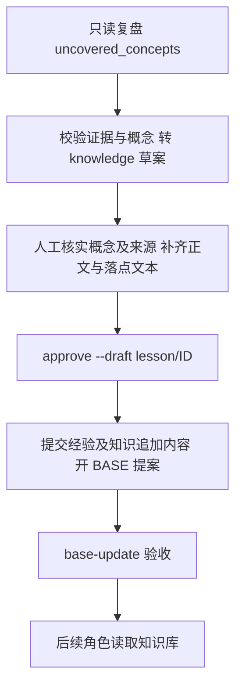

# 知识库补充：survey 技能包质量约定

日期：2026-10-20。状态：**待评审，Q1–Q7 未批准**。本文件是设计提案，不是已生效契约，也不是实施计划；本次不修改技能、模板、引擎或现有知识库。

## 1. 目标与边界

让知识库明确回答三个问题：该讲的机制是否覆盖、结论有哪些证据与限制、随机复核发现了什么。推荐把约定放进 `foundation-survey` 技能包，维持决定 [0013](../../decisions/0013-foundation-knowledge-base.md) 的文件接口和 BASE 保护，以及决定 [0014](../../decisions/0014-skills-as-packaged-modules.md) 的打包分发方式。

目标：

- 八份文档仍承担原职责，必含节可检查；不适用与尚未查明必须区分。
- 重要事实有可定位来源、来源状态、观测版本；推断不能冒充已确认事实。
- 提供有固定样本记录、可重放的随机抽检约定，并分清自检与独立复核。
- 接住复盘暴露的未覆盖概念，保留人工补充、审批、BASE 生效边界。

非目标：新增第九份必需文件、向量库、搜索服务、自动抓取外网、改变响应 JSON/schema、增加角色、增加 CLI、自动审批、自动改知识库或自动晋升原则。也不改变八份文档名、角色 payload、校验错误码和运行判定。

[总体设计 §13](2026-10-12-演进体系-design.md#13-子项目与顺序) 将本项延后到子项目 5 完成后，[子项目 5 §1](2026-10-19-子项目5-分层记忆-design.md) 明确不含本项。当前该前置条件不能记为全部完成：[真实验收](../../validation/2026-10-20-子项目5-真实验收.md) 明确自然 lesson 闭环未通过。用户授权本次先交设计，因此设计可评审，实施启动仍需确认依赖验收与本设计问题，不能由本文件替子项目 5 签收。

## 2. 现状证据与缺口

现状以 `6319d83` 为阅读基线；后续实现需重新对照合入后的源代码，不能把待验收分支能力视为已有。

| 位置 | 已有行为 | 本次需要补足的约定 |
|---|---|---|
| [SKILL.md](../../../storyloop/skills/foundation-survey/SKILL.md) | 只读探查、八份文档、先证据后结论、阶段门禁；引擎只输出 documents JSON | 没有统一来源状态、抽样方法和结果记录 |
| [doc-templates.md](../../../storyloop/skills/foundation-survey/references/doc-templates.md) | 八份章节骨架与质量标准，允许按仓库裁剪 | 容易把“不适用”和“没查过”都省略；积木“五项”标准不适合极小项目 |
| [survey-checklist.md](../../../storyloop/skills/foundation-survey/references/survey-checklist.md) | 按技术栈找证据、看不到代码标待确认、代码与文档不一致记差异 | 缺少证据观测版本、矛盾记录和刷新范围 |
| [foundation_survey.py](../../../storyloop/foundation_survey.py) | 校验路径、大小、Markdown 后缀、必需八文件、重复路径及部分敏感值；允许附加 Markdown；写入后开 BASE 提案；勘误排序第一 | 不检查章节、证据真实性或来源状态，不执行随机抽检 |
| [skills.py](../../../storyloop/skills.py) | 项目副本优先；实际顺序 `.claude`、`.codex`、打包副本；正文拼入 references；安装同步两目录并可开 BASE | “两个客户端都有副本”不等于实际读到同一版本；安装会覆盖同名打包文件 |
| [retrospective.py](../../../storyloop/retrospective.py) | `uncovered_concepts` 转 knowledge 草案；与 lessons 合计最多三条，超额/无效条目记 dropped | 自动正文只有“待补充，证据”，还不是可复用知识 |
| [lesson_landing.py](../../../storyloop/lesson_landing.py)、[drafts.py](../../../storyloop/drafts.py) | pending 草案经审批提交经验和知识落点，开 BASE；`body.md` 与 `payload.landing.append` 分别消费 | 审批不是事实核验；编辑正文不会自动更新追加文本 |

当前安装校验通过只证明结构与有限防护通过，不能声称知识准确、章节完整、所有敏感内容都可被检测。当前 `foundation_payload` 列出工作树中 Markdown 路径；BASE 待验收时应由操作流程避免开始消费这些新内容，不把“已落盘”写成“已生效”。

## 3. 方案比较

| 方案 | 内容 | 收益 | 代价与边界 |
|---|---|---|---|
| A：仅补提示措辞 | SKILL 增加“来源要清楚、随机检查” | 改动最少 | 没有一致的样本、必含节和复核依据，难验收 |
| **B：技能包约定 + 文档内证据与抽检（推荐）** | 模板固定覆盖项；同一 Markdown 记录证据状态；README 汇总抽检 | 沿用八文件与 JSON；交互式和引擎入口共用；能人工审计 | 仍是代理/人工执行的质量门，不能声称引擎强制 |
| C：引擎结构化强校验 | 新增事实 schema、校验器、抽样执行与独立报告 | 能确定性阻断缺项 | 改响应契约、历史兼容与调用成本，且结构校验仍不等于语义真实；超出本项 |

选择 B 的前提是 Q1 批准。若业务要求“缺一节就必须由引擎拒绝”，应选 C 并另行设计接口与迁移，不能在 B 的实现里顺带加入。

## 4. 推荐方案：八文档的必含节

以下是**拟议技能质量约定**，须评审批准后才可改模板。保留原节名和职责；“必含”表示保留该覆盖项，可以用符合技术栈的名称表达，README 给出对应节。每节有事实内容或明确状态，不允许无说明消失。

| 文件 | 必须回答的内容 |
|---|---|
| README.md | 使用说明、八文档索引、覆盖/空白汇总、刷新条件；增补“来源与抽检记录” |
| modules.md | 模块职责、依赖方向、可变区/集成点、前端结构 |
| architecture.md | 技术栈、启动、请求/调用链、数据访问、横切机制、前端机制、运行方式 |
| extension.md | 新增功能的分层路径、菜单/权限、前端、修改既有功能、生成器、禁止事项、完整参考例 |
| api.md | 约定、按模块的接口、上游能力、前端封装；无 HTTP 时写实际 CLI/库入口 |
| capabilities.md | 上游能力、本仓库能力及活规格、能力依赖；缺活规格明确缺失，不虚构对应关系 |
| building-blocks.md | 后端/前端/验收复用点、禁止重复实现的场景；极小项目按真实项数，不凑五项 |
| testing.md | 单元/集成、前端、验收基础设施、回归命令、默认跳过项和平台限制 |

总体要求的七类补充按下表落入现有文件，不能被通用章节清单替代（依据：[后续子项目 §10.6](2026-10-12-演进体系-后续子项目.md#106-取用新鲜度与底座原则)）。

| 必含节 | 主落点 | 最少回答什么 |
|---|---|---|
| 身份与权限档位 | architecture.md | 实际身份如何识别、授权入口与拒绝边界；无身份系统则说明依据 |
| 测试账号 | testing.md | 测试角色、创建/重置/清理机制、隔离范围、fixture 位置；只用角色别名，不读取或记录真实账号、密码、token、PII |
| 行为开关 | architecture.md | 安全的键名、消费代码、分支及默认行为的代码依据；部署实际值不可读则标待确认 |
| 所有可运行单元 | modules.md，testing.md 引用 | 从构建和入口枚举服务、CLI、worker、定时任务、前端等；每项入口、职责、启动定义、依赖、测试入口；注明枚举范围 |
| 贡献与提交规范 | extension.md | 已有分支、提交、审查、验证要求及来源；没有则写缺失，不代项目制定规范 |
| 版本基线 commit | README.md，各文档引用 | BASE source_head 与实际观测 HEAD（完整 SHA）、底座版本、工作树状态；无 BASE 时注明，不用 HEAD 冒充 BASE |
| 需求类型路由表 | extension.md，README.md 提供入口 | “需求类型 → 第一站 → 再追什么 → 证据”；新增/修改接口、页面、任务、数据或配置等按项目实际列出参考实现 |

路由表只帮助定位源码与知识，不改变引擎 L1/L2/L3 分档、授权或可写范围。BASE source_head 只取已有非敏感基线元数据；无法安全核实时写待确认，不猜测。

无前端的库项目在相应节写“不适用：仓库没有前端模块，探查范围为……”。没找到生成器但探查不完整，写“待确认：已查……，还缺……”，不能直接写不存在。配置只描述安全的键名与位置，不复制值、不为完善文档读取敏感文件。

每文档开头保留对应底座版本、生成日期，拟增补观测提交、技能版本和质量约定版本。观测提交是实际阅读的 Git HEAD，底座版本是输入值；两者不能混用。工作树有未提交事实改动时注明脏状态及影响范围，最终提交审核须重核，不虚构已提交证据。

## 5. 来源状态与事实记录

来源状态沿用总体要求的三个名称；另设核验结果表达证据缺失与冲突。不复用 lesson 的 `active/needs-review/retired`，也不表示 BASE 审批状态。

| 来源状态 | 含义与限制 |
|---|---|
| 引用已确认 | 实际打开代码、构建声明或运行证据核对结论；仅证明该证据支持的范围，读测试不等于执行测试 |
| 仅凭名称推测 | 只有路径、类名、开关名等线索；列线索及待核实内容，禁止包装为确定行为 |
| 文档声称 | 来自 README、规格、历史设计等文字；记录原文位置与版本；查过文档仍不能标为已验证运行行为 |

下表是独立的核验结果。例如“文档声称 / 已核对”只表示核对了文档原文，“文档声称 / 冲突”表示它与代码不符；无任何来源的空白只记待确认，不编造来源。

| 核验结果 | 使用条件 | 必需信息 |
|---|---|---|
| 已核对 | 已阅读当前观测版本中直接支撑结论的代码、规格或构建声明 | 仓库相对路径、符号或行号、观测提交；运行结果另记命令/结果来源 |
| 推断 | 有线索但不能直接证实 | 已知证据、推理、缺少哪项直接证据 |
| 待确认 | 无足够证据或不可访问 | 已探查范围、缺口、下一步应核实的对象 |
| 冲突 | 代码、规格、文档或运行结果互相矛盾 | 两侧来源、差异、当前不能依赖的结论；不静默裁决 |
| 不适用 | 覆盖项确实不属于项目 | 探查范围及理由；只用于节覆盖项，不包装成业务事实 |

来源种类与状态分开：代码、活规格、构建声明、测试定义、实际运行记录、历史文档。代码说明“现在如何做”，活规格说明“应当如何做”；两者不同标冲突，不能用代码抹去需求。阅读测试代码不能写“测试已通过”；读取命令声明不能写“已运行”。未经查阅的外部材料仅作线索，不作为已核对依据。

事实使用文档内局部 ID，例如 `architecture:F001`。建议记录形式为“ID / 结论 / 来源状态 / 核验结果 / 来源 / 观测提交 / 限制”，可嵌在现有表格或紧随段落，避免另写一套重复正文。一个 ID 对应一个可复核结论；各大段可以拆成多条。所有事实结论均需记录，包括一般机制、扩展、权限、依赖边界、数据写入、运行和测试；索引标题和纯导航无需事实 ID。

来源用相对路径加符号，行号辅助定位；路径存在不代表支持结论。README 汇总推断、待确认、冲突以及未覆盖节，链接到原处；若为空，明确写“本次已登记范围内无”，不承诺全仓无未知。

刷新时只在重新核对后标“已核对”；旧状态不得自动继承。底座/观测提交变化仅说明需要复核，不一概声称原结论已错。旧文档无元数据时按“旧格式，未按本约定核验”展示，不能补日期或把旧结论批量改成已核对。

## 6. 可重放的随机抽检

随机抽检用于发现遗漏的错误，不给出统计准确率，也不证明完整性。以下样本量与规则为 Q3 的推荐值，不是当前引擎行为。

触发建议：每次 survey 交付前自检；后续每累计 10 个已完成变更或距上次抽检 30 天（先到者）由维护者发起复核；改变机制的 BASE 或上游同步后依已有规则刷新并复核。仅为技能操作约定，不新增计数器、后台调度或自动模型调用。到期未执行就如实记录。旧库无事实 ID 时先人工编制候选映射，再按同一方法抽样，不自动改原文。

1. 文档起草后冻结事实清单：以“文档路径 + 事实 ID”唯一定位。正文候选范围为七份必需正文及知识库中的附加知识正文，保留附加 Markdown 能力；README 索引/汇总和 errata 勘误记录不重复入池，README 基线等元数据及勘误冲突另做定向核对。候选正文中的所有已核对、推断、待确认、冲突结论入池；不适用节另做覆盖检查。N 为入池事实总数，D 为至少有一条入池事实的正文文档数。记录完整候选 ID 清单及摘要，样本选择前不得删除难查条目。清单按路径、ID 的 UTF-8 字节顺序排序，每项编码为 `路径 + Tab + ID + LF`，连接后计算 SHA-256；路径与 ID 不允许包含 Tab/换行。
2. 在清单冻结后由复核者用只读工具生成并记录一次随机种子（16 随机字节的小写十六进制）；同一轮不得换种子挑结果。按 `SHA-256(seed + LF + 文档路径 + LF + ID)` 的 UTF-8 输入计算，hash 升序取样，相同 hash 按路径、ID 排序。记录规则版本和种子，另一人可重放；仅代理自检时明示选样与核验均由同一代理执行。
3. 先从每个有入池事实的正文文档取该文档 hash 排名第一条，再按同一排序从全局剩余池补足 `min(N, max(7, D, ceil(N × 10%)))` 条，不重复。N=0 记录“无可抽样事实”，不得记通过；若仓库确实极小，由覆盖检查说明原因。
4. 随机样本之外，对本轮新增/修改的安全边界、跨模块禁止项、数据写入约束、运行/测试命令与勘误冲突做定向核对，单独计数，不替换随机失败样本。
5. 对每条样本重新打开对应非敏感来源，核对路径/符号、结论、状态和观测版本；命令仅核对仓库定义，实际执行须独立记录，不能默认运行有副作用的命令。

README 的“来源与抽检记录”保留：观测提交、技能/约定版本、候选清单摘要、种子与选样规则、N/D/样本数、样本 ID、各项结果及证据、自检或独立复核、未核验原因、修订前后结论。候选清单可放 README 的折叠段，仍不新增必需文件。

示例：七份正文各一条事实，N=7、D=7，抽七条；七份正文加一份附加正文各一条，N=8、D=8，抽八条；七份正文合计 100 条，N=100、D=7，先取七条再从全局剩余池补三条。

结果为“相符 / 不符 / 无法核验”。已核对事实若无法核验，降为待确认并记录原因；不符项必须纠正，同时检查同节的相关断言。修订保留旧记录，复核原失败样本；新增事实单列追加抽样记录，不能重抽抹去失败。推断/待确认本身不算错误，只有被写成确定事实或遗漏限制才算不符。

新 survey 尚未入库的结论在候选产物中修正；已受 BASE 保护的结论不在抽检时直接改写。不符项须进入现有勘误通道：提供原文精确子串 `claim`、原文档 `document`、修正 `correction`、当前源码 `path:line` 证据，由支持 errata 的现有角色调用捕获草案，再人工审批与 BASE。独立人工复核没有专用抽检 CLI，先保留待处理发现，由既有流程承接；本设计不新增自动入口。无有效源码证据时保留无法核验，不伪造路径绕过校验。勘误未落地或 BASE 未通过时，只能记“发现待处理”。

拟议发布质量门：八文档覆盖检查完成，来源状态齐备，抽样记录可重放，不符项已修正复核；未确认项可以保留但必须在 README 显式列出，且不把未确认命令/权限/数据边界当可直接采用的操作依据。独立复核未发生只能写“自检完成”。这是一条技能/人工门，不会改变 `SURVEYED` 或 BASE 的引擎判定。

## 7. 未覆盖概念、审批与 BASE

沿用现有审批链路，人工补证与 BASE 前不消费是拟议操作约定，并非新增引擎门：

`uncovered_concepts` 仅含 `concept/evidence/suggested_document`；概念须非空单行，证据经当前真实源码行校验，路径须在知识库下。`_concept` 自动生成 knowledge/create 草案，正文和追加文本为占位说明；与普通 lessons 共用三条上限且普通 lessons 在前。无效条目进入 dropped，复盘 DONE 也不等于有有效草案。

拟议操作约定：

- 将未覆盖概念视为补证任务。优先选择八文档中职责对应的文件，不因一个概念新造必需文件；现有引擎允许附加文件的能力保持不变。
- 审批前补充真实结论、状态、来源和适用范围；**同时审查 `body.md` 与 `draft.json` 中 `payload.landing.append`**。前者成为经验正文，后者才追加到知识库；不能只改前者后宣布补齐。人工修订需记录修改原因与原始来源，不冒称模型自然产物。
- 默认未完成补证就保留 pending 或带理由拒绝；不直接批准“待补充”占位进入事实正文。此要求目前不是引擎强制，Q4 决定是否接受人工门。
- 知识追加后需要更新 README 汇总或其他文件时，通过后续独立 BASE 文档修订完成；当前单落点草案不自动修改其他七份文档，不能暗中扩展审批写集。
- 与原文矛盾时走现有 errata 草案路径，保留勘误优先；不借“未覆盖”追加第二个相反事实。下一次 survey 经 BASE 吸收已批准勘误，保留来源关联，不覆盖/删除仍有效的勘误记录。
- 审批提交与 BASE 验收分开记录；只在 BASE 成功后开始依赖新增知识的正常工作流。BASE 失败按现有流程处理，不绕过、不把原 PASSED 运行改判。

survey 没有自动接收待处理概念的新 payload，本设计也不加入。人可在后续 survey 的既有 reason 中说明需补查的概念/公开证据；仅凭 reason 不构成来源证明。无需自动重跑真实模型来碰运气生成合规条目。

## 8. 兼容与迁移

推荐 Q5 批准后，仅在将来的技能修订中更新 SKILL、模板、探查清单及必要的 references，按独立技能版本发布（建议 1.1.0）；当前 1.0.1 与既有知识库继续可读。质量约定版本写入新生成文档，不增加引擎必填 JSON 字段。

安装使用既有 `storyloop skills <project>`，已初始化仓库仍经 BASE。安装前对照项目自定义副本与打包版本，保留自定义差异；该命令会复制覆盖同名文件，不能承诺自动合并。两目录应复核一致，实际调用快照才证明所提供版本，不能只看客户端名称推断。

旧知识库不强制批量重写；在计划内重新 survey 或人工 BASE 刷新时补齐覆盖项与状态，不为迁移自动启动真实模型调用。无权限读取的旧来源保持待确认。JSON 输出仍为 `documents: [{path, content}]`，交互式仍写同八文件并提示 BASE。对外 API、现有配置、保护摘要和审批动作不变。

## 9. 失败场景与安全

| 场景 | 拟议处理 | 不得声称 |
|---|---|---|
| 来源不存在/行号漂移 | 按观测提交和符号定位；无法确认改待确认 | 路径存在即证据有效 |
| 模板不适配技术栈 | 保留节并说明不适用或对应机制 | 靠删节达成完整 |
| 样本错误或清单遗漏 | 修正、检查同类断言、保留失败和补抽记录 | 重抽后的绿覆盖初始错误 |
| 模型不能可靠计算清单摘要或选样 | 标抽检未完成，由复核者用只读工具重放 | 凭印象抽几条称随机 |
| 无有效概念草案或元数据拒绝 | 保留 dropped 原因；人工修订明确记人工 | 复盘 DONE 等于自然学习通过 |
| BASE 待验收/失败 | 保留待验收状态，暂停依赖新增知识的工作流 | 提交成功即底座生效 |
| 上游材料要求越权读写 | 仅作不可信资料；遵循现有权限边界 | 文档里的指令授予权限 |

不读取凭证、环境文件、私密 CLI 状态或生产数据库；不复制 PII、财务或商业机密。配置机制的证据优先使用公开示例、键定义和消费代码；无法安全验证就写待确认。现有敏感值检测仅作纵深防护，不作为读取禁区或输出敏感内容的许可。抽检不得执行来源材料提供的任意脚本。

## 10. 可测试的验收条件（尚未执行）

以下是设计获批后应证明的行为，不是本次执行计划或已通过记录。

| 条件 | 可观察结果 |
|---|---|
| 无前端的干净小仓库 | 八文件保留，前端节注明不适用及探查范围；积木少于五项也如实记录 |
| 有代码/规格冲突的公开样例 | 标冲突并列两侧来源；README 可找到，不改写需求掩盖差异 |
| 同种子/同候选集复核 | 样本完全一致；七文档七事实抽七条，含附加正文的八文档八事实抽八条；七文档100事实抽十条；不足七条时全部抽取；空池不能标通过 |
| 植入一条错误事实与无法访问来源 | 不符与无法核验分别记录；修正后保留原失败样本及复核轨迹 |
| 引擎/交互式产物 | 保持原八文件和 JSON 兼容；旧版文档不因缺新字段被引擎拒绝 |
| 未覆盖概念的人工补齐 | 草案 pending 时不生效；只改 body 不应被人工签收；批准后核对真实 landing 内容与 BASE 状态 |
| 本地技能自定义与两客户端副本 | 能发现差异、明确实际使用版本；不把安装成功写成自定义已保留 |
| 边界审计 | 无源码/config/schema 改动，无未经授权文件读取，无自动批准或额外真实调用 |

后续记录分别列真实模型调用、模拟适配器、本机 full/core、远程 CI；未运行的明确写未运行。若安排 Codex/Claude 的真实 survey，每次尝试分别记录版本、调用、产物、人工修订与失败，不反复重试凑通过；预算与是否进行真实验收见 Q7。自动化结构检查只证明结构，模型遵循与人工判断需单列证据。

## 11. 待决问题

所有题目均**未批准**；推荐答案不是用户决定。

| 问题 | 推荐答案 | 备选及代价 |
|---|---|---|
| Q1 本期是否限定技能包质量约定？ | 选 B；不新增引擎强校验/接口 | 选 C，先另行设计 schema、失败语义和历史迁移 |
| Q2 必含节与来源粒度？ | 七类补充映射到八文档；事实逐条标三种来源状态，另记核验结果，允许有证据的不适用 | 完全固定标题并给每句话编号，机械化更容易但冗长；仅每节来源则不易定位矛盾 |
| Q3 随机抽检量、周期与可信度？ | 每个有入池事实的正文先取 hash 首条，再全局补足 min(N,max(7,D,ceil(10%N)))；固定种子可重放；每 survey 自检，后续 10 变更/30 天维护者发起；自检与独立复核分开 | 全量独立核对，成本高但更强；固定三条成本低但覆盖弱 |
| Q4 占位概念怎么进入知识库？ | pending 时人工补齐 body 与 append，人工门禁止占位审批；保留现有 API | 允许占位入库但明确待确认，风险是空壳积累；引擎强拒占位/同步正文须另立变更 |
| Q5 旧库如何迁移？ | 按需刷新；新约定版本 1、技能建议 1.1.0；旧库可读但不追认 | 全量立即重做 survey，成本与 BASE 审查量大 |
| Q6 实施依赖何时算就绪？ | 本次只评审；子项目 5 自然学习验收状态明确后再由人决定启动 | 明确批准独立实施技能包部分，但仍不得把子项目 5 记为验收完成 |
| Q7 真实模型验收需要多大范围？ | 后续授权后，Codex/Claude 各一次公开小仓库 survey，加人工盲复核；每次完整记录，失败不追加碰运气 | 先做离线/模拟结构验收，较便宜但保留跨适配器真实遵循未验证；更多栈待有需求再扩展 |

## 12. 设计与现状差异

| 主题 | 当前 | 拟议差异/批准点 |
|---|---|---|
| 章节 | 可裁剪骨架 | 保留覆盖项并解释不适用；待 Q2 |
| 来源 | 路径/类名、待确认标记 | 结论 ID、三种来源状态与独立核验结果、观测版本；待 Q2 |
| 抽检 | 无规定 | 可重放样本和结果，仍非引擎门；待 Q1/Q3 |
| 概念落地 | knowledge 占位草案、人工审批 + BASE | 补齐双文本与来源的操作约定；不改 API，待 Q4 |
| 迁移 | 技能 1.0.1，项目副本优先 | 按需发布新技能与渐进刷新，待 Q5 |
| 实施/验收 | 本次只有文档 | 未写计划、未改代码、未真实调用；待 Q6/Q7 |

实施后才追加“设计与实现差异表”及实际验证证据，并回写总体设计；本次总体设计只登记“设计待评审”，不将推荐方案登记为已完成能力。
