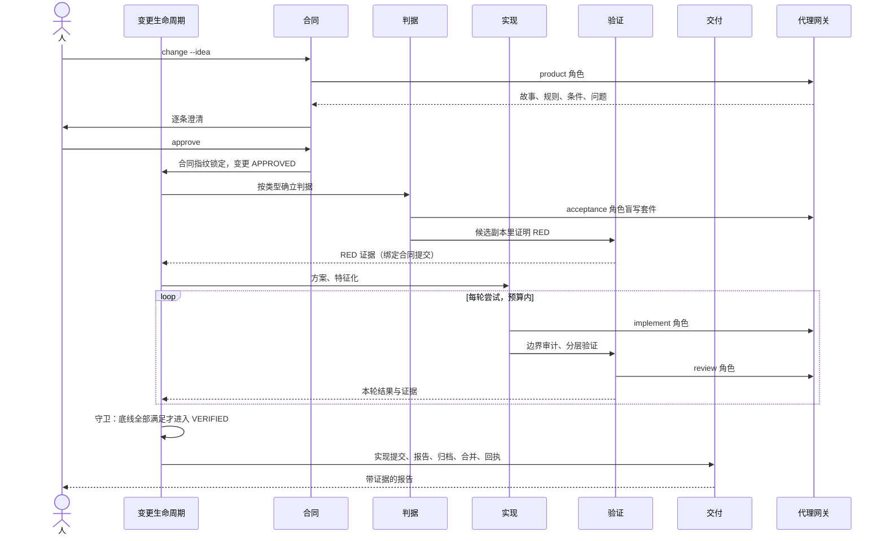
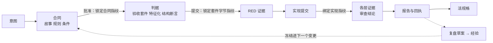
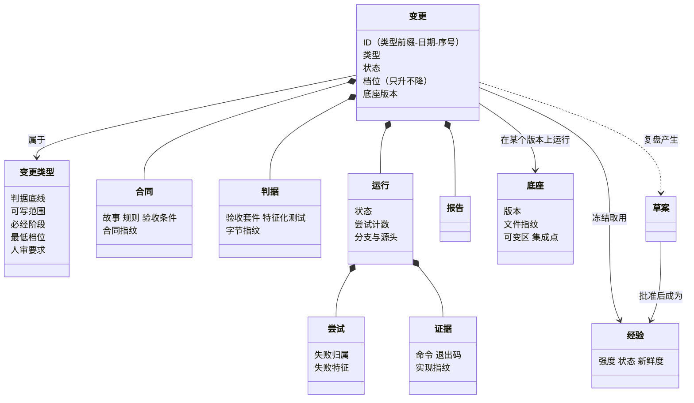
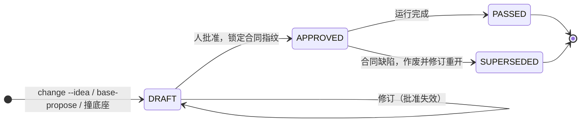
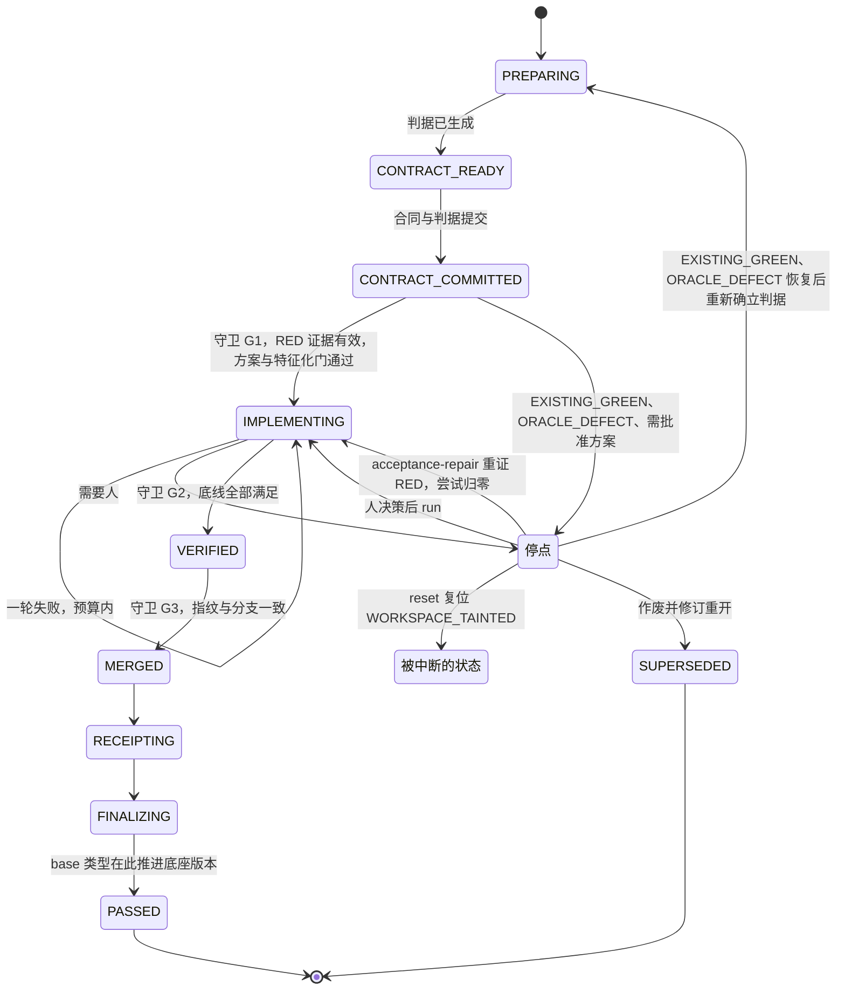
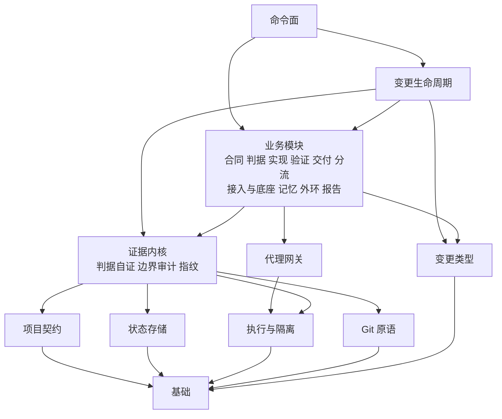
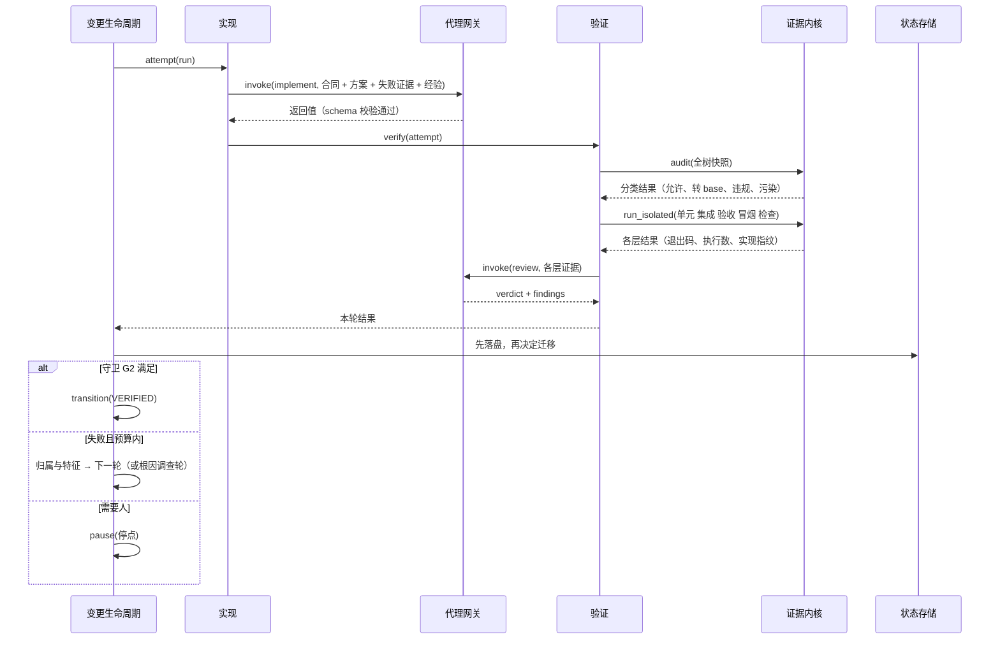
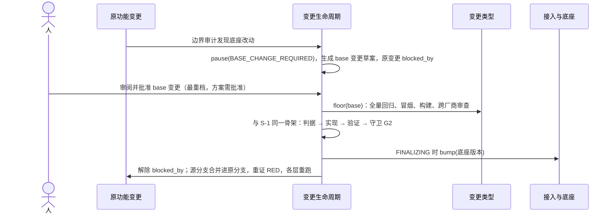
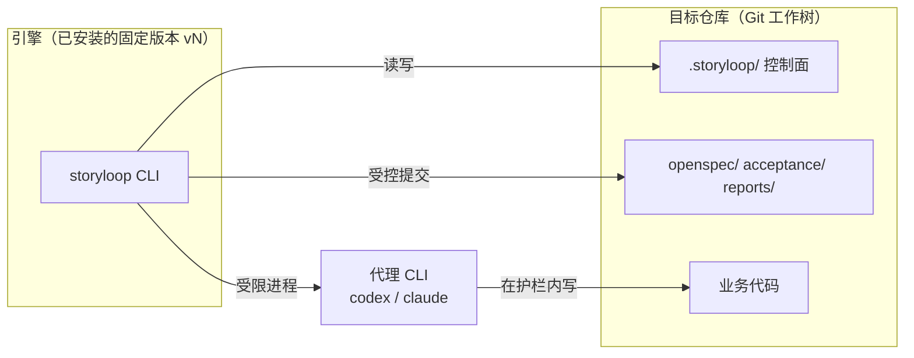

# StoryLoop 架构收敛

- 状态：草案，待评审。§13 的待决问题未批准，批准前不写实施计划、不改代码。
- 依据：[README](../../../README.md) 的产品定义；[定位与概念手册](../../concepts.md)；[总体设计](2026-10-12-演进体系-design.md) §1–§3、§6；[架构与运行机制](../../architecture.md)；[模块组成](../../modules.md)；[分流指南](../../routing-guide.md)；决策 [0001](../../decisions/0001-external-loop-owns-verdict.md)、[0004](../../decisions/0004-foundation-vs-mutable-area.md)、[0011](../../decisions/0011-no-push-no-history-rewrite.md)、[0016](../../decisions/0016-roles-by-authority.md)。代码事实取自 `origin/main` `d1700cc`（#17–#20 合入之后）；初稿基于 `a48d9ea`，附录 A 在两处都实测过，并列出了差异。阶段 A 落地后，以分层测试的输出为准。
- 方法：先从产品核心功能出发确定核心流程，再建领域模型、划分模块，用模块协作完成的数据流转和状态变化（静态视图加动态视图）表达业务架构和技术架构，逐个场景做闭环校验，最后从模型中推出底座。
- 与后续工作的关系：这是 T6（自举）的前提。T6 设计中"本仓库的底座与可变区"一节改为引用本文 §9。

## 1. 产品与核心用途

**产品定义**（README）：StoryLoop 是面向已有 Git 工程的产品需求—开发—验收闭环。人只需要与 AI 共创用户故事和验收条件并最终批准；批准之后的判据、实现迭代、回归、独立验收、证据报告和本地合并都由外部 Loop 控制。

**作者的设想**：人确定产品用户故事，用 Loop 工程让 AI 完成后续开发。StoryLoop 本身也是一个产品，最终要能用这个工具迭代自己。

**一句话的架构核心**（决策 0001、总体设计 §1）：StoryLoop 是包在自主代理外面的**确定性外壳**，判定权在引擎，代理的文字不构成证据。

### 1.1 典型场景

| 编号 | 场景 | 谁、什么时候、做什么、看到什么 |
|---|---|---|
| **S-1 主干** | 一个故事从意图到合并 | 人给一句产品意图 → 与 AI 澄清，共创故事和验收条件 → 批准 → Loop 自动完成：确立判据、证明 RED、方案、实现、分层验证、审查 → 人看到带证据的报告，代码已经在本地合并 |
| S-2 | 接入一个已有仓库 | 人执行 `init`、`readiness`、`survey` → 看到底座已锁定版本、知识库已就绪，可以开始提故事 |
| S-3 | Loop 停下来等人 | 遇到业务歧义、人工验收、用例缺陷、预算耗尽、无进展 → 人看到停点、证据和下一步命令 → 做出决策后 Loop 继续 |
| S-4 | 底座演进 | 故事需要改底座，或者人计划升级底座 → 走一个 base 类型的变更，人审方案 → 全量回归通过 → 底座版本加一 |
| S-5 | 越用越好 | 复盘提出经验 → 人批准 → 下一个相关故事用上它；外环指标提示规则该调了 → 人决定是否采纳 |

**自举不单列为场景，而是整个架构的验收标准**：S-1 到 S-5 在"目标仓库就是 StoryLoop 自己"时都必须成立（§8）。

### 1.2 核心功能

| 编号 | 功能 | 来源 |
|---|---|---|
| F-1 | 合同共创与批准：意图 → 澄清 → 故事、EARS 规则、验收条件 → 质量门 → 批准锁定 | S-1 |
| F-2 | 判据确立：按变更类型生成判据，实现之前证明它有效（该红的红、该绿的绿、执行数不为 0） | S-1、S-4 |
| F-3 | 实现迭代：方案 → 特征化 → 实现尝试 → 失败归属 → 根因调查，在预算内循环 | S-1 |
| F-4 | 验证与审计：候选副本里分层验证、全树边界审计、独立审查 | S-1、S-4 |
| F-5 | 交付：实现提交、报告、规格归档、本地合并、回执 | S-1、S-4 |
| F-6 | 停点与人工决策：每个停点都有证据和恢复命令 | S-3 |
| F-7 | 接入：探测工程、锁定底座、准备度、知识库摸底 | S-2 |
| F-8 | 底座版本化：只能由 base 类型的变更推进 | S-4 |
| F-9 | 记忆：复盘 → 草案 → 批准 → 冻结取用 → 退休 | S-5 |
| F-10 | 外环：调用账本、指标与调整建议 | S-5 |

## 2. 目标、非目标、反目标

**目标**

1. 用领域模型和模块协作把 StoryLoop 的业务架构与技术架构写清楚，并让代码结构与之对应。
2. 从架构中推出底座，每一项都有设计理由，而不是从现状或改动频率推出来。
3. 主干的状态机有唯一归属，判定底线集中在状态迁移的守卫上。
4. 变更类型成为显式的扩展点；BASE 迭代并入变更类型，同时保留专属的严格通道。
5. 架构声明可执行：分层方向和不变量都有守护测试，并进入 core 套件。

**非目标**

- 本期不实现 docs、test、perf 等新类型，只定义扩展点；新类型按需另立变更。
- 不实现 T6 的引擎分离、PR 出口和多变更并行，只给出约束（§8）。
- 不引入第三方依赖，继续只用标准库。
- 除阶段 E（base 类型并入）外，收敛是纯重构，不改 CLI、停点、错误码、`.storyloop/` 格式和报告格式。

**反目标**（做到下面这些，即使"技术上完成了"也算失败）

- 底座清单变成"把现在的文件分一下类"。凡是说不出设计理由的条目，都不进底座。
- 守护测试第一次跑就是绿的。每条守护都要先在一个故意注入的违规上跑红（总体设计 §3 原则 3）。
- 为了让测试变绿，把违规写进永久豁免。
- 收敛过程中顺手改变判定行为，或者放宽任何一道门。

## 3. 核心流程（动态视图）

### 3.1 主干 S-1 的时序

### 3.2 数据沿主干流转

前一样东西一旦锁定指纹，就是后一样东西的不可变输入。这条链是"确定性外壳"在数据上的体现：任何一环被改，后面的证据全部失效。

## 4. 领域模型（静态视图）

### 4.1 核心对象

| 对象 | 角色 | 生命周期 |
|---|---|---|
| **变更**（聚合根） | 主干上的一切都挂在它下面 | 草案 → 已批准 → 已通过 / 已作废 |
| **变更类型** | 决定判据底线、可写范围、必经阶段、最低档位、人审要求 | 声明式，随引擎版本变化 |
| **底座** | 带版本号的稳定部分；变更在它的某个版本上运行 | 只能被 base 类型的变更推进 |
| **经验** | 仓库的长期知识 | 草案 → 批准 → 冻结取用 → 退休 |
| 旁路：调用账本、外环指标 | 只记录和统计 | 不改变上面这些对象的状态 |

### 4.2 变更类型

变更 = **共同的生命周期骨架 + 按类型插入的策略**。类型写在合同里（`product.nature`），随合同一起被批准指纹锁定，所以运行中不能改类型；这也是"一个变更只有一种性质"（总体设计 §6.1）在数据上的保证。类型对照 PR 的常见分类：

| 类型 | 对应 PR | 判据底线（实现前确立） | 可写范围 | 必经阶段与人审 | 现状 |
|---|---|---|---|---|---|
| feature | feat | 验收套件中应红的条件先红；改到的既有文件先做特征化 | 可变区、`test_roots` | 按档位 | 已有 |
| fix | fix | 复现缺陷的测试因缺陷本身而红 | 可变区、`test_roots` | 按档位 | 已有 |
| refactor | refactor | 结构断言先红；行为判据（特征化、回归、系统冒烟）保持绿 | 可变区、`test_roots` | 特征化不可跳过 | 已有 |
| **base** | chore、build、ci，以及底座内的改动 | 全量回归、系统冒烟、构建都通过；改动判据自身时，新判据先在注入的违规上跑红 | **只有它能写底座和集成点** | 最重一档，方案必须人批准，强制跨厂商审查，不能被分流降档 | 阶段 E 并入（现在是手工通道） |
| docs | docs | 结构校验（链接、锚点、一致性）加人工审 | 文档路径 | 待定 | 扩展，按需 |
| test | test | 新测试先在注入的违规上跑红 | `test_roots` | 待定 | 扩展，按需 |
| perf | perf | 基准测试加阈值 | 可变区 | 待定 | 扩展，按需（总体设计 §6.2 已登记） |

**base 类型：同一骨架，专属通道。** 它和其他类型共用"合同锁定 → 判据确立 → 实现 → 验证 → 证据 → 合并"这条生命周期，状态机、证据、报告都是同一套，不再有骨架之外的路。它独有的是：

1. **入口专属**：只能由人显式发起（`base-propose`），或者在其他变更撞到底座时生成，生成后要人批准。其他变更不能顺手改底座；被阻塞的原变更记录 `blocked_by`，衔接方式见下文"撞底座后的衔接"。
2. **写权限专属**：底座路径和集成点只有 base 类型能写。其他类型永远拿不到这个权限，配置也放不开。
3. **判据最严**：全量回归、系统冒烟、构建都必须通过；判据本身被改时，新判据要先在注入的违规上跑红；改动角色说明文本或角色 schema 时，还要在固定样本上用真实调用重放新旧两版，对比结果（Q7）。单元测试判断不了提示词的好坏，T2 就是例子：schema 放行了，真实输出却被逐项丢弃。
4. **人审不可裁剪**：档位固定为最重，方案必须经人批准，强制跨厂商审查。
5. **结果专属**：独立提交，不和功能改动混在一起；通过后底座版本加一，后续变更都在新版本上运行。
6. **自举时多一层**：StoryLoop 改自己的底座时，判定它的是固定版本的旧引擎；新底座发布之后，才轮到它判定别的变更（§8）。

**base 变更的合同、判据与实现者**（评审中已定）：

- **合同** = 目标 + 改动范围（路径）+ 必须保持绿的条件，不走 product 角色的完整共创。
- **判据与 G1**：免 RED，但要先在旧底座上跑一遍全量，确认是绿的；如果改动涉及判据自身（类型定义表中登记的判据路径，例如系统冒烟、检查命令、证据内核），新判据必须先在注入的违规上跑红。
- **实现者**：默认由 implement 代理实现，有三重约束：方案必须人批准、强制跨厂商审查、最后固定停在人工验收，由人逐条确认后才合并。自举时判定它的是固定版本的旧引擎，代理即使改了守卫也判不到它自己（§8）。上游同步、CI 纳入这类机械操作保留"人工实现"通道：人提交，引擎按改动范围核验路径一致，其余骨架照走。

**撞底座后的衔接**（评审中已定）：原变更保留合同、批准、预算和失败历史。base 变更通过后，把源分支合并进原变更的功能分支（决策 0011 不允许 rebase），已有证据因此按 I6 失效，所以要在新底座上重证 RED、各层重跑。原变更里已经写下的底座改动作为参考附进 base 变更草案，然后从原分支还原，不直接带过去。

现有 `base-propose` 的几种用途（上游同步 `--allow-mutable`、CI 纳入 `--allow-ci`、技能包和知识库、勘误）都成为 base 类型的 `scope`，权限仍按 scope 分别授予（Q2）。

### 4.3 状态机

**变更**：

**运行**（状态名沿用现有代码，阶段 B 只统一归属，不改名）。下图是概要，阶段 B 的迁移表以代码中全部状态写入点为准（§10.1）：

停点包括：`NEEDS_INPUT`、`MANUAL_ACCEPTANCE_REQUIRED`、`BASE_CHANGE_REQUIRED`、`BOUNDARY_VIOLATION`、`WORKSPACE_TAINTED`、`BUDGET_EXHAUSTED`、`ORACLE_DEFECT`、`NEEDS_SPEC_FIX`、`NO_PROGRESS`、`CHARACTERIZATION_FAILED`、`EXISTING_GREEN`、`COST_LIMIT_REACHED`（以上是 `stop_report.STOP_STATUSES`），以及分流引入的 `DESIGN_APPROVAL_REQUIRED`、`DESIGN_REVISION_REQUIRED`、`SPLIT_RECOMMENDED`（不在 `STOP_STATUSES` 中，见分流指南）。停点集合目前分散在 `stop_report` 与 `project_loop` 的可恢复集合两处，阶段 B 统一为迁移表的一部分。

**变更状态的现状**：`changes.py` 的校验还接受 `RUNNING`、`PAUSED`、`FAILED`，但代码中只有完成阶段会写变更状态（只写 `PASSED`），这三个值可能已是死值。阶段 B 确认后登记，删除属于格式变更，另立变更处理。

**判定底线就是迁移守卫。** 分流指南已经写明"所有档位都保留 RED、执行数、基线下降检查、隔离回归、重检查收尾、边界保护、独立审查和 manual 条件"，这就是底线。守卫读取变更类型的判据底线，在迁移时统一核验：

| 守卫 | 迁移 | 核验内容 |
|---|---|---|
| G1 | → IMPLEMENTING | 类型要求先红的判据有有效 RED 证据（候选副本、退出码 1、执行数不为 0），并绑定合同提交；要求保持绿的判据已经绿 |
| G2 | → VERIFIED | 各层结果绑定当前实现指纹，且全部通过或按配置跳过；执行数不低于基线；边界审计无违规，改动都在类型的可写范围内；独立审查通过；manual 条件已由人确认 |
| G3 | → MERGED | 工作树干净；分支和提交与运行记录一致 |

阶段和能力（方案、特征化、分流、记忆）可以在底线之上加检查，但不能绕过守卫。这就是**底线单调**原则。

## 5. 模块划分

### 5.1 业务模块

模块按领域职责划分，每个模块拥有自己的数据，对外只通过接口协作。

| 模块 | 职责 | 拥有的数据 | 对外接口 | 支撑的功能 |
|---|---|---|---|---|
| **变更生命周期** | 变更与运行的状态机；迁移守卫；阶段调度；恢复 | 变更记录、运行记录 | `advance(change)`、`transition(run, to)`、`pause(run, stop)` | 全部 |
| **变更类型** | 每种类型的判据底线、可写范围、必经阶段、最低档位、人审要求 | 类型定义表 | `type_of(change)`、`floor(type)`、`writable(type)` | F-2、F-4、F-8 |
| 合同 | 意图 → 澄清 → 合同；质量门；批准锁定；作废重开 | 草案、合同、澄清回答 | `draft`、`revise`、`approve`、`supersede` | F-1 |
| 判据 | 按类型生成判据；证明 RED；判据修复；系统冒烟维护 | 验收套件、特征化测试、系统冒烟 | `establish`、`prove_red`、`repair`、`propose_smoke` | F-2 |
| 实现 | 方案、特征化门、实现尝试、失败归属、根因调查 | 方案、尝试记录、事实记录 | `plan`、`characterize`、`attempt` | F-3 |
| 验证 | 候选副本分层验证、边界审计、判据自证、独立审查 | 各层结果、审查结论 | `verify(attempt)`、`audit(tree)` | F-4 |
| 交付 | 实现提交、报告、规格归档、合并、回执 | 报告、回执、活规格 | `finish(run)` | F-5 |
| 分流 | 档位评估、拆分建议、方案批准 | 评估记录 | `assess(change)` | F-1、F-3 |
| 接入与底座 | 工程探测、底座锁定与版本、准备度、知识库摸底 | 项目画像、底座记录、知识库 | `init`、`readiness`、`survey`、`bump(base)` | F-7、F-8 |
| 记忆 | 复盘、草案、经验、勘误、经验检索 | 草案、经验、勘误 | `retrospect`、`approve_draft`、`select_lessons` | F-9 |
| 外环 | 调用账本、成本上限、指标 | 账本、指标报告 | `record_call`、`metrics` | F-10 |
| 报告 | 追溯报告、停止报告、`log` 排障视图 | 不拥有数据，只读取以上数据 | `report`、`stop_report`、`log` | F-5、F-6 |

### 5.2 技术模块

| 模块 | 职责 | 对外接口 |
|---|---|---|
| **代理网关** | 角色调用的唯一入口；返回值 schema 结构与校验；适配器协议（codex / command / manual）；能力握手；调用护栏（只读调用不能改树，写入型调用不能动控制面和暂存区） | `invoke(role, request)` |
| **项目契约** | settings 字段与校验；验收执行器退出码 0/1/2 的语义；测试分层命令；引擎拥有的路径 | `load_profile`、`layer_commands` |
| **状态存储** | `.storyloop/` 下带 `version` 的状态文件：格式定义、原子读写、互斥锁 | `load`、`save`、`locked` |
| **执行与隔离** | 构造候选副本；受限子进程；进程树回收；全树快照与差异 | `run_isolated`、`snapshot` |
| **Git 原语** | 本地分支、只提交显式路径、no-ff 合并；没有 push 和改写历史的能力 | `start_branch`、`commit_paths`、`merge` |
| 基础 | 错误类型、参数校验、路径安全 | `StoryLoopError`、`require`、`safe_target` |
| 命令面 | 参数解析、终端交互、渲染、退出码 | `main` |

### 5.3 静态结构与依赖方向

"证据内核"是验证模块中判定所依赖的那一部分（判据自证、边界审计、指纹计算），从验证模块里单独拿出来，因为生命周期的守卫也要读它。

规则：

1. 依赖只能向下；同层业务模块之间要么经生命周期调度，要么通过对方的接口协作，不形成环。
2. 证据内核不调用代理网关：它只核验磁盘上的事实，保持最小，便于审查（Q4）。
3. 业务模块不绕过代理网关启动代理，不绕过状态存储写状态文件。
4. 代理网关不自己组装上下文：角色说明、经验、画像由业务模块组装好，作为请求的一部分传入。

## 6. 模块协作：数据流转与状态变化

### 6.1 一轮尝试的协作

### 6.2 base 类型（S-4）的协作

## 7. 核心数据模型

| 实体 | 存储位置 | 主键 | 关键字段 | 谁写 |
|---|---|---|---|---|
| 项目画像与配置 | `.storyloop/config.json` | 仓库 | profile、adapters、roles、limits、routing、metrics | 接入与底座；人 |
| 底座 | `.storyloop/baseline.json` | 仓库 | baseline_version、文件指纹、module_roots、integration_paths | 接入与底座（只经 base 类型推进） |
| 变更 | `.storyloop/state/changes/<id>.json` | change_id | version、status、revision、product（类型在 `product.nature`，缺省为 feature）、approval 指纹 | 合同；生命周期 |
| 合同（物化） | `openspec/changes/<id>/` | change_id | proposal、stories、acceptance、traceability、增量规格、design.md、decisions.md | 合同；交付 |
| 判据 | `acceptance/changes/<id>/`、`test_roots` 中的特征化测试、`acceptance/smoke/` | change_id / 套件 | manifest、字节指纹 | 判据 |
| 运行 | `.storyloop/state/runs/<id>.json` | change_id | status、attempt、分支与源头、contract_digest、design_plan、characterization、failures | 生命周期 |
| 证据 | `.storyloop/evidence/<id>/` | change_id + 文件名 | acceptance-red、acceptance-result、实现指纹、命令与退出码 | 证据内核 |
| 报告与回执 | `reports/storyloop/<id>/` | change_id | JSON 与 Markdown 报告、合并回执 | 交付 |
| 底座提案 | `.storyloop/base-proposals/BASE-*.json` | proposal_id | 路径、理由、scope、状态 | 阶段 E 后并入 base 类型的变更记录 |
| 草案 | `.storyloop/drafts/{lesson,errata}/` | 草案 ID | 提议者调用 ID、内容、状态 | 记忆 |
| 经验 | `openspec/lessons/` | lesson ID | 层级、强度、状态、落点 | 记忆（经人批准） |
| 调用账本与诊断 | `.storyloop/state/telemetry/` | change_id、调用 ID | 角色、耗时、轮数、token、费用；请求、回答、会话 ID；**执行画像**（见下） | 外环；代理网关 |
| 问答 | `.storyloop/state/answers/` | change_id | 问题、回答 | 合同；生命周期 |

**执行画像。** 每条调用记录要能回答"这次调用是哪一版引擎、用哪一版说明和 schema 发出的"。字段：

- `engine_version`：引擎版本；
- `instructions_digest`：本次调用实际下发的角色说明文本的摘要；
- `schema_digest`：本次调用使用的输出 schema 的摘要；
- `adapter`：适配器名称与版本（现在 `report_evidence` 里已经有 adapter，这里落到每条账本上）；
- 已有的 `model`、`vendor`、`tier_applied` 保持不变。

现状：账本只记录 model、vendor、tier（`telemetry.py:16-17`），没有引擎和说明的版本。自举之后，提示词会被变更本身修改；没有执行画像，外环看到质量波动时，分不清它来自哪个引擎版本，Q7 的新旧对比结果也无法和后续真实运行对上。只存摘要，不存说明原文，原文可以由摘要在对应版本的引擎里找回。

## 8. 运行视图与自举约束

自举时目标仓库就是 StoryLoop 自己，架构必须满足：

1. **判定者与被判定者分离**：引擎从固定版本运行（已安装的 wheel，或者钉在某个 tag 上的独立工作树）。检测到引擎源码路径落在目标仓库内时，拒绝运行。
2. **改动在发布后才生效**：本仓库合入的任何改动，都要等人发布新版本后才参与判定；base 类型改动的发布需要人显式确认。
3. **本仓库的底座就是 §9 的底座声明**：`init` 读取声明，而不是机械截取已跟踪文件。
4. **类型覆盖**：本仓库的变更至少要用到 feature、fix、refactor、base；docs 类型是 1.0 自举的前置条件（属于 T6 范围）。
5. **每次调用可归因到引擎版本**：账本记录执行画像（§7），在第一个自举变更之前合入。

## 9. 底座声明

### 9.1 推导

底座是架构中被设计为稳定的部分。从上面的模型推出三类：

1. **架构原则**：确定性外壳"是什么"。原则一变，产品就变了。
2. **骨架与判定**：变更生命周期的状态机与迁移守卫、变更类型定义表、证据内核。它们出错，所有变更的"通过"都不可信。
3. **协议面与平台**：代理网关的协议、项目契约、状态存储格式、CLI 契约，以及执行与隔离、Git 原语、基础。协议一变，适配器、已接入的仓库和历史记录都会断；平台出错，证据就失去了依据。

可变区是建在这三类之上的部分：各业务模块中阶段的具体实现、角色说明文本、技能包、分流规则和阈值、记忆、外环、报告的渲染。它们可以在底线之上快速迭代。

被引用多、改得少是底座的结果，不是认定的依据；这些数据只用来校验声明（§11.1）。

### 9.2 架构原则与不变量

| 编号 | 不变量 | 出处 | 守护方式 |
|---|---|---|---|
| I1 | 判定只来自引擎在受控进程中观察到的退出码和指纹，代理文字不构成证据 | 0001 | 证据内核的结果中不存在由代理文字产生的通过 |
| I2 | 合同在批准时锁定指纹，任何修订都让批准失效 | 运行规则 1 | 修订后 run 拒绝继续 |
| I3 | 判据受字节保护，实现者写入即越界 | 运行规则 2 | 注入写入，期望 `BOUNDARY_VIOLATION` |
| I4 | 只有候选副本中退出码为 1 的行为失败才是有效 RED | 运行规则 3 | 环境错误、跳过、超时都不产生 RED |
| I5 | 每轮尝试后都做全树边界审计 | 运行规则 4 | 不存在绕过审计到达 G2 的路径 |
| I6 | 证据和人工验收绑定实现指纹，代码变了就失效 | 运行规则 5 | 改一个字节，已有证据失效 |
| I7 | 判据自证：执行数不为 0、不比基线骤降；新检查先在注入违规上跑红 | 总体设计 §3 原则 3 | 判据自证回归；本文所有守护测试自身也遵守 |
| I8 | 完成阶段幂等，每一步状态先落盘 | 运行规则 7 | 每一步崩溃后恢复，不重复调用、不重复提交 |
| I9 | 不 push、不改写历史，只提交显式路径 | 0011 | Git 原语没有这两种能力 |
| I10 | 角色按权限划分 | 0016 | 注入改动，期望 `WORKSPACE_TAINTED` |
| I11 | 只升不降：档位在运行中只能升级，且不低于类型的最低档位 | 总体设计 §3 原则 4 | 降档请求被拒 |
| I12 | 底线单调：状态迁移只经守卫，守卫读取类型底线；阶段只能加严 | 本文 §4.3 | 注入一个跳过某层验证的阶段改动，G2 能拦住 |
| I13 | 底座只能被 base 类型的变更推进，也只有 base 类型能写底座 | 0004、本文 §4.2 | 其他类型写底座路径，期望转 base 并暂停 |
| I14 | 依赖只能向下，底座不导入可变区 | 本文 §5.3 | 分层测试 |
| I15 | 判定者与被判定者分离 | 本文 §8 | 引擎源码在目标仓库内时拒绝运行 |

### 9.3 底座与可变区

| 区 | 内容 |
|---|---|
| **底座** | 架构原则（`docs/decisions/`、本文、`docs/architecture.md`）；变更生命周期（状态机、守卫、恢复骨架）；变更类型定义表；证据内核；代理网关的协议部分；项目契约；状态存储；执行与隔离；Git 原语；基础；架构声明文件与守护测试；`pyproject.toml`；`.github/workflows/` |
| **可变区** | 合同、判据、实现、验证、交付、分流、接入、记忆、外环、报告中的阶段实现；角色说明文本；技能包；分流规则与阈值；指标规则；命令面的渲染；`examples/`；其余文档 |

注意两处边界：

- **schema 的结构在底座，枚举取值属于状态格式，也在底座**。T2 里复盘提议的枚举直接引用了记忆模块 `lessons.py` 的常量，造成 `role_schemas → lessons` 这条底座指向可变区的依赖（附录 A），违反 I14。经验的层级、强度、状态这些取值本来就是经验文件的格式，所以把常量放进契约层的状态格式，`lessons.py` 和 `role_schemas` 都从那里导入。这样保持了 T2 "只有一份定义"的要求，依赖方向也对。
- **被冻结进合同指纹的可变区内容照旧受保护**（总体设计 §3 原则 2）。可变区的意思是"可以经变更修改"，不是"运行中可以随便改"。

## 10. 现状与目标的差距

### 10.1 最根本的两处

1. **运行状态机没有归属。** 运行状态的写入点分散在 9 个模块里：`project_preparation`、`project_loop`、`project_loop_gates`、`project_loop_failures`、`project_loop_finish`、`project_loop_support`（`pause` 与保存）、`acceptance_repair`、`run_recovery`（复位到被中断的状态）、`supersede`。没有一处定义哪些迁移合法，底线检查也散在各处。主干的核心状态机没有主人；附录 A 里的依赖环大多由此而来。
2. **底座演进在骨架之外。** BASE 迭代现在是"人手工提交，再执行 `base-update`"，不经过合同、判据、守卫和报告。它和变更类型是两套机制，违反总体设计 §3 原则 11"同一件事只有一条通道"。

### 10.2 其余差距

| 差距 | 事实（`d1700cc`） |
|---|---|
| 类型行为分散 | `models.NATURES`、`changes.ID_PREFIXES` 定义了类型，但判据形式、可写范围、必经阶段分散在判据、特征化、分流和边界审计的代码里，没有一张定义表 |
| 代理网关自己组装上下文 | `project_agents` 依赖 13 个业务模块（角色说明、经验检索、画像、勘误、账本等），协议和上下文组装混在一起 |
| 证据内核依赖业务模块 | 例如 `baseline → system_smoke`、`smoke_runner → system_smoke / changes`、`project_loop_support → stop_report / next_steps` |
| 基础层带入产品概念 | `models` 里有产品合同校验，并局部导入 `assessment → routing_policy` |
| 文档落后 | `docs/modules.md` 登记了 69 个模块，`storyloop/` 顶层实际有 130 个，另有子包 `testing/smoke_harness/` 的 14 个 |
| 文件压线 | `project_loop.py` 500 行，等于单文件上限；`cli.py` 496 行 |
| 账本缺执行画像 | 调用记录只有 model、vendor、tier，没有引擎版本、说明与 schema 摘要（§7） |

## 11. 收敛路线

每个阶段一个或多个 PR，阶段之间有明确的完成标准。

| 阶段 | 内容 | 是否改变外部行为 | 完成标准 |
|---|---|---|---|
| **A 声明与守护** | 机器可读的架构声明（每个模块归属哪个业务或技术模块、属于底座还是可变区，形式见 Q3）；分层测试，现有违规全部登记为豁免，豁免只减不增；不变量测试：已有覆盖的登记，缺的补齐；`modules.md` 补齐全部模块 | 否 | core 绿；每组守护在注入违规上跑红有记录 |
| **B 生命周期归一** | 抽出变更生命周期模块：运行状态迁移表、`transition` 唯一入口、守卫 G1–G3 集中实现；原来的 5 个模块改为调用它 | 否 | 所有状态写入都经过 `transition`（由分层测试检查）；full 绿；金样报告与 CLI 输出比对一致 |
| **C 类型定义表** | 把 feature、fix、refactor 的判据底线、可写范围、必经阶段、最低档位集中为声明式定义表，守卫与边界审计读取它 | 否 | 三种类型的现有行为不变；新增一个测试用的假类型，只改定义表就能跑通骨架 |
| **D 底座闭合** | 清零附录 A 中底座指向可变区的依赖；拆分 `project_agents`（协议与上下文组装）、`models`、`baseline._git`；`project_loop.py`、`cli.py` 降到 450 行以下 | 否 | 底座内无环、不导入可变区；full 绿 |
| **E base 类型并入** | BASE 迭代成为 base 类型：`base-propose` 和撞底座都生成 base 变更草案；§4.2 的六条专属通道由类型定义表和守卫实现；`base-update` 保留为兼容入口，内部走骨架；原变更通过 `blocked_by` 衔接 | **是**，另写实施计划，按 feature 规格交付 | S-4 走完骨架；其他类型写底座被拦截；兼容入口的行为与文档一致 |
| **F 文档与决策** | 新增决策 0018"底座来自架构声明，底座只被 base 类型推进"，修订 0004；更新 `architecture.md`、`concepts.md`；登记到总体设计 §16 的偏离表 | 否 | 文档、声明、测试三处一致 |

两项不在 A–F 里，单独交付：

- **执行画像**（§7）：账本多出字段，会改变外部可见的输出，所以不放进纯重构的 A–D。它作为一个独立的 feature，可以和 A 并行，必须在第一个自举变更之前合入。
- **固定样本重放**（Q7）：它是 base 类型的判据，随阶段 E 一起实现；样本集本身属于判据，放在底座里。

A–D 完成后即可启动 T6 设计中的引擎分离；E 完成后，本仓库的底座改动才有合规通道，所以自举的第一个 base 变更以 E 为前提。

收敛期间新功能照常开发，但豁免只减不增；B 和 D 进行期间，暂停触碰底座的功能变更（Q5）。

### 11.1 用数据校验声明（阶段 A 起持续）

外环和 git 历史只用来检查声明是否成立，不用来提名底座：

- 被声明为底座的模块频繁改动，说明架构还没收敛，或者归属错了，要人判断；
- 可变区的模块被大量引用，提示它可能是没被识别出来的协议，同样要人判断。

阈值本期不定，等自举积累样本后在外环里校准。

## 12. 模块 × 场景闭环校验

把每个场景按步骤走一遍，检查每一步都有归属模块、接口和数据。

| 场景 | 步骤 | 模块 → 接口 | 读写数据 | 状态变化 | 结论 |
|---|---|---|---|---|---|
| S-1 | 意图到批准 | 合同 → `draft`、`revise`、`approve`；代理网关 → `invoke(product)` | 草案、合同、问答 | 变更 DRAFT → APPROVED | 通 |
| S-1 | 判据与 RED | 生命周期 → 判据 `establish`、`prove_red`；证据内核 `run_isolated` | 判据、RED 证据 | 运行 PREPARING → CONTRACT_COMMITTED → IMPLEMENTING（G1） | 通 |
| S-1 | 方案与特征化 | 分流 `assess`；实现 `plan`、`characterize` | 评估、方案、特征化测试 | 运行内的子状态；可能停在 `DESIGN_APPROVAL_REQUIRED`、`CHARACTERIZATION_FAILED` | 通 |
| S-1 | 尝试循环 | 实现 `attempt`；验证 `verify`；证据内核 `audit` | 尝试记录、各层证据、审查结论 | IMPLEMENTING 自循环，或 → VERIFIED（G2） | 通 |
| S-1 | 交付 | 交付 `finish`；Git 原语 | 报告、回执、活规格 | VERIFIED → … → PASSED（G3）；变更 → PASSED | 通 |
| S-2 | 接入 | 接入与底座 `init`、`readiness`、`survey`；项目契约 | 配置、底座 v1、知识库 | 底座建立；知识库经 base 类型进入底座（阶段 E 之后） | **阶段 E 之前不通**：知识库进入底座仍走手工通道 |
| S-3 | 停点与恢复 | 生命周期 `pause`；报告 `stop_report`；命令面 | 运行、问答、人工验收记录 | 停点 → IMPLEMENTING | 通 |
| S-4 | 底座演进 | 生命周期；变更类型 `floor(base)`；接入与底座 `bump` | base 变更、底座 | base 变更走完骨架；底座版本加一；原变更解除阻塞 | **阶段 E 之前不通**：现在是骨架之外的手工通道 |
| S-5 | 复盘与经验 | 记忆 `retrospect`、`approve_draft`、`select_lessons`；外环 `metrics` | 草案、经验、账本 | 经验：草案 → 批准 → 冻结取用 | 结构上通；但"自然产生有效经验"的验收未达成（T2） |
| 自举 | 以上全部，目标仓库 = 本仓库 | 运行视图 §8 | — | — | **T6 之前不通**：缺引擎分离和 docs 类型 |

## 13. 待决问题

讨论中已经定下：

- 底座来自架构设计；
- 典型场景，以及"自举作为验收标准"；
- 变更类型是领域模型的核心维度；
- BASE 迭代并入变更类型并保留专属通道（含判据被改时先注入跑红、强制跨厂商审查）；
- base 变更默认由代理实现，机械操作保留人工实现通道；base 合同的形式和 G1 的判法；撞底座后原变更的衔接方式（均见 §4.2）。

下面是剩余的问题。

| # | 问题 | 推荐 | 备选 |
|---|---|---|---|
| Q1 | 变更类型定义表用什么形式？ | **底座内的一个 Python 模块，用声明式常量**：有类型检查，守卫直接读取 | 外部声明文件（TOML），可读性更好，但要多一层解析和校验 |
| Q2 | base 类型内部怎么区分上游同步、CI 纳入、知识库与勘误、技能包？ | **一个 base 类型加 `scope` 字段**，权限按 scope 分别授予（例如只有 `scope=ci` 能写 CI 文件） | 拆成多个独立类型：定义表变长，但每种的判据可以单独定 |
| Q3 | 架构声明（模块归属）用什么形式？ | **`storyloop/architecture.toml`**，用标准库 `tomllib` 读取，测试比对 `modules.md` | 由声明生成 `modules.md` 的模块表；或者把归属写进每个模块的 docstring |
| Q4 | 证据内核能否调用代理网关？ | **不能**。内核只核验磁盘事实，保持最小；代价是要把若干调用改成由调用方传参 | 允许，少拆一次，但代理协议会进入可信计算基 |
| Q5 | 收敛期间新功能怎么办？ | **A 合入后照常开发**，豁免只减不增；B、D 进行期间暂停触碰底座的功能变更 | 冻结所有新功能，直到 F 完成 |
| Q6 | RuoYi 这类没有架构声明的仓库怎么划底座？ | **继续以 0004 的机械近似为默认**；有声明的仓库用声明，`init` 时由人确认 | 所有仓库都必须先写声明再接入，这会和 T4（接入模板化）的目标冲突 |
| Q7 | 改角色说明或 schema 的 base 变更，固定样本重放用多少样本、怎么判？ | **每个受影响的角色 5 个样本**，详见下文 | 3 个：成本再降四成，但回归样本只剩 2 个，覆盖不了一个角色的典型输入；10–20 个：更稳，成本翻 2–4 倍，细微差异照样判不了（见下文）；不做，只靠人审：T2 那类问题人审时看不出来 |

**Q7 推荐方案：每个受影响的角色 5 个样本。**

- **样本来源**：历史真实调用的输入快照（`calls/` 诊断记录），冻结进样本集。样本集属于判据，放在底座里，增删也走 base 变更。
- **样本构成**：1 个触发本次修改的失败样本，它必须由坏变好；另外 4 个是回归样本，覆盖这个角色的典型输入，例如正常通过、带问题信号、边界情况。
- **怎么跑**：新旧两版各跑一次，在该角色配置的每个厂商上都跑。不重试；结果波动也如实记下，交人判断（与交接约定"不为凑通过反复重试真实调用"一致）。
- **怎么判**：只看机械结果：schema 是否合法、逐项丢弃了几条、必填字段是否齐全、引用的 `path:line` 是否存在。新版在任何一个样本上都不能比旧版差，触发样本必须变好。语义质量交给人审，base 类型本来就必须人审。
- **成本**：按子项目 5 的实测，每次调用约 $0.54（已知费用 $9.16，覆盖 17 次调用）。一个角色、两个厂商：5 个样本 × 新旧 2 版 × 2 个厂商 = 20 次，约 $11；只有一个厂商时 10 次，约 $5.4。
- **为什么是 5 个**：重放要抓的是明显退化，例如格式错、被逐项丢弃、拒答，也就是 T2 那类问题；对这类问题，5 个样本加机械判据就够了。细微的质量差异要几十个样本才可能判出来，每次 base 变更要花 $50 以上，而且模型输出本身的波动会盖过这种差异。细微变化交给外环，在真实运行中持续观察，前提是账本有执行画像（§7）。

## 14. 留给实现者的

- 每个现有模块在架构声明中的最终归属，以 §5 的职责和 §9.3 的划分为准；判断不了的写进 PR 描述交给评审，不自行定案。
- 阶段 B 中 `transition` 的接口形状和守卫的组织方式，以"所有状态写入只有一个入口、守卫可以单独测试"为准。
- 拆分时的模块命名和搬迁路径；是否保留旧名称的重新导出，以测试通过、导入面最小为准。
- 不变量测试如何复用现有测试和模拟适配器。

### 14.1 作者已定的实现约定

审阅中提出、由作者直接定下的几点（评审时可以推翻）：

1. **阶段 B 遇到绕过守卫的现有迁移**（`acceptance_repair`、`run_recovery`、`supersede` 直接写状态）：如实建模为迁移表中的合法迁移，每条配上与现有代码等价的检查，例如 acceptance-repair 重证 RED，本身就满足 G1。阶段 B 不收紧任何一条；如果发现某条迁移比底线弱，登记下来，另立 fix 变更处理。这样"纯重构"和"不放宽门"两条都守得住。
2. **阶段 A–D 中的"底座"只是静态概念**：只用于架构声明和分层测试，不改本仓库的 `baseline.json`，也不进入边界审计。本仓库按底座声明受保护，从阶段 E 和 T6 开始。
3. **尚未实现的不变量**（I13 只有 base 类型能写底座，属于阶段 E；I15 判定者与被判定者分离，属于 T6）：阶段 A 把它们登记为"待实现"，并关联到对应阶段。它们不算豁免，阶段 A 也不实现它们。

## 15. 设计与实现差异

实现完成后在此补表。

## 附录 A：现状依赖实测（`d1700cc`，并对照 `a48d9ea`）

**统计口径**：用 `ast` 解析 `storyloop/` 下全部 `.py` 的导入，包括子包，也包括函数内的局部导入；相对导入和 `from storyloop.x` 形式的绝对导入都算。同一口径在 `a48d9ea` 上复现了初稿的环与 34 条向上依赖。被引用次数比初稿高，例如 `models` 是 84 而不是 78，因为初稿没算绝对导入，下表统一用新口径。

**分层**：按 §9.3 的初步划分，从下到上依次是基础、契约、内核、代理网关、可变区、编排与命令面，同层之间不算违规。#18–#20 新增模块的归属是作者的判断，阶段 A 写声明时确认：

- `testing/smoke_harness/*`、`onboarding_manifest` 归契约：可信冒烟执行器的积木，以及 `helper_api`、模板版本的声明；
- `harness_command` 归内核：为 `smoke_runner` 解析可信安装；
- `initialization_transaction` 归基础：控制面文件的原子事务日志，只依赖基础层；
- 其余 `onboarding*` 归可变区（接入），`onboarding_cli` 归命令面。

| 指标 | `a48d9ea` | `d1700cc` |
|---|---|---|
| 模块数（顶层 + 子包） | 123 + 1 | 131 + 14 |
| 模块级强连通环 | 7 个，最大 29 个模块 | 7 个，最大 31 个模块（新进环：`onboarding_manifest`、`role_schemas`） |
| 最大环的层分布 | 契约 2、内核 6、代理网关 2、可变区 19 | 契约 3、内核 6、代理网关 3、可变区 19 |
| 被引用最多 | `models` 84、`baseline` 45、`storage` 44、`path_security` 37 | `models` 101、`storage` 48、`baseline` 48、`path_security` 47 |
| 30 天内改动最多 | `project_loop` 33、`project_agents` 24、`cli` 22、`role_instructions` 13、`smoke_runner` 13 | `project_loop` 32、`cli` 23、`project_agents` 23、`smoke_runner` 14、`role_instructions` 14 |
| 向上依赖 | 34 条：底座 → 可变区 28、底座内部逆向 2、可变区内部 4 | **36 条：底座 → 可变区 30**、底座内部逆向 2、可变区内部 4 |

最大环的例子：`baseline → system_smoke → project_agents → baseline`。`modules.md` 规定"验证层不调用代理"，但 `system_smoke → project_agents` 仍然存在（`smoke-propose` 调用 acceptance 角色）。

36 条向上依赖按组列出，**粗体**是 `a48d9ea` 之后新增的：

| 组 | 依赖 | 处理方向 |
|---|---|---|
| 基础层带入产品概念 | `models → assessment` | 拆 `models`，产品合同校验移到合同模块（阶段 D） |
| 契约依赖内核或业务 | `project_profile → oracle_counts`（底座内部逆向）；`smoke → changes`；**`onboarding_manifest → onboarding_templates`**（#19） | 模板清单与版本是项目契约的一部分，并入契约层；`onboarding_templates` 只依赖 `__version__`，可以直接下沉 |
| 证据内核依赖业务 | `baseline → system_smoke`、`project_boundaries → system_smoke`、`smoke_runner → system_smoke / changes`、`evidence_locations → failure_attribution`、`project_loop_guards → errata`、`project_loop_support → stop_report / next_steps`、`project_receipt → change_report` | 由调用方传参，或者把被用到的定义下沉到内核（阶段 B、D） |
| 内核依赖代理网关 | `baseline → adapter_capabilities`（底座内部逆向） | 能力握手结果由调用方传入（阶段 D） |
| 代理网关组装上下文 | `project_agents →` `adapter_profiles`、`call_context`、`call_log`、`cost_limits`、`cross_vendor`、`errata`、`foundation_survey`、`lesson_retrieval`、`role_instructions`、`role_profiles`、`role_subagents`、`skills`、`telemetry`；`adapter_capabilities → cross_vendor / role_profiles / role_subagents`；`role_schemas → routing_policy`；**`role_schemas → lessons`**（#17，T2） | 拆 `project_agents`：协议留在网关，上下文组装移到可变区（阶段 D）；`role_schemas → lessons` 按 §9.3 把经验的枚举常量放进契约层的状态格式 |
| 可变区内部（只登记） | `acceptance_repair → project_loop`、`project_loop_gates → project_loop`、`change_log → next_steps`、`supersede → next_steps` | 阶段 B 归一生命周期时一并处理 |

**这段时间的变化**：#17–#20 新增了 21 个模块，只带来 2 条新的向上依赖，两条的目标模块都只依赖基础层，处理成本低。但它们说明了一件事：在架构声明和分层测试落地之前，新功能会持续产生这类依赖。T2 正是按设计要求"直接引用常量"，结果却违反了 I14。这支持阶段 A 先行（Q5）。

这张表是声明文件生成之前的估计；阶段 A 由分层测试重新生成，以测试输出为准。
