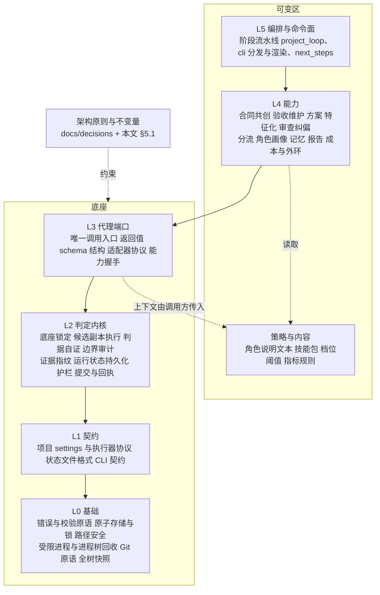

# StoryLoop 架构收敛

- 状态：草案，待评审。Q1–Q7 未批准，批准前不写实施计划、不改代码。
- 依据：[决策 0001](../../decisions/0001-external-loop-owns-verdict.md)、[0004](../../decisions/0004-foundation-vs-mutable-area.md)、[0016](../../decisions/0016-roles-by-authority.md)；[总体设计 §3 设计原则](2026-10-12-演进体系-design.md#3-设计原则不变量)；[架构与运行机制](../../architecture.md)；[模块组成](../../modules.md)。代码事实取自 `origin/main` `a48d9ea`。
- 与后续工作的关系：这是交接文档中 T6（自举）的前提。T6 设计第 2 节"本仓库的底座与可变区"改为引用本文 §5，不再单独列清单。

## 1. 为什么现在收敛

StoryLoop 是按功能想法一步步迭代出来的：先有闭环，再加纠偏、分流、报告、角色画像、记忆、外环。结构现在基本清楚了，但这份清楚停留在作者脑子里，代码和文档里都还没有落下来：

| 事实 | 数据（`a48d9ea`） |
|---|---|
| 架构文档落后于代码 | `docs/modules.md` 登记了 61 个模块，`storyloop/` 实际有 122 个；分流（`routing_*`）、报告（`report_*`）、角色画像（`adapter_*`、`claude_*`、`role_profiles`）、方案（`planning*`、`design_approval`）整组没有登记 |
| 声明的分层没有守住 | 模块级依赖（含函数内局部导入）里有一个 29 个模块组成的强连通环，横跨"工程与底座""验证""合同""代理""记忆"五层。例如 `baseline → system_smoke → project_agents → baseline` |
| 最底层也在向上依赖 | `models →（局部导入）assessment → routing_policy`：基础层的错误类型模块，依赖分流策略 |
| 声明的禁止方向被违反 | `modules.md` 规定"验证层不调用代理"，但 `system_smoke → project_agents`（`smoke-propose` 调用 smoke 角色） |
| 两个文件已经压线 | `project_loop.py`、`cli.py` 都正好 500 行，等于单文件上限 |
| 底座定义是机械近似 | 决策 0004 把"`init` 时已跟踪、又不在可变区的文件"定为底座。这个近似来自 Java/Spring 应用：在那里，底座是别人设计好的框架，按路径冻住就行 |

要自举（T6，用 StoryLoop 迭代 StoryLoop），先要回答"StoryLoop 自己的底座是什么"。按 0004 的机械办法截取现状，得到的是"现在的样子"，不是"设计上要稳定的东西"。

## 2. 目标、非目标、反目标

**目标**

1. 从架构设计出发声明底座：底座 = 架构原则 + 支撑原则的机制 + 协议面。每一项都写明设计理由，而不是从现状或改动频率推出来。
2. 让代码符合声明：底座只向下依赖，可变区不能绕过底座。
3. 把声明变成可执行的守护：分层方向和架构不变量都有测试，进入 core 套件。
4. 架构文档（`architecture.md`、`modules.md`）与代码一致，并由测试检查，不再靠人工同步。

**非目标**

- 不改任何外部行为：CLI、停点、错误码、`.storyloop/` 格式、报告格式都不变。整个收敛是纯重构，用现有 full 套件当回归。
- 不整理可变区的内部结构。可变区里的环和大文件只登记，不要求清零（例外见 §6.3）。
- 不在本期实现 T6 的引擎分离、PR 出口和多变更并行。
- 不重写模块，不引入第三方依赖（继续只用标准库）。

**反目标**（做到下面这些，即使"技术上完成了"也算失败）

- 底座清单变成"把现在所有文件分一下类"。凡是说不出设计理由的条目，都不进底座。
- 守护测试只在文档里存在，或者第一次就是绿的。按总体设计 §3 原则 3，每条新守护都要先在一个故意注入的违规上跑红。
- 为了让分层测试变绿，把违规写进永久豁免。豁免清单只能缩小，每条都要有清零计划（§6.2）。
- 收敛过程中顺手改变判定行为。

## 3. 底座的定义

**底座来自架构设计中被设计为稳定的部分。** 被引用多、改得少是底座的结果，不是认定底座的依据；这些数据只用来校验声明（§6.4）。

StoryLoop 的架构核心只有一句话，来自决策 0001 和总体设计 §1：

> 它是包在自主代理外面的**确定性外壳**：判定权在引擎，代理的文字不构成证据。

由此推出，设计上必须稳定的是三类东西：

1. **架构原则**：确定性外壳"是什么"，例如判据先于实现、实现者改不了判据、证据可复核。原则一变，产品就变了。
2. **判定内核**：把原则落到证据上的那部分代码，相当于操作系统的可信计算基（TCB）。它出错，所有变更的"通过"都不可信。
3. **协议面**：引擎和外部世界（代理、目标仓库、磁盘状态、使用者）之间的契约。它一变，适配器、已接入的仓库和历史变更记录都会断。

其余部分建在这三类之上，可以快速迭代。总体设计 §3 原则 5 已经给出了划分依据："证据型门"属于内核；"成本型步骤"（方案、子代理、模型档次、报告详略）属于可变区。

**底线单调原则**（新增，待 Q2 确认）：内核规定判定的底线。可变区可以在底线之上加检查（加严），但不能绕过或放宽底线；放宽底线只能通过修改内核，也就是走 BASE 迭代。这样就能解决"规则要稳、实现规则的代码还在变"的矛盾：

- 设计门、特征化门这类在底线之上加严的门，属于可变区，可以继续快速演进；
- 候选副本里的 RED、边界审计、分层验证全绿、证据绑定实现指纹，这些是底线，属于内核。

## 4. 目标架构

（图中只画相邻层；上层可以直接依赖更下面的任意层。）

### 4.1 各层职责与准入规则

| 层 | 职责 | 准入规则（什么东西能放进来） | 禁止 |
|---|---|---|---|
| L0 基础 | 与产品无关的可靠原语 | 换一个产品也能原样复用 | 导入任何上层；出现产品概念（变更、角色、档位） |
| L1 契约 | 引擎与目标仓库、磁盘、使用者之间的数据契约：定义、解析、校验 | 改它会让已接入的仓库或历史记录失配；只有数据和校验，没有流程 | 包含阶段逻辑；依赖 L2 及以上 |
| L2 判定内核 | 产生和核验证据；运行状态只按合法顺序前进；代理调用的护栏 | 删掉它，"通过"就不可信 | 调用代理；读取策略与内容；依赖 L3 及以上 |
| L3 代理端口 | 角色调用的唯一入口；返回值结构；适配器协议与能力握手 | 改它会让适配器失配 | 自己组装上下文（角色说明、经验、画像由 L4 组装后传进来）；依赖 L4 及以上 |
| L4 能力 | 一个阶段或一项产品功能 | 其余都在这里 | 绕过 L3 直接启动代理；绕过 L1 直接写状态文件 |
| L5 编排与命令面 | 阶段顺序、恢复、终端交互 | 只做组合，不做判定 | 被下层导入 |

**为什么契约在内核下面**：内核审计和核验的依据就是这些契约（可变区在哪里、测试命令是什么、证据文件长什么样），所以内核必须能读它们；而契约本身只是数据加校验，不需要知道判定怎么做。

**为什么代理端口在内核上面**：内核只核验磁盘上的事实，不需要知道代理怎么调用。护栏（写入型调用不能动控制面）由内核提供函数，调用方把代理调用作为参数传进来，现有的 `project_loop_guards.write_safely` 就是这种形状。这样内核最小，最容易审查。

### 4.2 协议面清单

协议面是 L1 和 L3 的合称：

| 契约 | 内容 | 层 | 当前位置 |
|---|---|---|---|
| 项目契约 | settings 字段与校验；验收执行器退出码 0/1/2 语义；套件清单与字节保护；测试分层命令；引擎拥有的路径 | L1 | `project_profile`、`smoke`、`modules.md` §三 |
| 状态格式 | `.storyloop/` 下所有带 `version` 的 JSON；证据目录结构；草案目录 | L1 | 分散在 `changes`、`telemetry`、`call_log`、`change_report` 等模块各自的读写代码里 |
| CLI 契约 | 子命令、参数、退出码、停点代码 | L1 | `cli` 的参数定义、`docs/api.md` |
| 代理端口 | 唯一调用入口；角色返回值的 schema 结构；适配器协议（codex / command / manual 的输入输出与退出语义）；能力握手 | L3 | `project_agents.invoke_project_agent`、`role_schemas`、`adapter_capabilities`、`examples/claude-code/` 依赖的 command 协议 |

注意：角色返回值的 **schema 结构**属于协议面，枚举的**取值**来自内核或能力层的常量（例如 T2 中引用 `lessons.py` 的 `TIERS`）。角色说明的**文本**属于策略与内容，在可变区。

## 5. 底座声明

### 5.1 架构原则与不变量

下面这些原则从现有决策和文档中整理出来，本期不新增原则（底线单调原则除外，见 Q2）。每条不变量都必须有守护测试；现有测试已经覆盖的，阶段 A 只做登记。

| 编号 | 不变量 | 出处 | 守护方式 |
|---|---|---|---|
| I1 | 判定只来自引擎在受控进程中观察到的退出码和指纹，代理文字不构成证据 | 0001 | 内核结果类型中不存在由代理文字产生的 PASSED |
| I2 | 合同在批准时锁定指纹，任何修订都让批准失效 | 运行规则 1 | 修订后 run 拒绝继续 |
| I3 | 变更验收套件、系统冒烟受字节保护，实现者写入即越界 | 运行规则 2 | 注入写入，期望 `BOUNDARY_VIOLATION` |
| I4 | 只有候选副本中退出码为 1 的行为失败才是有效 RED | 运行规则 3 | 环境错误、跳过、超时都不产生 RED |
| I5 | 每轮尝试后都做全树边界审计 | 运行规则 4 | 编排层每一轮都经过内核审计，不存在绕过的代码路径 |
| I6 | 证据和人工验收绑定实现指纹，代码变了就失效 | 运行规则 5 | 改一个字节，已有证据失效 |
| I7 | 判据自证：执行数不为 0、不比基线骤降；新检查先在注入违规上跑红 | 总体设计 §3 原则 3 | `oracle_counts` 回归；本文所有守护测试自身也遵守 |
| I8 | 完成阶段幂等，状态每一步先落盘 | 运行规则 7 | 每一步崩溃后恢复，不重复调用、不重复提交 |
| I9 | 不 push、不改写历史，只提交显式路径 | 0011 | Git 原语没有 push 和改写历史的能力 |
| I10 | 角色按权限划分：只读角色不能改树，写入型调用不能动控制面和暂存区 | 0016、`project_loop_guards` | 注入改动，期望 `WORKSPACE_TAINTED` |
| I11 | 只升不降：分类和档位在运行中只能升级 | 总体设计 §3 原则 4 | 降档请求被拒 |
| I12 | 底线单调：可变区只能在内核底线之上加严 | 本文 §3（Q2） | 完成前由内核统一复核底线（§6.3 阶段 C） |
| I13 | 依赖只能向下，底座不导入可变区 | 本文 §4 | 分层测试（§6.1） |

### 5.2 底座与可变区的模块归属

下表按功能组给出**初步**归属，阶段 A 逐个模块确认，写进机器可读的声明文件（§6.1）。"拆分"指一个模块里同时有底座部分和可变部分，需要先拆开。

| 层 | 模块（`a48d9ea`） | 说明 |
|---|---|---|
| L0 | `storage`、`path_security`、`processutil`、`windows_job`、`process_bootstrap`、`linux_job`、`linux_supervisor`、`boundaries`（快照）；`models` 的错误与校验原语；Git 原语（从 `baseline._git` 移出） | `models` 拆分：`validate_product` 属于合同能力，移到 L4 |
| L1 | `project_profile`、`smoke`；各状态文件的格式定义与 `version` 校验（从各模块抽出）；`cli` 的参数与退出码定义 | 状态格式目前散落在各模块，阶段 B 只抽出底座模块用到的那部分 |
| L2 | `baseline`（底座锁定与漂移检查）、`project_boundaries`、`smoke_runner`（候选副本执行、`implementation_digest`）、`oracle_counts`、`changes.contract_digest` 与 `approvals` 的锁定部分、`project_loop_support`（运行状态持久化、控制面指纹）、`project_loop_guards`、`project_receipt`、`project_git`、`characterization_locks`、`evidence_locations`、`project_loop_finish` 的底线复核与幂等推进部分 | 分流、方案、记忆相关的门不在这里 |
| L3 | `role_schemas`（结构）、`project_agents` 的调用入口与适配器分发、`adapter_capabilities` | `project_agents` 拆分：角色说明拼装、经验注入、画像选择、账本记录属于 L4 |
| L4 | 合同共创（`intake`、`requirement_checklist`、`answers`、`facts`、`manual_acceptance`）；验收与冒烟维护（`acceptance_repair`、`system_smoke`）；方案与特征化（`planning*`、`design_approval`、`project_loop_gates`、`characterization_baseline`、`semantic_repair`）；审查与纠偏（`review_*`、`finding_disposition`、`failure_attribution`、`consistency*`、`project_loop_failures`、`supersede`、`run_recovery`）；分流（`routing_*` 中除执行与命令外的部分、`assessment`、`dependency_*`、`principles`）；角色画像（`role_profiles`、`role_subagents`、`claude_*`、`cross_vendor`、`adapter_profiles`、`call_context`）；记忆（`lessons`、`lesson_*`、`drafts`、`errata`、`retrospective`、`foundation_survey`、`skills`）；报告（`change_report`、`report_*`、`stop_report`、`change_log`）；成本与外环（`telemetry*`、`cost_*`、`call_log`、`metrics*`）；`base_upgrade`、`openspec_docs`、`readiness*`、`ci_*` | 底线之上的门都在这里 |
| L5 | `project_loop`、`project_preparation`、`routing_execution`、`cli` 的分发与渲染、`cli_output`、`next_steps`、`memory_cli`、`routing_cli` | |
| 策略与内容 | `role_instructions`（文本）、`routing_policy` 的阈值、`metrics_rules`、`storyloop/skills/` | 在可变区，但被冻结进合同指纹的部分照旧受保护（总体设计 §3 原则 2） |

`base_upgrade` 放在 L4：它是"如何提出和应用底座改动"的流程，不是底线本身；它依赖的回归门由内核提供。`system_smoke` 也放在 L4：它的保护和隔离执行复用内核，`smoke-propose` 要调用代理，不能留在内核里。

### 5.3 本仓库自举时的映射（交给 T6）

引擎以固定版本运行之后，StoryLoop 仓库作为**目标仓库**接入时：

- **底座**（受 0004 保护，改动走 BASE 迭代）：L0–L3 的模块；架构声明文件；不变量与分层守护测试；`docs/decisions/`、`docs/architecture.md`、本文；`pyproject.toml`；`.github/workflows/`。
- **`module_roots`**：`storyloop/` 中其余模块、`examples/`、`docs/` 中其余文档。
- **`test_roots`**：`tests/`，守护测试除外。

这同时回答了决策 0004 的补充问题：底座由架构声明给出，`init` 读取声明，不再从"已跟踪文件"机械截取。RuoYi 一类的项目如果没有声明，继续用现在的机械近似（Q6）。

## 6. 守护与收敛

### 6.1 机器可读的架构声明

新增一个声明文件（位置和格式见 Q3，推荐 `storyloop/architecture.toml`，用标准库 `tomllib` 读取）：每个模块属于哪一层、属于底座还是可变区，并带上豁免清单。

core 套件新增两组测试：

1. **分层测试**：解析 `storyloop/*.py` 的全部导入（包括函数内局部导入），检查依赖方向；检查声明文件与实际模块一一对应；检查 `modules.md` 的模块表与声明一致（表格由声明生成，或者由测试比对，见 Q3）。
2. **不变量测试**：§5.1 中每一条一组，复用 `tests/` 里现有的端到端积木和模拟适配器。已有覆盖的，把现有测试登记到对应编号下，不重复写。

每一组守护先在注入的违规上跑红，记录在测试注释或验收记录里（I7）。

### 6.2 豁免清单

阶段 A 先把现有违规全部登记为豁免，分层测试因此能马上进 core 并变绿，同时防止**新的**违规。规则：

- 豁免只能删除，不能新增；新增一条要单独 PR，并写明理由。
- 每条豁免标注所属阶段 B 的批次。

### 6.3 收敛顺序

| 阶段 | 内容 | 完成标准 |
|---|---|---|
| A 声明与守护 | 写声明文件；分层测试与豁免清单；不变量测试登记与补齐；`modules.md` 补齐全部 122 个模块 | core 绿；每组守护在注入违规上跑红有记录 |
| B 底座闭合 | 清零 §6.5 中"底座 → 可变区"的 28 条依赖和底座内部的 2 条逆向依赖；拆分 `models`、`baseline._git`、`project_agents`、`changes` | 底座内部无环，底座不导入可变区；full 套件绿；外部行为不变（金样报告、CLI 输出比对一致） |
| C 底线集中 | 把散落在 `project_loop` 和 `project_loop_finish` 里的底线检查集中到内核的一个入口，完成前统一复核（I12） | 注入一个"跳过某一层验证"的可变区改动，复核能拦住 |
| D 文档与决策 | 新增决策 0018"底座来自架构声明"，补充 0004；`architecture.md` 加入分层与不变量；总体设计 §16 偏离登记 | 文档、声明、测试三处一致 |

可变区内部的环（例如 `stop_report ↔ routing_report`、`cli ↔ routing_cli`）只登记，不要求清零。例外：`project_loop.py` 和 `cli.py` 已压线 500 行，阶段 B 顺带把它们降到 450 行以下，留出余量，避免下一个功能被迫硬塞。

每个阶段一个 PR；B 可以按批次拆成多个 PR。

### 6.4 用数据校验声明

外环（`storyloop metrics`）和 git 历史只用来检查声明是否成立，不用来提名底座：

- 被声明为底座的模块频繁改动，说明要么架构还没收敛，要么归属错了，要人来判断；
- 可变区的模块被大量引用，提示它可能是没被识别出来的协议，同样要人来判断。

具体阈值本期不定，等自举积累样本后在外环里校准。

### 6.5 现有违规清单（按 §5.2 的初步归属，`a48d9ea`）

统计口径：模块级导入，包括函数内局部导入；未在 §5.2 点名的模块按 L4 计。共 34 条向上依赖，其中 28 条从底座指向可变区，2 条在底座内部逆向，4 条在可变区内部。

| 组 | 依赖 | 处理方向（阶段 B 定案） |
|---|---|---|
| 基础层带进产品概念 | `models → assessment` | 拆分 `models`，产品合同校验移到 L4 |
| 契约依赖内核 | `project_profile → oracle_counts`；`smoke → changes` | 把被引用的解析函数或常量下沉到 L1/L0 |
| 内核依赖能力 | `baseline → system_smoke`、`project_boundaries → system_smoke`、`smoke_runner → system_smoke / changes`、`evidence_locations → failure_attribution`、`project_loop_guards → errata`、`project_loop_support → stop_report / next_steps`、`project_receipt → change_report` | 内核需要的常量和路径下沉；"采纳已提交冒烟""停点渲染"这类流程上移到调用方，由调用方传参 |
| 内核依赖代理端口 | `baseline → adapter_capabilities` | `init` 时的能力探测上移到 L5 |
| 代理端口组装上下文 | `project_agents →` `adapter_profiles`、`call_context`、`call_log`、`cost_limits`、`cross_vendor`、`errata`、`foundation_survey`、`lesson_retrieval`、`role_instructions`、`role_profiles`、`role_subagents`、`skills`、`telemetry`；`adapter_capabilities → cross_vendor / role_profiles / role_subagents`；`role_schemas → routing_policy` | 拆出 L4 的"调用准备"模块：组装说明、经验、画像，调用后记账；L3 只保留请求结构、适配器分发和返回值校验 |
| 可变区内部（只登记） | `acceptance_repair → project_loop`、`project_loop_gates → project_loop`、`change_log → next_steps`、`supersede → next_steps` | 不要求清零 |

这张表是生成声明文件之前的估计，阶段 A 由分层测试重新生成，以测试输出为准。

## 7. 待决问题

| # | 问题 | 推荐 | 备选 |
|---|---|---|---|
| Q1 | 底座是否包含协议面（L1 契约、L3 代理端口）？ | **包含**。协议一变，适配器、已接入的仓库和历史记录都会断，代价和内核出错同级 | 只含 L0 + L2，协议面作为可变区的"敏感路径"（重档、人审，但不停在 BASE） |
| Q2 | 是否采纳"底线单调"原则（I12）？ | **采纳**。它让设计门、特征化门、分流这类高频演进的门留在可变区，而不削弱判定 | 不采纳，凡是参与判定的门都进底座，自举时会频繁停在 BASE |
| Q3 | 声明文件的形式？ | **`storyloop/architecture.toml`**，测试比对 `modules.md`（文档保留人写的说明） | 由声明生成 `modules.md` 的模块表；或者把层写在每个模块的 docstring 里 |
| Q4 | 代理端口放在内核之上（L3）还是之下？ | **之上**。内核只核验磁盘事实，不调用代理，保持最小，便于审查；代价是 `project_agents` 要拆出一个"调用准备"模块 | 放在内核之下，内核可以直接调用代理，少拆一次，但内核会把代理协议带进可信计算基 |
| Q5 | 阶段 B 是否要求底座内部无环、零局部导入？ | **无环必须做到；局部导入只在底座内禁止** | 只要求方向正确，环和局部导入一律登记 |
| Q6 | 0004 的机械近似怎么处理？ | **保留为没有声明时的默认**；有声明的仓库用声明，`init` 时人确认 | 所有仓库都要求先写声明再接入（接入成本上升，与 T4 冲突） |
| Q7 | 收敛期间新功能怎么办？ | **A 合入后照常开发**，豁免清单只减不增；B 进行期间暂停触碰底座的功能变更 | 冻结所有新功能直到 D 完成 |

## 8. 留给实现者的

- 每个模块在声明文件中的最终层次，以 §4.1 的准入规则为准；规则判断不了的，写进 PR 描述交给评审，不自行定案。
- 拆分时的模块命名、函数搬迁路径和兼容导入（是否保留旧名称的重新导出，以测试通过、导入面最小为准）。
- 不变量测试复用现有测试的方式。
- `project_profile → oracle_counts` 这条依赖：先判断 `oracle_counts` 中被引用的部分是"测试工具输出解析"（L0/L1）还是"判据自证规则"（L1），再决定移动哪一边。

## 9. 设计与实现差异

实现完成后在此补表。
