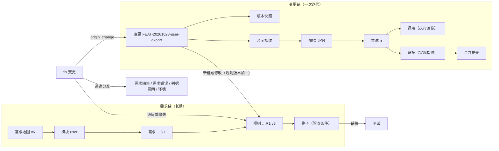

# 链路骨架：贯穿需求与迭代的 ID 与版本

- 状态：已批准（2026-10-23）。实现排在架构收敛阶段 D 合入之后。
- 依据：2026-10-23 的规格与测试充分性调研（未入库，存放在共享工作区的 `research_notes/规格与测试充分性调研/`）；[架构收敛设计](2026-10-21-架构收敛-design.md) §7 执行画像、§9 底座；代码事实取自 `origin/main` `0f21ed3`。
- 所属：需求与质量改进的第 1 个子项目，共 4 个：1 链路骨架 → 2 需求共创技能 → 3 能力指标 → 4 测试充分性。

## 1. 为什么要做

作者的目标是：StoryLoop 每迭代一版，都能观察、定位它的能力是变好了还是变差了。比如：规格被重新修改了几次；某个功能出了几个 Bug；Bug 是因为需求没写、需求写错，还是测试没拦住；这些指标在技能 1.1 和 1.2 之间有没有差别。

作者的判断是：**指标的前提是全链路可追溯，并且每个节点都有版本**。先打好这个地基，指标只是对它的查询；没有地基，指标就只是孤立的数字。

本文只设计这个地基：ID 怎么编、版本记在哪里、Bug 怎么接回链路。具体有哪些指标、怎么算，属于子项目 3。

## 2. 目标、非目标、反目标

**目标**

1. **两条链都能追溯**：
   - 变更链：一次迭代内，从意图到合并的每一步；
   - 需求链：一条需求从被引入，到被修改、修复、废弃的整个生命周期。
2. **每个节点都能回答"当时是哪个版本"**：引擎、技能、说明文本、schema、适配器、模型、需求地图、底座。
3. **Bug 在 StoryLoop 内部闭合**：每个 fix 都能指回引入问题的变更、相关的规则，并说明是哪一环漏掉的。
4. **并行开发不撞号**：不同功能在不同分支上同时开发，ID 不冲突，也不需要任何中心协调。

**非目标**

- 不定义具体指标，留给子项目 3。
- 不设计需求文档和规格文档的模板，也不设计共创对话，留给子项目 2。本文只规定它们必须使用的 ID 和登记格式。
- 不涉及发布、灰度和外部缺陷系统：StoryLoop 到本地合并为止，线上 Bug 通过 fix 变更回到链路里。
- 不回填历史数据。

**反目标**（做到这些就算失败）

- ID 由 AI 自行编造，或者同一个 ID 被复用。
- 人绕过 StoryLoop 直接改需求文档，导致登记与文档不一致，而且没人发现。
- 版本信息只记在部分调用上，统计时一部分数据能归因、一部分不能，而报告不说明这一点。
- 为了填满字段，在证据不足时编造溯源信息（`origin_change`、规则、逃逸分类）。

## 3. 已定的决定（来自讨论）

| # | 决定 |
|---|---|
| D1 | 需求按"系统 → 模块 → 需求 → 规则 → 例子"组织。模块是**产品能力**划分（用户视角），不是代码模块；两者用一张对应表连接 |
| D2 | 需求地图由 AI 起草，人确认调整。生效后放进仓库，由人通过 StoryLoop 维护 |
| D3 | 三种读者共用一个来源：产品读需求，开发读规格和例子，AI 读机器形式；三者都由同一份结构化登记渲染出来 |
| D4 | 规则 ID：**改内容不换 ID，版本加一**；拆分、合并时旧 ID 退役，新 ID 记下来源；废弃时退役，永不复用；ID 由引擎分配，不由 AI 编写 |
| D5 | 规则 ID 的格式：`<首次引入它的变更 ID>.R<n>`；模块是规则的一个属性，可以改变 |
| D6 | 变更 ID 的格式：`<类型前缀>-<日期>-<功能短名>`。并行开发是按不同功能进行的，加上功能短名就能避免重复 |
| D7 | 所有需求修改都通过 StoryLoop 发起，渲染出来的文档不能手工编辑 |
| D8 | Bug 在 StoryLoop 内部闭合：每个 Bug 都作为 fix 变更修复，用来评估 StoryLoop 具体版本的效果 |
| D9 | fix 溯源三项：引入它的变更、相关的规则、逃逸分类。由代理根据证据提出，人在批准时确认 |
| D10 | 执行画像落实架构文档 §7，并扩展到技能的版本、来源和内容摘要；每个变更在批准时冻结一份版本快照 |
| D11 | 已有项目在首次生成需求地图时，把现有活规格拆成规则并编上 ID；历史变更不回填 |
| D12 | 登记格式、ID 规则、执行画像字段、fix 溯源字段属于底座（契约层、状态格式）；渲染、地图起草、指标属于可变区 |

## 4. 两条链

- **变更链**的 ID 现在基本齐全（§5.1），本文只改变更 ID 的格式，并补上版本。
- **需求链**是新建的，核心是稳定的模块 ID、需求 ID、规则 ID，以及它们的版本历史。
- **两条链在两处相交**：变更新建或修改规则时；fix 指回变更和规则时。

## 5. ID 体系

### 5.1 现状

| 节点 | 现有 | 问题 |
|---|---|---|
| 变更 | `<前缀>-<YYYYMMDD>-<NNN>`，本机按当天序号分配（`changes._next_id`） | 两台机器同一天建变更会撞号 |
| 尝试 | 运行状态里的 `attempt`、`epoch` | 无 |
| 调用 | `<时间>-<角色>-<随机串>`（`call_log.open_call`） | 无 |
| 故事、验收条件 | 只在一个变更内唯一 | 跨变更不稳定 |
| 活规格中的需求 | 按故事标题匹配（`### Requirement: <title>`），场景按验收条件 ID 匹配 | 标题一改，身份就断了 |
| 模块 | `product.capability`，缺省时用变更 ID 代替（`openspec_docs.capability_of`） | 没有稳定的模块，整体会碎片化 |
| 规则 | `story.rules` 里的字符串 | 没有 ID |

### 5.2 新的 ID

| 对象 | 格式 | 分配者 | 变化规则 |
|---|---|---|---|
| 变更 | `<前缀>-<YYYYMMDD>-<slug>`；`slug` 为 3–40 个小写字母、数字和连字符 | AI 从意图提出 `slug`，起草时展示给人，人可以改；引擎校验 | 不变 |
| 模块 | `slug`，例如 `user`、`role` | 人确认需求地图时定下 | 显示名可改，ID 不变；拆分、合并时退役，新模块记下 `derived_from` |
| 需求 | `<首次引入它的变更 ID>.S<n>` | 批准合同时由引擎分配 | 同规则 |
| 规则 | `<首次引入它的变更 ID>.R<n>` | 批准合同时由引擎分配 | 改内容：ID 不变，`version` 加一；拆分、合并：旧 ID 退役，新 ID 记下 `derived_from`；废弃：退役 |
| 例子 | 合同内仍用验收条件 ID，新增必填的 `rule` 字段指向规则 ID；登记中的稳定 ID 为 `<首次引入它的变更 ID>.E<n>` | 批准合同时由引擎分配稳定 ID | 同规则；合同里写已有例子的稳定 ID 表示修改，写 `"new"` 表示新增 |

- **需求 ID 这一层由本文决定（作者在讨论中只定了规则 ID）。** "这个功能出了几个 Bug"里的"功能"，对应的是需求（用户故事）这一层，所以需求也要有稳定的 ID；规则和需求用同一套语义。
- **`<n>` 的分配**：在同一个变更内从 1 开始，按合同中出现的顺序编号。合同被修订后重新批准时，已分配的号保持不变，新增的接着往后编。
- **合同里怎么写**：AI 起草时，对已有规则写它的 ID，表示修改；对新规则写 `"new"`。批准时引擎分配新 ID，并核对引用的已有 ID 确实存在、没有退役。
- **`slug` 在创建变更时确定**：`create_change` 分配 ID 之前，AI 先从意图提出 `slug`；CLI 在创建前展示给人，人可以改（交互式或用参数指定）。ID 一旦分配，就不再改名，因为状态文件、账本、`openspec/changes/<id>/`、特性分支都以它命名。
- **变更 ID 冲突**：创建时检查本地状态、仓库里的 `openspec/changes/` 以及需求登记中的变更记录，被占用就要求换 `slug`。合并时再检查一次（防止别的分支在此期间合入了同名变更）；被占用时合并失败，停在停点，提示用 supersede 在新 ID 下重建。不提供改名迁移。
- **兼容**：旧格式的变更 ID 继续有效，引擎同时接受两种格式。

### 5.3 版本与退役

- 每条规则和需求都带 `version`（从 1 开始）和 `history`。`history` 每一项记录：版本号、变更 ID、操作（`created`、`modified`、`split_from`、`merged_from`、`retired`）、合并提交。
- 退役的 ID 保留在登记里，标为 `retired`，并记下去向（`superseded_by`）；它永远不会再被分配给别的对象。
- **模块挂在需求这一层**：需求（用户故事）属于一个模块，它的规则和例子跟着它。D5 说的"模块是规则的属性，可以改变"，落实为"模块是需求的属性，可以改变"：模块不进任何 ID，地图调整时只改归属，不换 ID。一个合同涉及多个模块时，按每个需求所属的模块分别生成 delta spec。
- **什么时候加版本**：
  - 规则：内容、所属需求或类型（EARS 句式）变化时，`version` 加一；
  - 需求：故事字段（标题、角色、意图、价值、优先级）变化，或者下属规则的集合变化（新增、移入、移出、退役）时，`version` 加一；下属规则只改内容，不带动需求加版本；
  - 例子：内容（given、when、then、行类型）或所属规则变化时，`version` 加一。
- **规则可以在需求之间移动**：算一次修改，规则 ID 不变；规则本身和移入、移出的两个需求各加一个版本。
- **"改到什么程度算新规则"由人判断**：AI 起草时如果认为某个修改已经改变了规则的本意，要在问题里提出"作为修改，还是作为新规则（旧规则退役）"，由人决定。

## 6. 需求登记

### 6.1 位置与形式

- **登记按变更追加，不就地修改**：每个合入的变更写一份记录 `openspec/requirements/changes/<change_id>.json`（带 `version`），列出它对模块、需求、规则、例子做的新建、修改、退役，以及每项修改所基于的版本（`base_version`）。当前状态由引擎按合并顺序重放这些记录得到，不单独保存。这样做有两个好处：
  - 并行分支各写自己的文件，Git 上不会冲突；
  - 历史就是这些记录本身，不会被覆盖。
- **重放顺序**：以记录所在合并提交在主分支上的先后为准。重放结果可以缓存在 `.storyloop/` 下，但缓存不是权威来源。
- **需求地图**：`openspec/requirements/map.json`，记录系统、模块（ID、显示名、职责、边界、对应的代码区域、`derived_from`、状态）和地图版本，进入 Git。
- **渲染出来的文档**：需求文档（产品读）和规格文档（开发读）的模板由子项目 2 定。本文只规定：
  - 文档由登记渲染生成，文件头写明"由登记生成，不要手工编辑"，并带上生成时登记的摘要；
  - 引擎每次渲染前检查文档内容是否与上一次生成的一致；不一致时报告"文档与登记不一致"，不覆盖，交给人处理。
- **路径保护**：`openspec/requirements/` 加入引擎拥有的路径（`project_profile.GENERATED_PATHS`），实现者写入即越界，与活规格同等对待。

### 6.2 与现有活规格的关系

- 现有活规格 `openspec/specs/<capability>/spec.md` 继续生成，以保持 OpenSpec 兼容，现有的 `openspec validate` 门禁照旧。
- 生成方式改为：按模块生成，文件名用模块 ID；`### Requirement:` 块后面附上需求 ID；每条规则行前面附上规则 ID 和版本。
- `capability` 字段由"模块 ID"取代。合同里的 `capability` 改为声明本变更涉及的模块；缺省为变更 ID 的旧行为只保留给历史合同。

### 6.3 写入时点

- **批准合同时**：引擎分配 ID，但不写入登记，只把分配结果记在变更状态里，并锁进合同指纹。
- **写入时点：合并前，在特性分支上**：完成阶段写活规格的同一步（现在是 `project_loop_finish._write_openspec_artifacts`），写入本变更的登记记录，并随活规格一起提交。记录里写的是变更 ID 和实现提交；合并提交在写入时还不存在，由已有的合并回执（`project_receipt`）把变更 ID 和合并提交关联起来，需要时从回执查。这样完成阶段不需要新增状态，崩溃恢复沿用现有的幂等推进（I8）。
- **合并前对着主分支复核**：写入记录之前，引擎对着当前主分支的重放结果检查一遍：
  - 本变更修改的每一项，`base_version` 仍然是当前版本；
  - 引用的规则、需求、例子没有退役。
  
  不满足时，说明另一个变更在此期间已经改过同一项：停在新的停点，要求人在新版本的基础上修订合同并重新批准，不自动重算版本。按功能并行时这种情况很少，一旦发生，就需要人来判断两次修改怎么合。
- **未合并的变更不影响登记**：变更作废（supersede）或未完成时，分配出去的 ID 不进入登记。这些 ID 中包含变更 ID，作废后也不会被别的变更复用。

### 6.4 只改需求的变更

措辞修正、补例子这类不涉及代码的修改，走"规格变更"：批准流程与普通变更相同，不需要实现、RED 和实现验证，合并时同样写入登记和历史。它对应架构收敛 §4.2 中预留的 `docs` 类型扩展点；具体用哪个类型名、它的判据底线是什么，在实现计划里按变更类型定义表定案，要求是"批准与登记写入不得省略"。

## 7. 执行画像与版本快照

### 7.1 每次调用（落实架构文档 §7）

由引擎写入账本（通过 `telemetry.record_call` 的 `engine_fields`，不采信适配器自报），字段：

| 字段 | 内容 |
|---|---|
| `engine_version` | `storyloop.__version__` |
| `role` | 已有 |
| `skills` | 每个技能的 `{name, version, source: packaged|project, digest}`；`digest` 是本次实际下发文本的摘要 |
| `instructions_digest` | 本次下发的角色说明文本摘要 |
| `schema_digest` | 本次使用的输出 schema 摘要 |
| `adapter` | 名称与版本 |
| `model`、`vendor`、`tier_applied` | 已有，保持不变 |

只存摘要，不存原文；原文可以由摘要在对应版本的引擎里找回。

### 7.2 每个变更的版本快照

批准合同时冻结，写进变更状态，锁进合同指纹：引擎版本、批准时选定的各技能 `{version, source, digest}`、需求地图版本、底座版本。

统计时**按快照切分**，而不是逐次调用去拼。运行途中引擎或技能升级的情况，在账本里能看到，在报告里要标出"本变更运行中版本有变化"。

## 8. fix 溯源

`defect` 块的变化：

| 字段 | 现状 | 改为 |
|---|---|---|
| `origin_change` | 可选 | **必填**：变更 ID，或者 `{"unknown": "<原因>"}` |
| `rules` | 无 | **必填**：涉及的规则 ID 列表，或者 `{"missing": "<应当存在的规则描述>"}` |
| `escape` | 无 | **必填**：`spec_missing`（需求缺失）、`spec_wrong`（需求错误）、`oracle_gap`（判据漏网）、`environment`（环境或外部）、`unknown`，并给出证据（`path:line`、测试 ID、报告位置） |

- 三项都由 product 角色根据证据提出（追调用链、`git log`、报告），**人在批准 fix 合同时确认**。不新增逐项确认的交互，沿用现有的批准流程：
  - 代理提出的值，在创建或修订合同时冻结为"提出值"，记在变更状态里；
  - 人可以先修订合同再批准；批准时引擎比较提出值和批准时的值，记下哪几项被人改过。
  
  这样就能统计"提出的和人确认的有多少不一致"。
- `unknown` 是合法值，但必须写明原因；需求质量清单对 `unknown` 给出警告，而不是报错。这样在证据不足时可以如实留白，不会被逼着编造。
- 统计时，沿着 `origin_change` 找到那个变更的版本快照，Bug 就记到"当时那一版"头上；`escape` 决定记到哪一环。

## 9. 已有项目的迁移

**没有需求地图时照常运行**：`map.json` 不存在时，需求的模块为"未归类"，ID、版本、登记记录照常生成，不拒绝批准；活规格按旧规则生成（`capability`）。地图生成之后，未归类的需求在地图确认时一并归入模块。全新项目没有活规格，第一个合入的变更就是登记的第一条记录，不需要单独初始化。

- **首次生成需求地图**（子项目 2 的地图起草，本项目只提供记录格式和写入接口）时，同时把现有活规格中的 `### Requirement:` 块和规则行拆出来，分配到模块，编上 ID，需求 ID 和规则 ID 统一以一个专门的迁移变更作为"首次引入它的变更"，其 ID 按 §5.2 的格式生成，`slug` 为 `requirements-bootstrap`；类型前缀用哪个，在实现计划里按变更类型定义表定案。地图与这批 ID 一起交给人确认，作为登记的初始版本。
- **历史变更不回填**：它们没有规则 ID 和版本快照，统计时标为"历史数据，无法按版本归因"，单独列出，不计入按版本的对比。
- 历史 fix 的 `origin_change` 如果有值，仍然可以用于变更级的统计（现有 M5）。

## 10. 底座与可变区

| 区 | 内容 | 落点（按 `storyloop/architecture.toml`） |
|---|---|---|
| 底座 | 登记与地图的格式和校验、ID 格式与分配规则、版本与退役规则、执行画像字段、版本快照字段、`defect` 新字段的校验 | 项目契约或状态存储；`models` 中合同结构的部分（该模块阶段 D 会拆分，见下） |
| 底座 | 合并时写入登记（完成阶段的一步） | 变更生命周期（阶段 B 之后的完成骨架） |
| 可变区 | 文档渲染、地图起草、不一致检测的报告、指标计算 | 报告、接入与底座、外环 |

**时间约束**：本文的实现会改合同格式和状态格式，属于触碰底座的功能变更。按架构收敛 Q5，阶段 B、D 期间暂停这类变更，所以**实现排在阶段 D 合入之后**。阶段 E（base 类型并入）完成前，本仓库的底座改动仍然走现有的手工通道，由人审查。

## 11. 不变量

| 编号 | 不变量 | 守护方式 |
|---|---|---|
| T1 | 登记里的 ID 唯一，退役的 ID 不会被再次分配 | 注入一个重复或复用的 ID，期望登记校验失败 |
| T2 | 登记记录只由完成阶段写入（迁移记录由人确认后写入）；实现者和其他角色写入即越界 | 注入写入，期望 `BOUNDARY_VIOLATION` |
| T3 | 每个合入的变更都带版本快照；每条账本记录都带执行画像 | 缺字段时报告"无法归因"，不得静默 |
| T4 | 每个例子都引用存在且未退役的规则 | 注入一个悬空引用，期望批准被拒 |
| T5 | 渲染出来的文档被手工修改后，不会被静默覆盖 | 改文档一个字节，期望报告不一致，原文件不变 |

这些不变量按阶段 A 的方式登记进 `storyloop/architecture.toml` 的不变量表，守护测试进入 core 套件。

## 12. 留给实现者的

- 登记和地图 JSON 的具体字段名与嵌套方式，以本文 §5–§9 的语义为准。
- 摘要算法沿用引擎已有的指纹做法。
- 实现计划的分批方式。建议：变更 ID 格式 → 执行画像与版本快照 → 规则、需求、例子的 ID 与登记 → fix 溯源。前两项对现有数据影响最小，可以先合入。迁移的起草属于子项目 2。

### 12.1 作者定的约定（审阅中提出，评审已确认）

1. **登记按变更追加**（§6.1）：每个变更一份记录，当前状态靠重放得到，并行分支在 Git 上不冲突。
2. **登记在合并前写入**（§6.3）：在特性分支上随活规格一起提交；合并提交通过合并回执关联，完成阶段不新增状态。
3. **并行修改同一项时停下**（§6.3）：合并前对着主分支复核 `base_version`，不一致就停在停点，由人修订后重新批准，不自动重算。
4. **`slug` 在创建时确定**（§5.2）：ID 分配后不能改名；合并时才发现冲突的，走 supersede 重建。
5. **例子也有稳定 ID**（§5.2）：`<首次引入它的变更 ID>.E<n>`，语义与规则相同。
6. **模块挂在需求这一层**（§5.3）：这是对 D5 的落实，模块仍然不进 ID、可以改变。
7. **版本加一的条件**（§5.3）：规则、需求、例子分别定义；规则可以在需求之间移动，ID 不变。
8. **fix 溯源沿用现有批准流程**（§8）：记录提出值，批准时比较差异，不新增逐项确认的交互。
9. **没有地图时照常运行**（§9）：模块记为"未归类"，不拒绝批准。

## 13. 决策记录

| # | 问题 | 决定（按推荐方案，2026-10-23） | 备选（未采纳） |
|---|---|---|---|
| Q1 | 需求 ID 这一层是否需要？ | **需要**：Bug 数和修订次数按"功能"统计时，功能对应的是需求（用户故事） | 只有规则 ID，按模块统计：更简单，但"这个功能"只能近似为"这个模块" |
| Q2 | 只改需求的变更用什么类型？ | **复用架构收敛预留的 `docs` 类型，判据底线为"登记校验 + 文档一致性"** | 新增 `spec` 类型：语义更清楚，但类型定义表多一行 |
| Q3 | 运行途中引擎或技能升级怎么办？ | **允许，按批准时的快照统计，并在报告中标注版本有变化** | 禁止：运行中检测到版本变化就停下，要求重新批准。更干净，但会打断正在进行的变更 |

## 14. 设计与实现差异

实现完成后在此补表。
