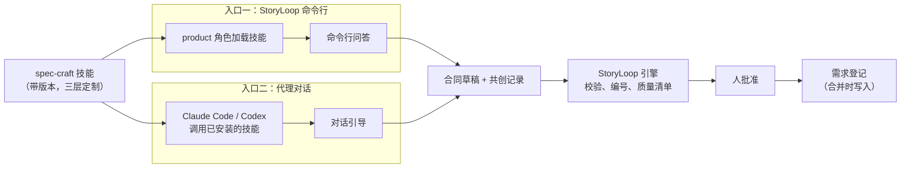

# 需求共创技能（spec-craft）

- 状态：已批准（2026-10-23）。第 1、2 批可以立即开始；第 3 批起依赖链路骨架，排在架构收敛阶段 D 之后。
- 所属：需求与质量改进的第 2 个子项目（1 链路骨架 → **2 需求共创技能** → 3 能力指标 → 4 测试充分性）。
- 依据：
  - [链路骨架设计](2026-10-23-链路骨架-design.md)（ID、需求登记、版本快照；PR #30）；
  - 2026-10-23 的规格与测试充分性调研（未入库，存放在共享工作区的 `research_notes/规格与测试充分性调研/`）；
  - 参考的开源项目：spec-kit（`specify`、`clarify`、`checklist`、`analyze` 命令与 `assess` 扩展）、BMAD-METHOD（`bmad-prd`、`bmad-advanced-elicitation`）、OpenSpec（规格组织方式）。
- 代码事实取自 `origin/main` `0f21ed3`。

## 1. 为什么要做

规格是整条链的第一个入口：规格写错了，下游每一环都会一致地错下去，测试通过、报告也是绿的。作者希望需求共创满足五点：

1. 产出的东西人能看懂，有固定的结构和模板；
2. 需求能组织成整个系统，按模块划分；
3. AI 不擅长的部分交给人来澄清；
4. 共创本身是一个可以单独维护和迭代的技能；
5. 技能迭代之后，能用指标看出共创能力是变好了还是变差了。

现在共创的方法论写在 product 角色的说明文本里（`role_instructions.py`），产出是 JSON 合同和几份落盘时生成的 Markdown，没有按模块组织，也没有独立的版本。

## 2. 目标、非目标、反目标

**目标**

1. 一个带版本的技能包 `spec-craft`，同时服务两个入口：StoryLoop 命令行，以及 Claude Code、Codex 这类代理的对话。
2. 共创分为评估、需求、规格、澄清、交给引擎五步，每一步都写明 AI 做什么、人拍什么板。
3. 产出三层内容：需求层（产品读）、规格层（开发读）、机器形式（AI 读），三者都由同一份合同渲染出来。
4. 每条规则都配正例和反例，例子用具体数据写。
5. 每次共创都留下一份格式统一的共创记录，供子项目 3 计算指标。

**非目标**

- 不定义 ID、需求登记和版本快照的格式，这些由链路骨架规定，本文直接使用。
- 不定义指标，由子项目 3 负责。
- 不做反例驱动的变异，由子项目 4 负责。
- 不做图形界面；对话入口借用现有的代理工具。

**反目标**（做到这些就算失败）

- AI 替人决定"值不值得做"，或者替人认定例子的预期结果是对的。
- 两个入口各有一套方法，或者各写一种共创记录。
- 技能升级后，冲掉了项目里的团队定制。
- 模板变成必须逐节填满的表格：小改动也被扩成一大堆文档（Böckeler 对 SDD 的批评）。
- 质量门禁交给大模型判断。调研显示，大模型只能发现约一半的需求问题，而且几乎都会漏掉"是否必要"和"是否正确"两类。

## 3. 已定的决定（来自讨论）

| # | 决定 |
|---|---|
| E1 | 一个技能，两个入口（方式 C）：StoryLoop 命令行和代理对话共用同一个技能本体 |
| E2 | 无论从哪个入口进来，质量清单、ID 分配、批准都在引擎里完成；技能只负责引导和起草 |
| E3 | 新功能默认先过"值不值得做"这一关，由人决定做、需澄清还是放弃；小改动和 fix 可以跳过 |
| E4 | 三种读者共用一个来源（链路骨架 D3）：产品读需求，开发读规格和例子，AI 读机器形式 |
| E5 | 需求地图在接入时由 AI 起草，人确认（链路骨架 D2） |
| E6 | 两个入口留下同一种共创记录（格式与位置见 §11，由本文规定；链路骨架只规定它引用的 ID） |
| E7 | 写多细按风险决定：轻量是默认，高风险用完整版，和分流档位挂钩 |
| E8 | 两种工作方式：快速（AI 起草整份，人集中审）和引导（逐节带着人走），默认按档位选择，人随时可以切换 |
| E9 | 技能名 `spec-craft`，和 `oracle-craft` 成对 |
| E10 | 技能三层定制：技能本体随引擎发布、升级时覆盖；团队定制和个人定制放在项目里，升级时保留 |
| E11 | product 角色说明里的共创方法论迁进技能；角色说明只保留输出格式和引擎约束 |

## 4. 总体结构



- **入口一**在现有流程上扩展：`storyloop change --idea` 调用 product 角色，角色加载技能，返回合同和问题；`clarify_interactively` 在命令行里逐个提问，人回答后修订。命令行入口**只支持快速方式**：现有 product 角色是一次调用返回完整合同，命令行问答适合选择题，不适合逐节引导和讲述真实经历。引导方式只在对话入口提供。评估一步在命令行里由新命令 `storyloop assess --idea` 承担（§5.1）。
- **入口二**是新的：技能通过 `storyloop skills` 安装到 `.claude/skills/`、`.codex/skills/`（已有机制），人在对话里调用它。对话结束时，技能写出合同草稿和共创记录，人执行新命令 `storyloop change --from-draft <文件>` 交给引擎，此后的流程和入口一完全相同。

## 5. 共创流程

| 步 | 做什么 | 谁拍板 | 产出 |
|---|---|---|---|
| 0 接入时 | AI 读代码、菜单、路由、接口、数据表和已有活规格，起草需求地图，并给已有需求编号（链路骨架 §9） | 人确认地图 | 需求地图 v1 |
| 1 评估 | AI 引导人讲清三件事：解决谁的什么问题、怎么知道解决了、不做会怎样 | **人**决定做、需澄清或放弃 | 评估记录；放弃也算成功的结果 |
| 2 需求 | 按需求模板引导（§6.1）；AI 做有依据的猜测，标成"假设" | 人确认，假设逐条过 | 需求层 |
| 3 规格 | 每条业务规则写成 EARS 规则；每条规则配正例和反例，用具体数据写；引用术语表 | AI 起草，人核对例子的预期结果 | 规格层 |
| 4 澄清 | 按覆盖地图找缺口，按规则提问（§7），回答立即写回 | **人**回答 | 写回后的合同 |
| 5 交给引擎 | 确定性质量清单（§8）、ID 分配、批准 | **人**批准 | 锁定的合同 |

### 5.1 第 1 步：评估

- **何时做**：nature 为 feature 时默认要做；fix、refactor，以及人显式声明"小改动"时可以跳过，跳过要记入共创记录。
- **三问**：
  1. 谁遇到了什么问题，请讲一次真实发生的情况；
  2. 做完之后，凭什么知道问题解决了；
  3. 不做会怎样。
- **AI 的角色**：只引导和整理，不下结论。可以指出"这个问题和已有模块 X 的需求重叠"，但做不做由人决定。
- **结论**：做、需澄清、放弃。"需澄清"时停在这一步，把待澄清的事项列给人；"放弃"时把评估记录存档，不创建变更。
- **评估在创建变更之前**：现有的 `change --idea` 会先创建变更，与"放弃时不创建变更"冲突。所以评估是单独的一步：
  - 命令行：`storyloop assess --idea "<意图>"`，用自由文本逐个询问三问（不是选择题），再请人选结论；结论为"做"时，产出的评估记录 ID 交给 `change --idea ... --assessment <ID>`；
  - 对话：技能在对话里完成三问和结论，写进草稿。
- **评估结论只认人在 StoryLoop 里的确认**：对话入口带来的结论，在 `--from-draft` 时由命令行再请人确认一次（§10）。

### 5.2 写多细

| 档位 | 需求模板 | 规格模板 | 工作方式默认值 |
|---|---|---|---|
| 轻 | 轻量版：目标、非目标、1–2 个用户场景、规则 | 每条规则至少一个正例和一个反例 | 快速 |
| 标准 | 完整版去掉可选节 | 同上，加上边界与失败的规则 | 快速 |
| 重 | 完整版 | 同上，加上状态相关规则和消费端矩阵 | 引导 |

档位来自现有分流（`intake`、`routing_policy`）。共创开始时还没有分流结论，所以先按 nature 和人的声明估计，分流给出结论后再按需要补写，只能往上补，不能往下减，与 I11 一致。

## 6. 三层内容的模板

### 6.1 需求层（产品读）

不出现技术词。章节如下，*斜体*表示可选，轻量版只保留带 ★ 的：

1. ★ 目标：一句话写清楚为谁解决什么问题；
2. ★ 非目标：明确不做什么；
3. ★ 用户场景：按优先级 P1、P2、P3 排序，每个场景讲一个有具体人物的真实情况（参考 BMAD："Mary，三个孩子的妈妈"，而不是"用户"），并写明怎样单独验证它；
4. 成功标准：可度量、不提技术（参考 spec-kit："用户 3 分钟内完成结账"，而不是"接口 200ms 内返回"）；
5. ★ 业务规则：用业务语言写，每条对应规格层的一条或多条 EARS 规则；
6. *边界情况*；
7. *关键实体与术语*：只写属性和关系，引用术语表；
8. 假设：凡不是由已确认事实推出、由人或模型提出的预期、数值和前提，都单列入假设表，标明已知的提出者身份及依据；身份不明时写“提出者”，不为此额外提问。状态仅用“待确认”“已确认”，只有真实负责人明确核对后才写“已确认”；试用操作者是可选来源，其暂采纳的内容仍是“待确认”。轻量版把表放在“目标”节内，不增加章节；完整版用“假设”节；
9. 澄清记录：问题与回答，按时间排列；
10. 所属模块：已有模块，或者提出新模块。

### 6.2 规格层（开发读）

按规则组织，每条规则一块：

- 规则 ID 与版本（链路骨架 §5）；
- EARS 句式，五种都可用：普遍、事件驱动（WHEN）、状态驱动（WHILE）、不期望行为（IF…THEN）、可选特性（WHERE）；
- 例子：每个例子写明所属规则、**正反**、行类型（沿用 oracle-craft 的验收矩阵）、选择行类型的一句理由，以及用具体数据写的 Given、When、Then；至少一个正例、一个反例。正例是规则前提成立时系统按规则做，IF…THEN 的异常发生和应对也属于正例；反例是前提不成立或处在规则边界之外时，系统不按这条规则做，即不误触发。
  - **正反和行类型是两件事，不能互相推出**。行类型按 oracle-craft 验收矩阵的判据及“这个例子在旧代码上会不会失败”决定，并写一句理由：正例通常实现前应失败，可按场景选 positive、degradation 或 unknown_state；反例通常实现前应通过，可按场景选 regression 或 non_goal。`degradation` 只用于依赖失败；无效日期校验若旧代码会接受，应选 `positive`。
  - 证据不足时先检查旧代码或请人核对，不能把行类型留空或写成待定。（2026-10-24 第 2 批修正：第 1 批把"规则被违反时的应对"归为反例，导致 IF…THEN 和边界不误触发的标签混淆。）
- 接口与数据约束：只写外部可观察的部分，不写类名、框架和实现步骤（参考 OpenSpec："实现变了而外部行为不变的内容，就不属于规格"）；
- 消费端矩阵（重档）。

### 6.3 机器形式（AI 读）

即合同 JSON。在现有结构上，按链路骨架增加：规则对象（ID、句式、正文）、验收条件的 `rule` 引用、需求的模块归属、假设列表、评估记录的引用。两层 Markdown 都由它渲染出来，渲染器属于可变区。

## 7. 澄清：AI 和人的分工

### 7.1 覆盖地图

参考 spec-kit `clarify` 的分类，按 10 类逐一标出"清楚、部分、缺失"：

1. 功能范围与行为（目标、非目标、角色差异）；
2. 领域与数据（实体、唯一性、生命周期与状态、数据规模）；
3. 交互流程（关键路径、空状态、加载、失败）；
4. 非功能（性能、可靠性、安全与隐私、合规）；
5. 外部依赖（外部服务及其失败方式、数据格式、协议版本）；
6. 边界与失败（反例、限流、并发冲突）；
7. 约束与取舍；
8. 术语一致性；
9. 完成标准（可测、可度量）；
10. 占位与含糊词。

覆盖地图写入共创记录，供子项目 3 统计"哪类问题最常在批准后才暴露"。

### 7.2 提问规则

- **先猜，再问**：AI 先做有依据的猜测，标成假设；只有当一个问题会实质影响范围、安全隐私、用户体验，而且没有合理的默认值时，才提问。优先级：范围 > 安全与隐私 > 体验 > 技术细节。
- **数量**：初稿中待澄清的地方最多 3 处；五步表的步骤 1 评估、2 需求、3 规格、4 澄清、5 交接中向人提出的问句分别计数，不跨步骤累加；每步默认 5 个问题，一次只问一个。运行过 `--view` 时以视图“生效配置”节的上限为准；否则按正文默认值。步骤 0 接入及交接后 StoryLoop 命令行问答不计入本技能。`question_limit` 可由项目定制调整，范围 3–10：下限容纳评估固定三问，上限为默认值两倍，保留“少问”的约束。
- **格式**：每个问题是一个完整的疑问句；下一行先写一句"为什么重要"；再写推荐选项和理由；最后是选项表（2–5 个互斥选项，可以另附一个简短的自由回答）。现有问题结构（`id`、`text`、`options`、`recommended`、`why`）已经能承载这些内容。
- **写回**：每个回答立即写回合同对应的位置，并记入澄清记录；被回答推翻的旧说法要删掉，不能留下互相矛盾的文字。
- **引导，而不是代写**（参考 BMAD）：用户场景让人自己讲；AI 可以问"我猜是 X，对吗"，但不能用一串选择题替人做产品决策。

### 7.3 只能由人判断的事

| 事项 | 在哪一步 | 理由 |
|---|---|---|
| 值不值得做 | 1 评估 | 必要性，大模型几乎总是漏判 |
| 优先级与取舍 | 2 需求 | 业务判断 |
| 假设是否成立 | 2 需求、4 澄清 | 假设本来就是 AI 的猜测 |
| 例子的预期结果对不对 | 3 规格 | 正确性，大模型几乎总是漏判；具体数据让产品看得懂 |
| "改到什么程度算新规则" | 3 规格 | 链路骨架 §5.3 |
| 新模块是否成立 | 2 需求 | 链路骨架 D2 |

## 8. 质量清单的新增项

在现有 `requirement_checklist` 的基础上新增，全部是确定性检查：

| 检查 | 级别 |
|---|---|
| 每条验收条件都引用一条存在、未退役的规则 | error |
| 每条规则至少一个正例 | error |
| 每条规则至少一个反例（例子的正反字段为 `negative`；不根据行类型判断，见 §6.2） | 标准档及以上为 error，轻档为 warning |
| 识别全部五种 EARS 句式；一个 feature 一条"不期望行为"规则都没有时 | warning |
| `given` 里没有任何具体值（数字、带引号的文本、日期、ID）的例子 | warning |
| 还有未确认的假设 | error（批准前必须逐条确认或删除） |
| 需求没有声明模块，或者声明了地图中不存在的模块 | 有地图时为 error，没有地图时不检查（链路骨架 §9） |
| 评估结论不是"做"，或者没有评估记录又没有声明跳过 | feature 为 error |

## 9. 技能包与维护

### 9.1 目录

```
storyloop/skills/spec-craft/
├── SKILL.md                    # 何时用、五步流程、入口差异、输出要求；frontmatter: name, version, description
├── references/
│   ├── assess.md               # 评估三问与结论
│   ├── requirement-template.md # 需求层模板（轻量版、完整版）
│   ├── spec-template.md        # 规格层模板
│   ├── ears.md                 # 五种句式与例子
│   ├── examples.md             # 正例、反例的写法，具体数据的要求
│   ├── clarify.md              # 覆盖地图与提问规则
│   └── handoff.md              # 对话入口：草稿与共创记录的格式、交给引擎的命令
```

### 9.2 三层定制（参考 BMAD）

- **技能本体**：`storyloop/skills/spec-craft/`，随引擎发布；安装到项目时文件头标明"由 StoryLoop 安装，升级时覆盖，请勿编辑"。
- **团队定制**：仓库根目录下的 `storyloop-custom/spec-craft.toml`，进入 Git（位置见 Q1）。
- **个人定制**：`storyloop-custom/spec-craft.user.toml`，不进 Git（写进 `.git/info/exclude`）。
- **合并规则**：标量以后者为准；普通数组追加；带 `code` 键的表数组，键相同就替换，键不同就追加。
- **视图位置**：定制视图写在控制面 `.storyloop/skills-view/`；安装到 `.claude/skills/`、`.codex/skills/` 的仍是技能本体（2026-10-24，第 2 批计划决定 1）。
- **可定制的内容**：额外的覆盖地图分类、问题偏好、额外的模板节、术语表的来源路径，以及每步骤提问上限 `question_limit`（整数 3–10；团队与个人均可设置，个人标量覆盖团队）。生成视图总在末尾同一个“生效配置”标题下显示生效值和来源；技能正文保留默认值，供无法生成视图时使用。未定制时来源为内置默认；机器字段 `question_limit_source` 用 `null` 表示内置默认，否则为定制文件路径。这项只调整对话提问节奏，不改变输出格式、引擎约束或人拍板的事项（§7.3）。
- 定制文件的摘要计入执行画像（链路骨架 §7），这样不同项目、不同定制下的指标可以分开比较。
- **定制怎么生效**：对话入口先运行 `storyloop skills <项目> --view spec-craft`，再读取控制面视图；定制变更后重新生成视图。第 2 批仍不把 spec-craft 下发给任何引擎角色；命令行角色迁移留待后续批次。
- 内置覆盖地图保留在 `references/clarify.md`，定制分类渲染为视图末尾的 Markdown 表格；技能包只含 `.md` 文件。
- **与现有机制的关系**：现有 `skills.py` 是"项目里的安装副本优先，本地修改胜出"，安装副本在已初始化的项目上属于底座。spec-craft 不走这一条：它的安装副本由引擎生成、每次覆盖，项目的修改只能写在定制文件里。oracle-craft、foundation-survey 的现有行为不变，是否也改成三层定制，以后单独决定。
- **定制文件的保护**：`storyloop-custom/` 加入实现者不能写的路径（实现者写入即越界）；人可以直接编辑并提交，不需要走 BASE。它是团队的配置，不是判定逻辑。

### 9.3 版本

- 技能 frontmatter 的 `version` 按语义化版本递增：只改措辞是补丁版本；改了流程、模板章节或提问规则是次版本；改了输出格式是主版本，同时要求引擎侧兼容。
- 技能改动走正常的变更流程。按架构收敛的发布门（§8 第 3 条），改了技能文本的新引擎版本，发布前要在固定样本上重放。

### 9.4 product 角色说明的迁移

**时机**：迁移排在最后一批（§13）。在此之前，命令行入口的 product 角色说明保持不变，spec-craft 只在对话入口使用，避免两套说法同时下发给同一个角色。

`role_instructions.py` 里 product 段中关于方法论的部分（EARS、Gherkin 纪律、故事大小、提问方式、spec-kit 风格结构）迁到技能里；角色说明只保留输出 JSON 的结构、`routing_version` 的评估字段要求、只读约束和引擎规则。迁移前后用同一组样本重放对比，确认输出没有退化。发布门的自动重放（架构收敛 §8）还没有实现，所以本项目先做一个**手动的简化版**：从本仓库和 RuoYi 的历史调用诊断记录（`calls/`）里挑 5 个 product 样本，新旧两版各跑一次，用机械判据比较（schema 合法、问题数、规则与例子数、质量清单结果），结果写进验证记录。

## 10. 对话入口的交接

- 对话结束时，技能写出两个文件，放在 `.storyloop/drafts/spec/<slug>/`（控制面，不进 Git）：
  - `contract.json`：合同草稿，结构与命令行入口产生的相同；
  - `record.json`：共创记录（§11）。
- 人执行 `storyloop change --from-draft .storyloop/drafts/spec/<slug>`。引擎：
  1. 请人确认关键字段（§11"谁写、信不信"）；
  2. 校验合同结构和质量清单，与命令行入口相同；
  3. 核对 `record.json` 里的技能版本与摘要，和项目中已安装的技能是否一致；不一致就在共创记录里标"版本不符"，不拒绝；
  4. 创建变更，分配 ID，此后的流程和命令行入口相同。
- 草稿中还有未回答的问题时，`--from-draft` 照样接收，转入命令行入口继续澄清。

## 11. 共创记录

**格式与位置由本文规定**：
- 创建变更之前（评估、对话草稿）：`.storyloop/drafts/spec/<slug>/record.json`，控制面，不进 Git；
- 创建变更时：引擎把它迁到变更下，批准时随合同一起物化到 `openspec/changes/<id>/cocreation.json`，进入 Git，锁进合同指纹；
- 评估结论为"放弃"时：没有变更，记录随评估记录一起写进 `openspec/assessments/<slug>.md`（Q2）。
- 格式带 `version`，属于底座的状态格式。

**谁写、信不信**：
- 命令行入口：由**引擎**根据问答过程写，角色不写；
- 对话入口：由代理写，标为 `source: agent`。`--from-draft` 时，引擎请人在命令行逐项确认关键字段（评估结论、哪些假设已确认），确认后的值标为 `source: human`。门禁（§8）和指标只采信 `source: human` 或引擎写入的值，代理自报的值只作参考。

字段：

- 入口（`cli` 或 `chat`）、工作方式（快速或引导）、档位估计与最终档位；
- 技能版本、来源、摘要，以及定制文件的摘要；
- 评估：是否进行、三问的回答、结论、跳过的理由；
- 覆盖地图：每类的初始状态和最终状态；
- 问题：每个问题的类别、推荐选项、人的选择（是否采纳了推荐）；
- 假设：每条的内容、最终是被确认、被修改还是被删除；
- 时间：开始、批准、每次修订。

子项目 3 会用到的数据都在这里，比如问题数、推荐采纳率、假设被推翻的比例、各类缺口在批准后才暴露的频率。

## 12. 底座与可变区

| 区 | 内容 |
|---|---|
| 底座 | 共创记录的格式、合同的新字段（规则、`rule` 引用、假设、评估引用）、质量清单的新增检查、`--from-draft` 的校验 |
| 可变区 | 技能包本身、模板、渲染器、地图起草、角色说明 |

**时间约束**：底座部分依赖链路骨架，排在架构收敛阶段 D 之后。技能包和模板属于可变区，可以先写、先在对话入口里试用，不等引擎改动。

## 13. 分批

| 批 | 内容 | 区 | 前提 |
|---|---|---|---|
| 1 | spec-craft 技能包（SKILL.md、参考资料、数据文件、模板），只在对话入口使用；草稿按**现有** product v1 合同结构产出，人把草稿内容交给现有的 `change` 流程 | 可变区 | 无，可以立即开始、独立试用 |
| 2 | 三层定制与合并视图；`storyloop skills --view` 写入控制面，安装副本仍为技能本体 | 可变区（视图生成）、`storyloop-custom/` 的路径保护属于底座 | 批 1 |
| 3 | 合同新字段（规则、`rule` 引用、假设、评估引用）、质量清单新增项、共创记录、`assess` 命令、`--from-draft` | 底座 | 链路骨架实现之后（阶段 D 之后） |
| 4 | 第 0 步需求地图起草：新命令 `storyloop map-propose` / `map-apply`，仿照 `smoke-propose` / `smoke-apply` 和 `survey --from` 的"代理提议、人确认后安装"模式；同时生成 `requirements-bootstrap` 迁移记录（链路骨架 §9） | 可变区（起草），写入登记属于底座 | 批 3 |
| 5 | product 角色说明迁入技能（§9.4），手动 5 样本对比 | 可变区 | 批 1–3 |

### 13.1 作者定的约定（审阅中提出，评审已确认）

1. **共创记录的格式与位置由本文规定**（§11），不放进链路骨架。
2. **命令行入口只支持快速方式**（§4）；引导方式只在对话入口提供。**这是对"两个入口都支持"的收窄**：命令行问答适合选择题，不适合逐节引导和讲述真实经历。
3. **评估是创建变更之前的单独一步**（§5.1）：命令行用新命令 `storyloop assess`，结论为"放弃"时不创建变更。
4. **代理写的记录不直接采信**（§11）：对话入口的关键字段在 `--from-draft` 时由人在命令行确认，门禁和指标只认人确认或引擎写入的值。
5. **spec-craft 的安装副本由引擎生成、每次覆盖**，定制只能写在 `storyloop-custom/` 里（§9.2）；其他技能的"本地修改胜出"行为不变。`storyloop-custom/` 实现者不能写，人可以直接改。
6. **需求地图起草纳入本项目，作为第 4 批**（§13），用"代理提议、人确认后安装"的模式。
7. **角色说明的迁移放在最后一批**，此前不同时下发两套说法；迁移用手动 5 样本对比代替尚未实现的发布门重放（§9.4）。

## 14. 留给实现者的

- 模板的具体措辞和例子；
- `coverage.csv` 的列与检查要点的写法；
- 定制合并脚本的实现方式，沿用 `skills.py` 现有的安装与版本机制。

## 15. 决策记录

| # | 问题 | 决定（按推荐方案，2026-10-23） | 备选（未采纳） |
|---|---|---|---|
| Q1 | 团队定制文件放在哪里？ | **`storyloop-custom/`**，放在仓库根目录、进入 Git，与引擎拥有的路径分开 | 放在 `.storyloop/` 下：不进 Git，团队无法共享 |
| Q2 | 评估记录在"放弃"时存在哪里？ | **`openspec/assessments/<slug>.md`，进入 Git**，以后可以查"为什么当初没做" | 只存在控制面，不进 Git |
| Q3 | 先做哪个入口？ | **先做对话入口**：技能包可以独立试用，不等引擎改动；命令行入口在链路骨架落地后接上 | 先改命令行入口：链路更完整，但要等阶段 D |

## 16. 设计与实现差异

实现完成后在此补表。
